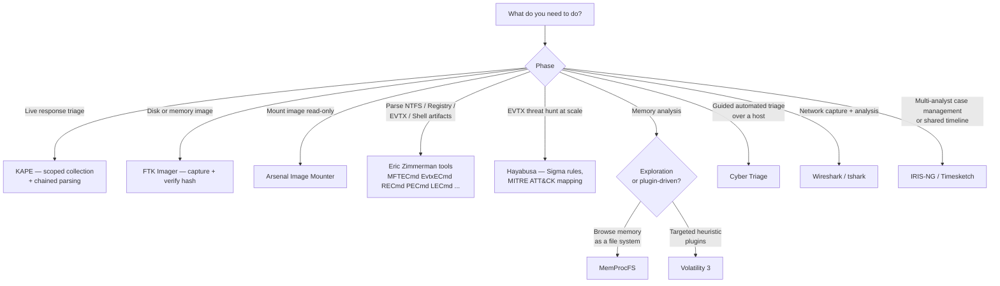

# Appendix D — Tooling Reference for Windows IR

This appendix consolidates the tools the chapters name as they come up into a single reference. Each entry covers what the tool does, where it fits in the IR workflow, its license and platform, and the chapter or lab where it is most relevant. The list is intentionally short. It favors *free or freely available* tools that an IR practitioner can deploy without a procurement conversation.

The list is not exhaustive, and many more good tools exist. The selection below is the working set this book assumes you are reaching for, plus a few complements that pair naturally with them.

> **Reflects tooling as of 2026.** Forensic tools evolve quickly. Hayabusa adds Sigma rules every release, MemProcFS adds plugins, Volatility 3 changes its plugin surface, and Eric Zimmerman tools update field names. Each tool's official site is linked below. Check it for the version you're actually running before you copy a command line verbatim. The *patterns* in this appendix outlast specific versions, but the *exact flags and field names* do not. When you change tools or tool versions, record the version per case alongside the output it produced.

## D.1 Quick Reference Table



*Figure D.1 — Tool selection by investigative phase. Most labs in this book chain three to five of these together: KAPE collects, EZ tools parse, Timeline Explorer reviews. The chains are deliberately small — five tools do most of Windows IR.*


| Tool | Primary Use | Platform | License | Most Relevant To |
|---|---|---|---|---|
| **[Eric Zimmerman tool suite](https://ericzimmerman.github.io/)** | NTFS / registry / shell / log parsing | Windows (.NET) | Free, MIT-style | Ch4, Ch5, Ch6, Ch9, Ch10, every artifact lab |
| **[KAPE](https://www.kroll.com/en/services/cyber/incident-response/kroll-artifact-parser-extractor-kape)** | Triage collection + chained parsing | Windows | Free for individual / non-commercial use; commercial licensing through Kroll | Ch3, Lab02, Lab03 |
| **[FTK Imager](https://www.exterro.com/digital-forensics-software/ftk-imager)** (Exterro) | Disk and memory imaging, image preview, hash verification | Windows | Free | Ch1, Ch3, Ch7, Lab01, Lab03, Lab07 |
| **[Arsenal Image Mounter](https://arsenalrecon.com/downloads/)** | Mounting forensic images (E01, VHDX, raw) as physical disks for analysis | Windows | Free version; paid Pro for write-temporary support | Ch4, Ch7, Lab04, Lab07 |
| **[Hayabusa](https://github.com/Yamato-Security/hayabusa)** | Sigma-rule-based EVTX analysis with MITRE ATT&CK mapping | Windows / Linux / macOS (Rust) | AGPL-3.0 | Ch9, Lab09, Lab10 |
| **[HayabusaAutorun](https://github.com/zach115th/HayabusaAutorun)** | PowerShell automation around Hayabusa for repeatable IR scans | Windows (PowerShell) | Open source | Ch9, Lab09 |
| **[Volatility 3](https://www.volatilityfoundation.org/)** | Plugin-driven memory image analysis | Cross-platform (Python) | Volatility Software License | Ch7, Lab07 |
| **[MemProcFS](https://github.com/ufrisk/MemProcFS)** | Memory image as virtual file system; navigation-friendly memory analysis | Cross-platform (Windows / Linux) | AGPL-3.0 | Ch7, Lab07 |
| **[Cyber Triage](https://www.cybertriage.com/download-eval/)** | Guided automated triage on a live host or collected artifacts | Windows | Free evaluation; commercial Pro / Standard tiers | Ch2, Ch3, Lab02 |
| **[IRIS-NG](https://github.com/zach115th/iris-ng)** (fork of [DFIR-IRIS](https://github.com/dfir-iris/iris-web)) | Collaborative IR case management with shared timeline, IOCs, assets, notes | Web (self-hosted, Docker) | LGPL-3.0 | Ch10, Lab10 |
| **[Timesketch](https://github.com/google/timesketch)** | Collaborative timeline analysis (Plaso + CSV) with Sigma, tagging, saved searches | Web (self-hosted, Docker) | Apache-2.0 | Ch10, Lab10 |
| **[SANS SIFT Workstation](https://www.sans.org/tools/sift-workstation)** | Linux distro pre-loaded with forensic tooling (Sleuth Kit, Autopsy, Volatility, Plaso, RegRipper) | Ubuntu VM / VMware appliance | Free | Lab01 (alternative environment) |
| **[Sysmon](https://learn.microsoft.com/sysinternals/downloads/sysmon)** | High-fidelity event-log telemetry on Windows endpoints | Windows | Free (Microsoft Sysinternals) | Ch9, Appendix C |
| **[Wireshark](https://www.wireshark.org/) / `tshark`** | Packet capture analysis | Cross-platform | GPL-2.0 | Ch8, Lab08 |

The rest of this appendix gives a paragraph or two on each tool: what it does in operational terms and when to reach for it. Tools the main chapters already cover in depth get only a brief entry here: Volatility 3 (Chapter 7) and Wireshark / tshark (Chapter 8).

## D.2 Eric Zimmerman Tool Suite

Eric Zimmerman maintains this coherent set of small, fast, single-purpose Windows forensic parsers. The suite is the workhorse of modern Windows IR, and nearly every chapter in this book references one of its members.

The members you will use most often:

- `MFTECmd` — parses `$MFT` and `$J` (USN Journal) into CSV (Chapter 4)
- `EvtxECmd` — parses `.evtx` files into CSV (Chapter 9)
- `RECmd` — registry parser with batch-file support (Chapter 5)
- `Registry Explorer` — GUI registry browser that understands transaction logs (Chapter 5)
- `PECmd` — Prefetch parser (Chapter 6)
- `LECmd` — LNK file parser (Chapter 6)
- `JLECmd` — Jump List parser (Chapter 6)
- `SBECmd` — Shellbag parser (Chapters 5, 6)
- `AmcacheParser` — Amcache parser (Chapter 6)
- `Timeline Explorer` — GUI for browsing the CSVs the above tools produce (Chapter 10)

All produce CSV output with consistent timestamp formatting, so their output combines naturally into multi-source timelines (Chapter 10). All run on Windows. Older versions targeted .NET Framework, and recent releases target .NET 6+.

The official site (`ericzimmerman.github.io`) hosts current binaries, training materials, and changelogs. Tool versions matter. Record the version of each parser you use per case, because field names and behavior change across releases.

## D.3 KAPE — Kroll Artifact Parser and Extractor

KAPE is the standard tool for **scoped triage collection** on Windows. It runs against a live system or a mounted image, copies a defined set of artifacts to an output directory, and can optionally chain parsers across the output to produce ready-to-review CSVs in one pass.

Two concepts dominate KAPE usage:

- **Targets** define *what to collect* — file lists or file system patterns expressing items such as "every Prefetch file," "the SYSTEM and SOFTWARE hives plus their transaction logs," "the user's NTUSER.DAT and AppData browser stores." Hundreds of community-contributed targets ship with KAPE.
- **Modules** define *what to do with what was collected* — typically parser invocations against the collected artifacts. Modules can chain Eric Zimmerman tools, Sleuth Kit, RegRipper, and many others.

A common KAPE invocation for a fast triage:

```
kape.exe --tsource C: --target !SANS_Triage --tdest C:\Triage\WKSTN-221 \
         --msource C:\Triage\WKSTN-221 --module !EZParser --mdest C:\Cases\WKSTN-221
```

That single command line runs the SANS Triage target against `C:\`, which collects the MFT, USN Journal, Prefetch, registry hives, event logs, and a few dozen other artifacts. It drops them under `C:\Triage\WKSTN-221\`. It then runs the Eric Zimmerman parser bundle against the collection and produces analysis-ready CSVs under `C:\Cases\WKSTN-221\`.

KAPE is free for internal and non-commercial use. Using it to deliver services to a client, which covers most consultancy work, requires a license from Kroll. The free tier covers self-study and internal training. Check the current license terms for your case.

## D.4 FTK Imager

[FTK Imager](https://www.exterro.com/digital-forensics-software/ftk-imager) (Exterro, formerly AccessData) is the imaging and image-preview tool most commonly seen in Windows IR. It is free, has a stable GUI, and handles the operational basics:

- Acquire a physical or logical disk image (E01, raw, AFF) from a live system or a mounted device, with hashing on acquisition
- Capture memory from a live system to a `.mem` file
- Preview an image without modifying it (browse files, view registry hives, export individual artifacts)
- Verify image integrity by re-hashing
- Mount an existing image read-only

Commercial alternatives exist for larger or more demanding image work, such as deduplicating, segmenting, or integrating with workflow tooling. For the scope of this book, FTK Imager is sufficient.

## D.5 Arsenal Image Mounter

FTK Imager mounts images at the file-system level, so you see the files. [Arsenal Image Mounter](https://arsenalrecon.com/downloads/) mounts them as **virtual physical disks** instead. The mounted image appears in `Disk Management` as if a real disk were attached. Your existing Windows tools then work without modification, including Sleuth Kit, MFTECmd against `\\.\PhysicalDriveN`, and registry tools that load hives directly.

This matters in two operational scenarios:

- **Tools that require physical-disk access.** Some parsers and recovery tools cannot operate against logical volumes mounted by FTK Imager. They need a raw block device, which Arsenal Image Mounter provides.
- **Working with VHD/VHDX/E01 images on a Windows analysis host.** Arsenal handles the major image formats natively.

The free version is sufficient for read-only analysis. The Pro tier adds *write-temporary* support, which keeps changes in a delta file rather than writing them to the original image. That support helps with tools that insist on modifying the disk during analysis.

## D.6 Hayabusa

> **Figure D.2 — _placeholder for `figures/fig-d-2-hayabusa-cli.png`_**
>
> Hayabusa CLI run with `--rules` and a Sigma rule update, showing the rule count, the Logon-failures rule firing on the WKSTN-221 dataset, and the resulting CSV output path. See [`figures/Readme.md`](figures/Readme.md) for capture instructions.


[Hayabusa](https://github.com/Yamato-Security/hayabusa) (Yamato Security, AGPL-3.0) is a fast Windows event-log forensics and threat-hunting tool written in Rust. It applies a large library of [Sigma](https://github.com/SigmaHQ/sigma) rules against `.evtx` files: over 4,000 community rules plus 170+ built-in detections. It produces a single CSV, JSON, or JSONL summary that maps detections to MITRE ATT&CK techniques. It is multi-threaded and cross-platform, and it ships as a single static binary.

Hayabusa is the right tool for the IR-fast version of the question Lab 09 asks: *what attacker-relevant events are in this collection of EVTX files?* Where `EvtxECmd` produces a CSV of every event for you to filter and hunt through, Hayabusa produces a focused detection summary that highlights the events most likely to be incident-relevant.

A typical first invocation:

```
hayabusa.exe csv-timeline -d C:\Triage\WKSTN-221\Logs -o C:\Cases\WKSTN-221\hayabusa.csv -p super-verbose
```

That command scans every `.evtx` in the directory, applies the full rule set, and writes a single CSV with one row per detection. Each row holds the timestamp, computer, channel, EID, rule name, rule level (informational / low / medium / high / critical), MITRE ATT&CK technique IDs, and the relevant payload fields. The CSV opens cleanly in Eric Zimmerman's Timeline Explorer for sorting and filtering.

Hayabusa's MITRE ATT&CK mapping pairs particularly well with the EVTX-to-MITRE-Attack dataset covered in Chapter 9 §9.1.6: run Hayabusa against the dataset's technique folders and verify that the rules detect what the folder claims to contain.

## D.7 HayabusaAutorun

[HayabusaAutorun](https://github.com/zach115th/HayabusaAutorun) is a PowerShell wrapper around Hayabusa and, optionally, [Takajo](https://github.com/Yamato-Security/takajo), Yamato Security's deeper artifact parser. It automates the parts of a Hayabusa workflow that are tedious to run by hand. It prompts for log sources, creates timestamped output folders, and refreshes rule sets before each run. It executes the scan in multiple output formats: CSV for Excel review, Timesketch for collaborative timeline analysis, and JSONL for SIEM ingestion. Where useful, it chains Takajo for deeper artifact parsing.

It is the right choice when:

- You run Hayabusa frequently enough that the manual command-line ceremony becomes friction
- You want consistent output structure across cases for archival and review
- You want to combine Hayabusa with Takajo without keeping two separate workflows in your head

The repository runs on PowerShell 5.1+ and is structured for use on a dedicated analysis host or analyst workstation.

## D.8 Volatility 3

Chapter 7 covers Volatility 3 in depth, and Appendix E §E.5 lists its key plugins. In brief, it is the de facto framework for Windows memory analysis. It is plugin-driven (`windows.info`, `windows.pslist`, `windows.psscan`, `windows.pstree`, `windows.cmdline`, `windows.netscan`, `windows.malfind`, `windows.dlllist`, `windows.svcscan`, `windows.handles`, etc.), written in Python 3, and cross-platform. The Volatility community has built mature heuristics for tasks such as injection detection (`malfind`) and unlinked-process recovery (`psscan`). Reach for Volatility 3 when you want plugin-driven targeted analysis.

## D.9 MemProcFS

[MemProcFS](https://github.com/ufrisk/MemProcFS) is the other major Windows memory analysis tool. Many practitioners find it the more ergonomic one for exploratory work. Where Volatility 3 invokes one plugin per query, MemProcFS mounts the memory image as a virtual file system, typically at `M:\` on Windows or `/tmp/mount/` on Linux. Once the image is mounted, processes become directories, modules become files, and registry hives are browsable as text. You can navigate the image with the shell tools you already know: `dir`, `findstr`, `Get-Content`, `grep`, and your editor.

A typical exploration:

```
M:\name\powershell.exe-3704\
  cmdline\        command line as a text file
  modules\        one file per loaded DLL
  handles\        open handles, browsable
  vad\            virtual address descriptors with hex dumps
  memorymap.txt   summary of the process address space
  ...
```

Beyond navigation, MemProcFS includes:

- **Plugin architecture** in Python and C for custom analytics
- **Built-in YARA scanning** across process memory
- **Forensic timeline generation** with MITRE ATT&CK mapping
- **Live memory acquisition** via [PCILeech](https://github.com/ufrisk/pcileech) over DMA, where appropriate hardware is available

MemProcFS is AGPL-3.0 licensed and cross-platform. It runs on Windows and Linux, with analysis support for memory captured on macOS.

The pragmatic recommendation: **install both Volatility 3 and MemProcFS, default to MemProcFS for exploratory triage and "what's on this host?" navigation, and reach for Volatility 3 when you want a specific plugin's analytical output**. Lab 07 in this book uses Volatility 3 output for tooling continuity. You could answer every analytical question it asks by mounting the same memory image with MemProcFS, and many responders find that path faster.

## D.10 Cyber Triage

[Cyber Triage](https://www.cybertriage.com/download-eval/) (Sleuth Kit Labs) is a guided IR triage tool that automates the early-stage workflow. It collects artifacts from a live or imaged Windows host, scores them against attacker-relevant patterns, and presents findings in a directed-investigation UI. Underneath, it uses the Sleuth Kit plus a curated set of detections.

Compared with KAPE plus manual analysis, Cyber Triage trades some control for guidance. For a less-experienced responder, it can sharply shorten the time to the first useful finding. For an experienced responder, it serves as a sanity check and a place to start before deeper manual analysis. A free evaluation tier is available, and commercial tiers add expanded artifact coverage and team features.

It pairs naturally with the Lab 02 (investigation-process) and Lab 03 (triage) workflows. A student working through those labs in a real environment may benefit from the structure Cyber Triage provides.

## D.11 SANS SIFT Workstation

[SIFT Workstation](https://www.sans.org/tools/sift-workstation) is an Ubuntu-based VM appliance pre-loaded with a broad forensic toolkit: Sleuth Kit, Autopsy, Volatility, Plaso/log2timeline, RegRipper, plus dozens of smaller utilities. SANS maintains it, and it is free.

Use cases:

- A pre-built second-VM analysis environment alongside the Windows lab from Lab 01
- Running Linux-only tools (`fls`, `mmls`, Plaso, the Volatility 2 ecosystem)
- Reproducing analyses described in SANS course material or DFIR community write-ups, since most of those use SIFT as the assumed host

For students who prefer to do their parsing on Linux while keeping a separate Windows VM for artifact generation, SIFT is the standard answer.

## D.12 Sysmon

Appendix C covers Sysmon in depth. In brief, it is a free Microsoft Sysinternals driver that writes high-fidelity process / network / file / registry / image-load event telemetry to a dedicated event log channel. With a thoughtful configuration, it produces EDR-class telemetry on hosts that don't have an EDR. The [SwiftOnSecurity Sysmon config](https://github.com/SwiftOnSecurity/sysmon-config) is the standard starting point.

## D.13 Wireshark and `tshark`

Chapter 8 covers Wireshark and `tshark` in depth. In brief, they are the standard packet-capture analysis tools. `tshark` is the command-line companion. It is faster than the GUI for large captures and pipes naturally into other tools.

## D.14 IRIS-NG and Timesketch — Collaborative Timeline & Case Management

The labs in this book assume solo analysis on a single workstation. When more than one analyst contributes to the same investigation, a shared platform becomes useful. Two open-source options are worth knowing:

[**IRIS-NG**](https://github.com/zach115th/iris-ng) is a fork of [DFIR-IRIS](https://github.com/dfir-iris/iris-web), a web-based incident-response case-management platform. A case in IRIS-NG holds timelines, IOCs, assets, evidence references, notes, and tasks under a single shared workspace. The timeline module accepts CSV import with one event per row, using the field names `event_date`, `event_tz`, `event_title`, `event_source`, `event_content`, `event_tags`, and optional `event_color`. The spreadsheet schema used in Chapter 10 and Lab 10 maps onto these fields directly:

| Spreadsheet column   | IRIS-NG field   | Notes |
|---|---|---|
| Time (UTC)           | `event_date`    | Pair with `event_tz=UTC` |
| Source Artifact      | `event_source`  | e.g., `MFT`, `Security`, `Prefetch` |
| Event Description    | `event_title`   | Keep concise |
| Notes                | `event_content` | Long-form description |
| Significance         | `event_tags`    | Comma-separated, e.g., `c2-comm,lateral-move` |
| Confidence           | `event_color`   | HIGH=green, MEDIUM=yellow, LOW=gray |

An IRIS-ready CSV ships at `Labs/Lab10/timeline-template-iris.csv`.

[**Timesketch**](https://github.com/google/timesketch) is a Google-maintained, web-based collaborative timeline tool. It accepts both Plaso (`.plaso`) storage files and direct CSV uploads, and adds Sigma rule support, tagging, saved searches, comments, and per-event highlighting. Where IRIS-NG is case-shaped, Timesketch is timeline-shaped. It works best when timeline review is the central activity rather than one of several artifact types.

Use cases:

- A multi-shift or multi-analyst IR engagement where handoff continuity matters
- Multi-host incidents where individual host timelines need to be merged into a shared case timeline
- Tabletop exercises and IR team training, where shared annotations are part of the learning loop

Both platforms are self-hosted and free. Spreadsheets remain the right answer for solo work and for learning the analytical workflow. These platforms add team coordination, not analytical capability the spreadsheet lacks.

## D.15 What's Not on This List (and Why)

Four notable absences are worth explaining:

- **Autopsy / Sleuth Kit (full IDE).** Left off the main list because other tools here cover its ground: the Sleuth Kit underlies Cyber Triage, FTK Imager's mounting overlaps with it, and Eric Zimmerman's tools cover the artifact parsers. Autopsy is still useful for full-image deep dives. If you need it, it is free at [sleuthkit.org/autopsy/](https://www.sleuthkit.org/autopsy/).
- **Commercial DFIR suites (Magnet AXIOM, OpenText EnCase, X-Ways).** These are excellent tools, but they are expensive and outside the "free or freely available" scope of this list. If your organization has them, use them. The analytical patterns in this book translate.
- **Cloud-side forensic tools (Sparrow, Hawk, ROADtools, BloodHound).** Appendix B (cloud / M365) and Appendix A (AD) cover these, so they are listed there rather than here.
- **Malware analysis tools (PE-bear, PEStudio, IDA Free, Ghidra).** These are outside the book's scope. See Chapter 14 §14.3 *Malware analysis* for pointers.

## D.16 Tool Hygiene

Four habits pay off across every tool above:

- **Record the version of every tool used per case.** Forensic output can vary between versions, and reproducibility requires knowing what produced the result.
- **Hash the tool binary** at the time of acquisition or analysis, especially for live-response binaries. A defense reviewer will eventually ask whether the tool itself was tampered with.
- **Run tools from a known-clean analysis host or a dedicated analyst workstation**, not from the suspect system. The suspect system is evidence. Deploy any tools you bring to it for live response deliberately, and remove them cleanly.
- **Keep the configuration data your tools depend on under version control** alongside your case notes. That data includes Sysmon configs, KAPE Targets/Modules, and Sigma rule packs. Detection logic changes, and recording which version of which rules produced which alert is part of defensible IR.

The single most consistent unforced error in IR tooling is using a tool well but documenting its use poorly. The chapters and labs stress this repeatedly. This appendix puts the point next to the tool list itself.

---

*End of Appendix D.*

---
