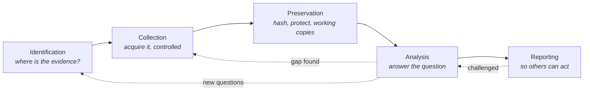

# Chapter 1 — Windows Forensics in Incident Response

> **Reader note:** This chapter and the next two cover IR foundations: the phases, the questions, the legal guardrails, and the lab setup. If you already work in IR, skim 1.1–1.3 and skip directly to 1.4 (lab build) or to Chapter 4 (NTFS), where the artifact-level material starts. The foundations ground readers new to forensics. Veteran practitioners can use them as a refresher.

## Chapter Overview

Digital forensics is one of the disciplines that gives incident response its credibility. During an incident, people will ask urgent questions: What happened? Is the threat still active? Which systems were affected? Was data accessed, staged, deleted, or stolen? Guesswork, memory, and intuition cannot answer those questions well. They have to be answered with evidence.

That requirement separates digital forensics from ordinary technical troubleshooting. A systems administrator may be judged on how quickly service is restored. A forensic analyst is judged on whether others can trust the findings. That trust comes from disciplined collection, careful preservation, defensible analysis, and clear reporting.

In real-world incident response, digital forensics does not happen in a neat laboratory sequence. Responders often identify relevant systems while collecting from others and analyzing a third set of artifacts. The work is iterative, time-sensitive, and sometimes messy. Documentation, scope control, and method keep it defensible, not perfect order.

This chapter introduces digital forensics from an incident response perspective and explains why Windows systems remain central to enterprise investigations. It outlines the legal and procedural guardrails that protect both the responder and the organization. It closes by showing how to stand up a safe Windows incident response lab. By the end of the chapter, you should understand what digital forensics is and how to begin practicing it in a structured, repeatable way.

## Learning Objectives

By the end of this chapter, you should be able to:

* Define digital forensics in practical incident response terms
* Explain the five major phases of a forensic process and how they overlap during live incidents
* Distinguish forensic analysis from ordinary IT troubleshooting
* Explain why Windows artifacts are especially valuable during incident response
* Identify common Windows evidence sources and the kinds of questions they can answer
* Describe the role of authorization, scope, and chain of custody in preserving trust
* Build a basic Windows lab suitable for safe forensic practice
* Create and document a simulated evidence item using fundamental evidence-handling practices

---

## 1.1 What Is Digital Forensics?

Digital forensics is the systematic process of identifying, acquiring, preserving, analyzing, and reporting digital evidence so that others can rely on the findings. In an incident response context, that definition matters because response decisions often carry business, regulatory, legal, and operational consequences. If leadership asks whether a system was compromised, whether credentials were abused, or whether sensitive files were exfiltrated, the answer must be grounded in demonstrable evidence.

Digital forensics is therefore about answering specific questions with evidence that can withstand review, not just finding suspicious artifacts. A strong forensic conclusion is not, “This looked bad.” It is, “These artifacts show that this executable ran under this user context at this time, established these network connections, and persisted through this mechanism.”

### 1.1.1 The Five High-Level Phases

The work is easier to understand when broken into five broad phases, even though real investigations rarely proceed in a straight line.

*Figure 1.1 — The five phases of digital forensics. The dotted arrows make it incident response rather than a textbook process. Analysis routinely sends you back for evidence you did not know you needed, and a challenged finding sends you back to the analysis that produced it. Expect to be in several phases at once.*

**Identification** is the process of determining which systems, accounts, applications, storage media, logs, and data sources are relevant to the incident. At this stage, the responder decides where the evidence is likely to be and which questions to answer first.

**Collection** is the controlled acquisition of evidence from those sources. Depending on the situation, this may include full disk images, memory captures, exported logs, registry hives, virtual disk files, browser databases, cloud audit records, or triage collections.

**Preservation** is the protection of evidence integrity. This includes hashing, documenting dates and times, controlling access, preserving originals, and avoiding unnecessary changes that could alter or destroy relevant artifacts.

**Analysis** is the examination of the evidence to answer investigative questions. In this phase, the analyst interprets artifacts, builds timelines, establishes relationships between events, and evaluates competing explanations.

**Reporting** is the communication of findings. A good report explains what happened, what evidence supports that conclusion, what remains unknown, and what actions or decisions should follow.

In a textbook, these phases look sequential. In incident response, they often overlap. A responder may identify a new host while analyzing a prior collection, then return to gather more evidence once a new lead emerges. That is normal. Documentation is what must remain constant. Even when the sequence compresses, the responder still needs to record what they did, when, why, and what evidence supports the next step.

### 1.1.2 Digital Forensics vs. IT Troubleshooting

Troubleshooting and forensic work have different objectives, and that distinction is foundational.

Traditional IT troubleshooting usually aims to restore service, eliminate user impact, or return a system to normal operation. If a reboot fixes the problem, the reboot may be a perfectly reasonable administrative action.

Forensic work aims to preserve and interpret evidence, not merely to make the system behave correctly again. That changes how responders make decisions.

Reboots, patches, reinstallations, malware cleanups, and profile resets are all common troubleshooting steps. In a forensic context, each of those actions can destroy volatile evidence, alter timestamps, overwrite files, rotate logs, clear caches, or otherwise reduce visibility into what occurred.

A useful way to frame the difference:

* Troubleshooting asks, “How do I fix this?”
* Forensics asks, “How do I prove what happened?”

Service restoration still matters. Responders must make deliberate decisions about the tradeoff between speed and evidence preservation.

### 1.1.3 Asking Questions Before Touching Evidence

One of the most important forensic habits is developing specific investigative questions before diving into data. Without questions, analysis easily turns into browsing.

A weak question is: “Was something bad happening?”

A strong question is: “Was there an interactive or remote logon to this workstation outside business hours during the last 14 days?”

Other examples include:

* Did a suspicious executable run on this host?
* Which user account launched it?
* Was a tool downloaded to disk?
* Was there evidence of persistence?
* Were files staged, renamed, or deleted?
* Did a removable device connect?
* Did a process make outbound network connections consistent with command-and-control or exfiltration?

These questions shape collection priorities, reduce wasted effort, and make the final conclusions more defensible.

### 1.1.4 Documentation as a Constant

In incident response, documentation is not clerical overhead. It is the thread that holds the investigation together.

Even correct technical findings become harder to trust if the responder cannot account for the work. That means explaining what was collected and when, what changed on the system, which assumptions were made, and why each decision was taken.

An analyst’s opening note is often the first formal act of discipline in a case. It records the reported issue, what is currently known, what remains unknown, and what evidence to collect first. That note helps keep the investigation factual, bounded, and accountable.

---

## 1.2 Why Windows Matters in Incident Response

Windows remains one of the most important environments in digital forensics because it dominates enterprise endpoints, administrative workstations, line-of-business systems, and many critical application and infrastructure roles. Even organizations with extensive cloud adoption, centralized logging, and mature endpoint tooling still rely on Windows systems somewhere in the attack path.

For incident response, that means most investigations will begin on a Windows system, pivot through one, or depend on artifacts one produced. Attackers use Windows machines to establish footholds, execute tools, access file shares, escalate privileges, abuse credentials, move laterally, and stage or exfiltrate data. Responders therefore need to know why Windows native artifacts remain indispensable.

### 1.2.1 Windows Artifacts Provide Native Visibility

Windows systems generate artifacts for file activity, program execution, authentication, network usage, user behavior, removable media interaction, and persistence. Those artifacts often capture details that EDR, SIEM, firewall logs, and cloud audit data either do not store or do not preserve with the same granularity.

A responder who understands Windows artifacts can map questions to evidence quickly, which is a real advantage under time pressure.

For example:

* If the question is whether a binary ran, Prefetch, Amcache, UserAssist, and related execution artifacts may help answer it.
* If the question is whether a user opened or staged files, LNK files, Jump Lists, MFT records, and the USN Journal may help answer it.
* If the question is whether PowerShell was used, Windows event logs and PowerShell operational logging may provide evidence.
* If the question is whether a user plugged in removable media, registry artifacts and shell-related traces may help establish that behavior.

### 1.2.2 Common Windows Evidence Sources

The following artifact categories appear repeatedly throughout Windows incident response work:

**Master File Table (MFT).** The MFT is one of the core NTFS metadata structures. It can reveal file existence, timestamps, names, paths, and deleted file traces. For many responders, it becomes the backbone of file-system reconstruction.

**USN Journal.** The Update Sequence Number Journal tracks file-system changes on NTFS volumes. It is especially valuable for showing creations, deletions, renames, and changes over time, including traces that remain useful after a file is deleted.

**Event Logs.** Windows event logs often answer first-line questions about logons, service activity, system changes, and script execution. Security.evtx and System.evtx are especially important, but many incident-relevant logs exist beyond those.

**Registry Hives.** SYSTEM, SOFTWARE, SAM, SECURITY, NTUSER.DAT, and USRCLASS.DAT can reveal boot configuration, installed software, user behavior, persistence, USB history, typed paths, shellbags, and more.

**Prefetch.** Prefetch artifacts can show that a program executed and may also reveal referenced file paths or supporting context, depending on the version of Windows and the state of the system.

**Amcache.** Responders often use Amcache to identify binaries that existed on the system and to gather metadata about them, including path and execution-related context.

**SRUM.** The System Resource Usage Monitor database can provide process-related network and resource usage over time, making it useful for triage and behavior reconstruction.

**LNK Files and Jump Lists.** These artifacts often show recent file access, working directories, target paths, and application-specific usage patterns.

**Browser History and Download Artifacts.** Browsers frequently preserve URLs, downloads, search activity, and session clues relevant to phishing, staging, tool delivery, or exfiltration.

**Memory.** Memory acquisition can reveal running processes, injected code, active sockets, decrypted data, credentials, and other volatile evidence that may disappear at shutdown or reboot.

### 1.2.3 Why Native Artifacts Still Matter When EDR Exists

Native artifacts still matter even when the organization already has EDR on every endpoint and ingests telemetry into a SIEM, because those tools are incomplete.

EDR and SIEM platforms provide centralized visibility, alerting, correlation, and speed. They are often how the team notices an incident in the first place. But they also depend on collection logic, retention policies, sensor health, ingestion success, configuration choices, and the attacker’s interaction with those systems.

Native Windows artifacts provide an independent and often more detailed record of what occurred on the host itself. They can reveal local activity that predates EDR deployment, falls outside SIEM retention, was not parsed into useful fields, or occurred when the sensor was disabled, misconfigured, evaded, or absent.

The relationship is complementary rather than competitive. Good incident response uses both. EDR may tell you where to look. Native artifacts often tell you what actually happened.

### 1.2.4 Prioritization Under Time Pressure

A responder cannot always collect everything. Production needs, system criticality, access limitations, and time constraints often force prioritization.

That is why artifact awareness matters before the incident, not during it. A responder who already knows what the MFT, event logs, registry hives, Prefetch, PowerShell logs, SRUM, and memory can provide is better positioned to make defensible triage decisions.

When time is limited, the responder should prioritize based on the investigative question, the volatility of the evidence, and the cost of losing it. Memory, live connections, and active process information are especially time-sensitive. Other artifacts persist longer but may still change quickly under continued use.

Knowing what not to collect is also part of professional discipline. Every collection decision leaves a gap somewhere. The goal is deliberate, justified prioritization, not perfection.

---

## 1.3 Authorization, Legal Considerations, and Chain of Custody

Technical skill alone does not make forensic work defensible. A responder can interpret artifacts correctly and still undermine the investigation by collecting data without authority, exceeding scope, failing to preserve the original, or leaving the evidence history undocumented.

Authorization, scope, and chain of custody are therefore not optional administrative details. They are the controls that make forensic work trustworthy to leadership, legal counsel, HR, regulators, external partners, and, when necessary, a court.

### 1.3.1 Authorization

Before touching a system in a real incident, a responder should be able to answer a simple question: Do I have permission to do this?

The source of that permission depends on context. It may come from internal incident response policy, management direction, a contract, legal counsel, HR, or a formal retainer agreement. What matters is that the authority exists, is appropriate for the situation, and is documented.

“I assumed it was fine” is not authorization.

Working without authorization can create legal exposure, breach internal policy, expand organizational risk, and later cast doubt on otherwise valid findings. Even in fast-moving incidents, record verbal approval and follow it with written confirmation when possible.

A responder should document at least:

* who authorized the action,
* under what authority or policy basis,
* when authorization was given,
* and what conditions or limits apply.

### 1.3.2 Scope

Scope defines what the responder collects and, equally important, what the responder does not collect.

Poorly defined scope is a common source of trouble. Collect too little and the investigation may fail. Collect too much and the organization may absorb unnecessary legal, privacy, or regulatory risk.

Good scope documentation identifies:

* the system or systems involved,
* the reason for collection,
* the categories of data in scope,
* the categories of data out of scope,
* and any special handling requirements, such as personal data, regulated data, or cross-jurisdictional issues.

Scope creep deserves special attention. A responder who finds relevant-looking data outside the original scope should not quietly grab it and move on. Document the discovery, assess the need, and obtain authorization to expand scope if appropriate.

### 1.3.3 Chain of Custody

Chain of custody is the chronological record of who handled an evidence item, when they handled it, what they did to it, where it came from, where it went, and whether integrity was verified along the way.

Its purpose is to let others trust that the evidence under analysis is the same evidence that was originally collected.

In practical terms, chain of custody should record:

* a unique evidence identifier,
* a clear description of the item,
* the source system,
* acquisition date and time,
* the collector,
* the storage location,
* hash values,
* and each transfer, copy, or analysis event.

Chain of custody matters even when law enforcement is not involved. Internal stakeholders still need to trust the process. Regulators may still ask questions. External counsel may still review the work. And future responders may need to revisit the same evidence months later.

### 1.3.4 Hashing and Evidence Integrity

Hashing is one of the simplest and most important integrity controls in digital forensics. A cryptographic hash creates a fixed-length representation of the evidence file. If the file changes, the hash changes.

For modern evidence handling, SHA-256 is the standard baseline. MD5 may still appear in some tools or legacy workflows, but do not rely on it alone.

The first hash is typically computed at acquisition. Later verifications confirm that the original has not changed and that working copies match their source.

The underlying principle is simple: if you cannot show that the evidence is stable, the analysis built on it becomes harder to defend.

### 1.3.5 Working Copies vs. Originals

A foundational best practice is to preserve the original and analyze a verified copy.

Store the original evidence item separately, control access to it, and disturb it as little as possible. If you need more analysis later, create new working copies and verify them against the preserved original.

This approach reduces the chance of accidental modification and makes the process easier to explain and defend.

### 1.3.6 Why These Controls Matter in Internal Investigations

Chain of custody and strict evidence discipline matter even when no criminal prosecution is expected. Many newcomers assume otherwise, and that view is too narrow.

Internal investigations can still affect employment decisions, insurance matters, executive reporting, regulatory disclosures, vendor disputes, and litigation risk. Even where no courtroom is expected, the organization still benefits from a process that can survive scrutiny.

Trust is easier to preserve than to rebuild.

---

## 1.4 Standing Up a Windows IR Lab

Theoretical understanding is not enough. Responders need a safe environment where they can generate artifacts intentionally, practice collection and analysis, test tools, make mistakes, and document their process without affecting production systems.

A good lab does more than provide a Windows VM. It provides repeatability.

### 1.4.1 Core Design Goals

A beginner Windows IR lab should be:

* **isolated**, so mistakes do not affect production systems,
* **documented**, so it can be rebuilt,
* **repeatable**, so exercises can start from a known-clean state,
* **artifact-rich**, so later analysis has real value,
* and **organized**, so evidence, notes, exports, and tools do not become chaotic.

### 1.4.2 Building the VM

A practical lab starts with a Windows 10 or Windows 11 virtual machine in a hypervisor such as VirtualBox, VMware Workstation, or Hyper-V.

A reasonable baseline includes:

* 2 virtual CPUs,
* 4 GB of RAM at minimum, with 8 GB preferred,
* a 60 GB primary disk,
* and a clearly documented hostname.

Create a second local account in addition to the default administrator, because multi-user activity produces richer artifacts later.

Document the system timezone too. Many practitioners prefer UTC because it simplifies timeline interpretation across systems.

### 1.4.3 Network Isolation

Network design in a lab is both a safety decision and a realism decision.

A host-only network is often the best default for this kind of training because it lets the host and VM communicate without exposing the guest to the internet or production network.

Other options exist:

* **No network** for maximum isolation,
* **NAT** for temporary tool downloads,
* **Internal-only networks** for multi-VM simulations,
* and **bridged networking** for higher realism at higher risk.

Whichever option you choose, make the choice deliberately and document it.

### 1.4.4 The Secondary Evidence Disk

Add a separate virtual disk for evidence and artifact work. Format it as NTFS, assign it a consistent drive letter such as `E:`, and label it clearly.

Using a separate disk provides several advantages:

* it separates evidence from the operating system,
* makes it easier to export or hash the evidence container,
* supports repeatable collection exercises,
* and better reflects how responders often package triage data in practice.

Once the disk exists, populate it with realistic sample content such as office documents, images, scripts, archives, and a renamed executable in a staging-like folder. Writing that content generates the kinds of artifacts later chapters analyze.

### 1.4.5 Generating Baseline Activity

A sterile machine is less useful than a lightly used one.

To produce meaningful artifacts, the user should open files, run a few PowerShell commands, create folders, and interact with the environment in normal ways. Those actions generate traces in places such as LNK files, Jump Lists, PowerShell operational logs, the MFT, the USN Journal, and related user activity artifacts.

The objective at this stage is a clean, known baseline of ordinary system use, not attacker simulation.

### 1.4.6 Tooling

A basic lab should include a small set of dependable free tools suitable for the exercises ahead. Typical examples include:

* the Eric Zimmerman tool suite (MFTECmd, EvtxECmd, RECmd, Registry Explorer, PECmd, LECmd, JLECmd, SBECmd, AmcacheParser, Timeline Explorer),
* FTK Imager,
* KAPE (Kroll Artifact Parser and Extractor) for triage collection plus chained parsing,
* Hayabusa for Sigma-rule-based EVTX threat hunting with MITRE ATT&CK mapping,
* Volatility 3 and MemProcFS for memory analysis — install both, because MemProcFS gives a file-system-style view of the same image and is often faster for exploratory triage,
* Arsenal Image Mounter for working with disk images on a Windows analysis host,
* Autopsy,
* Cyber Triage, a guided IR triage tool with a free evaluation tier,
* 7-Zip,
* Sysinternals tools,
* Notepad++,
* and DB Browser for SQLite.

For an alternative analysis environment, the SANS SIFT Workstation is a free Linux VM appliance with its own, Linux-native toolset. It shares Volatility and Autopsy with the list above and adds Sleuth Kit, Plaso, and RegRipper. **Appendix D — Tooling Reference for Windows IR** is the complete annotated reference for these and a few related tools. For each tool, it covers what the tool does, where it fits in the IR workflow, its license terms, and the chapters that lean on it.

Always record tool versions. Forensic output can vary between versions, and reproducibility requires knowing what produced the results.

### 1.4.7 Baseline Snapshots and Notes

Once the VM is configured, the secondary disk prepared, sample activity generated, and tools installed, capture a baseline snapshot. A name such as `Baseline-Clean` makes its purpose explicit.

This snapshot becomes the starting point for later labs. When an exercise requires destructive actions or simulated malicious activity, you can revert the VM to the known baseline.

Baseline notes should include:

* hostname,
* OS version and build,
* timezone,
* local accounts,
* installed tools and versions,
* audit policy status,
* logging status,
* and the snapshot date and name.

If the environment cannot be rebuilt from the notes, the notes are not good enough.

### 1.4.8 Organizing the Lab

A good folder structure prevents confusion later. Give notes, exports, evidence files, templates, and tool installers each a defined place. That structure reduces accidental mixing of originals and working copies and makes discipline easier to keep across chapters.

### 1.4.9 A First Practical Exercise

A simple first exercise is to create a simulated evidence item and handle it as though it were part of a real investigation.

That exercise might include:

1. creating the secondary disk,
2. writing realistic files to it,
3. shutting down the VM,
4. locating the virtual disk file on the host,
5. computing a SHA-256 hash,
6. completing a chain-of-custody record,
7. and writing a short reflection about what would differ in a real incident.

The exercise reinforces a core lesson: forensic methodology starts with disciplined handling of even simple evidence items, long before complex artifact parsing.

### 1.4.10 Honest Lab Assessment

No lab is perfect.

A basic single-VM environment is enough to learn the fundamentals, but it has limits. It may not model enterprise identity infrastructure, realistic lateral movement, multiple users, or long-lived system histories. Hardware constraints, storage limits, limited network realism, and incomplete audit logging can all reduce fidelity.

That is acceptable, provided you understand the limitations.

A mature practitioner gets in the habit of asking:

* What can this lab teach well?
* What can it not teach well yet?
* What risks would exist if this machine were misconfigured or accidentally exposed?
* What should be improved next?

---

## Chapter Summary

Digital forensics in incident response is the disciplined use of evidence to answer investigative questions in a way that others can trust. The work is usually described in terms of identification, collection, preservation, analysis, and reporting, but in live incidents these phases often overlap. Documentation is the constant that keeps the work defensible.

Windows matters because it remains deeply embedded in enterprise operations and produces native artifacts that are invaluable for reconstructing user activity, program execution, persistence, file operations, authentication, and network behavior. Even mature EDR and SIEM deployments do not replace the need to understand those artifacts.

Authorization, scope, and chain of custody are not optional administrative exercises. They are the mechanisms that protect the integrity of the investigation, the organization, and the responder. Evidence must be collected under authority, within scope, hashed, preserved, and tracked.

A well-designed Windows IR lab turns these concepts into repeatable practice. By building an isolated VM, creating a secondary evidence disk, generating baseline activity, installing core tools, recording system state, and preserving a clean snapshot, you establish a safe environment for all of the work that follows.

## Key Terms

**Amcache:** A Windows artifact that can preserve metadata about programs present on the system.

**Chain of Custody:** The documented history of who handled an evidence item, when, where, and for what purpose.

**Collection:** The acquisition of relevant evidence in a controlled and documented manner.

**Digital Forensics:** The systematic process of identifying, acquiring, preserving, analyzing, and reporting digital evidence.

**EDR:** Endpoint Detection and Response tooling used for endpoint visibility, alerting, and response actions.

**Identification:** The phase in which relevant systems, accounts, logs, and data sources are identified.

**MFT:** The Master File Table, a core NTFS artifact used to understand file-system activity.

**Preservation:** The protection of evidence integrity through hashing, access control, and careful handling.

**Scope:** The defined boundaries of what is authorized for collection and analysis.

**SHA-256:** A cryptographic hashing algorithm commonly used to verify evidence integrity.

**SRUM:** The System Resource Usage Monitor database, which can preserve per-process resource and network usage information.

**USN Journal:** An NTFS artifact that records file-system changes over time.

## Review Questions

1. Why is digital forensics different from ordinary IT troubleshooting?
2. What are the five major phases of digital forensics, and why do they overlap during incident response?
3. Why do Windows-native artifacts remain valuable even when EDR and SIEM are present?
4. What risks arise when collection occurs without documented authorization or clearly defined scope?
5. Why should analysis be performed on working copies rather than preserved originals?
6. What are the practical advantages of using a separate virtual evidence disk in a training lab?
7. Why is a baseline snapshot so important in a forensic lab environment?
8. What kinds of investigative questions can Windows artifacts help answer?

## Practical Exercises

1. Build a Windows 10 or 11 VM with host-only networking and document its configuration.
2. Add a secondary evidence disk, populate it with realistic files, and hash the backing virtual disk file.
3. Create a basic chain-of-custody log for the simulated evidence item.
4. Write an analyst opening note for a suspicious workstation scenario.
5. Create a personal reference list of at least twelve Windows artifacts and the IR questions they help answer.
6. Document the limitations of your lab and propose three improvements for later chapters.

> **Hands-on:** [Lab 01 — Windows Forensics Foundations](../Labs/Lab01/ReadMe.md) — stand up the analyst VM, take a clean baseline, and practice chain-of-custody documentation before any real artifact work.

---

## Looking Ahead

The next chapter moves from foundational concepts to investigative process. You will begin thinking more explicitly about triage, prioritization, collection strategy, and how to turn broad incident concerns into repeatable forensic workflows.

---

[Chapters](.) · [Labs](../Labs/ReadMe.md) · [Simulated Data](../Data/README.md) · [Quick Reference](AppendixE.md) · [Glossary](Glossary.md) · [About the Author](About.md)

