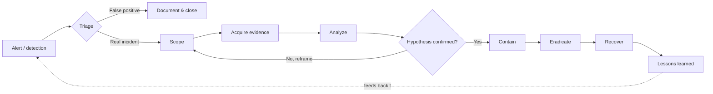

# Chapter 2 — The Forensic Investigation Process for IR

> **Reader note:** This is the chapter on *how to think* about an investigation — questions, hypotheses, documentation, alert-to-plan transition. Working SOC and IR practitioners will recognize most of what's here as something they already do. Treat it as a vocabulary check and a place to standardize patterns across a team. The artifact-level material starts in Chapter 4.

## Chapter Overview

Incident response rarely begins with clarity. It usually begins with a fragment: an EDR alert, a user complaint, a firewall anomaly, a suspicious process chain, or a vague statement that "something looks wrong." The challenge is not only to collect evidence but to turn incomplete, time-sensitive information into a structured, defensible investigation.

That transition is where many forensic efforts fail. Responders start pulling artifacts before deciding what they need to prove. They treat alerts as findings. They isolate systems before capturing volatile evidence. They document conclusions before separating facts from assumptions. The result is often the same: wasted time, preventable evidence loss, and findings that are harder to defend than they should be.

This chapter explains the forensic investigation process for incident response from a Windows-focused perspective. It begins with the questions forensics should answer during an active incident. It then walks through the high-level workflow that moves a team from alert to evidence-backed understanding. It also covers a subject teams often neglect: documentation and repeatability. Finally, it shows how to convert a raw alert into an investigation plan another responder could execute under stress.

The central idea of this chapter is simple: forensic work should be question-driven, evidence-based, and repeatable. The more pressure the incident creates, the more important that structure becomes.

## Learning Objectives

By the end of this chapter, you should be able to:

* Define the core incident response questions Windows forensics should answer
* Translate a vague escalation into specific, prioritized investigative questions
* Explain the major phases of a Windows-focused forensic investigation during incident response
* Distinguish initial triage from scoping, collection, analysis, timeline building, and reporting
* Prioritize volatile and persistent evidence in a live response scenario
* Build and document a repeatable collection workflow
* Separate facts, assumptions, hypotheses, and conclusions in written analysis
* Create investigation notes, timelines, and handoff material another analyst could follow
* Turn a raw alert into a structured investigation plan within a short time window

---

## 2.1 IR Questions Forensics Should Answer

In incident response, forensic work is a targeted effort to answer the questions that matter most to containment, eradication, recovery, and executive decision-making. It is not an abstract search for everything that happened on a system.

Responders rarely begin with the question, “Can we prove who did this?” They begin with more urgent, operational concerns:

* Is the attacker still present?
* Which systems or accounts are compromised?
* How did the intrusion begin?
* What did the attacker execute or change?
* Was persistence established?
* Did the threat spread?
* Was data accessed, staged, deleted, or exfiltrated?
* When can containment and recovery happen safely?

These questions determine whether a host is isolated, whether credentials must be reset, and whether file servers or domain controllers are in scope. They also decide whether legal or compliance teams need to be notified and whether leadership should prepare for operational or regulatory impact.

### 2.1.1 Question-Driven vs. Tool-Driven Investigation

A common failure mode in incident response is starting with tools rather than questions.

When an alert lands, the natural instinct is to begin collecting: export the event logs, parse the MFT, dump memory, copy registry hives, examine Prefetch, and start reviewing PowerShell artifacts. None of that is wrong in itself. The problem starts when no defined investigative need anchors the collection.

A tool-driven investigation often produces unfocused evidence gathering, duplicated effort, and conclusions that are hard to explain. A question-driven investigation begins by asking what needs to be proven or disproven. The answer decides what to collect, when to collect it, and how to interpret it.

The difference affects speed, defensibility, and the quality of the final findings.

### 2.1.2 What Good Forensic Questions Look Like

Good forensic questions are specific, falsifiable, and prioritized.

A weak question is: “Was something malicious happening?”

A stronger question is: “Did PowerShell execute with encoded arguments on this host within the hour following the user’s interaction with the email attachment?”

The stronger version is better because you can test it against identifiable evidence sources. It also narrows the investigation toward a concrete answer rather than a vague impression.

In practice, forensic questions in Windows incident response often fall into six categories.

**Active threat.** Is the attacker still present or actively operating on the host or elsewhere in the environment?

**Initial access.** How did the attacker gain entry? Was it a document, a script, stolen credentials, a remote service, or something else?

**Execution.** What processes, scripts, or binaries ran, under what user context, and when?

**Persistence.** Did the attacker establish a mechanism that will survive reboot, user logoff, or partial remediation?

**Impact.** What was accessed, staged, modified, deleted, encrypted, or transferred?

**Scope.** Which other hosts, accounts, services, shares, or data stores may be involved?

A well-structured question list touches each of these areas, even when some start at a lower priority.

### 2.1.3 Facts, Assumptions, and Unknowns

Before you write the first investigative question, separate what is known from what is only suspected.

An alert often contains a mix of facts, assumptions, and implied conclusions. For example, an EDR alert may report a suspicious PowerShell process after a user opened an attachment. Some parts of that statement may reflect reliable telemetry. Other parts may reflect the detection engine’s interpretation. Still others may be unknown.

Early errors in classification propagate quickly. If an analyst treats “the attachment was malicious” as a fact rather than a working possibility, the investigation may become anchored to a phishing theory even when later evidence points elsewhere. If a responder treats the absence of additional alerts as proof that no other hosts are affected, scoping may stop too early.

Good forensic discipline requires saying:

* what is confirmed,
* what is assumed,
* what is still unknown,
* and what evidence would change those categories.

### 2.1.4 Mapping Questions to Artifacts

Tie each forensic question to evidence sources before collection begins.

For example:

* Questions about suspicious execution may map to Security.evtx, PowerShell operational logs, Prefetch, Amcache, ShimCache, or memory.
* Questions about initial access may map to browser history, email artifacts, LNK files, Jump Lists, Office-related file traces, or authentication logs.
* Questions about persistence may map to registry autoruns, services, scheduled tasks, startup folders, WMI-related traces, and SYSTEM or SOFTWARE hive data.
* Questions about impact may map to the MFT, USN Journal, SRUM, shell artifacts, browser data, remote access logs, and network telemetry.
* Questions about scope may extend beyond the primary host into domain controller logs, file server records, VPN logs, Citrix logs, email gateway data, and administrative authentication artifacts.

The mapping focuses collection and highlights gaps. If the evidence a question needs was never logged, was cleared, or was not retained, the responder should know that early.

### 2.1.5 Evidence Gaps Are Findings Too

A gap in evidence is part of the investigative picture, not a minor inconvenience.

If PowerShell Script Block Logging was not enabled, you may be limited in what you can conclude about script content. If process command-line capture was disabled in EDR, important execution detail may be missing. If Security.evtx was cleared, you may need to frame conclusions about authentication activity more carefully. If the outbound destination resolves to shared CDN infrastructure, attribution about the remote host may remain uncertain.

A professional forensic process names these gaps and explains what they prevent the analyst from concluding.

“We cannot confirm X because the relevant source was unavailable” is very different from “We confirmed X did not happen.”

### 2.1.6 Reusable Question-to-Evidence Frameworks

One of the most useful outputs of a mature IR program is a reusable question-to-evidence worksheet. The exact wording of the questions may change from case to case, but the structure is stable.

Teams that build and maintain these worksheets improve consistency, reduce decision fatigue, and help newer responders understand why a given artifact matters. Over time, the worksheet becomes a playbook component: a living reference that ties investigative needs to Windows artifacts, log sources, common event IDs, and likely corroborating evidence.

---

## 2.2 High-Level Process in an Incident

*Figure 2.1 — The IR investigation loop. Triage gates the work. Scoping, acquisition, and analysis iterate until a hypothesis is confirmed or rejected. Lessons learned feed forward into detection for the next incident.*

Once the responder knows which questions need answers, the next problem is process. The process has to settle which actions come first, how triage differs from collection, when containment should occur, and how artifacts become findings rather than raw output.

A useful way to structure Windows-focused incident forensics is as a six-phase workflow. In real incidents these phases overlap, but they provide a reliable mental model for staying oriented when everything is moving at once.

### 2.2.1 Initial Triage

Initial triage is rapid assessment, not deep analysis.

Triage determines urgency, decides whether an active threat is present, assesses whether immediate containment is required, and sets the first collection priorities. On a suspected Windows compromise, triage often focuses on:

* suspicious or recently launched processes,
* active network connections,
* user session state,
* key event logs,
* EDR telemetry and alerts,
* whether the host is online,
* whether the attacker may still be active,
* and whether the situation suggests risk beyond the initial system.

Triage should produce an explicit containment recommendation. The typical options are to isolate immediately, monitor and collect before isolating, or defer isolation temporarily while observing. Each option carries risk. Document the decision rather than leaving it implied.

### 2.2.2 Scoping and Prioritization

An alert on one Windows host is often not just about that host.

Scoping asks which related systems, accounts, shares, servers, and data stores may also be involved. If the user has access to finance systems, file shares, VPN, Citrix, or administrative tools, those resources may be in scope even before evidence confirms they were abused.

This phase should identify likely pivot points and high-value systems first. Domain controllers, file servers, application servers, remote access systems, and mail infrastructure often become important quickly.

Prioritization sits alongside scoping. The responder should decide which evidence sources matter most, in what order, and why. Volatility, business impact, and investigative value all shape that order.

### 2.2.3 Targeted Evidence Collection

Once the responder knows what needs to be answered and what is at risk of being lost, collection can proceed with discipline.

Windows incident response usually combines volatile and persistent evidence collection.

Volatile evidence may include:

* running processes,
* active network connections,
* logged-on users,
* RAM contents,
* command history,
* clipboard or transient session data,
* and the state of live services or tasks.

Persistent evidence may include:

* event logs,
* registry hives,
* Prefetch,
* Amcache,
* MFT and USN Journal data,
* shell artifacts,
* SRUM,
* browser history,
* and application-specific artifacts.

Scripted triage helps here because it improves speed and consistency. Even so, document every collection action with tool versions, commands, timestamps, output locations, and hash values where appropriate.

### 2.2.4 Analysis and Hypothesis Testing

Analysis becomes more disciplined when framed as hypothesis testing.

Rather than browsing artifacts until something interesting appears, the analyst should form specific statements about what may have happened. For each one, the analyst then defines what evidence would confirm or eliminate it.

Examples of hypotheses include:

* A malicious document triggered PowerShell execution.
* A dropped executable staged in a temporary folder was then run.
* Explicit credentials were used to move laterally to a file server.
* Outbound traffic represented command-and-control rather than ordinary application behavior.
* Data was staged locally before exfiltration.

This approach protects against confirmation bias. A good hypothesis is not only something you try to confirm. It is something you are equally prepared to disprove.

### 2.2.5 Timeline Construction

Single artifacts rarely tell the whole story. Timelines help connect them.

A forensic timeline orders meaningful events from multiple artifact sources into a single chronological view. Logons, process launches, file creation, file access, script execution, service creation, outbound connections, credential use, and deletion events become easier to understand when placed together.

The timeline's main value is correlation. An event that appears at roughly the same time in Security.evtx, Prefetch, SRUM, and MFT-related data is usually much stronger than one seen in a single ambiguous source.

A good timeline is curated, not dumped. Each entry should identify:

* the timestamp,
* the source artifact,
* the event description,
* the significance,
* and the confidence level.

### 2.2.6 Reporting and Remediation Support

The last phase of the process is translation, not merely “write the report.”

Forensic analysis has to become outputs that other people can act on. Those outputs may include:

* technical findings for responders,
* executive summaries for leadership,
* impact statements for legal or compliance teams,
* indicator lists for detection or blocking,
* recommended password resets,
* rebuild or reimage decisions,
* containment or monitoring instructions,
* and scoping updates for other system owners.

The practical value of the investigation depends on how effectively those findings drive action.

### 2.2.7 The Process Is Iterative, Not Linear

Real incidents almost never move through the six phases in a clean sequence.

A responder may still be triaging one host while another analyst is already building a timeline on a second. A containment decision may change when new evidence appears. Scoping may expand because a credential event on one system points to another. Reporting may begin before all analysis is complete because leadership needs an update.

That is normal. The workflow exists to maintain structure and reasoning under pressure, not to impose rigidity.

---

## 2.3 Documentation and Repeatability

A forensic investigation that cannot be reconstructed is difficult to trust.

Teams often treat documentation as something that happens after the real work is done. In incident response, that view is dangerous, because documentation is part of the work. It makes the investigation repeatable, reviewable, transferable, and defensible.

### 2.3.1 Why Documentation Matters

Good documentation serves several purposes at once.

It supports repeatability by allowing another analyst to re-run the same collection or analysis in the same way. It supports handoff continuity by making shift changes survivable. It supports legal and regulatory defensibility by showing exactly what was collected and how it was handled. It supports accountability by establishing who made which decisions and when. It also protects the analyst personally by preserving context that would otherwise be lost to time or pressure.

Poor documentation creates the opposite. Teams duplicate work, lose context, mislabel findings, forget assumptions, struggle to explain decisions, and discover too late that a key command or output path was never recorded.

### 2.3.2 Real-Time Notes Beat Retroactive Notes

One of the most persistent traps in incident response is the belief that documentation can be cleaned up later.

Retroactive notes are reconstructions, not records. They are vulnerable to memory gaps, sequence errors, missing timestamps, omitted commands, and quiet reinterpretation of what the analyst believed at the time.

The details most likely to blur are often the details that matter most:

* when an action happened,
* whether the host was isolated before or after a memory capture,
* which command syntax was used,
* whether a tool produced an error,
* whether a conclusion was tentative or confirmed at that moment,
* and where the output was written.

Real-time logging is therefore a professional habit, not a luxury.

### 2.3.3 The Structured Case Log

A structured case log records investigative actions in chronological order as they occur.

Typical entries include triage actions, evidence collection, decisions, findings, escalations, notes, errors, and handoffs. Each entry should identify when the action occurred, who performed it, what kind of action it was, and what happened.

Do not rewrite the case log to look cleaner after the fact. If an error occurs, document it as an error and follow it with a correction entry. The log then preserves the true investigative history rather than an edited version of it.

### 2.3.4 Command Records and Tooling Discipline

Case logs capture what happened. Command records capture how it happened.

For each meaningful tool execution, the responder should record:

* the tool name,
* the version,
* the platform it ran on,
* who ran it,
* the working directory,
* the exact command,
* the output location,
* file size and hash where appropriate,
* and any errors, warnings, or deviations.

This level of detail lets another analyst reproduce the result. It also explains why a result may differ if someone later uses a different version or method.

### 2.3.5 Facts, Conclusions, and Assumptions Registers

Good analysts keep three things distinct: what they observed, what they conclude, and what they assume.

A fact is supported directly by a named artifact.

A conclusion is an inference supported by one or more facts.

An assumption is something believed to be true without direct supporting evidence.

Mixing these categories in notes or reporting is one of the fastest ways to weaken an investigation. If a conclusion is written as though it were an observed fact, reviewers may overestimate confidence. If an assumption is not labeled as such, the team may make decisions on a shaky foundation.

Many teams benefit from maintaining an explicit register, or at least from enforcing this distinction in their case notes.

### 2.3.6 Timelines as Documentation, Not Just Analysis

A forensic timeline is a documentation artifact, not merely an analytical aid.

A good timeline records not only what happened, but where the entry came from and how strongly it is supported. When another analyst picks up the case, the timeline becomes one of the fastest ways to understand the current state of the investigation.

Timelines therefore need provenance and confidence, not just timestamps.

### 2.3.7 Handoff Notes

Investigations do not stop because a shift ends.

A handoff note should tell the incoming analyst what the case is, what was completed, what evidence has been collected, and what has been analyzed. It should state what is known, what remains unknown, what the active hypotheses are, and what the evidence gaps are. It should end with what should happen next, in priority order.

A poor handoff slows the case, risks duplication, and can cause important leads to go stale. A good handoff preserves momentum.

### 2.3.8 Personal and Team Standards

Documentation becomes easier to maintain when the format is decided before the incident.

Teams should standardize their expectations for case logs, command records, timeline entries, findings language, and handoff content. Individual analysts also benefit from adopting personal standards that survive bad days, time pressure, and fatigue.

A useful rule of thumb is simple: if the note would not make sense to a future analyst, counsel, or regulator who was not present, it is not complete enough.

---

## 2.4 From Alert to Investigation Plan

A raw alert is not an investigation.

It is a starting signal, often incomplete and sometimes misleading. The skill that bridges that gap is the alert-to-plan transition. It converts alert data into a structured, prioritized investigation plan before evidence collection begins in earnest.

### 2.4.1 The First 20 Minutes Matter

The early phase of an incident sets the trajectory for everything that follows. If the responder treats assumptions as facts, captures artifacts in the wrong order, or makes an undocumented containment call, the case may be harder to recover later.

A well-executed alert-to-plan transition usually produces five outputs:

* separation of facts from assumptions,
* a short list of prioritized investigative questions,
* a documented containment recommendation,
* an evidence collection priority list,
* and a written investigation plan another responder could execute.

This process does not need to be long. In many cases it should take roughly 15 to 20 minutes. The goal is structured clarity before action, not perfection.

### 2.4.2 Dissecting the Alert

The first task is to break the alert into individual claims and assess the confidence of each.

Some claims come from direct telemetry, such as a recorded process chain or network connection. Some are interpretations made by a detection engine, such as the assertion that the behavior was suspicious. Some are inferences from missing evidence, such as "no lateral movement detected" or "no data loss occurred." Those last two phrases often mean only that no such activity generated an alert.

An analyst should ask of each claim:

* What is the source?
* Is it a direct observation or a conclusion?
* How confident should we be before verification?
* What artifact would confirm or challenge it?

This step often produces the first useful summary of the case: a one-sentence statement of only what the alert confirms, without speculation.

### 2.4.3 Facts, Assumptions, and Hypotheses

The alert-to-plan stage benefits from a three-part separation.

**Facts** are directly supported by a named source.

**Assumptions** are plausible but not yet verified.

**Hypotheses** are testable statements about what may have happened.

This structure keeps the plan both practical and honest. For example, the responder can say that EDR telemetry confirms the process chain. The same plan can record that the user’s physical presence at the system is still an assumption, and that a malicious macro-triggered execution path is a working hypothesis to be tested.

Without this separation, plans tend to harden around whatever story seems most convenient.

### 2.4.4 Making the Containment Decision

One of the most consequential early decisions is whether to isolate immediately, monitor and collect before isolating, or continue observation briefly.

Each option preserves something and sacrifices something.

Immediate isolation may reduce spread and protect other systems, but it may also destroy volatile evidence and close off the chance to observe active command-and-control behavior.

Monitoring and collecting before isolation may preserve high-value evidence and infrastructure visibility, but it accepts additional risk if the attacker remains active.

Observation without immediate intervention may produce intelligence value in rare situations, but usually carries the greatest operational risk.

No single answer fits every case. What matters is that the choice is deliberate, reasoned, and authorized. Document it together with the trigger conditions that would force reassessment.

### 2.4.5 Building the Collection Plan

After the containment decision, the responder should define the collection order.

The plan should identify which artifacts will be collected first, which are volatile, which tools will be used, where the output will be written, and how it will be hashed or packaged. It should also identify any known evidence gaps and alternative sources that might compensate for them.

For example, suppose the EDR did not capture a PowerShell command line. The plan might note alternative sources such as PowerShell operational logs, Script Block Logging, Prefetch context, recent LNK files, or command history, depending on what was enabled and preserved.

A plan like this keeps the investigation grounded when time pressure and interruptions accumulate.

### 2.4.6 A Plan Another Analyst Could Execute

The best test of an investigation plan is whether another analyst could pick it up cold and begin working from it.

A good plan should therefore include:

* a factual alert summary,
* what is known,
* what is assumed,
* active hypotheses,
* systems and accounts in scope,
* the containment decision and its reasoning,
* prioritized investigative questions,
* the first evidence collection actions,
* known evidence gaps,
* immediate next actions,
* and escalation or notification expectations.

If the document only makes sense to the analyst who wrote it, it is not yet a sufficient plan.

---

## Chapter Summary

Windows incident forensics works best when questions drive it, not tools alone. Before collection begins, the responder should know what they are trying to prove or disprove, what is confirmed, what is assumed, and what remains unknown. That discipline keeps the investigation focused and helps produce findings that are easier to defend.

A high-level Windows IR workflow runs through triage, scoping and prioritization, targeted evidence collection, analysis through hypothesis testing, timeline construction, and reporting that supports remediation. In practice these phases overlap, but the structure helps responders stay oriented under pressure.

Documentation is a core part of the investigation, not a post-incident administrative task. Structured case logs, command records, facts-versus-conclusions discipline, timelines with provenance, and clear handoffs are what make investigations repeatable, transferable, and defensible.

The alert-to-plan transition matters because it shapes the first 20 minutes of a case. The responder dissects the alert, separates facts from assumptions, makes a documented containment recommendation, prioritizes evidence collection, and writes a plan another analyst could execute. Those steps lay the foundation for the rest of the investigation.

## Key Terms

**Case Log:** A chronological real-time record of investigative actions, decisions, findings, and context.

**Containment Decision:** The documented choice to isolate, monitor, or otherwise control a system during incident response.

**Corroborating Artifact:** A secondary evidence source used to confirm or challenge a conclusion drawn from a primary artifact.

**Evidence Gap:** A missing, unavailable, or insufficient source of data that limits what the analyst can conclude.

**Fact:** A statement directly supported by a named artifact or confirmed telemetry source.

**Hypothesis:** A testable statement about what may have happened, held until evidence confirms or eliminates it.

**Investigation Plan:** A structured document that converts alert information into prioritized questions, collection steps, and decisions.

**Question-to-Evidence Mapping:** The process of tying investigative questions to specific artifacts or data sources.

**Repeatability:** The ability for another analyst to reproduce a collection or analysis method and understand the same reasoning path.

**Triage:** The rapid early assessment of an incident to determine urgency, risk, and next actions.

**Volatile Evidence:** Evidence that may be lost if the system is rebooted, shut down, or allowed to continue running without collection.

## Review Questions

1. Why is a question-driven forensic investigation usually more defensible than a tool-driven one?
2. What are the six major categories of incident response questions described in this chapter?
3. Why is it dangerous to treat alert language as though it were artifact-verified fact?
4. What is the difference between triage and analysis?
5. Why should hypotheses include elimination conditions, not just confirmation conditions?
6. How does a forensic timeline strengthen conclusions drawn from individual artifacts?
7. Why are real-time notes more reliable than retroactive documentation?
8. What information should be present in a handoff note for an active investigation?
9. What are the practical benefits of standardizing documentation and collection workflows across a team?
10. What should a responder include in an investigation plan built from a raw alert?

## Practical Exercises

1. Take a vague Windows endpoint alert and write twelve specific investigative questions organized by category.
2. Build a reusable question-to-evidence worksheet for a common Windows workstation compromise scenario.
3. Create a triage checklist for the first five minutes of a live host response.
4. Draft a documented containment decision for a host with a live outbound connection and justify the risk accepted.
5. Write a structured volatile and persistent evidence collection workflow for a Windows workstation.
6. Build a facts, assumptions, and hypotheses register from a sample alert.
7. Construct a timeline from mixed Windows artifacts and annotate each entry with source and confidence.
8. Write a case opening note and analyst handoff note for an active Windows incident.
9. Create a one-page investigation plan that another responder could execute without further explanation.
10. Draft a personal documentation standard that you would apply to every future case.

> **Hands-on:** [Lab 02 — The Forensic Investigation Process for IR](../Labs/Lab02/ReadMe.md) — work an end-to-end mini-investigation that turns a vague alert into scoped questions, a collection plan, and a defensible answer.

---

## Looking Ahead

The next chapter moves from process structure to deeper forensic handling and analysis of specific Windows evidence sources. With the investigation workflow in place, you can begin working directly with artifact-rich collections, deciding what to parse first, and turning raw Windows data into defensible incident findings.

---

[Chapters](.) · [Labs](../Labs/ReadMe.md) · [Simulated Data](../Data/README.md) · [Quick Reference](AppendixE.md) · [Glossary](Glossary.md) · [About the Author](About.md)

