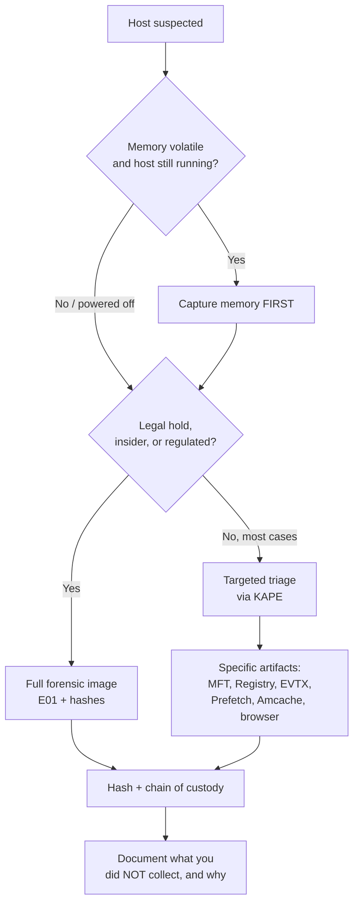
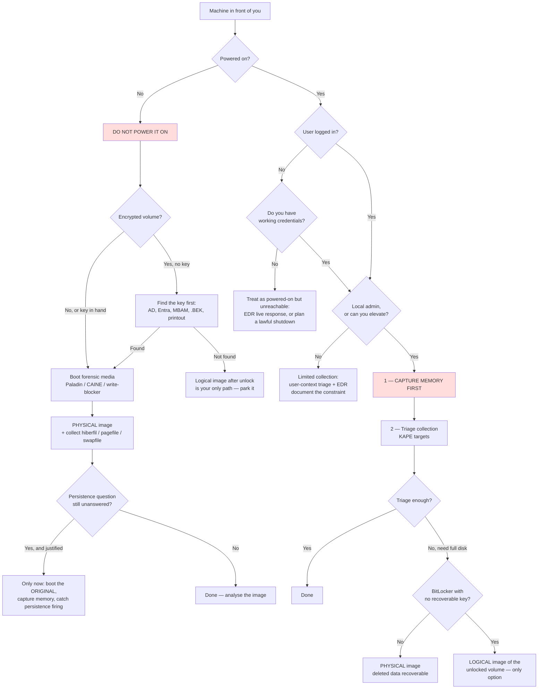

# Chapter 3 — Digital Forensics and Advanced Data Triage

> **Reader note:** This chapter covers triage decisions — full image vs. targeted collection, memory acquisition timing, host prioritization across an incident. It's the last of the three foundational chapters before the artifact-level material starts in Chapter 4. Readers who already make these decisions routinely can skim 3.1–3.3 and focus on 3.4 (designing a defensible triage strategy), 3.5 (encrypted volumes), and 3.6 (shadow copies).
>
> **If a machine is in front of you right now, go straight to §3.7.** It collapses this entire chapter into a single decision tree — powered on or off, logged in or not, admin or not, encrypted or not — and tells you what to acquire in what order. The rest of the chapter is the reasoning behind it.

## Chapter Overview

One of the hardest decisions at the collection stage is how much evidence to collect, from which systems, in what order, and under what constraints. Whether evidence matters is no longer in question by then.

Traditional forensic practice often treats the full disk image as the gold standard. That standard still matters in incident response, but it cannot always be the default. Enterprise systems are large, incidents often involve multiple hosts, storage is limited, and responders are outnumbered. Volatile evidence disappears while the team debates completeness. A collection strategy that is perfect in theory but unrealistic in operation can do real damage in a live incident.

This chapter introduces advanced data triage as a practical forensic discipline. It explains the tradeoff between full imaging and targeted triage and outlines disk imaging basics for incident response. It covers why memory acquisition matters and shows how to build a triage strategy that is both operationally practical and forensically defensible. The goal is not to lower standards. It is to collect deliberately, preserve what matters most, and document the reasoning well enough that the decisions still make sense later.

The central theme of this chapter is that collection depth is a judgment call. Good responders do not collect less because they are careless. They collect proportionately, based on value, volatility, investigative need, and risk.

## Learning Objectives

By the end of this chapter, you should be able to:

* Explain the operational tradeoffs between full disk imaging and targeted triage
* Identify when full imaging is justified in a Windows incident response context
* Describe how and when memory acquisition should be prioritized
* Define a practical minimum triage package for a Windows host
* Plan and document defensible disk and memory acquisition workflows
* Explain why original evidence must be preserved separately from working copies
* Build a host-prioritization strategy across multiple systems during a live incident
* Document constraints, limitations, and residual risk in a way that strengthens defensibility
* Communicate triage decisions clearly to management, legal reviewers, and other responders
* Detect BitLocker before acquisition, identify which state the volume is in, and locate the recovery key
* Enumerate, mount, and collect from Volume Shadow Copies, and recognize what their absence implies

---

## 3.1 Full Images vs. Targeted Triage

One of the first collection decisions in a Windows incident is whether a host gets a full disk image, targeted triage, memory capture, or some combination of those.

Full disk imaging was historically the default forensic response, and for understandable reasons. A full image preserves the broadest possible evidence set and supports deep re-analysis. It lets investigators examine deleted files, slack space, unallocated space, and artifacts that did not seem important at collection time.

In incident response, however, the operational environment changes the calculation.

### 3.1.1 Why Full Imaging Is Not Always Realistic

Several constraints make full imaging difficult to use as a default in active IR:

* enterprise systems are often measured in terabytes rather than gigabytes,
* imaging can take hours,
* collection storage may be limited,
* incidents may involve many hosts at once,
* and volatile evidence may be lost while a responder is occupied preserving one disk in full.

Imaging every suspicious system immediately may sound thorough. In practice it can consume responder time, delay scoping, and increase the chance that more time-sensitive evidence on other hosts disappears.

Full imaging is not obsolete, but the decision to image must be justified rather than automatic.

### 3.1.2 What Full Imaging Preserves

A full disk image is valuable because it captures much more than the artifacts a responder happens to think about during the first few hours of an incident.

Depending on the imaging method and system state, a full image can preserve:

* deleted files and attacker tooling remnants,
* unallocated space,
* slack space,
* alternate data streams,
* broader file system metadata,
* artifacts not included in a triage set,
* and a larger evidence base for future peer review, legal proceedings, or re-analysis.

That preservation value matters most when the host is high-value, legally sensitive, central to attacker activity, or likely to need deep reconstruction later.

### 3.1.3 What Targeted Triage Provides

Targeted triage is often the better operational first move when responders need answers quickly across several hosts.

Instead of preserving everything, triage focuses on the artifacts most likely to answer the current incident response questions. These commonly include:

* MFT and USN-related file activity,
* registry hives,
* key event logs,
* Prefetch,
* Amcache,
* SRUM,
* shell artifacts,
* browser history,
* scheduled tasks and services,
* user profile artifacts,
* and a memory capture where volatile evidence matters.

A well-designed triage package is a focused collection set tied to specific investigative goals. What it leaves out, it leaves out deliberately, not by accident.

### 3.1.4 Triage First, Full Image Where Justified

In many Windows IR cases, the most practical model is triage first, full image where justified.

The team often needs to answer urgent questions before it needs to preserve every possible artifact. If the host later proves legally significant, strategically important, or richer than initial telemetry suggested, the responder can escalate to deeper preservation.

Document why that escalation did or did not occur.

### 3.1.5 Collection Depth Is a Risk Decision

Choosing between imaging and triage is a risk decision, not just a technical preference.

A full image reduces the risk of missing something later, but increases collection time, storage burden, and opportunity cost elsewhere. A triage package speeds scope assessment and scales better across many systems, but accepts the risk that some later-useful artifacts may not be preserved.

Make that tradeoff deliberately, not by habit.

---

## 3.2 Disk Imaging Basics in an IR Context

When a full image is justified, treat it as a preservation activity that requires method and documentation, not as a casual file copy.

### 3.2.1 When a Full Image Is Justified

A Windows system is more likely to justify full disk imaging when one or more of the following are true:

* the system is high-value or business-critical,
* legal or regulatory preservation is likely,
* attacker tooling appears to have been deleted,
* broad re-analysis may be needed later,
* the incident may lead to contractual disputes or external review,
* or the system appears central to the attacker’s persistence, privilege abuse, or lateral movement.

A domain controller, finance server, sensitive application server, or endpoint tied to possible data exposure may all fall into this category depending on the case.

### 3.2.2 Core Imaging Principles

Several practices matter from the moment you take a full image.

**Use a write blocker where feasible.** In some environments and acquisition models this is straightforward. In others, especially live servers, it may not be possible. If you do not use a write blocker, document the reason rather than ignoring it.

**Identify the correct source device before imaging begins.** Imaging the wrong disk is both an operational and evidentiary failure. Record device identifiers, serial numbers, interface type, and relevant metadata up front.

**Document tool, version, and output format.** Whether you capture the image with FTK Imager, dc3dd, or another tool, the details matter because trust depends on reproducibility.

**Record hashes and verify them.** Hashing is not a postscript. It is part of integrity control from the moment of acquisition.

**Preserve the original, analyze a copy.** The original image is ground truth. Store it accordingly.

### 3.2.3 What Must Be Documented

A defensible imaging record should include at minimum:

* case reference,
* hostname,
* acquisition date and time in UTC,
* who performed the acquisition,
* who authorized it,
* source device description,
* source device serial or identifier,
* source interface,
* write blocker use or non-use,
* imaging tool and version,
* output format,
* destination path,
* image file name or segmented file names,
* hash algorithm,
* hash values,
* and any errors, interruptions, or notes.

Without this information, the image becomes much harder to trust later.

### 3.2.4 Hashing and Verification

Hash a full image as part of acquisition, then verify it independently where possible.

Hash every relevant image file, whether that means a single raw image or a segmented evidence file set. Store the results in the case record, and ideally in a separate hash record, rather than only inside tool output.

Independent verification matters because it reduces reliance on a single tool-generated assertion. Even if the imaging tool reports a hash, a separate validation step strengthens defensibility.

### 3.2.5 Originals and Working Copies

The original image is not the one you analyze. That rule is basic but critical.

Store the original in a controlled location, write-protected or logically protected as appropriate, and use it only to produce verified working copies. Skipping this separation under time pressure increases the chance of accidental modification, confusion about provenance, and later disputes about what changed when.

### 3.2.6 Imaging in Operational Reality

In live incident response, imaging is an operational decision as well as a forensic one.

A maintenance window may be required. Storage may be tight. Business owners may be reluctant to take a system offline. Responders may need to choose between imaging one system fully and collecting minimal viable evidence from several others before the business day accelerates.

Document each imaging decision as a reasoned choice rather than treating it as self-evidently correct.

---

## 3.3 Memory Acquisition Basics

Disk artifacts are essential, but memory is often the most fragile and time-sensitive source of evidence in a Windows incident.

### 3.3.1 Why Memory Matters

A reboot, shutdown, crash, containment action, or even a modest delay can permanently destroy volatile evidence that never existed on disk in a useful way.

Memory may contain:

* running processes and their state,
* full command-line arguments,
* injected code,
* fileless malware,
* active or recent network socket state,
* PowerShell remnants,
* decrypted content,
* logon sessions, tokens, or credentials,
* clipboard or console history,
* and references to files, registry keys, or named pipes.

If the responder suspects web shells, short-lived PowerShell execution, in-memory beacons, process injection, or other transient activity, memory often becomes the highest-value collection target.

### 3.3.2 Capture Before Shutdown or Remediation

If memory matters, capture it before shutting the system down. That is one of the simplest and most important memory acquisition rules.

Containment, reboot, reimage, service restart, or even an unplanned crash can remove the best evidence available. Memory does not have to come first in every case, but the decision to skip or defer it should be conscious and documented.

### 3.3.3 Memory Acquisition Tools and Approaches

Common Windows memory acquisition approaches include tools such as WinPmem, DumpIt, FTK Imager, and some EDR live response capabilities. The best choice depends on the environment, the responder’s tooling, operational convenience, and the need to minimize disruption.

The choice does not need to be universally optimal. It needs to be practical, well-documented, and appropriate to the case.

### 3.3.4 Pagefile and Hibernation Files

Memory-related evidence is not limited to the live RAM capture.

Where practical, also consider collecting `pagefile.sys` and `hiberfil.sys`. These files may contain memory-resident content that was paged out or preserved from earlier system states. They do not replace a live memory image, but they can strengthen volatile evidence coverage.

### 3.3.5 Operational Risks of Live Collection

Live memory collection is valuable, but it is not consequence-free.

Potential risks include:

* changes to running system state,
* temporary performance impact,
* large output files,
* tool failure,
* possible instability on sensitive production hosts,
* and the reality that not all captured memory content will be easily interpretable.

These risks do not make memory capture indefensible, but they make documentation and planning more important.

### 3.3.6 What Must Be Recorded

A defensible memory acquisition note should record:

* case reference,
* hostname,
* collection time in UTC,
* the reason for the capture,
* who authorized it,
* current system status,
* tool and version,
* exact command or method,
* output file name and location,
* approximate file size,
* hash algorithm and value,
* whether pagefile or hibernation files were collected,
* any warnings or errors,
* and the next planned collection step.

The exact command matters here for the same reason it matters in disk imaging: trust depends on being able to reconstruct what was done, not just what the analyst remembers doing.

### 3.3.7 Memory and Disk Complement Each Other

Memory is valuable, but it does not replace disk evidence.

Disk artifacts often preserve the broader history of a system: event logs, registry hives, file metadata, shell artifacts, persistent autoruns, browser history, installation traces, and evidence that predates the short live collection window.

The strongest investigations correlate volatile and persistent sources rather than relying on either in isolation.

---

## 3.4 Designing a Defensible Triage Strategy



*Figure 3.1 — A defensible triage decision tree. The "what you didn't collect, and why" footnote at the end is the single most overlooked artifact in real engagements.*


Advanced data triage means making collection decisions that still make sense when someone reviews them later. That reviewer may be another responder, a manager, legal counsel, or an auditor who was not there when the clock was running. Collecting artifacts quickly is only part of the job.

> **From the field — illustrative composite.** A regional retail incident: the EDR flagged 40 endpoints over a long weekend, the responder team was small, and the CISO wanted "everything imaged, just in case." Imaging 40 endpoints would have taken the team through Wednesday, giving the live attacker three more days. The responders built a triage matrix instead. Two high-value hosts (an admin workstation and a DC) got full disk and memory. Another 35 got KAPE artifact collections only. The last three got nothing, because their EDR alerts turned out to be a known false-positive pattern. The investigation closed in 32 hours instead of 6 days. What protected the team afterward was not the timeline but the *triage decision memo*, which documented exactly why the team chose each tier. When asked six months later why the other 38 hosts weren't imaged, the team pointed at the memo.

### 3.4.1 What Makes a Triage Strategy Defensible

A defensible triage strategy lets a later reviewer answer five basic questions:

* What was known at the time?
* What questions was the team trying to answer first?
* Why were some hosts prioritized over others?
* What operational constraints influenced the plan?
* What limitations or residual risks remained after collection?

Defensible does not mean perfect. It means reasonable, documented, and proportionate to the available facts.

### 3.4.2 Prioritizing Hosts

When several Windows systems may be involved, evaluate each host across several dimensions rather than treating all systems equally.

Important factors include:

* business criticality,
* likelihood of relevant evidence,
* volatility risk,
* scope value,
* operational disruption risk,
* and legal preservation value.

A domain controller, VPN gateway, finance workstation, engineering file server, and print server may all sit in the same incident but deserve very different collection depth and timing.

### 3.4.3 Collection Tiers

A scalable triage strategy benefits from defined collection tiers.

A basic model may include:

**Tier 1** for fast scoping and minimum viable collection on hosts that need quick answers.

**Tier 2** for broader targeted triage on hosts with stronger compromise indicators or higher investigative value.

**Tier 3** for deep preservation, including full imaging or extended collection, on systems where the value justifies the cost.

Tiers exist for consistency, not bureaucracy. They let teams scale across many systems while still explaining why one host received full preservation and another received focused triage.

### 3.4.4 Constraints Shape Reasonable Decisions

Staffing, storage, leadership deadlines, business disruption concerns, and legal preservation requirements all shape what is reasonable. Responders do not operate in a vacuum.

Document those constraints explicitly.

A note that simply says collection was postponed is weak. A note that says a server was deferred because two higher-priority hosts were competing for limited responders and same-day scope visibility is much stronger. The technical decision matters, and so does the context that produced it.

### 3.4.5 Residual Risk and Limitations

A triage plan that pretends to answer everything is less credible than one that states its limitations clearly.

Examples of residual risk include:

* some hosts not receiving deep collection immediately,
* volatile evidence being lost before collection reaches lower-priority systems,
* same-day scope updates relying on partial data,
* deferred systems later proving more important than current indicators suggest,
* and triage packages failing to preserve older or less obvious artifacts outside the collection set.

Acknowledging those limitations strengthens the plan rather than weakening it. It shows the team understands what the current strategy can and cannot support.

### 3.4.6 Dynamic Revision

A good triage strategy is not static. Revise the plan as new facts arrive.

A host previously considered low priority may move to the top of the list if new authentication evidence, large-scale file access, suspicious macro execution, or VPN activity shifts the case. That is disciplined adaptation, not inconsistency.

Tie each revision to a specific triggering fact and record it with a timestamp.

### 3.4.7 Triage Notes and Review Points

A written triage strategy note is one of the best ways to preserve early reasoning.

A useful note should summarize:

* known hosts and their initial assessment,
* the primary triage objectives,
* host priorities,
* collection tiers,
* operational constraints,
* residual risks,
* escalation conditions,
* and the next review point.

That note becomes the bridge between planning and execution.

---

## 3.5 BitLocker and Encrypted Volumes

Full-volume encryption stopped being an edge case some time ago. BitLocker ships enabled on many OEM Windows 11 devices, Entra-joined machines encrypt themselves automatically, and most organizations with a compliance obligation push it by policy. A meaningful fraction of the hosts you are asked to acquire will be encrypted. The question is not what to do in the exotic case but what to do this afternoon.

An encrypted volume does not stop you from imaging. It stops you from *reading* the image. A locked BitLocker volume acquires perfectly. The imaging tool runs to completion, the hashes verify, the chain of custody is clean, and the evidence file contains nothing but ciphertext. Discovering that a week later, after the host has been wiped and handed back to the business, is one of the more painful ways to lose a case.

### 3.5.1 Detecting Encryption Before You Image

On a running system, the fastest check is `manage-bde`, run from an elevated prompt:

```
manage-bde -status
```

The output lists every volume with four fields that matter to a responder: Conversion Status (fully encrypted, fully decrypted, encryption in progress), Percentage Encrypted, Protection Status (Protection On or Protection Off), and Lock Status (Locked or Unlocked). The PowerShell equivalent is `Get-BitLockerVolume`, which returns the same information as objects you can log.

Offline, the signal is in the volume boot record. A normal NTFS volume begins with the OEM identifier `NTFS    `. A BitLocker volume begins with `-FVE-FS-` and carries FVE metadata blocks instead of a usable `$MFT`. That is why some tools show an encrypted volume as broken rather than encrypted. In FTK Imager, adding the physical drive as an evidence item shows the partition table normally. The encrypted partition, though, appears without a recognizable file system — no `[root]` node, no `$MFT`, sometimes labelled as an unrecognized or "Discovered Partition". Newer FTK Imager builds detect the FVE signature and prompt for BitLocker credentials rather than showing nothing.

Enumerate the key protectors before you touch anything else:

```
manage-bde -protectors -get C:
```

The output tells you *how* the volume can be unlocked: TPM, TPM + PIN, password, external key (a `.BEK` file), or a numerical password (the 48-digit recovery key). Critically, it also prints the **Numerical Password ID**, a GUID that identifies which escrowed recovery key belongs to this volume. Hand that GUID to the identity team. It is how they find the right key among the thousands in a directory.

> **Why this matters:** Running `manage-bde -status` takes four seconds and belongs in your live-response script ahead of the memory capture, not after it. The answer changes the entire acquisition plan for the host, and it is only cheaply available while the machine is still running.

### 3.5.2 The Three States You Will Find

Encrypted hosts arrive in one of three conditions. Each is a different acquisition problem, not a variation on a theme.

**Unlocked and live.** The host is running, someone is signed in, and the volume is mounted in the clear. Protection Status is On, Lock Status is Unlocked. Everything the operating system can see, you can see. This state ends the moment the machine loses power.

**Locked.** The host is powered off, or the volume is a secondary disk that was never unlocked this boot. Protection Status is On, Lock Status is Locked. You can image it, and you will get a byte-perfect copy of ciphertext. Nothing in it is readable until you produce a key protector.

**Suspended.** Protection Status is Off but the volume is still encrypted. Administrators suspend protection before a firmware update. When they do, BitLocker writes a **clear key** into the volume metadata so the disk unlocks itself without the TPM. For acquisition purposes, a suspended volume behaves almost like an unencrypted one, but only until protection is resumed or the suspend counter expires.

| State you found it in | What you can still get | What you lose by waiting |
|---|---|---|
| **Unlocked and live** | Memory image (including a recoverable FVEK), full triage collection through the running OS, a decrypted logical image, live registry and hive access, and the ability to read the volume without any key at all | Everything. Power off without a key protector in hand and the volume reverts to ciphertext. The FVEK in RAM is gone within seconds |
| **Locked** | A physical image of ciphertext — forensically sound, currently unreadable — plus whatever the escrow systems hold | Little forensically (ciphertext does not decay) but a great deal operationally: computer objects get deleted from AD during cleanup, tenant records get purged, and unmanaged or personal devices may never have escrowed a key at all |
| **Suspended** | A readable image, because the clear key travels with the volume | The clear key, the moment an administrator or a scripted maintenance job runs `manage-bde -protectors -enable` or the reboot counter expires |

### 3.5.3 Where the Recovery Key Lives

The recovery key is a 48-digit numerical password. In a managed environment it is almost always escrowed somewhere. The work is knowing where, and asking the right team quickly.

| Escrow location | How to retrieve it |
|---|---|
| **Active Directory** | Recovery information is stored as `msFVE-RecoveryInformation` child objects of the computer object. Retrievable through the BitLocker Recovery tab in Active Directory Users and Computers, or with `Get-ADObject -SearchBase "<computerDN>" -Filter {objectClass -eq 'msFVE-RecoveryInformation'} -Properties msFVE-RecoveryPassword` |
| **Entra ID / Intune** | Keys escrowed by Entra-joined and Intune-managed devices appear under the device object in the Entra admin center, or through the Microsoft Graph BitLocker recovery key API |
| **MBAM or Configuration Manager** | Older estates escrow to the MBAM recovery database or the Configuration Manager BitLocker management database, usually surfaced through a helpdesk self-service portal |
| **Printed or saved to a file** | Users are prompted to save or print the key at enablement. It may be in a ticket, a password manager, a network share, or a filing cabinet |
| **USB escrow / `.BEK` file** | An external key protector is a hidden `.BEK` file on removable media. If the device that unlocks the disk is sitting next to the disk, seize both |

Match the Numerical Password ID from `manage-bde -protectors -get` against the escrowed record. Directories routinely hold several recovery entries per machine — one per re-encryption event — and using the wrong one wastes an hour.

Treat recovery keys as sensitive material in their own right. Record in the case file *where* the key came from and *who authorized* its release. There is rarely a reason to paste the key itself into a report body.

### 3.5.4 Unlocking for Analysis

Once you have a key, unlocking is straightforward. Do it against a working copy rather than the original.

**Arsenal Image Mounter** has the most complete BitLocker support of the common mounting tools. It accepts a recovery password or a `.BEK` file when mounting an image. It then presents the decrypted volume to Windows as a normal disk, which any downstream parser can read.

**FTK Imager** prompts for BitLocker credentials when it detects an FVE volume in an added evidence item. It can then export the logical file system or produce a decrypted image.

**`manage-bde -unlock D: -RecoveryPassword <48-digit-key>`** works on a Windows analysis host against an attached working copy. It is normally all you need: the volume becomes readable for the current session without altering the encryption state.

Do **not** reach for `manage-bde -off` unless you specifically want it. It starts a full decryption of every sector on the volume, which takes hours and permanently changes the working copy. Unlocking is enough for analysis.

Use either deliberately. Unlocking writes to the volume metadata, so it belongs on a copy, never on original media behind a write blocker.

**`dislocker`** is the standard approach on a Linux or SIFT analysis workstation. It presents the decrypted volume as a virtual file that you can then loop-mount read-only:

```
dislocker -r -V /dev/sdb2 -p<recovery-password> -- /mnt/dislocker
mount -o ro,loop /mnt/dislocker/dislocker-file /mnt/ntfs
```

Commercial options such as Passware Kit Forensic and Elcomsoft Forensic Disk Decryptor add attack and key-extraction capability where no escrowed key exists. Whatever the route, document the tool, the version, the key protector type used, and the hash of both the encrypted source and the decrypted output.

### 3.5.5 The Live-Response Implication: Capture Memory First

**If the host is running and the volume is unlocked, capture memory before you do anything that risks the power state.** That is the single most important operational rule in this section.

While a BitLocker volume is mounted, the **Full Volume Encryption Key (FVEK)** is resident in kernel memory. The FVEK is the symmetric key that actually decrypts the data. Tools built for that purpose may recover the FVEK later from a memory image taken at that moment. If the escrow search comes back empty, that memory capture can be what unlocks the disk image weeks afterwards. `hiberfil.sys` can occasionally serve the same purpose for a hibernated system.

The moment the machine powers off, that key is gone. Suppose no recovery key is escrowed, no `.BEK` file exists, and the TPM refuses to release the volume master key because the boot configuration changed. Then a machine that was fully readable at 09:00 becomes a permanently opaque block of ciphertext at 09:01.

The practical live-response order for an encrypted host is therefore:

1. Run `manage-bde -status` and `manage-bde -protectors -get` and save the output.
2. Capture memory.
3. Request the recovery key from escrow, using the Numerical Password ID, in parallel with the rest of the work.
4. Collect the triage package through the running (decrypted) file system — this is plaintext and it is available right now.
5. Only then consider a full physical image, shutdown, or containment action.

> **Why this matters:** Encryption inverts the usual triage calculus. Ordinarily a full physical image is the most complete option and a live triage collection is the compromise. On a live, unlocked, encrypted host with no escrowed key, the live triage collection is the *only* option that produces readable evidence. The physical image is the one that produces nothing. Steps 2 and 4 above are irreversible-by-omission: there is no going back for them later.

Record the encryption state in the acquisition note alongside the usual fields. Include protection status, lock status, protector types, the Numerical Password ID, whether a key was obtained and from where, and whether the image was acquired encrypted or decrypted. A reviewer looking at a physical image that will not mount needs to see in the record that the responder knew why.

---

## 3.6 Volume Shadow Copies as an Analysis Target

Shadow copies are more than a retention consideration (see Chapter 5 §5.1.5). They are a **place to look**. The Volume Shadow Copy Service (VSS) periodically snapshots a volume. Each snapshot is a point-in-time view of the file system as it existed before the attacker did whatever they did. An investigation that skips shadow copies routinely concludes that evidence "was deleted" when a copy of it is sitting on the same disk the team already imaged.

### 3.6.1 What a Snapshot Preserves

A VSS snapshot is a block-level, copy-on-write view of the volume. It is not a backup and it is not a file copy. It stores the original contents of blocks that have changed since the snapshot was taken. That design makes snapshots cheap to create, and it is why they get discarded as the difference area fills.

That gives an investigator a genuine prior state of the volume, including:

* **Historical registry hives** — a `SOFTWARE` or `NTUSER.DAT` from before the attacker touched it, with the persistence value still present
* **Prior versions of files** — a document as it existed before it was modified, encrypted, or overwritten
* **Files that have since been deleted** — still allocated, still complete, inside the snapshot
* **Pre-cleanup state** — event logs before they were cleared, scheduled task XML before it was removed, `Startup` folder contents before they were tidied up
* **Prior `$MFT` and journal state** — with entries that have since been reused or wrapped out on the live volume

Snapshot creation is not evenly spaced. Windows creates them around system restore points, Windows Update installs, and some backup and installer operations. On a typical workstation you may find three or four. On a server with deliberate shadow storage sizing, you may find considerably more. Enumerate rather than assume.

### 3.6.2 Enumerating Snapshots

On a live system, from an elevated prompt:

```
vssadmin list shadows
```

For each snapshot, the output gives a creation time, a shadow copy ID, the originating volume, and the **Shadow Copy Volume Name**. That last field is the one you actually need. It looks like `\\?\GLOBALROOT\Device\HarddiskVolumeShadowCopy1`. `vssadmin list shadowstorage` shows how much space is allocated to the difference area, which tells you how much history the volume can hold.

The PowerShell equivalent is scriptable and easier to log:

```
Get-CimInstance -ClassName Win32_ShadowCopy |
    Select-Object ID, InstallDate, VolumeName, DeviceObject |
    Sort-Object InstallDate
```

Against an acquired image rather than a live host, the mounting tool does the enumeration. Arsenal Image Mounter lists the snapshots it finds inside a mounted image, and `vshadow -q` performs the same query on a system where the volume has been attached.

### 3.6.3 Mounting a Snapshot for Analysis

A snapshot device path is not directly browsable, but a directory symbolic link makes it so. From an elevated prompt:

```
mklink /d C:\vss1 \\?\GLOBALROOT\Device\HarddiskVolumeShadowCopy1\
```

The trailing backslash is mandatory. Without it, the link is created but resolves to nothing, a five-minute mistake that most responders make exactly once. `C:\vss1` then behaves like a read-only copy of the volume as it was at snapshot time. You can point every tool in the kit at it directly: KAPE, MFTECmd, RECmd, `robocopy`, a hashing script.

Three approaches cover most situations:

| Approach | Use it when |
|---|---|
| `mklink /d` against a `\\?\GLOBALROOT\...` path | You are on the live host, or on an analysis box with the evidence volume attached, and want to run existing tools against a snapshot with no extra software |
| **Arsenal Image Mounter** | You have an image file (E01, raw, VHD) and want the snapshots inside it surfaced as mountable volumes. It handles both the image format and the VSS layer, including on BitLocker-decrypted volumes |
| **`vshadow`** (from the Windows SDK) | You need to create, expose, or script snapshot operations, including exposing a snapshot to a drive letter (`vshadow -el=...`) |

The Sleuth Kit and libvshadow-based tooling provide the same capability on a Linux analysis host, mounting snapshot volumes from an image without a Windows system in the loop.

Whichever route you take, collect from the snapshot the same way you would collect from a live volume: targeted triage, hashed, documented. Record which snapshot each artifact came from, by ID and creation time. An artifact whose provenance is "a shadow copy, I think the second one" is worth much less than one labelled with the snapshot ID and its creation timestamp.

### 3.6.4 The Forensic Payoff

Snapshots hand back evidence that cleanup removed from the live volume. Three cases show the value.

An attacker establishes persistence with a `Run` key on Monday, operates for three days, and deletes the key on Thursday during cleanup. The live `SOFTWARE` hive shows nothing. A snapshot taken Tuesday night contains the hive with the value intact, its last-write time, and the path to a binary that no longer exists on the live file system. The finding goes from "we believe there was persistence" to "here is the persistence mechanism, its configuration, and when it was created".

A user copies a sensitive spreadsheet into a staging folder on Tuesday and deletes it on Wednesday before the laptop is collected. Monday's snapshot does not have it. Tuesday's evening snapshot does, and not just the MFT record: the actual file, in full, recoverable and hashable.

An event log is cleared at 02:14. The snapshot from the previous evening contains the pre-clearing `Security.evtx`, with the entries the attacker was trying to remove.

> **Why this matters:** Snapshots are the closest thing Windows offers to a time machine, and they are free: no extra collection at the endpoint, no additional legal process, no vendor. The only cost is remembering to look. Add "enumerate shadow copies" to the triage checklist for any host where prior state matters. Add "collect from the most relevant snapshot" as a Tier 2 collection step in the tiering model from 3.4.3.

### 3.6.5 The Absence of Snapshots Is Itself Evidence

Shadow copy deletion is the anti-forensic counterpart, and it is one of the most reliable early indicators in the business.

```
vssadmin delete shadows /all /quiet
```

That command, or one of its equivalents, is a near-universal precursor to ransomware encryption. The equivalents include `wmic shadowcopy delete`, `Get-WmiObject Win32_Shadowcopy | Remove-WmiObject`, and resizing shadow storage to a value so small that Windows silently discards every existing snapshot. Attackers run it to remove the victim's ability to roll back, usually within minutes of the encryption routine starting. It is frequently paired with `bcdedit /set {default} recoveryenabled No` and `wbadmin delete catalog -quiet`.

For a responder, this produces two useful signals:

* **A record of the command.** Security event ID 4688 with command-line auditing enabled, Sysmon event ID 1, PowerShell script block logs, or EDR process telemetry shows `vssadmin.exe` or `wmic.exe` invoked with deletion arguments. The record ties the invocation to a specific account, a specific time, and a parent process. That parent process is often the first solid pointer at the encryptor itself.
* **The state itself.** A production Windows host with system protection enabled and zero shadow copies is anomalous. Absence is not proof. Snapshots also age out naturally, and some administrators disable VSS deliberately. But on a host where `vssadmin list shadowstorage` shows an allocated difference area and `vssadmin list shadows` returns nothing, something removed them. Finding out what is a priority.

Chapter 12 develops this in the ransomware context, where shadow copy destruction sits inside a wider pattern of pre-encryption preparation. For triage, the rule is simple. Enumerate snapshots early, because the answer is informative whether it is a list or an empty one. If the list is non-empty, collect from it before something else deletes it.

---

## 3.7 The Acquisition Decision Tree

This section collapses the whole chapter into one decision. The earlier sections treat each consideration separately: full image versus triage, when memory matters, what BitLocker does to your options, whether snapshots exist. In a real engagement you do not get to consider them separately. You walk up to a machine, or someone hands you a laptop in a bag. You have to decide what to do with it in the next few minutes, in an order that does not destroy the thing you needed.

Work the tree top to bottom.



*Figure 3.2 — The acquisition decision tree. The two red nodes are the ones that cost you evidence if you get them wrong: capture memory before anything else on a live host, and never power on a machine you were handed powered off.*

### 3.7.1 Powered On, Logged In, With Admin — Memory First, Always

This is the best case and the one with the tightest clock. The order is not negotiable:

1. **Memory.** WinPmem, DumpIt, FTK Imager, or your EDR's live-response capture. Everything else on the host will still be there in 20 minutes. The contents of RAM will not.
2. **Triage collection.** KAPE with a targeted set. This gets you MFT, USN, registry hives, event logs, Prefetch, Amcache, ShimCache, browser data, and the rest in minutes rather than hours.
3. **Full disk image, if the triage did not answer the question.** Escalate deliberately, and record why.

Memory goes first because it is the only artifact where *your own actions* are the main threat to it. It is not first because it is the most valuable artifact. Often it is not. Running a triage collection changes memory. Plugging in a USB drive changes memory. Every minute the host stays up, memory turns over. Disk artifacts are comparatively patient.

> **Why this matters:** If the volume is BitLocker-encrypted and currently unlocked, memory capture is doubly urgent, because the FVEK may be recoverable from RAM (§3.5.5). Lose the running state and you may lose access to the disk entirely.

### 3.7.2 Powered On Without Admin

If you are logged in as a standard user and cannot elevate, say so in your notes and collect what you can. A user-context triage still yields that user's `NTUSER.DAT`, their Recent folder, their Jump Lists, and their browser data. What you will not get is a raw memory image, the SYSTEM and SECURITY hives, other users' profiles, or `$MFT` at the volume level.

There are usually two ways forward. One is an EDR platform's live-response console, which runs with SYSTEM privileges regardless of who is at the keyboard. The other is getting an administrator credential through the proper channel. Do not attempt privilege escalation on a production host to get around an authorization gap. That is a policy problem, not a technical one, and Chapter 1's authorization discussion applies.

### 3.7.3 Powered Off — Do Not Power It On

A machine handed to you powered off should stay powered off. Booting it costs you evidence immediately and irreversibly:

- **`RunOnce` keys execute and delete themselves.** A persistence mechanism configured to run exactly once will fire, remove its own registry value, and leave you with a gap you cannot recover.
- **Prefetch and Amcache take new writes**, pushing older entries down or out. ShimCache is not written at boot. Windows holds it in kernel memory during the session and flushes it to the registry at clean shutdown (Chapter 6 §6.3.3). That is no comfort: boot the machine and you have started a session that will overwrite the cached entries when it ends.
- **Event logs record the boot**, and on a busy log with a small `MaxSize` that can roll older records off the end.
- **Timestamps move.** Last-access times, registry `LastWriteTime` values, and `$SI` modified times all shift.
- **Scheduled tasks with boot triggers run**, which on a compromised host may mean the attacker's tooling re-executes and changes the disk under you.

Image it with forensic boot media instead — [Paladin](https://sumuri.com/software/paladin/), CAINE, or a hardware write-blocker with your imaging tool of choice. The disk never mounts read-write and nothing on it changes.

**Check for encryption before you start**, not after. §3.5.1 covers detection. In short, a BitLocker volume presents an `-FVE-FS-` boot record where an unencrypted NTFS volume reads `NTFS␣␣␣␣`. A forensic boot environment shows you an unreadable volume rather than a file system. If it is encrypted and you do not have the key, stop and find the key. The imaging decision downstream depends entirely on that answer.

### 3.7.4 "Powered Off" Might Still Have Memory In It

A powered-off machine can still hold memory evidence. Beginners get this part wrong, so internalise it before you ever touch one.

Memory on modern Windows is less volatile than the old teaching suggests, for two separate reasons:

**Fast Startup means "shut down" often is not.** Since Windows 8, the default shutdown behaviour is a *hybrid shutdown*: user sessions are closed, but the kernel session is hibernated to `hiberfil.sys` rather than discarded. A machine a user "turned off" last night may be carrying a compressed image of kernel memory on disk, waiting for you. That image holds loaded drivers, kernel structures, and often a good deal more. Look for `hiberfil.sys` and check its size and timestamp.

**Paged-out memory persists on disk regardless.** `pagefile.sys`, `swapfile.sys`, and `hiberfil.sys` are all part of the disk image you are about to take. They routinely contain fragments of process memory that were paged out while the system was running: strings, command lines, decrypted configuration, sometimes credentials. They are not a substitute for a live RAM capture, which has structure a page file does not. But they are a genuine second source, and they survive shutdown.

**Collect all three files explicitly**, and check whether hibernation is enabled before concluding that memory is unavailable. A hibernation file is compressed and is not a raw memory image. Recent Volatility 3 releases include a hibernation layer that reads one directly, but older releases do not, and support elsewhere is uneven. Confirm your tool version handles it, or convert the file first with `Hibr2Bin` and analyse the converted image.

### 3.7.5 The Justified Exception: Booting to Catch Persistence

Booting a powered-off evidence machine is defensible in one circumstance, and only under conditions.

That circumstance is a persistence question the disk image left unanswered. You can see a suspicious `Run` value, a service, a scheduled task, or a WMI subscription, but you cannot tell what it actually does. Booting the machine in a controlled environment makes the persistence fire. A memory capture taken at that moment shows you the result: the process it launches, the code it injects, the configuration it decrypts, the network destination it reaches for.

That capture will **not** give you the attacker's prior interactive session or any volatile state from before the shutdown. Those are gone. What you get is a demonstration that the persistence mechanism works and an observation of what it does when it runs. That is a genuine finding: *"the scheduled task `WindowsUpdateSync` executes `powershell.exe` with the following encoded command and beacons to X"* is far stronger than *"a suspicious scheduled task exists"*. But describe it as what it is.

The conditions:

1. **Image first.** The pristine physical image is taken and hash-verified before the original is powered on. Non-negotiable.
2. **Isolate the network,** or use a controlled sinkhole. Do not let the implant reach live infrastructure.
3. **Prefer a copy.** Booting the *image* in a VM is safer than booting the original hardware, and is usually possible. Boot the original only where hardware dependencies or full-disk encryption make the VM route impractical.
4. **Document the decision, the justification, and the exact time of the boot**, so every artifact timestamp after that point is attributable to you rather than to the attacker.

This is an analysis step performed on evidence you have already preserved. It is not an acquisition step, and it should never be the reason a disk image was skipped.

### 3.7.6 Physical or Logical?

The last branch on the tree is what *kind* of image, and the default is straightforward.

| | Physical (bit-for-bit) | Logical (file-level / volume) |
|---|---|---|
| **What it captures** | Every sector: allocated files, unallocated space, slack, partition gaps, host-protected areas | Files the file system currently knows about |
| **Deleted data** | Recoverable — this is the whole point | Not recoverable |
| **Unallocated / slack** | Preserved | Lost |
| **Size** | Full disk capacity, even if mostly empty | Roughly the used space |
| **Works on locked BitLocker** | Yes, but the image is ciphertext and useless without the key | No — needs the volume unlocked |
| **When to choose it** | Default whenever a full image is justified | When physical is impossible or pointless |

**Take a physical image by default.** If a full image is warranted at all, the reason is usually that you need what triage cannot give you. The biggest single item in that category is deleted data, and a logical image throws it away.

The exception is encryption. A physical image of a locked BitLocker volume is a valid preservation of ciphertext, and it decrypts fine if you later obtain the recovery key. Take it if you have the storage. If the key is unrecoverable, though, that image is a large pile of noise. The only useful acquisition is then a **logical image taken after the volume is unlocked** on a running system. In that situation the live host is not merely the better option but the only one, which pushes the whole engagement back up to the left-hand branch of the tree.

> **Why this matters:** The sequence *powered off → no recovery key → nothing you can do* is one of the few genuinely unrecoverable positions in this book. It is also entirely preventable by a BitLocker escrow policy. When you write the lessons-learned (Chapter 13 §13.6), this is the finding that funds the fix.

---

## Chapter Summary

Advanced data triage in Windows incident response is the disciplined process of deciding how much evidence to collect, from which systems, and in what order, under real operational constraints. Full disk imaging remains valuable, especially for high-value systems, deep reconstruction, or legal preservation, but it is not always the right first move.

Targeted triage answers urgent incident response questions faster and at greater scale. It focuses on the artifacts most likely to explain active threat, execution, persistence, impact, and scope. Combined with memory capture where appropriate, it can produce a strong evidence set without the cost of full imaging every host immediately.

Disk imaging and memory acquisition both require careful documentation. Tool choice, versions, source identifiers, exact commands, hashes, output locations, and handling decisions all contribute to whether the resulting evidence will be trusted later.

A defensible triage strategy goes beyond technical collection choices. It documents host priorities, collection tiers, operational constraints, residual risk, and the reasons certain systems were escalated or deferred. It is also dynamic: the plan should adapt as new evidence arrives, and the team should document each revision.

Two volume-level realities complicate all of this and belong in every acquisition plan. Encryption is now routine, and a locked BitLocker volume images perfectly and reads as nothing. Detecting encryption with `manage-bde -status`, enumerating protectors, and locating the escrowed recovery key are therefore acquisition steps, not afterthoughts. On a live, unlocked, encrypted host, memory capture and live triage collection are the irreplaceable steps, because the FVEK and the plaintext view both disappear at power-off. Volume Shadow Copies work in the opposite direction. For the price of remembering to enumerate them, they hand back state the responder thought was lost: deleted files, pre-cleanup registry hives, event logs from before they were cleared. Their absence on a host that should have them is itself a finding.

In incident response, the question is rarely whether more data would be helpful. It is whether the team is collecting the right data at the right time, in a way that remains explainable afterward.

## Key Terms

**BitLocker:** The Microsoft full-volume encryption feature built into Windows, which renders a volume unreadable without a key protector even when the volume is imaged successfully.

**Fast Startup (Hybrid Shutdown):** The default Windows shutdown behaviour since Windows 8, which closes user sessions but hibernates the kernel session to `hiberfil.sys` rather than discarding it — meaning a machine that appears powered off may still hold a recoverable image of kernel memory.

**Forensic Boot Media:** A bootable environment such as Paladin or CAINE that starts a machine without mounting its internal storage read-write, allowing a powered-off host to be imaged without altering it.

**Logical Image:** A file-level acquisition capturing only the files the file system currently references, excluding unallocated space, slack, and deleted content.

**Physical Image:** A bit-for-bit acquisition of an entire storage device, including unallocated space, file slack, and partition gaps, from which deleted data may be recoverable.

**BitLocker Recovery Key:** A 48-digit numerical password that unlocks a BitLocker volume independently of the TPM, commonly escrowed to Active Directory, Entra ID, MBAM, or Configuration Manager.

**Clear Key:** A key protector written into the volume metadata when BitLocker protection is suspended, allowing the volume to unlock itself without the TPM until protection is resumed.

**Collection Tier:** A defined level of collection depth used to scale triage across multiple hosts.

**Defensible Triage:** A documented, proportionate, and reviewable triage strategy tied to available facts and constraints.

**Full Disk Image:** A broad preservation copy of a storage device intended to retain as much evidence as possible for later analysis.

**FVEK (Full Volume Encryption Key):** The symmetric key that actually encrypts and decrypts BitLocker volume data. It is resident in memory while the volume is unlocked and may be recoverable from a memory image.

**Hybrid Collection:** A mixed approach that combines memory, targeted triage, and full imaging based on host value and investigative need.

**Key Protector:** A mechanism that releases the BitLocker volume master key — TPM, TPM with PIN, password, external key (`.BEK`) file, or numerical recovery password.

**Memory Acquisition:** The live capture of volatile RAM content from a running system.

**Residual Risk:** The investigative uncertainty or exposure that remains after a chosen collection strategy is executed.

**Targeted Triage:** Focused collection of selected artifacts intended to answer specific incident response questions quickly.

**Volatile Evidence:** Evidence that may be lost if the system changes state, especially through reboot, shutdown, or delay.

**VSS Snapshot (Volume Shadow Copy):** A point-in-time, copy-on-write view of a volume created by the Volume Shadow Copy Service, preserving prior versions of files, registry hives, and logs as they existed when the snapshot was taken.

**Write Blocker:** A hardware or software control used to reduce the risk of modifying source media during acquisition.

**Working Copy:** A verified copy of preserved evidence used for analysis instead of the original acquisition artifact.

## Review Questions

1. Why is full disk imaging no longer practical as the default response for many Windows incidents?
2. What kinds of cases still justify full imaging despite the operational cost?
3. Why is targeted triage not simply a lesser or weaker form of collection?
4. What categories of evidence make memory acquisition especially valuable?
5. Why should memory often be captured before shutdown or containment actions?
6. What information must be documented for a full disk image to be trustworthy later?
7. Why should original images and memory captures be preserved separately from working copies?
8. How do operational constraints affect the defensibility of a triage strategy?
9. Why does acknowledging residual risk strengthen rather than weaken a collection plan?
10. What kinds of new facts should trigger a triage strategy revision?

## Practical Exercises

1. Compare three Windows hosts with different business and investigative value and assign full imaging, targeted triage, or deferred collection to each.
2. Build a minimum viable Windows triage package for a suspicious user workstation.
3. Design a PowerShell triage script structure that creates a case directory, copies selected artifacts, compresses them, and hashes the result.
4. Practice hashing a sample archive and recording the result in a simple evidence handling record.
5. Write a management-facing note explaining why the team did not image every host immediately.
6. Plan a full disk imaging workflow for a high-value Windows server with legal preservation concerns.
7. Build a live memory acquisition workflow for a production Windows system and document the operational tradeoffs.
8. Create a triage strategy note that prioritizes hosts, acknowledges constraints, and defines escalation triggers.
9. Revise the triage strategy when new facts expand incident scope and document what changed.

> **Hands-on:** [Lab 03 — Digital Forensics and Advanced Data Triage](../Labs/Lab03/ReadMe.md) — design a per-host triage strategy, build a scoped collection script, and write the management justification memo for not imaging everything.

---

## Looking Ahead

The next chapter moves into Windows file system artifacts in depth, beginning with NTFS structures and the evidence they preserve. With this chapter's collection strategy decisions in place, you are ready to work directly with the artifacts that targeted triage and full imaging are designed to preserve.
