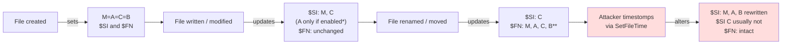

# Chapter 4 — Windows File System Forensics (NTFS)

## Chapter Overview

Almost every meaningful question in a Windows incident eventually returns to the file system, and NTFS answers each of them in part or in full. It can show whether a binary existed on the host, when it was created, and when it was last touched. It can show whether the attacker dropped a tool, ran it, and deleted it before the SOC got involved. It can also show whether sensitive files were copied, renamed, or staged in a directory the user does not normally use.

For incident responders, NTFS is one of the most reliable and hardest-to-tamper-with sources of evidence available. Windows has used it for production systems for more than two decades, and most users go their entire careers without thinking about it. Even when an attacker deletes a tool, modifies its timestamps, or empties the Recycle Bin, NTFS often retains enough metadata to reconstruct what happened and when. It also tells you how confident you can be in that reconstruction.

This chapter covers Windows file system forensics from an incident response perspective, and the focus is operational. It explains how NTFS is structured, why the Master File Table and the USN Journal matter, and what the common parsing tools can and cannot do. It also shows how to combine NTFS evidence with other artifacts to build a defensible investigative narrative. By the end of the chapter, you should know how the file system works and how to use it under time pressure to answer real incident questions.

The central idea is that NTFS evidence is durable in a way that many other artifact sources are not. EDR may have been disabled. Logs may have rolled over or been cleared. Prefetch may have been pruned. The MFT and the USN Journal are usually still there, and they remember things that other artifacts forget.

## Learning Objectives

By the end of this chapter, you should be able to:

* Describe the high-level structure of NTFS and how it differs from simpler file systems
* Explain what the Master File Table records and why it is central to file system forensics
* Distinguish Standard Information timestamps from File Name attribute timestamps and explain why the difference matters
* Identify the IR questions that the MFT and USN Journal can answer
* Recognize the common signs of timestamp manipulation, deletion, and staging behavior
* Use common NTFS parsers to produce CSV output that can be reviewed and timelined
* Correlate NTFS evidence with registry, log, and execution artifacts to support or challenge a hypothesis
* Recover evidence that a file once existed in a directory from `$I30` index entries and index slack
* Parse Recycle Bin `$I` and `$R` files to attribute a specific deletion to a specific user at a specific time
* Articulate the limits of NTFS evidence and the conditions under which it can be lost or rendered ambiguous

---

## 4.1 NTFS Overview

NTFS (New Technology File System) is a journaled, metadata-rich file system that records far more about each file than older systems such as FAT32 did. For responders, that metadata is the evidence. NTFS has been the default Windows file system since the Windows NT line, but its design matters more to a forensic examiner than its history.

Every file and directory on an NTFS volume has at least one record in a central database called the **Master File Table**. Each record holds a set of attributes. Some attributes describe the file, such as its name, timestamps, and security descriptor. The data attribute holds the file content itself, either inline for small files or as pointers to data runs elsewhere on disk for larger files. NTFS also maintains supporting structures, such as the USN Journal, that record changes over time.

### 4.1.1 Why NTFS Matters in IR

Native Windows artifacts derive much of their forensic value from the file system underneath them. Prefetch, registry hives, event logs, browser history, and shell items all live as files on disk. NTFS structures record each one's existence, modification, and deletion. Even when an artifact's contents have been wiped, the metadata about it often remains.

A responder who understands NTFS can:

- Confirm or refute that a specific file was ever present on a host
- Reconstruct the approximate sequence in which files were created, modified, or deleted
- Detect timestamp tampering that would otherwise mislead a chronological reconstruction
- Identify staging directories, deleted attacker tooling, and unusual file access patterns
- Strengthen findings drawn from log or EDR sources by corroborating them with independent file-system evidence

### 4.1.2 Volumes, Records, and Attributes

A few structural concepts come up repeatedly in NTFS forensics.

A **volume** is a single NTFS-formatted partition. Every volume has its own MFT and its own set of journal files. A typical Windows host has at least one volume (usually `C:`) and may have several.

An **MFT record** is a fixed-size entry (typically 1024 bytes) that describes one file or directory. Records contain attributes. A file usually has at least one Standard Information attribute, one or more File Name attributes, and a Data attribute.

**Attributes** can be resident or non-resident. A resident attribute is stored entirely inside the MFT record. A non-resident attribute is stored elsewhere on disk, and the MFT record holds pointers to it. Small files often live entirely inside the MFT record, so the MFT itself can preserve their content even after the on-disk data is overwritten.

Two attributes deserve special attention because they record timestamps independently:

- **Standard Information ($STANDARD_INFORMATION, often abbreviated $SI):** Contains the timestamps shown by Windows Explorer and most user-facing tools. A process can modify Standard Information timestamps easily, and many attacker tools manipulate them deliberately.
- **File Name ($FILE_NAME, often abbreviated $FN):** Contains a separate set of timestamps that the file system itself updates, generally when the file is created or renamed. $FN timestamps are much harder for ordinary user-mode code to alter.

Disagreement between $SI and $FN timestamps is one of the classic indicators of timestamp manipulation, often called **timestomping**.

### 4.1.3 What NTFS Will Not Tell You

NTFS evidence has limits, and a defensible analysis names them rather than papering over them.

NTFS does not record who logged on or what process performed an action. It records that a file was created, modified, or deleted. Attribution to a user or process must come from other artifacts, such as event logs, Prefetch, or memory.

NTFS structures degrade over time. NTFS can reuse deleted MFT records for new files. USN Journal entries roll out of the journal as it wraps. Volume snapshots and TRIM behavior on SSDs can reduce recoverability. The longer the gap between an event and the analyst's collection, the more likely it is that some NTFS evidence is gone or partially overwritten.

Some artifact-level questions also require the underlying file content, not just the MFT record. Knowing that `update.exe` existed at a particular path at a particular time tells you the file was there. It does not tell you what the file did unless you also have the binary.

---

## 4.2 The Master File Table (MFT)

The MFT is the centerpiece of NTFS forensics. It is the structure most responders parse first, and the one most often referenced in findings.

### 4.2.1 What the MFT Records

The MFT is a special file (`$MFT`) that contains one record for every file and directory on the volume, including special system files. Each record captures:

- The file's logical name and parent directory reference
- Standard Information timestamps (Modified, Accessed, Changed, Born — often abbreviated **MACB**)
- File Name attribute timestamps (a parallel MACB set, generally less tampered with)
- Allocation flags indicating whether the file is allocated (live), deleted, or a directory
- Logical and physical size
- Pointers to the file's data runs, if the data is non-resident
- The data itself, for small files where the data is resident in the MFT record

In incident response, the MFT most often answers operational questions: whether a file existed, when it was created and last touched, where it was on disk, and whether its timestamps show any sign of alteration.

### 4.2.2 MACB Timestamps and What They Actually Mean

The Modified, Accessed, Changed, Born model is universal, but the precise meaning of each field on Windows is widely misunderstood.

**Modified (M)** records the last time the file's data content changed.

**Accessed (A)** records the last time the file was read or opened. On modern Windows, last access updates are often disabled or coalesced, so treat Accessed with caution.

**Changed (C)** records the last time the file's MFT record metadata changed, such as its permissions, attributes, file name, or parent directory. Tool output sometimes calls it *MFT entry modified*.

**Born (B)**, also called Created, records when the file was first created on this volume.

The Standard Information and File Name attributes each hold their own copy of these four timestamps, so each file has up to eight timestamps in a single MFT record. Two independent sets are valuable precisely because they can disagree, and the disagreement is itself evidence.

### 4.2.3 Reading $SI vs $FN

A file written to disk normally has $SI and $FN timestamps that match closely, often to the second. They diverge for a few reasons that matter to incident response.

The $FN attribute is generally set when a file is created or renamed, and ordinary writes to the file do not update it. The $SI attribute changes continuously as the file is written, modified, and accessed. In normal operation, $SI Modified should drift forward of $FN Modified over time for actively used files.

Timestomping is the deliberate manipulation of $SI timestamps to make a file look older or newer than it is. Common patterns include:

- $SI timestamps that predate $FN timestamps (the file appears to have been modified before it was created)
- $SI timestamps that predate the file system's earliest known activity for that volume
- Multiple files with identical, suspiciously round $SI timestamps (e.g., all with millisecond `.0000000`)
- $SI Modified, Accessed, and Changed all matching exactly, which rarely happens through normal use

None of these patterns is conclusive on its own, but each is a flag worth following up. When you suspect an attacker tool was timestomped, a $SI/$FN comparison is often the first check to run.

### 4.2.4 Resident Data and Deleted Files

When a small file is deleted, NTFS marks its MFT record unallocated, but the record itself frequently remains intact for a while. If the file's data was small enough to be resident in the MFT record, the file content also survives until the record is reused.

**How small is "small enough"?** MFT records are typically 1,024 bytes. Subtract the record header and the mandatory attributes — `$STANDARD_INFORMATION`, `$FILE_NAME`, and the rest — and the space left for a resident `$DATA` attribute is usually between 600 and 700 bytes. The exact figure varies with the length of the file name and with whether the file carries extra attributes, such as alternate data streams or a security descriptor. Treat "under about 600 bytes" as the working rule, and confirm per file rather than assuming.

That threshold is small, but many forensically interesting files fall under it: a batch file, a short PowerShell script, a scheduled-task XML fragment, a base64-encoded stager, a configuration stanza with a C2 address in it, an `$I` Recycle Bin metadata record (§4.6). Anything that is essentially a few lines of text is a candidate.

Resident data has three practical implications. First, MFT parsers can often recover the names, paths, and timestamps of deleted files long after they are gone from the live file system, at any file size. Second, for files under the resident threshold, the *content* may be recoverable in full from MFT records that no longer correspond to live files. Third, the artifacts most likely to be resident are disproportionately the ones attackers delete: small scripts and configuration files, dropped and removed within minutes.

The recovery window depends on activity. A busy system reuses MFT records quickly. A quiet system may preserve them for months.

> **Why this matters:** an attacker who deletes a 400-byte PowerShell downloader has removed it from the file system but may not have removed it from the MFT. The content sits in an unallocated record until something reuses it, which is a strong argument for collecting `$MFT` early rather than after a week of normal operation on the host.

### 4.2.5 Common IR Questions the MFT Helps Answer

The MFT can answer these operational questions:

- *Did this file ever exist on this host?* Yes, if it has a record. The record may be allocated, unallocated, or referenced by a parent directory entry.
- *When was it created?* Look at $SI Born and $FN Born. If they disagree, treat $FN as the more reliable source unless you have reason to believe otherwise.
- *Was it deleted?* The allocation flag tells you, and the USN Journal often tells you when.
- *Was it timestomped?* Compare $SI and $FN timestamps as described in 4.2.3.
- *What other files were created in the same window?* Sort the MFT by $FN Born and look at neighbours. Attacker tools rarely arrive alone.
- *Where on disk did the file live?* The data runs (if non-resident) and the parent directory reference give you the path.

### 4.2.6 Directory Indexes ($I30) and INDX Slack

A directory in NTFS is not a container. It is a file whose content is a sorted index of the entries inside it, held in two attributes. `$INDEX_ROOT` is resident in the MFT record and holds the top of the index. `$INDEX_ALLOCATION` is non-resident and holds the rest in fixed-size (typically 4 KB) blocks called **INDX records**. Both attributes carry the name `$I30`, which is why analysts usually call the artifact that.

The forensically interesting part is what each index entry contains. An entry is more than a name and a record number. It is effectively a copy of the child file's `$FILE_NAME` attribute: the file name, the parent directory reference, the `$FN` MACB timestamps, and the allocated and real sizes as of the last time the entry was written. The directory keeps its own record of its children's metadata, separate from the children's own MFT records.

When a file is deleted, NTFS removes its entry from the sorted index by rewriting the surrounding entries and shrinking the used portion of the INDX record. It does not zero the space that the entry occupied. The old bytes remain in the unused tail of the record — **index slack** — until a later insertion happens to overwrite them. That leftover is a complete, parseable `$FILE_NAME` structure for a file that no longer exists.

`$I30` is therefore a recovery avenue for exactly the situation where the usual sources have run out. Suppose a new file has already reused the deleted file's MFT record, and the USN Journal has wrapped past the deletion. The directory's index slack may still prove that a file with that name, that size, and those creation and modification timestamps once existed in that specific directory. For a staging directory that the attacker emptied, the slack can be the only remaining list of what was staged.

Two caveats keep the finding honest. First, the timestamps in an index entry are `$FN` timestamps captured when the entry was last written. They reflect the file's creation or rename, not its most recent modification. Second, index slack is fragile in a different way from the MFT. A directory that receives many new entries after the deletion rebuilds its B-tree nodes and overwrites the slack, so a busy directory preserves less than a quiet one.

Standard MFT parsers do not surface index slack. [INDXRipper](https://github.com/harelsegev/INDXRipper) parses `$I30` attributes from an image or extracted directory and reports both live and slack entries, flagging which is which. [The Sleuth Kit](https://www.sleuthkit.org/) can extract a directory's `$I30` attribute directly for manual carving by running `icat` against the attribute, and `istat` shows the attribute layout. Record which entries came from slack rather than from the live index, because the distinction affects the confidence level of the finding.

---

## 4.3 USN Journal

If the MFT is a snapshot of the file system as it currently exists, the USN Journal is a record of how it got that way.

### 4.3.1 What the USN Journal Records

The USN (Update Sequence Number) Journal, located at `$Extend\$UsnJrnl:$J`, is a circular log of changes to files and directories on the volume. Each entry records:

- The Update Sequence Number itself (a monotonically increasing identifier)
- The MFT record number of the affected file
- The file name at the time of the change
- The parent directory reference
- A bitmask of change reasons (file created, data extended, file renamed, security changed, file closed, file deleted, etc.)
- A timestamp

Because the journal records both the change and the state at the time of the change, it captures information that the MFT alone cannot reconstruct after the fact. If a file was created, written to, renamed, and deleted, the live MFT may show only a deletion mark. The USN Journal can show all four steps, with timestamps and with the file's name at each stage.

### 4.3.2 Why the Journal Matters After Deletion

The most operationally valuable property of the USN Journal is that it survives deletion. A file may no longer exist in the live file system, and its MFT record may have been reused, yet the file can still appear in journal entries until those entries wrap out of the circular buffer.

Attackers often delete tooling, staging archives, or intermediate files as part of cleanup. The USN Journal frequently retains evidence of those files, including the name, the parent directory, and the creation and deletion timestamps, even when no other file-system evidence remains.

When an attacker renames a file, such as `mimikatz.exe` to `update.exe`, the USN Journal preserves both names and the time of the rename. The renamed file looks unremarkable in the live file system. The journal entry tells the real story.

### 4.3.3 Limits of the USN Journal

The journal is a circular buffer with a finite default size, typically 32 MB on modern Windows systems. On a busy host, that capacity holds hours to days of activity. On a quiet host, it can hold months.

The journal is therefore most valuable when collected promptly. By the time a host is imaged a week after an incident, routine activity may have overwritten the most relevant journal entries.

The journal also records changes in a compact form that is not always self-explanatory. The same file may produce several entries in close succession, such as file created, data extended, and file closed, for what a user would consider a single action. Interpreting journal output requires familiarity with the change reason codes. Good parsers translate them into human-readable form.

### 4.3.4 What a Useful Journal Entry Looks Like

The WKSTN-221 journal entry that records `update.exe` arriving in the Temp directory looks like this in parsed form. Field names vary by tool, but the substance is consistent.

| Field | Example Value |
|---|---|
| USN | 1,432,904,384 |
| Timestamp (UTC) | 2024-11-14 14:20:11.5 |
| MFT Record | 22,417 |
| File Name | update.exe |
| Parent Path | `\Users\payroll-admin\AppData\Local\Temp\` |
| Reasons | RenameNewName |

The entries around it complete the story. Earlier entries show `b.tmp` created at 14:20:11.00 UTC, written and closed by 14:20:11.05 UTC, and renamed (`RenameOldName`) at 14:20:11.25 UTC, all on record 22,417. USN 1,432,907,520 shows `FileDelete` against the same MFT record at 14:23:44 UTC. A rename keeps the record number, so the MFT shows only the record's current name, `update.exe`. The journal shows its history, including the `b.tmp` name. Together these entries reconstruct the brief life of an attacker tool that no longer exists in the live file system.

---

## 4.4 Tools

Reading the MFT and USN Journal directly from raw bytes is possible but rarely productive in time-pressured IR. A small set of tools covers most operational needs and produces output you can load into spreadsheets, timelines, or SIEM platforms.

### 4.4.1 MFTECmd

> **Figure 4.1 — _placeholder for `figures/fig-4-1-timeline-explorer-mft.png`_**
>
> Timeline Explorer (Eric Zimmerman) with the WKSTN-221 MFT loaded, sorted by `Created0x10` descending. The `update.exe` row in `\Users\payroll-admin\AppData\Local\Temp\` is highlighted at row 2, directly below its Prefetch file. See [`figures/Readme.md`](figures/Readme.md) for capture instructions.


MFTECmd, part of the [Eric Zimmerman tool suite](https://ericzimmerman.github.io/), is the most widely used MFT parser in modern Windows IR. It accepts a raw `$MFT` file as input and produces CSV output with all the metadata an analyst typically needs: timestamps for both $SI and $FN, allocation status, file size, parent path, and full path reconstruction.

A typical invocation in a triage workflow:

```
MFTECmd.exe -f 'C:\Triage\WKSTN-221\$MFT' --csv C:\Cases\WKSTN-221\mft\
```

Note the single quotes around the source path. PowerShell interprets `$MFT` as a variable expansion, so you must quote or escape the path to pass it through literally. The resulting CSV is wide, and most responders filter on path or timestamp range before inspection. MFTECmd also accepts USN Journal input (`-f '$J'`, with the same quoting caveat) and produces a comparable CSV.

### 4.4.2 AnalyzeMFT and Other Parsers

AnalyzeMFT.py is a Python MFT parser that predates MFTECmd. It remains useful where Windows tooling is not available or where the responder wants a scriptable Python integration. Its output is similar in spirit to MFTECmd's, though the field names differ.

Several other tools, such as `analyzeMFT`, `mft2csv`, and the file system tools in [The Sleuth Kit](https://www.sleuthkit.org/), fill similar niches. Consistency matters more than the choice of tool. Pick one, learn its output format, and document the version you used for each acquisition.

### 4.4.3 Autopsy and The Sleuth Kit

[Autopsy](https://www.autopsy.com/) and the underlying Sleuth Kit provide a broader forensic environment. They support full disk image ingestion, NTFS-aware navigation, deleted file recovery, keyword search, and timeline generation across multiple artifact types.

Autopsy is well suited to deeper investigations where the responder will be working with the disk image for hours or days. For fast triage, command-line parsers are usually quicker.

### 4.4.4 Live Acquisition vs. Offline Parsing

You can parse NTFS artifacts from a mounted image, an exported triage collection, or a running system. Each has tradeoffs.

Offline parsing of a forensic image is the most defensible approach for legally sensitive work. The image is preserved, the MFT is extracted from a known state, and there is no risk of the analysis altering the source.

Triage collections, such as a [KAPE](https://www.kroll.com/en/services/cyber/incident-response/kroll-artifact-parser-extractor-kape) target that copies `$MFT` and `$J` to a portable drive, trade some completeness for speed. They are usually adequate for incident response questions and far faster to obtain than full images.

Live acquisition with tools such as FTK Imager can copy `$MFT` and `$J` from a running system, but the file system keeps changing while the copy runs. That is acceptable for IR purposes if you document the limitation.

---

## 4.5 Correlating NTFS Artifacts in IR



*Figure 4.2 — Which NTFS operations update which timestamp set. Most tools show `$STANDARD_INFORMATION` by default. `$FILE_NAME` updates only when the directory entry itself changes (rename or move), which makes it the canonical anti-timestomp evidence. `$SI` and `$FN` disagreeing on creation time is one of the highest-confidence tamper signals NTFS produces.*

*\* Last-access updates are disabled by default on modern Windows (see §4.2.2), so the `$SI` A timestamp frequently does not move on a read or a write. Do not read a stale access time as evidence the file was not touched.*

*\*\* `$FN` updates depend on the operation. A rename sets all four, and a move within the same volume updates the parent reference too.*

*A third signal is worth knowing, with a caveat attached. The Win32 `SetFileTime` API accepts only creation, last-access, and last-write times, so it leaves the C (MFT-entry-modified) value for the file system to set. A naive timestomp therefore rewrites M, A, and B and leaves C pointing at the moment of the tampering. Two things stop this from being a clean test. First, `$SI` C being later than M, A, and B is routine. A permission change, an attribute change, a rename, or a hard-link edit all move C without touching the others, so on its own it means nothing. Second, the native `NtSetInformationFile` call with `FILE_BASIC_INFORMATION` does expose ChangeTime, and tooling built on it, such as SetMace and its descendants, sets all four. Treat a stranded C as a lead to combine with a backdated B and a `$FN` comparison, not as a signal in itself. And do not read four consistent timestamps as proof that nothing was stomped.*


NTFS evidence is at its strongest when it is correlated with other artifact sources. A finding that rests on the MFT alone is plausible. A finding that rests on the MFT plus Prefetch plus an event log entry plus a registry key, all aligned in time, is much harder to dispute.

> **From the field — illustrative composite.** In a counsel-driven investigation of suspected insider data theft, an executive was alleged to have copied a sensitive spreadsheet to a USB drive in the days before resigning. Defense counsel produced an MFT export in which the spreadsheet's `$STANDARD_INFORMATION` `Created` timestamp predated the executive's tenure at the company by two years. That, they argued, proved the file had simply followed the executive between jobs. The responder pulled `$FILE_NAME` for the same MFT entry, and the `$FN.Created` value was three weeks before the resignation. `SetFileTime` had been used to rewrite `$SI` only. The case turned on a tool that defaulted to `$SI` and an analyst who remembered that `$SI` and `$FN` are independent. Pulling both is now a standing item on the team's NTFS-analysis checklist.

### 4.5.1 The Multi-Source Story

A typical correlated narrative in a Windows intrusion investigation might look like this:

- The MFT shows that `update.exe` was created in `C:\Users\payroll-admin\AppData\Local\Temp\` at 14:20:11 UTC.
- The USN Journal shows the file landing as `b.tmp` (`FileCreate` at 14:20:11.00 UTC), a `RenameNewName` entry for `update.exe` at 14:20:11.5 UTC, and a `FileDelete` for `update.exe` at 14:23:44 UTC.
- A Prefetch entry for `update.exe` shows last execution at 14:21:03 UTC, with referenced paths consistent with the Temp directory.
- Security.evtx EID 4688 records `update.exe` running as `payroll-admin` at 14:21:03 UTC, parent process `cmd.exe`.
- Amcache records the binary's SHA-1 hash, the value to check against threat intelligence.

Each artifact contributes a piece of evidence, and together they give a high-confidence reconstruction. If any one of them is missing, the others can usually carry the conclusion. If most of them disagree, the responder knows to slow down and reconsider.

### 4.5.2 NTFS as a Cross-Check on Logs

Logs are the most familiar evidence source for many responders, but they are also the most likely to be cleared, rotated, or never enabled in the first place. NTFS provides an independent record that is harder to remove without leaving traces.

When a Security event log entry says a process ran at a particular time, the MFT and USN Journal can confirm or refute that the binary existed at that time. When PowerShell operational logs are missing or disabled, the on-disk traces of script files and their containing directories may still tell the story. When a malicious service is found in the registry, the MFT can confirm when its binary was placed and whether it has been deleted.

A defensible analysis treats NTFS not as the primary source but as the corroborating one — the artifact that turns a probable conclusion into a confirmed finding.

### 4.5.3 Recognizing Staging and Cleanup

Staging is the practice of gathering files in one location before exfiltrating, archiving, or processing them. Cleanup is the deletion of attacker tools and intermediate artifacts after they have served their purpose. Both leave distinctive NTFS patterns.

A staging directory often shows:

- A burst of file creations close together in time
- Files of unusual types or sizes for the directory location (executables in user profile temp, large archives in Downloads)
- A subsequent burst of accesses or copies as the staged files are moved
- Sometimes, a final burst of deletions

Cleanup often shows:

- Multiple `FileDelete` USN entries clustered around the same time
- MFT records marked unallocated for files with suspicious names or in suspicious locations
- Discrepancies between event logs (which still reference a binary) and the live file system (which no longer contains it)

Spotting these patterns is faster with experience, but the building blocks are timestamps, allocation flags, and parent directories — all available from any reasonable MFT and USN Journal parse.

### 4.5.4 NTFS Findings — Quick Reference

When an NTFS finding goes into the case file, record these per-file fields: name and full path, MFT record number, both `$SI` and `$FN` timestamps, allocation status, parsing tool plus version plus exact command, hash of the source `$MFT` and `$J` at collection, and any corroborating artifacts. Chapter 2 covers documentation discipline in depth. This list covers only the artifact-specific fields for NTFS findings.

---

## 4.6 The Recycle Bin: `$I` and `$R` Files

Most NTFS evidence tells you what happened to a file. The Recycle Bin tells you something rarer and more valuable: which *user* deliberately deleted a specific file, from a specific path, at a specific moment. Few Windows artifacts hand you user attribution and intent in the same record.

### 4.6.1 Layout and the `$I` / `$R` Pair

On Windows Vista and later, each volume has a hidden root directory named `$Recycle.Bin`, containing one subdirectory per user SID:

```
C:\$Recycle.Bin\S-1-5-21-1004336348-1177238915-682003330-1013\
```

When a user deletes a file through Explorer, Windows does not copy it anywhere. It *renames and moves* it into that per-SID directory and writes a small companion file describing it. The result is a pair:

| File | Contents |
|---|---|
| `$I<id>.<ext>` | Metadata: the original full path, the deletion timestamp, and the original file size |
| `$R<id>.<ext>` | The file content itself, byte-for-byte, under its new name |

The `<id>` is a six-character identifier shared by both halves of the pair, and both halves keep the original extension. `$IZ9K3PL.docx` and `$RZ9K3PL.docx` are the metadata and the content for the same deleted document. This pairing makes recovery trivial when the bin has not been emptied. Read the path and timestamp from the `$I`, copy the `$R` back out under the original name, and hash it.

Because the move is a rename within the same volume, the file keeps its MFT record number. That is a useful pivot. The USN Journal shows a `RenameOldName` / `RenameNewName` pair against that record number, which gives you the original file name and the exact time it went into the bin, even where the `$I` itself is gone.

Windows XP and earlier used a different scheme: `C:\RECYCLER\<SID>\` with a single binary index file named `INFO2`. It still turns up on legacy systems and in old images. The concepts map directly, and only the format differs.

### 4.6.2 What the `$I` Record Holds

The `$I` file is small and its structure is simple:

* **Header / format version** — 8 bytes
* **Original file size** — 8 bytes, in bytes
* **Deletion timestamp** — 8 bytes, Windows FILETIME, UTC
* **Original full path** — Unicode, including drive letter

The deletion timestamp is the field that carries the weight. It records the moment the user sent that path to the Recycle Bin, not "when the file was created" or "when Explorer was last opened".

The format changed between Windows generations, which matters when you parse by hand or write your own tooling:

| Format | Windows | Header value | Path field |
|---|---|---|---|
| Version 1 | Vista, 7 | `0x01` | Fixed 520 bytes (260 UTF-16 characters), so the record is always 544 bytes total and paths longer than 260 characters are truncated |
| Version 2 | 8, 8.1, 10, 11 | `0x02` | Preceded by a 4-byte character-count field, so the path is variable-length and the record size varies with it |

Version 1 records are a fixed size, which makes them easy to carve but means a very long path may be cut short. Version 2 records are variable-length and hold the full path, but a parser that assumes the old fixed layout produces garbage against them. Any tool you rely on should handle both, and you should know which format you are looking at before you trust a path.

### 4.6.3 Per-User Attribution

The SID in the directory name is the whole point. `$Recycle.Bin\S-1-5-21-…-1013\$IZ9K3PL.docx` does not just say a file was deleted. It says the user whose SID ends in `-1013` deleted it. Resolve the SID to an account name through `HKLM\SOFTWARE\Microsoft\Windows NT\CurrentVersion\ProfileList`, which maps each SID to its profile path, or through the SAM hive. Record the mapping in the finding.

On a multi-user host this separates the interesting from the routine immediately. Three users' deletions sit in three different directories, and the one that matters is the one belonging to the account under investigation.

State one caveat in any report. The SID identifies the *account context* in which the deletion occurred, not the person at the keyboard. If the account was compromised, the deletions belong to whoever was using it. Recycle Bin evidence is strong attribution to an account, and the report should describe it that way.

Not every deletion goes through the bin. Shift+Delete bypasses it entirely. So do deletions from removable media and network shares, files larger than the bin's configured quota, and deletions by scripts and command-line tools (`del`, `Remove-Item`). So does any deletion on a system where policy has disabled the Recycle Bin. **The absence of a `$I` record is therefore not evidence that a file was never deleted.** The deletion may simply have taken a different route. Say so explicitly when the bin is empty.

### 4.6.4 Recovery After the Bin Is Emptied

Emptying the Recycle Bin deletes the `$I` and `$R` files. In NTFS terms that means their MFT records are marked unallocated — which, as covered in 4.2.4, is a long way from gone.

Three things work in the responder's favour here:

**`$I` files are tiny.** A version 1 record is 544 bytes, and a typical version 2 record is smaller still. Both sit comfortably inside the space available for resident data in a 1024-byte MFT record. The `$I` content is therefore almost always resident, so recovering the unallocated MFT record recovers the *entire artifact* — original path, deletion time, and size — not merely its name. This is the unusual case where deleted-file recovery gives you the complete evidence rather than a fragment of it.

**The names themselves are diagnostic.** Unallocated MFT records and USN Journal entries for files matching `$I??????.*` and `$R??????.*` under a `$Recycle.Bin` path are unambiguous. Filtering an MFT parse for `$Recycle.Bin` in the parent path and sorting by `$SI` Created reconstructs the bin's history well past its last emptying.

**Unallocated space can be carved.** `$I` records have a recognizable structure: a small file beginning with `0x01` or `0x02`, followed by seven zero bytes. Carving tools and manual searches can find them in unallocated clusters even when the MFT record has been reused.

The sources from earlier in the chapter add to this. The USN Journal records the rename into `$R<id>` and the subsequent delete. `$I30` slack in the `$Recycle.Bin\<SID>\` directory may retain index entries for the pairs. Shadow copies (Chapter 3 §3.6) may contain the bin as it stood before it was emptied. Emptying the Recycle Bin is one of the least effective anti-forensic actions available to a user, which is unfortunate for them and convenient for everyone else.

### 4.6.5 Tooling

[RBCmd](https://ericzimmerman.github.io/), part of the Eric Zimmerman suite, is the standard parser. It handles both `$I` formats and the legacy `INFO2` index, and it processes a single file or walks an entire collected `$Recycle.Bin` tree:

```
RBCmd.exe -d 'C:\Triage\WKSTN-221\$Recycle.Bin' --csv C:\Cases\WKSTN-221\recyclebin\
```

As with `$MFT`, note the quoting. PowerShell would otherwise interpret `$Recycle` as a variable. The CSV output gives one row per record, with the source `$I` file, the SID-bearing path it came from, the recovered original path, the file size, and the deletion timestamp. That output drops straight into a timeline. `-f` parses a single file when you have carved one out of unallocated space. Autopsy and most commercial suites parse the Recycle Bin as part of their standard ingest, and RECmd or a SAM parse resolves the SIDs to account names.

> **Why this matters:** In a data-theft investigation, most evidence is circumstantial in structure: a file appeared here, a device was attached then, a process ran at that time. The analyst assembles intent from the pattern. A `$I` record is different in kind. It says that the account `S-1-5-21-…-1013` deleted `D:\Finance\Q4\ClientList.xlsx`, 4,182,016 bytes, at 2024-11-14 15:02:37 UTC. One artifact holds the original path, exact time, per-user attribution, and file size, and the matching `$R` file holds the deleted content itself. That is a rare, clean, high-confidence finding, and it is the kind of evidence that decides cases. The Chapter 11 exfiltration challenge includes a bin-emptying step for exactly this reason: the artifacts survive it.

---

## Chapter Summary

NTFS is the foundation under most Windows forensic work, and its core artifacts — the Master File Table and the USN Journal — preserve evidence that no other source replicates. The MFT records the existence, timestamps, allocation status, and metadata of every file on the volume, including many that have been deleted. The USN Journal records the sequence of changes that produced the current file system state, often retaining traces of files long after they are gone from the live volume.

For incident response, the practical value of NTFS lies in three properties. The MFT and USN Journal are durable in ways that logs and EDR telemetry are not. They record metadata that supports or refutes timestamps and file existence claims drawn from other artifacts. And they are difficult to tamper with completely. Even attackers who attempt timestomping or cleanup typically leave evidence in $FN attributes or journal entries.

Tooling for NTFS analysis is straightforward. MFTECmd and similar parsers convert raw NTFS structures into CSV output that fits naturally into spreadsheets, timelines, and SIEMs. Autopsy and the Sleuth Kit support deeper exploration on full images. Choice of tool matters less than consistent use, version documentation, and the discipline to record the exact command and source for every parse.

Two further NTFS structures repay attention when the obvious sources have been exhausted. Directory indexes (`$I30`) keep a per-directory copy of each child's `$FILE_NAME` metadata. Deleted entries frequently survive in index slack, which can prove that a file once existed in a specific directory even after its MFT record has been reused and the journal has wrapped. The Recycle Bin offers something rarer. A `$I` record ties an original full path, a deletion timestamp, and a file size to a specific user SID, and the matching `$R` file preserves the deleted content. Because `$I` records are small enough to be resident, they are usually recoverable in full from unallocated MFT records long after the bin has been emptied.

The strongest NTFS-based findings are correlated findings. An MFT entry, a USN Journal change record, a Prefetch execution, a Security event log line, and an Amcache hash that all point to the same file at the same time produce conclusions that are difficult to dispute. NTFS rarely tells the whole story by itself, but it is almost always part of the strongest version of that story.

## Key Terms

**Allocation Flag:** A bit in an MFT record indicating whether the corresponding file is currently in use (allocated) or has been deleted (unallocated).

**Attribute:** A typed structure within an MFT record that holds a specific piece of metadata or data, such as Standard Information, File Name, or Data.

**Data Run:** A pointer in an MFT record to a sequence of clusters on disk where a file's content is stored when the data is non-resident.

**Directory Index ($I30):** The `$INDEX_ROOT` and `$INDEX_ALLOCATION` attributes of a directory, which store an entry per child file containing a copy of that child's `$FILE_NAME` metadata.

**File Name Attribute ($FN):** An MFT attribute containing a separate set of MACB timestamps, generally updated by the file system itself and harder to tamper with than $SI.

**INDX Slack:** Unused space at the tail of an INDX record where the entries of deleted files often remain intact, allowing recovery of a file's name, size, and `$FN` timestamps after its MFT record has been reused.

**MACB Timestamps:** The Modified, Accessed, Changed (metadata), and Born (created) timestamps recorded for each file. Each appears in both $SI and $FN attributes.

**Master File Table (MFT):** The central database in NTFS containing one record per file or directory on the volume.

**MFT Record:** A fixed-size entry in the MFT representing a single file or directory and containing its attributes.

**Recycle Bin Content File ($R):** The renamed copy of a deleted file's content held under `C:\$Recycle.Bin\<SID>\`, paired with a matching `$I` metadata file.

**Recycle Bin Metadata File ($I):** A small record under `C:\$Recycle.Bin\<SID>\` holding a deleted file's original full path, deletion timestamp, and original size. Version 1 (Vista/7) uses a fixed 260-character path field; version 2 (Windows 8 and later) uses a variable-length path.

**Resident Data:** File content small enough to be stored entirely inside its MFT record rather than in separate data runs on disk.

**Standard Information Attribute ($SI):** An MFT attribute containing the timestamps shown in Windows Explorer; modifiable by user-mode code and a common target of timestomping.

**Timestomping:** The deliberate manipulation of file timestamps, usually $SI, to make attacker tools appear older, newer, or otherwise unremarkable.

**USN Journal:** The Update Sequence Number Journal, a circular log of file system changes that retains evidence of file creations, modifications, renames, and deletions.

**Volume:** A single NTFS-formatted partition with its own MFT and journal structures.

## Review Questions

1. Why are NTFS artifacts often considered more durable than logs or EDR telemetry?
2. What information does an MFT record contain, and which fields are most useful in incident response?
3. How do $SI and $FN timestamps differ, and why does that difference matter when investigating timestomping?
4. What conditions make resident data forensically valuable in deleted file recovery?
5. What does the USN Journal preserve that the live MFT cannot reconstruct after the fact?
6. Why is the USN Journal most valuable when collected promptly?
7. What kinds of patterns in the MFT and USN Journal suggest staging or cleanup behavior?
8. How can NTFS evidence be used to corroborate findings drawn from event logs or Prefetch?
9. What are the main tradeoffs between offline image analysis, triage collection, and live acquisition for NTFS artifacts?
10. What documentation should accompany an MFT or USN Journal parse to make the analysis defensible later?

## Practical Exercises

1. Parse the `$MFT` from your lab VM using MFTECmd and produce a CSV. Examine the columns and identify which represent $SI versus $FN timestamps.
2. Write a small file to disk with a known timestamp, then use a timestomping technique to alter its $SI timestamps. Compare the result against the file's $FN timestamps in the MFT.
3. Create, modify, rename, and delete a file in a single short window. Parse the USN Journal and reconstruct the sequence of events.
4. Identify three deleted files in your lab MFT and recover the file names, paths, and creation timestamps. Note which records are unallocated and which still contain resident data.
5. Choose a known executable on your lab VM and use the MFT plus the USN Journal to construct a one-page life history of the file from creation to current state.
6. Build a small CSV that combines MFT timestamps for a chosen directory with corresponding Prefetch entries. Sort by time and identify any sequences that suggest staging or execution chains.
7. Document the exact tool, version, command, and source `$MFT` hash for each parse you perform during the chapter exercises.
8. Write a one-paragraph finding that combines NTFS evidence with at least two other artifact sources to support a single conclusion about a file of interest.

> **Hands-on:** [Lab 04 — Windows File System Forensics (NTFS)](../Labs/Lab04/ReadMe.md) — parse `$MFT` and the USN journal from the simulated WKSTN-221 host, interpret MACB timestamps, and build correlation observations across NTFS sources.

---

## Looking Ahead

NTFS gives you the file system. The next chapter moves up the stack to the registry, Windows's central configuration database. It also covers cloud storage clients, which increasingly carry data off the host even when no removable media is involved. Together, the registry and cloud storage artifacts answer questions about persistence, configuration, account use, and exfiltration that the file system alone cannot.

---
