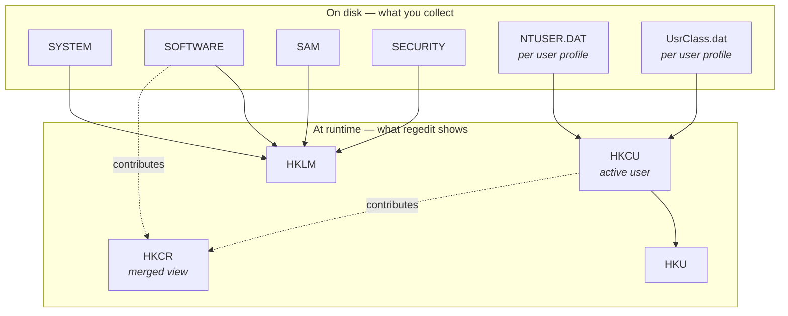

# Chapter 5 — Windows Registry and Cloud Storage Forensics

## Chapter Overview

If the file system tells you what existed, the registry tells you what was configured. The Windows registry is the hierarchical database at the center of the operating system. It records installed software, persistence mechanisms, network configuration, user preferences, USB device history, recently typed paths, recently accessed files, the contents of shellbags, and a great deal more. For incident responders, it is one of the densest sources of evidence on the platform, and reading it well makes every other skill in this book more effective.

Cloud storage clients add a second layer to this picture. OneDrive in particular, but also Dropbox, Google Drive, Box, and others, synchronize files between the local host and a cloud account. Forensically, these clients leave file-system artifacts, such as sync folders, local databases, and log files. They also leave registry artifacts, such as account configuration, sync roots, and mounted accounts. They are one of the most common modern paths for data to leave a host without ever touching removable media.

This chapter covers both. It explains the registry's structure, the keys that matter most in incident response, and how to read them efficiently with common tools. It then turns to cloud storage clients, using OneDrive as a worked example. It shows how registry, file system, and application-level artifacts combine to answer the question that increasingly drives data exposure investigations: *did this user move sensitive data off the host through a sync client, and if so, what and when?*

Together, the registry and cloud storage clients produce a more complete picture than either does alone. Registry keys may name an account. The sync client database may show which files were uploaded. File-system artifacts may corroborate the timing. None of those sources is conclusive on its own, but together they can be.

## Learning Objectives

By the end of this chapter, you should be able to:

* Describe the structure of the Windows registry and the role of system and user hives
* Identify the registry hives that matter most in IR and where they live on disk
* Locate the registry keys most often involved in persistence, lateral movement, and account misuse
* Use Registry Explorer, RECmd, and RegRipper to extract meaningful values quickly
* Distinguish per-user from per-machine artifacts and explain why that distinction matters
* Identify USB device history and removable media activity from the registry
* Recognize the registry, file system, and database artifacts produced by cloud sync clients
* Build a defensible reconstruction of cloud-based data exfiltration using multiple artifact sources

---

## 5.1 Registry Structure and Key Hives

The Windows registry is hierarchical, file-backed, and live. Windows assembles most of what an analyst sees through `regedit.exe` on a running system at boot from on-disk hive files. Transient runtime keys that exist only in memory augment that view. For forensic work, the on-disk hive files are the durable record.



*Figure 5.1 — Registry hives on disk and the runtime tree assembled from them. `HKCR` is a merged view rather than a hive of its own. `HKCU` is whichever user's `NTUSER.DAT` is currently loaded, which is why "check HKCU" is meaningless on a collected image until you say whose.*

### 5.1.1 Hives and Where They Live

A **hive** is a single file containing one branch of the registry tree. The system hives live in `%SystemRoot%\System32\config\`:

| Hive File | Loaded At Runtime As |
|---|---|
| `SYSTEM` | `HKLM\SYSTEM` |
| `SOFTWARE` | `HKLM\SOFTWARE` |
| `SAM` | `HKLM\SAM` |
| `SECURITY` | `HKLM\SECURITY` |
| `DEFAULT` | `HKU\.DEFAULT` |

Per-user hives live under each user profile:

| Hive File | Loaded At Runtime As |
|---|---|
| `%USERPROFILE%\NTUSER.DAT` | `HKCU` for the logged-on user |
| `%USERPROFILE%\AppData\Local\Microsoft\Windows\UsrClass.dat` | `HKCU\Software\Classes` for the logged-on user |

In addition to the live hive files, Windows maintains transaction logs (`.LOG1`, `.LOG2`) and previous backup copies. For most IR work, the live hive plus its transaction logs is sufficient. For deeper recovery, older copies in System Restore or Volume Shadow Copies may be useful.

### 5.1.2 Keys, Values, and Last-Write Times

The registry is structured as **keys** that contain **values**. A key is roughly equivalent to a folder. A value is roughly equivalent to a file with a name, a type such as string, DWORD, or binary, and content.

Each key has a **last-write time**, which records when the key or any value under it was last modified. Last-write times are sometimes the only timestamp available for a given piece of evidence. They are also one of the more easily misinterpreted artifacts. A recent last-write time tells you that *something* under the key changed, but not *which* value changed or *what* it was changed from.

Values do not have their own timestamps. To reconstruct value-level history, the analyst usually needs registry transaction logs, prior shadow copies, or independent corroboration.

### 5.1.3 Per-Machine vs. Per-User

The most consequential structural distinction in the registry is the split between per-machine and per-user data.

**`HKLM` (HKEY_LOCAL_MACHINE)** is per-machine. Keys here apply to the entire host: installed services, drivers, software, network configuration, system policies. Every user on the system sees the same `HKLM` content, and changes typically require administrator rights.

**`HKCU` (HKEY_CURRENT_USER)** is per-user, drawn from the active user's `NTUSER.DAT`. Keys here apply only to that user: typed paths, recently accessed files, application preferences, run-on-logon entries. Every user has their own `HKCU`, and changes generally do not require administrator rights.

**`HKU` (HKEY_USERS)** is the parent of all loaded `NTUSER.DAT` hives, indexed by user SID.

For incident response, the key questions about an artifact are usually: *which user does this apply to?* and *when did it change?* The hive location answers the first. The last-write time and any transaction-log evidence answer the second.

### 5.1.4 Transaction Logs and Recoverability

Modern Windows uses transaction logs to ensure registry integrity across crashes. The logs (`SOFTWARE.LOG1`, `NTUSER.DAT.LOG1`, etc.) contain pending changes that Windows has not yet merged into the main hive. Forensic parsers that understand transaction logs can recover values that were modified but not yet flushed to the hive at the time of acquisition. Parsers that do not may show stale values.

Transaction logs matter most when you collect registry hives from a live system, because the live hive may not reflect the most recent changes. Collecting the logs alongside the hive closes that gap. Tools such as RECmd and Registry Explorer handle this transparently when you provide both files.

### 5.1.5 Volume Shadow Copies

Windows can take periodic snapshots of system volumes through the Volume Shadow Copy Service. When VSC snapshots exist, prior versions of registry hives may be recoverable from them. Retention varies widely. Typical workstations hold a handful of snapshots that turn over within days as storage fills. Servers or hosts with deliberate VSC sizing may retain weeks of state. Treat any specific lookback window as something to verify (`vssadmin list shadows`) rather than assume.

Shadow copies are most useful when the question is *what did this look like before the incident?* An attacker may have modified a current registry value that looks innocuous. A shadow copy from before the incident can confirm or refute that hypothesis. VSC analysis adds time and complexity to a case but can be decisive when prior state matters.

A `Run` value that the attacker deleted during cleanup is one of the clearest examples. The live `SOFTWARE` hive shows nothing, but a hive pulled from a snapshot taken during the intrusion shows the value, its data, and its last-write time. Section 3.6 covers enumerating snapshots (`vssadmin list shadows`, `Get-CimInstance Win32_ShadowCopy`), mounting them for analysis, and what their unexplained absence implies. Point RECmd or Registry Explorer at the hives inside a mounted snapshot exactly as you would at a live collection, and record which snapshot each hive came from.

---

### 5.1.6 Control Sets: Why `CurrentControlSet` Is Not in Your Hive

A collected `SYSTEM` hive has no `CurrentControlSet` key, and this catches almost everyone the first time. This book, and every other reference you will read, writes system configuration paths as `HKLM\SYSTEM\CurrentControlSet\...`. Load a collected `SYSTEM` hive into Registry Explorer, though, and that key is not there. Nothing is wrong with your collection.

The kernel creates `CurrentControlSet` at boot as a **runtime symbolic link**. It does not exist on disk. The hive contains numbered control sets instead: `ControlSet001`, sometimes `ControlSet002`, and occasionally more. Windows 7 and earlier keep a last known-good configuration in a second set so they can roll back a failed boot. On Windows 10 and 11 you will often find only `ControlSet001`, so check what the hive holds rather than assume.

To find which one was live, read:

```
HKLM\SYSTEM\Select
    Current        -> the control set that was CurrentControlSet
    LastKnownGood  -> the fallback
    Default        -> the one selected at next boot
```

A `Current` value of `1` means `ControlSet001` is what the running system was using, so `HKLM\SYSTEM\CurrentControlSet\Services` on the live box is `ControlSet001\Services` in your hive.

Two practical consequences:

**Read the right set, or your finding is about a configuration the machine was not running.** A service defined in `ControlSet002` but absent from `ControlSet001` was not active. Tools differ in how they handle this. `AppCompatCacheParser` takes `-c` to select a control set and defaults to all of them. RECmd batch files usually target `ControlSet001` explicitly. Know which your tool did.

**The other control set is free history.** When `ControlSet002` exists, it often holds a slightly older snapshot of system configuration. Comparing the two occasionally shows a service or driver that was added or modified recently. It is not a reliable timeline, but it costs nothing to look. On a host where the attacker installed a service, it sometimes hands you a before-and-after.

## 5.2 Important Keys for IR

A small fraction of the registry's tens of thousands of keys appear in nearly every Windows incident investigation. Knowing where they are, what they record, and what their absence means is one of the most efficient ways to speed up triage.

### 5.2.1 Persistence Keys

> **Figure 5.2 — _placeholder for `figures/fig-5-2-registry-explorer-runkey.png`_**
>
> Registry Explorer (Eric Zimmerman) showing `HKCU\Software\Microsoft\Windows\CurrentVersion\Run` with a benign user value and its `LastWriteTime` visible in the right pane. See [`figures/Readme.md`](figures/Readme.md) for capture instructions.


Persistence is the mechanism by which an attacker arranges to regain code execution after reboot, logoff, or remediation. Several registry locations are classic persistence targets.

| Key | Purpose | Hive |
|---|---|---|
| `HKLM\Software\Microsoft\Windows\CurrentVersion\Run` | Per-machine programs run at user logon | SOFTWARE |
| `HKLM\Software\Microsoft\Windows\CurrentVersion\RunOnce` | Per-machine programs run once at next logon | SOFTWARE |
| `HKCU\Software\Microsoft\Windows\CurrentVersion\Run` | Per-user programs run at logon | NTUSER.DAT |
| `HKCU\Software\Microsoft\Windows\CurrentVersion\RunOnce` | Per-user single-run programs | NTUSER.DAT |
| `HKLM\Software\Microsoft\Windows NT\CurrentVersion\Winlogon` | Userinit, Shell, and other logon hooks | SOFTWARE |
| `HKLM\System\CurrentControlSet\Services` | Service definitions including binary path | SYSTEM |
| `HKLM\Software\Microsoft\Windows NT\CurrentVersion\Image File Execution Options` | Debugger hijacks | SOFTWARE |

A new or modified entry in any of these locations should raise immediate questions: who owns the executable, when did the key change, does the executable still exist on disk, and does it behave as a legitimate program would.

### 5.2.2 Service Definitions

`HKLM\System\CurrentControlSet\Services` is one of the most heavily inspected registry locations in IR. Each service has a subkey containing:

- `ImagePath` — the executable launched by the service
- `Type` — service type (kernel driver, user-mode service, etc.)
- `Start` — startup behavior (boot, system, automatic, manual, disabled)
- `DisplayName` — the friendly name shown in the Services console
- `Description` — explanatory text shown to users

Malicious services often appear with names that mimic legitimate Windows components, image paths in unusual directories, or `DisplayName` and `Description` fields that are blank, gibberish, or copied from other services. As a sanity check, cross-reference service definitions with `System.evtx` event ID 7045 (service installed, logged by Service Control Manager).

Note the channel. Event 7045 is a System log event, and Windows records it by default. Its Security-log counterpart, EID 4697, carries similar information but appears only if the *Audit Security System Extension* subcategory is enabled. **That subcategory is not enabled by default**, so look for 7045 first.

### 5.2.3 Network and Remote Access Configuration

Several registry locations reveal how the system communicates with the network.

`HKLM\Software\Microsoft\Windows NT\CurrentVersion\NetworkList\Profiles` holds wireless and wired network profiles the system has connected to, including SSIDs and last-connected timestamps. These profiles can place a laptop in a particular location at a particular time, or identify connections to networks the user does not normally use.

`HKLM\System\CurrentControlSet\Control\Terminal Server` and the `RDP-Tcp` subkey hold Remote Desktop configuration. Whether RDP is enabled, what port it listens on, and whether Network Level Authentication is required are all visible here.

`HKCU\Software\Microsoft\Terminal Server Client\Default` holds recently typed RDP destinations on the user's side. This frequently overlooked artifact is useful when investigating lateral movement. It shows where the user *intended* to connect, which often reveals attacker reconnaissance even when other sources record the actual connections.

### 5.2.4 USB and Removable Device History

`HKLM\System\CurrentControlSet\Enum\USBSTOR` records USB mass storage devices that have been connected to the system, indexed by vendor, product, and serial number. Each subkey contains the device's friendly name, a unique instance ID, and a `Properties` subtree.

Three qualifications matter before you rely on it:

- **First/last-connected timestamps are Windows 8 and later.** They live under `Properties\{83da6326-97a6-4088-9453-a1923f573b29}\` in values `0064` (first install), `0066` (last connected) and `0067` (last removed). On Windows 7 they are not there.
- **The "serial number" is not always the device's.** If the device descriptor has no unique serial, Windows generates an instance ID whose second character is `&`. That identifier is not device-unique and cannot bind a specific stick to a specific host.
- **Entries can be removed.** Driver cleanup, `pnputil`, and some third-party tools delete USBSTOR subkeys, so "ever connected" overstates it. Absence is weak evidence.

`HKLM\System\CurrentControlSet\Enum\USB` records USB devices more broadly, not only mass storage.

`HKLM\Software\Microsoft\Windows Portable Devices\Devices` records each device's `FriendlyName`, which is normally the volume label the device was formatted with. It does **not** record drive letters. For the drive-letter binding you need `HKLM\SYSTEM\MountedDevices`, which maps `\DosDevices\E:` to a volume GUID that in turn ties back to the USBSTOR entry.

When you investigate data exfiltration through removable media, these keys are usually the first stop. A new USBSTOR entry that appeared shortly before files of interest were created or accessed is strong corroborative evidence.

### 5.2.5 User Activity Artifacts in NTUSER.DAT

The user-specific hive contains several artifacts that record user behavior over time.

`HKCU\Software\Microsoft\Windows\CurrentVersion\Explorer\UserAssist` records GUI program executions launched through Explorer. Windows obfuscates the **value names** under each `{GUID}\Count` subkey with a simple ROT-13 transform. Once decoded, they reveal which applications the user launched, how many times, and when they were last run. UserAssist is one of the few sources of execution evidence on systems that have Prefetch disabled.

`HKCU\Software\Microsoft\Windows\CurrentVersion\Explorer\TypedPaths` records paths the user typed directly into Explorer's address bar. This thin artifact is useful for showing user intent. Typed paths are deliberate, and they often reveal interest in directories the user does not normally visit.

`HKCU\Software\Microsoft\Windows\CurrentVersion\Explorer\RecentDocs` records recently opened documents, broken down by file extension.

`HKCU\Software\Microsoft\Windows\CurrentVersion\Explorer\ComDlg32` records files chosen through standard Open and Save dialogs, including `OpenSavePidlMRU` and `LastVisitedPidlMRU`.

`HKCU\Software\Microsoft\Office\<version>` and similar Office-related keys record recent files opened in Word, Excel, PowerPoint, and other Office applications.

### 5.2.6 Shellbags

Shellbags are registry artifacts that record folder navigation history. They live in `UsrClass.dat` under `Software\Classes\Local Settings\Software\Microsoft\Windows\Shell\BagMRU` and `Bags`, with related entries in `NTUSER.DAT`.

For each folder the user has browsed in Explorer, shellbags record the folder's path, view settings such as icon size and sort order, and a timestamp. Critically, shellbags are *persistent*: they record folders even after the folders themselves have been deleted, even on removable media that is no longer attached.

That persistence makes shellbags valuable in two scenarios. First, they often reveal that a user browsed sensitive directories, including on a USB drive that is no longer present, even when the user denies doing so. Second, they survive cleanup that targets file-system artifacts. A user may delete files and clear browser history but is unlikely to think about clearing shellbags.

Chapter 6 covers shellbags in more depth alongside other shell-related artifacts.

### 5.2.7 Tools for Registry Analysis

Three tools cover most modern registry IR work.

**Registry Explorer**, part of the [Eric Zimmerman tool suite](https://ericzimmerman.github.io/), is a GUI tool for browsing and parsing registry hives. It understands transaction logs, decodes common binary structures such as UserAssist and shellbags, and shows last-write times prominently. It is the tool most analysts reach for first when exploring a hive.

**RECmd** is the command-line companion to Registry Explorer, useful for scripted parsing and for producing CSV output for timelines or SIEM ingestion. It uses *batch files*, which are declarative descriptions of what to extract. Batch files bundle common IR queries into reusable artifacts.

**RegRipper** is an older but still widely used Perl tool that runs plugins against a hive and produces text reports. Its large plugin library covers many less common keys not yet in mainstream tools.

For deeper or scripted work, libraries such as `python-registry` or the registry parsing modules in the Sleuth Kit are useful. The choice of tool matters less than documenting its version and recording exactly what you parsed and how.

---

## 5.3 Cloud Storage (OneDrive Example)

Cloud sync clients have become one of the most common ways data leaves a Windows host without leaving a physical trace. They synchronize files to a cloud account in the background, often persistently, often across multiple personal and corporate accounts on the same machine. For incident response, *no removable media was attached* no longer proves that data did not leave.

This section uses **OneDrive** as a worked example because it is the cloud client you will encounter most often in Windows environments. The concepts apply directly to Dropbox, Google Drive, Box, and others. The artifact locations and database schemas differ, but the reasoning is the same.

### 5.3.1 What a Sync Client Leaves Behind

A typical sync client produces several distinct categories of forensic artifact:

| Category | Where It Lives | What It Tells You |
|---|---|---|
| Local sync folder | Under the user profile (e.g., `%USERPROFILE%\OneDrive`) | Which files are currently synchronized |
| Account configuration | Registry under `HKCU\Software\Microsoft\OneDrive` | Which accounts, sync roots, and personal vs. business associations exist |
| Sync state database | Under `%LOCALAPPDATA%\Microsoft\OneDrive\settings\` | Per-file sync history, including uploads, downloads, conflicts |
| Application logs | Under `%LOCALAPPDATA%\Microsoft\OneDrive\logs\` | Detailed operational log of sync activity |
| File-system metadata | NTFS MFT and USN Journal entries for the sync folder | Creation, modification, and deletion of synchronized files |

Reconstructing what was synchronized requires combining these sources. The registry identifies the account, the database gives the file history, the logs show when activity happened, and the file system corroborates timestamps and content.

### 5.3.2 OneDrive Registry Artifacts

OneDrive stores its configuration under `HKCU\Software\Microsoft\OneDrive`. Several subkeys are particularly useful in IR:

- `Accounts` — one subkey per account configured (Personal, Business1, Business2, etc.). Each contains the account email, tenant identifier, sync folder path, and the user's principal name.
- `Accounts\<account>\Tenants` — tenant-level information for OneDrive for Business accounts, useful for distinguishing corporate from personal sync targets.
- `Accounts\<account>\SyncEngines` — internal identifiers for the sync engine instances, useful for correlating to log files.

A quick scan of `HKCU\Software\Microsoft\OneDrive\Accounts` answers a high-value question: *which cloud accounts has this user signed into on this machine?* Personal accounts mixed with corporate accounts, or unfamiliar tenant identifiers, are notable.

### 5.3.3 The OneDrive Settings Files

The most detailed picture of what was synchronized comes from the settings files in `%LOCALAPPDATA%\Microsoft\OneDrive\settings\<account>\`. These include:

- `<UserCid>.dat` — per-account state file
- `<UserCid>.ini` — initialization data
- `SyncDiagnostics.log` — periodic sync state snapshots
- `<UserCid>SyncEngineDatabase.db` — the local SQLite database recording sync state

The SQLite database is the richest single source. Tables typically record file paths, item identifiers, content hashes, last-modified times, sync states, and operation history. Schemas vary by client version, but the operationally useful fields are stable enough that recent forensic guidance from the major IR firms gives concrete query examples.

For analysis, a tool such as [DB Browser for SQLite](https://sqlitebrowser.org/) opens these databases for ad-hoc inspection. Scripted queries against the database produce CSV output suitable for timelines.

### 5.3.4 OneDrive Logs

OneDrive maintains a rolling set of log files in `%LOCALAPPDATA%\Microsoft\OneDrive\logs\`. These include the main client log, telemetry logs, and per-component logs.

The logs are verbose and can be intimidating, but they record the operational reality of the sync engine: which files were uploaded, when, which were deleted, which produced errors. Search the log set for a specific file path or item identifier. The results typically give a clear timeline: when the file appeared in the sync folder, when it was uploaded, and what the resulting state was.

Log retention is finite, and on a busy system log files roll out quickly. As with the USN Journal, collect them promptly.

### 5.3.5 Other Cloud Clients

The structure above generalizes to other major cloud sync clients, with predictable variation.

**Dropbox** uses configuration files under `%LOCALAPPDATA%\Dropbox\`, with `config.dbx` and `filecache.dbx` containing the most useful state. Dropbox encrypts these by default, but tools and published research describe how to decrypt them with the user's keys.

**Google Drive (Drive for desktop)** uses configuration under `%LOCALAPPDATA%\Google\DriveFS\`. Databases there record account information and per-file sync state.

**Box** uses similar conventions under `%LOCALAPPDATA%\Box\Box\`.

For each client the basic forensic questions are the same: which account is signed in, what is the sync root path, and what is the local record of files synchronized to or from that account.

### 5.3.6 Cloud Clients and Browser Uploads

Direct browser upload to a cloud service is a separate path for data to leave a host. Examples include dragging a file into a webmail attachment field or uploading to a personal Dropbox or Google Drive web interface. This path bypasses the sync client entirely.

A clean OneDrive database therefore does not rule out cloud-based exfiltration. The question is whether the user used the sync client or the web interface, and the evidence sources differ. Chapter 6 (browser history) and Chapter 8 (network telemetry) cover browser-based upload artifacts in more depth.

---

## 5.4 Correlating Registry and Cloud Evidence in IR

As with NTFS, registry and cloud evidence is most defensible when corroborated. This section shows how the artifact sources combine to answer common operational questions.

### 5.4.1 Did This User Mount a USB Device and Copy Files?

The evidence chain for USB-based copying typically combines:

- `HKLM\System\CurrentControlSet\Enum\USBSTOR` — device vendor, product, serial number, last-connected time
- `HKLM\Software\Microsoft\Windows Portable Devices\Devices` — device-to-friendly-name (volume label) mapping
- Shellbags — folders browsed on the device
- LNK files and Jump Lists — files opened from the device
- MFT and USN Journal — file creations on the device (if collected) or on the host (for files copied off the device)

A clean reconstruction names the device and ties it to a drive letter. It shows the user browsing into the sensitive directory on the device. It also shows the relevant files opened or copied, with timestamps that align across artifacts.

### 5.4.2 Did This User Move Data Off the Host Through OneDrive?

The evidence chain for cloud sync exfiltration combines:

- `HKCU\Software\Microsoft\OneDrive\Accounts` — which account was signed in
- OneDrive settings database — which files were synchronized to that account, when, and with what content hashes
- OneDrive logs — operational confirmation of upload activity
- NTFS — file creations in the OneDrive sync folder
- Browser history — direct uploads to the cloud web interface, if the sync client was not used

The strongest version of this finding identifies the account, the files, and the timestamps. If the sync client was the path, it also shows the corresponding upload activity in the logs. A weaker version is still useful. Sync-folder file creations alone, combined with an account configuration showing a personal Microsoft account, support a hypothesis worth communicating to leadership.

### 5.4.3 Did the Attacker Establish Persistence on This Host?

The evidence chain for registry-based persistence typically combines:

- The relevant persistence key (`Run`, `Services`, `Image File Execution Options`, etc.) — value name, value data, last-write time
- NTFS — existence and timestamps of the executable referenced by the key
- System.evtx — event ID 7045 for service installations. Security's equivalent, 4697, requires a non-default audit subcategory.
- Security.evtx — EID 4688 for executions, provided Audit Process Creation is enabled
- Prefetch and Amcache — execution evidence and binary metadata
- Memory — running process state, if collected

An uncorroborated persistence finding, such as "there's a suspicious Run key," is a starting point. A corroborated finding is a defensible conclusion: "there's a suspicious Run key, the binary it references was created in the last 48 hours, and it has run twice with the recorded SHA-1 matching a known offensive tool."

### 5.4.4 Registry and Cloud Findings — Quick Reference

For each registry finding, record the hive file and its transaction logs with hashes, the exact key path and value name, the last-write time, and the value data. Also record the tool, version, and command, any decoded form (ROT-13 UserAssist, Unicode hex, etc.), and the corroborating artifacts. For each cloud finding, also record the account email, the tenant identifier, and the sync-database query or log search that produced the file list. Chapter 2 covers the general documentation discipline. These are the artifact-specific fields for this chapter.

---

## Chapter Summary

The Windows registry is one of the densest and most frequently consulted artifact sources in incident response. Its hierarchical structure, split between system-wide hives and per-user hives under each profile, records configuration, persistence mechanisms, network settings, USB device history, and a rich set of user activity traces. Last-write times on keys provide the temporal anchor that makes registry findings defensible. Transaction logs and shadow copies extend the record back beyond the live state.

A small set of registry locations dominates IR work. Persistence keys (`Run`, `RunOnce`, `Services`, Winlogon hooks, Image File Execution Options) reveal how an attacker arranged to survive reboot. Service definitions, network profiles, and Terminal Server keys reveal configuration changes and remote access activity. USBSTOR and related keys catalogue the removable devices the system has recorded, though cleanup can remove entries. NTUSER.DAT artifacts (UserAssist, TypedPaths, RecentDocs, ComDlg32) record what the user did, with timestamps. Tools such as Registry Explorer, RECmd, and RegRipper turn raw hives into the CSV and report output that fits naturally into broader investigations.

Cloud storage clients have become a parallel evidence source whose importance is growing. OneDrive, Dropbox, Google Drive, and similar clients leave registry configuration, sync databases, log files, and file-system traces. Together those artifacts answer operational questions about account use, file synchronization, and cloud-based data movement that no single source can answer alone. A clean reconstruction of cloud-based exfiltration typically names the account, the files, the timestamps, and the corresponding sync or upload activity.

Registry and cloud evidence reach their full strength when correlated with NTFS, logs, execution artifacts, and, where available, memory. Each source carries a piece of the story, and defensible findings are usually those in which several sources agree.

## Key Terms

**Cloud Sync Client:** A background application that synchronizes files between a local folder and a cloud account, such as OneDrive, Dropbox, Google Drive, or Box.

**Hive:** A single file containing one branch of the registry tree, such as `SOFTWARE`, `SYSTEM`, or `NTUSER.DAT`.

**HKCU (HKEY_CURRENT_USER):** The per-user registry branch, drawn from the active user's `NTUSER.DAT` hive.

**HKLM (HKEY_LOCAL_MACHINE):** The per-machine registry branch, applying to all users on the system.

**Last-Write Time:** The timestamp recorded against each registry key, indicating when the key or any of its values was last modified.

**NTUSER.DAT:** The per-user registry hive containing user-specific configuration and activity artifacts.

**RECmd:** A command-line registry parser, part of the Eric Zimmerman tool suite, used for batch extraction and CSV output.

**Registry Explorer:** A GUI registry parser, part of the Eric Zimmerman tool suite, that understands transaction logs and decodes common binary structures.

**RegRipper:** A Perl-based registry parser with an extensive plugin library covering many specialized keys.

**Shellbags:** Registry artifacts under `UsrClass.dat` that record folder navigation history, including for folders on removable media or network shares.

**SYSTEM Hive:** A per-machine registry hive containing service definitions, network configuration, USB device history, and other system-wide settings.

**Transaction Log:** A file (`.LOG1`, `.LOG2`) maintained alongside each hive that records pending changes for crash recovery and forensic completeness.

**UserAssist:** An NTUSER.DAT artifact recording GUI program executions launched through Explorer, with names ROT-13 encoded.

**USBSTOR:** The registry path under `HKLM\System\CurrentControlSet\Enum\USBSTOR` that records the history of USB mass storage devices connected to the system.

**Volume Shadow Copy (VSC):** A periodic snapshot of system volumes that may preserve prior versions of registry hives and other files.

## Review Questions

1. What is the difference between a per-machine and a per-user registry hive, and why does it matter forensically?
2. Why is a key's last-write time a less precise artifact than people sometimes assume?
3. What kinds of attacks are commonly investigated using the `Run`, `RunOnce`, and `Services` keys?
4. How does USBSTOR combined with `Windows Portable Devices\Devices` support a "files copied to USB" hypothesis?
5. Why does UserAssist remain useful even when Prefetch is disabled?
6. What additional information do registry transaction logs provide beyond the live hive?
7. What forensic artifacts are produced by a typical cloud sync client, and which carries the most detailed per-file history?
8. How would you confirm or refute a "data was exfiltrated through OneDrive" hypothesis using multiple artifact sources?
9. Why is browser-based upload activity a separate evidence path from sync client activity?
10. What documentation should accompany a registry finding to make it defensible later?

## Practical Exercises

1. Export `SYSTEM`, `SOFTWARE`, `NTUSER.DAT`, and `UsrClass.dat` from your lab VM. Compute SHA-256 hashes and record them as evidence items.
2. Use Registry Explorer to inspect `Run` and `RunOnce` keys in both `SOFTWARE` and `NTUSER.DAT`. Document each entry, its target executable, and the key's last-write time.
3. Plug a USB drive into your lab VM, copy a file to it, and eject it. Then examine `USBSTOR` and confirm you can identify the device by vendor, product, and serial.
4. Decode at least five UserAssist entries in your lab `NTUSER.DAT` and confirm the program executions match your expectations from the lab activity.
5. Sign in to a OneDrive account on your lab VM (personal account is fine for testing). Examine `HKCU\Software\Microsoft\OneDrive\Accounts` and identify the account email, tenant, and sync folder path.
6. Open the OneDrive settings database in DB Browser for SQLite. Identify the table that records per-file sync state and run a query that lists the last twenty synchronized items.
7. Use RECmd with a published batch file to extract a standard set of IR-relevant values from a hive, and review the CSV output.
8. For a chosen file you copied to OneDrive, build a one-page reconstruction that combines the OneDrive database, OneDrive logs, NTFS metadata for the sync folder, and account configuration.
9. Document the exact tool, version, command, and source hive hash for each parse you perform.

> **Hands-on:** [Lab 05 — Windows Registry and Cloud Storage Forensics](../Labs/Lab05/ReadMe.md) — work persistence, USB-device, and OneDrive sync evidence on the HR-LT12 dataset using Eric Zimmerman's tools.

---

## Looking Ahead

The registry and cloud storage clients tell you about configuration and what was synchronized. The next chapter shifts to a different question: what did the user actually *do*? Shell items, execution artifacts, and removable device profiling answer that question by recording recent files, recent folders, application launches, and the precise identifiers of devices that were attached and detached.

---
