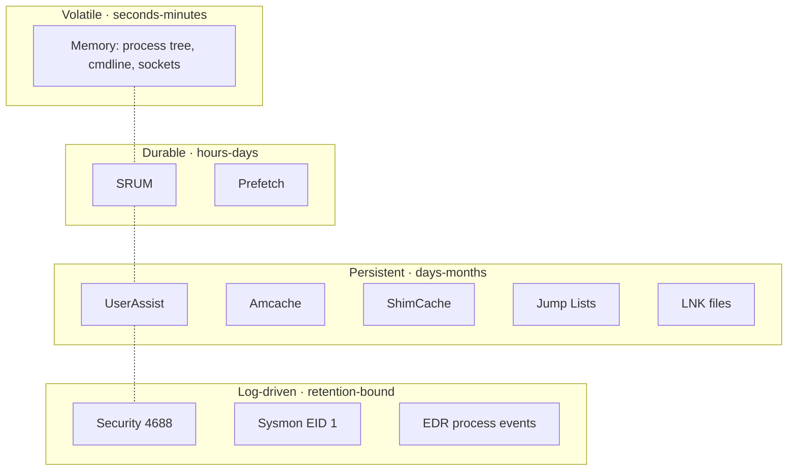

# Chapter 6 — Shell Items, Removable Devices, and Application Artifacts

## Chapter Overview

This chapter answers the question *what did the user actually do?* The previous two chapters covered what existed (NTFS) and what was configured (registry and cloud storage). Windows is unusually generous with evidence of user activity. It records, in many overlapping forms, which programs were launched, which files were opened, which folders were browsed, and which devices were attached. The artifacts that capture this behavior are **shell items** when they relate to the Explorer shell, **execution artifacts** when they relate to programs being run, and **device artifacts** when they relate to hardware that was connected and disconnected.

For incident response, these artifacts are some of the most useful evidence on the platform. They survive when other sources do not. They are difficult to clean up completely, because they live in many places at once. They tend to record both intent, such as typed paths and recently opened documents, and action, such as program executions and file accesses. That combination lets them support or refute hypotheses about what the user — or an attacker operating as the user — was trying to accomplish.

The chapter walks through the major categories: LNK files, Jump Lists, Prefetch, SRUM, shellbags, UserAssist and Amcache, browser and email artifacts, and removable device profiling. Each section explains what the artifact records, how to parse it, what questions it can answer, and what its limits are. Section 6.5 pulls these together. It shows how a multi-source analysis profiles a removable device and traces a file's journey from the host to the device. It also shows how that analysis produces conclusions defensible enough to support an internal or external investigation.

The unifying theme is redundancy. No single artifact tells the whole story. Many of them tell the same story from slightly different angles, and that overlap makes their conclusions strong.

## Learning Objectives

By the end of this chapter, you should be able to:

* Distinguish among the main categories of shell, execution, and device artifacts on Windows
* Parse LNK files and Jump Lists to recover recent file access history
* Use Prefetch and SRUM to establish program execution and resource usage over time
* Read shellbags to identify folder navigation history, including for removable media
* Decode UserAssist and inspect Amcache to corroborate execution evidence
* Parse ShimCache and state accurately what it does and does not prove on modern Windows
* Recognize WSL2 artifacts and examine a distribution's `ext4.vhdx` file system
* Use browser, email, and search index artifacts to investigate user activity that touches the network
* Profile a removable device using registry, shellbag, and file system evidence
* Combine several artifact sources into a defensible reconstruction of user or attacker behavior

---

## 6.1 Evidence of Execution



*Figure 6.1 — Execution evidence by persistence band. The same execution event leaves traces across several bands. The right artifact for your investigation depends on how much time has passed since the event and which sources still have valid data. Use the bands as a "where to look first" map, not as a strict ordering.*


Several Windows artifacts independently capture evidence of execution, which answers one of the most frequent questions in incident response: *did this program run on this host?* In a healthy investigation, several of them agree.

### 6.1.1 LNK (Shortcut) Files

> **Figure 6.2 — _placeholder for `figures/fig-6-2-lecmd-lnk.png`_**
>
> LECmd (Eric Zimmerman) terminal output for a Recent LNK pointing at the lure document `Q4_Payroll_Review.xlsm`, showing the resolved target path, target IDs, and volume serial number. See [`figures/Readme.md`](figures/Readme.md) for capture instructions.


LNK files are Windows shortcuts. Windows creates them automatically when a user opens a file from outside its native application or double-clicks a file in Explorer. Any other interaction that triggers shell shortcut creation produces them too. The most useful collection of LNK files for IR lives under each user's profile in `%APPDATA%\Microsoft\Windows\Recent\`.

A LNK file is a binary structure that records:

- The target file's full path
- The target file's MAC timestamps at the time the shortcut was created
- The target file's size
- The volume serial number and label of the volume containing the target
- The hostname of the machine that created the shortcut
- The MAC address of the system, in some configurations
- The working directory and command-line arguments, where applicable

Two properties of LNK files make them especially useful. First, they survive after the target file is deleted. A LNK file in `Recent\` may continue to point to a file path that no longer exists, with timestamps preserved from the original interaction. Second, when the target lived on removable media, the LNK file records the **volume serial number** of the file system the target sat on. That record survives after the device is detached. Be precise about what that value is. It belongs to the *volume* and is assigned at format time. It does not belong to the hardware. It is not the device serial number USBSTOR records, and the two cannot be compared directly. §6.5.1 sets out the `MountedDevices` chain that actually binds a shortcut to a physical device.

### 6.1.2 Jump Lists

Jump Lists are an Explorer feature, introduced in Windows 7, that exposes recently used items per application. A user who right-clicks Word in the taskbar sees a Jump List of recently opened documents. A user who right-clicks File Explorer sees a Jump List of recently visited folders.

Jump Lists are stored under `%APPDATA%\Microsoft\Windows\Recent\AutomaticDestinations\` and `%APPDATA%\Microsoft\Windows\Recent\CustomDestinations\`. Each file is named with an `AppID` — a unique identifier for the application that owns the Jump List. Each file is a compound file containing many embedded LNK structures plus a `DestList` stream that records the order, last-access time, and access count for each entry.

Jump Lists are valuable because they reveal *which application opened which file*. A LNK file says "this file was opened". A Jump List entry says "this file was opened *with this application*". That attribution matters in investigations involving Office macros, scripted execution, or specific applications used to access sensitive content. There, it is often the difference between a probable conclusion and a confirmed one.

### 6.1.3 Prefetch

> **Figure 6.3 — _placeholder for `figures/fig-6-3-pecmd-prefetch.png`_**
>
> PECmd (Eric Zimmerman) CSV opened in Timeline Explorer with the `update.exe`, `cmd.exe`, and `powershell.exe` rows visible. The `RunCount` and `LastRun` columns are surfaced. See [`figures/Readme.md`](figures/Readme.md) for capture instructions.


Prefetch is a Windows performance optimization that reduces application startup time by precomputing which files an executable typically needs. Forensically, it has an unintended virtue: every prefetched executable produces a `.pf` file in `%SystemRoot%\Prefetch\` that records:

- The executable name and a hash of the path
- The first execution timestamp. From Windows 8 onward, Prefetch retains the last eight execution timestamps, and earlier Windows kept only the last.
- The last execution timestamp
- The total run count
- A list of files referenced by the executable during startup
- The volume containing the executable

For IR, the most common questions Prefetch answers are *did this binary run, when, how many times, and from where?* The list of referenced files is also useful because it often reveals the working directory or input paths that an attacker tool used, even when those paths have since been cleaned up.

Prefetch is enabled by default on Windows desktop SKUs but is **disabled by default on Windows server SKUs**. This is one of the most consistently surprising facts in Windows IR. A clean Prefetch directory on a server does not mean nothing executed there. It usually means Prefetch was not collecting in the first place. Any responsible Prefetch analysis on a server confirms the enablement state at `HKLM\SYSTEM\CurrentControlSet\Control\Session Manager\Memory Management\PrefetchParameters\EnablePrefetcher`.

Modern Prefetch files are compressed. Tools such as PECmd handle the decompression transparently.

### 6.1.4 SRUM (System Resource Usage Monitor)

SRUM is a Windows feature that records per-process resource usage over time: CPU time, network bytes sent and received, and energy consumption. It stores these records in an ESE (Extensible Storage Engine, "JET Blue") database at `%SystemRoot%\System32\sru\SRUDB.dat`. ESE is the same engine behind `Windows.edb` and Exchange databases. It is **not** SQLite, and SQLite tooling will not open it. Parse it with `SrumECmd`, `srum-dump`, or a dedicated ESE reader. Windows updates the database roughly every hour and retains data for about 30 to 60 days.

For IR, SRUM is valuable for two specific questions:

- *Which processes used the network in a given window, and how much data did they send or receive?*
- *Which processes were active on this host on a given day, even if event logs do not record them?*

A process that exfiltrated data through a custom binary may not appear in any obvious place in event logs. It still leaves a SRUM record showing its name, its executable path, and the bytes sent over a particular interface in a particular hour.

You typically analyze SRUM offline, on a copy of `SRUDB.dat` and its associated transaction logs in `%SystemRoot%\System32\sru\`. Tools such as the [SRUM-Dump utility](https://github.com/MarkBaggett/srum-dump) and `srum_dump.py` produce CSV output for inspection or timelining.

---

## 6.2 Shellbags

Shellbags are often decisive in user behavior investigations. Chapter 5 introduced them briefly in the registry context, and this chapter treats them in more depth.

### 6.2.1 What Shellbags Record

Shellbags are registry artifacts in `UsrClass.dat` and `NTUSER.DAT` that record folder navigation in Explorer. For each folder a user has browsed, shellbags record:

- The folder's path or unique identifier
- The folder's view settings (icon size, sort column, sort order)
- A timestamp associated with the navigation

You do not need to understand the internal representation to use shellbags, although the mechanism is intricate. Windows represents folders as PIDLs (pointer-to-identifier-list structures), and the bag and BagMRU keys form a tree that mirrors the user's folder navigation history. Tools such as SBECmd parse shellbags into clear CSV output, with one row per remembered folder.

### 6.2.2 Why Shellbags Matter

Shellbags have three properties that make them useful in IR even when other artifacts are clean:

**They record folders that no longer exist.** A user who browsed a sensitive folder, copied its contents elsewhere, and then deleted the folder still has a shellbag entry for it. Even directory paths that the user explicitly tried to remove typically remain in shellbags.

**They record folders on removable media.** When a user attaches a USB drive and browses through its directory tree, shellbags record each folder visited. The shellbag entries persist after the drive is removed. Combined with USBSTOR and volume identifiers, shellbags are one of the most reliable ways to show that a particular user browsed a particular directory on a particular device at a particular time.

**They record folders on network shares.** Browsing into `\\server\share\Confidential\` produces shellbag entries the same way local browsing does, with the share path preserved. Those entries help when you investigate insider data access.

### 6.2.3 Limits and Gotchas

Shellbag timestamps are not always intuitive. The recorded time may be the time of first navigation, the time of last navigation, or a related event such as the folder last being viewed in Explorer. Different versions of Windows and different shellbag entry types have different conventions. A shellbag entry showing a recent timestamp tells you the folder was accessed recently. The precise meaning of "recent" depends on context, so note the ambiguity in your findings.

Shellbags are also per-user. They live in the user's `NTUSER.DAT` and `UsrClass.dat` and reflect that user's behavior alone. To investigate a multi-user host fully, examine the hives from every profile.

---

## 6.3 UserAssist and Amcache

These two artifacts fill different niches in execution evidence and frequently appear together in findings.

### 6.3.1 UserAssist

UserAssist lives in `HKCU\Software\Microsoft\Windows\CurrentVersion\Explorer\UserAssist` and records GUI program executions launched through Explorer. Each value records:

- The program identifier (a path or known folder ID, ROT-13 encoded)
- A run counter
- The last execution timestamp
- A focus time (cumulative window focus time, in some configurations)

UserAssist is per-user and reflects programs the user launched through the GUI — by clicking Start menu shortcuts, double-clicking executables in Explorer, or selecting items from the taskbar. Programs launched purely through command-line invocation, scripts, or scheduled tasks generally do not appear.

The ROT-13 encoding of the value names is a minor inconvenience and a frequent source of analyst confusion. It is not encryption. It is a simple substitution applied to the names so that they are not displayed accidentally in support tools. Registry Explorer and RegRipper handle the decoding automatically.

For IR, UserAssist is most useful in two situations. The first is when Prefetch is unavailable, as on server systems. The second is when the question is specifically *did the user launch this program through the GUI?* That question comes up in insider data movement cases, where the distinction between user-initiated execution and automated execution matters.

### 6.3.2 Amcache

Amcache lives in `%SystemRoot%\AppCompat\Programs\Amcache.hve`, an additional registry hive that records metadata about programs present on the system. For each binary, Amcache typically records:

- The full file path
- The SHA-1 hash of the file
- The file size and version metadata
- The first execution time, where available
- Several other compatibility-related fields

Amcache is valuable for two specific reasons. First, the SHA-1 hash lets you identify known-good or known-bad binaries even after the binary itself has been deleted from disk. Second, Amcache records binaries the system has *seen*. That set includes some programs that have not necessarily executed on this host but that Windows compatibility infrastructure has scanned.

**Amcache is not proof of execution.** That second property makes the artifact valuable, and it is also the most common source of misreadings. An entry means the binary was *present and inventoried*. The compatibility infrastructure walks directories, so a file that was merely copied onto the host, extracted from an archive, or sitting on an attached volume can earn an Amcache entry without ever running. Windows builds populate the `first execution time` field inconsistently, so do not treat it as an execution timestamp without corroboration.

Amcache cleanly proves **presence and identity**: this binary, with this hash, at this path, was on this host. That is a strong finding. It survives deletion of the binary, and the hash links to threat intelligence. It is still a different claim from "this binary ran." For execution, pair Amcache with Prefetch, a 4688 process-creation event, or a UserAssist entry. §6.3.3 covers the same trap in ShimCache, and the comparison table there sets out what each of the four artifacts does and does not prove.

Tools such as [AmcacheParser](https://ericzimmerman.github.io/) and RegRipper parse Amcache. The output is a catalogue of binaries that touched the system, with hashes that tie them to known threat intelligence.

Amcache records can persist for a long time, but the hive is also subject to periodic cleanup and rebuild. Older and modern Windows versions handle Amcache differently, and recent builds split Amcache content across multiple files. Draw specific tooling guidance from current vendor documentation.

### 6.3.3 ShimCache (AppCompatCache)

ShimCache matters most on the hosts where Prefetch is not collecting, which, as 6.1.3 noted, means every Windows server in the default configuration. It is also the most misunderstood artifact in this chapter, and the misunderstanding regularly produces findings that do not survive review.

It lives in the SYSTEM hive at:

```
HKLM\SYSTEM\CurrentControlSet\Control\Session Manager\AppCompatCache\AppCompatCache
```

The value is a single opaque binary blob. Windows uses it as part of the application compatibility infrastructure. When the shim engine evaluates an executable to decide whether any compatibility fixes apply, it records the file in this cache so it does not have to repeat the evaluation. That evaluation is a side effect of the operating system becoming aware of the binary. That is precisely why it is forensically interesting, and precisely why it is so easy to over-read.

**What each entry actually records.** On Windows 10 and 11, an entry contains two things: the full path of the executable and the `$STANDARD_INFORMATION` last-modified timestamp of that file as it stood when the entry was written. That is it.

**What it does not record.** On Windows 10 and 11, ShimCache **does not reliably record an execution timestamp, and it does not record an execution flag**. The older literature says otherwise because it described Windows 7 and Server 2008 R2. Their cache format included an insert-flag field that could be read as an execution indicator. That field is gone on modern Windows. The timestamp in a Windows 10 or 11 ShimCache entry is the *binary's* last-modified time, not the time it ran. A binary compiled in 2019 and executed this morning shows a 2019 timestamp.

The correct reading of a modern ShimCache entry is therefore: **this path was present on this system and the operating system became aware of it.** It is not proof of execution. Browsing a directory in Explorer, an antivirus scan, an installer enumerating files, and a user actually double-clicking the binary can all put an entry in the cache. A finding that says "ShimCache shows `psexec.exe` executed at 14:22" is wrong twice over — wrong about execution, and wrong about what the timestamp means.

Read in the right frame, ShimCache is still valuable. On a server with no Prefetch, ShimCache may be the only artifact showing that an attacker's tool was ever on the box, complete with the path it lived at and the last-modified time of the specific build they used.

**It is written at shutdown.** Windows maintains the cache in kernel memory during a boot session and flushes it to the registry when the system shuts down cleanly. Two consequences follow. First, a SYSTEM hive collected from a running host reflects the state as of the *last* shutdown, not the present moment. Everything that has happened since the current boot is in memory, not in the hive you just copied. Second, you can recover the current-session cache from a memory image, which is one more reason memory capture ranks where it does in Chapter 3. On a host that has not rebooted in 90 days, the hive-based ShimCache is 90 days stale.

**Capacity and ordering.** Modern Windows caps the cache at 1024 entries and stores them **most-recent-first**: the entry at position 0 is the most recently inserted. Entries carry no insertion timestamps, so that ordering is the only temporal information the artifact carries. It is real information, though. If a known-bad binary sits three positions away from a legitimate binary whose activity you can date from another source, you have bounded when the cache learned about it. On a busy server, the 1024-entry cap can churn in days. On a quiet one, it can hold months.

**Control sets.** The SYSTEM hive usually contains more than one control set (`ControlSet001`, `ControlSet002`). Because they can hold caches written at different shutdowns, parsing all of them sometimes yields entries that have already been pushed out of the current set. Parse every control set present and record which one each entry came from.

**Tooling.** [AppCompatCacheParser](https://ericzimmerman.github.io/), from the Eric Zimmerman suite, handles every format version from Windows XP through current builds and parses all control sets by default:

```
AppCompatCacheParser.exe -f C:\Triage\WEB-APP-03\SYSTEM --csv C:\Cases\WEB-APP-03\shimcache\
```

The CSV gives one row per entry with the control set, the cache position, the full path, and the last-modified timestamp. RegRipper's `appcompatcache` plugin does the same job in text-report form.

**The pairing pattern.** ShimCache and Amcache are stronger together than either is alone, because they fail in opposite directions. ShimCache gives you a path and an ordering but no hash and no confirmation of execution. Amcache gives you a SHA-1 hash, the file size, and version metadata, but its coverage is uneven and its own execution semantics are soft. When both name the same path, you can establish that a specific binary was present at a specific location. The hash identifies it and makes it checkable against threat intelligence. You also have a rough position for it in the host's timeline. Add Prefetch, a Security event ID 4688, or Sysmon event ID 1 to convert presence into execution.

| Artifact | Scope | What it proves | What it does **not** prove |
|---|---|---|---|
| **Prefetch** (`%SystemRoot%\Prefetch\*.pf`) | Per-machine | The binary executed; run count; first run and the last eight run times; files it referenced at startup | Which user ran it; the command line used. Absent entirely if Prefetch is disabled (server default) |
| **Amcache** (`Amcache.hve`) | Per-machine | The binary was present, with SHA-1 hash, size, path, and version metadata — identity even after deletion | That it executed. Entries are also created for binaries merely scanned or enumerated |
| **ShimCache** (`SYSTEM` hive) | Per-machine | The path was present and the OS became aware of it; the binary's `$SI` last-modified time; relative ordering by cache position | Execution, an execution time, or a user, on Windows 10/11. Written only at shutdown, so a live hive lags the current session |
| **UserAssist** (`NTUSER.DAT`) | Per-user | A specific user launched the program through the Explorer GUI, with a run count and a genuine last-execution timestamp | Anything launched from a command line, script, service, or scheduled task — these do not appear at all |

> **Why this matters:** These four artifacts are routinely quoted as interchangeable "evidence of execution", but they are not interchangeable. The strongest execution finding names the artifact, states what that artifact can carry, and adds a second source for the part it cannot. "ShimCache places `svchost.exe` at `C:\Users\Public\` — a path Windows never uses for that binary — and Amcache gives its SHA-1, which matches a known tool; Security 4688 confirms it ran at 03:14 as `svc-backup`" is a defensible chain. "ShimCache shows it ran" is an assertion the artifact cannot support.

---

## 6.4 Browser, Email, and Search Index

Several user-activity artifacts live outside the registry and shell artifact set. Browser history, email client artifacts, and the Windows Search index answer questions about user behavior that often touches the network.

### 6.4.1 Browser History

Modern browsers record visited URLs, downloads, search queries, and form data in SQLite databases. The location varies by browser:

| Browser | History Database |
|---|---|
| Chrome / Edge (Chromium) | `%LOCALAPPDATA%\Google\Chrome\User Data\Default\History` (Chrome) or `%LOCALAPPDATA%\Microsoft\Edge\User Data\Default\History` (Edge) |
| Firefox | `%APPDATA%\Mozilla\Firefox\Profiles\<profile>\places.sqlite` |
| Internet Explorer / legacy Edge | `%LOCALAPPDATA%\Microsoft\Windows\WebCache\WebCacheV01.dat` |

Browser history is most useful in IR for confirming or refuting browser-based activity claims. Did the user visit a phishing page? Did they download a particular file from a particular URL, and at what time? Did they upload a file to a personal cloud storage account through a web interface?

The artifact also records search queries, which can reveal user intent. A search for "how to delete browser history" or "encrypt and zip files" performed shortly before suspect activity is not proof of anything by itself. It is still a useful supporting observation.

DB Browser for SQLite is the standard tool for ad-hoc browser history inspection. Forensic suites such as Autopsy and dedicated browser parsers such as the [Hindsight tool](https://github.com/obsidianforensics/hindsight) automate the extraction and produce timelines.

### 6.4.2 Email Artifacts

Email clients vary widely in their on-disk format and forensic value.

**Outlook with PST/OST files** stores mail in a single file per profile: `*.pst` for archived mail and `*.ost` for cached Exchange mail. These files contain the message bodies, attachments, recipients, sender addresses, timestamps, and folder structure. Tools such as [libpff](https://github.com/libyal/libpff) and Outlook itself can open these files for inspection. For incident response, PST/OST analysis is most useful in confirming receipt of phishing messages, identifying attachment names and hashes, and understanding mail folder organization.

**Cloud-hosted mail (Outlook on the web, Gmail, etc.)** leaves much less on disk. Some metadata may be visible in browser history, and cached attachments may exist temporarily. The authoritative source is the cloud mail server itself, which is outside the host-based evidence picture but accessible through administrative tools.

### 6.4.3 Windows Search Index

The Windows Search service maintains an index of file content and metadata in `%ProgramData%\Microsoft\Search\Data\Applications\Windows\Windows.edb`. The database is large, and parsing it directly is unusual in IR. It occasionally yields content snippets from files that have since been deleted. Tools such as [ESEDatabaseView](https://www.nirsoft.net/utils/ese_database_view.html) and the [WinSearchDBAnalyzer](https://github.com/moaistory/WinSearchDBAnalyzer) project let you inspect it.

The search index is most useful when other artifact sources are unavailable and you need to partially recover a specific file's content. It is rarely the first stop in an investigation, but it has closed gaps in cases where other evidence had been deliberately destroyed.

---

## 6.5 Removable Device Profiling

Removable device investigations are common in insider data movement cases, contractor offboarding reviews, and incidents where the question is whether sensitive files were copied to a USB drive. The evidence chain combines registry, shellbag, file system, and device-specific artifacts.

### 6.5.1 The Core Evidence Chain

A defensible removable device profile typically includes:

| Source | What It Provides |
|---|---|
| `HKLM\System\CurrentControlSet\Enum\USBSTOR` | Vendor, product, serial number; first and last connection times (the timestamps are Windows 8 and later only — see Chapter 5 §5.2.4) |
| `HKLM\System\CurrentControlSet\Enum\USB` | Broader USB device history, not just mass storage |
| `HKLM\Software\Microsoft\Windows Portable Devices\Devices` | Device-to-friendly-name mapping |
| `HKLM\System\MountedDevices` | Volume GUID-to-drive-letter mappings |
| `HKLM\System\CurrentControlSet\Enum\USB\Vid_xxxx&Pid_yyyy\<serial>\Device Parameters` | Some additional device identifiers |
| `setupapi.dev.log` (`%SystemRoot%\INF\setupapi.dev.log`) | First-installation timestamp for the device |
| LNK files and Jump Lists | Files opened from the device, with volume serial number recorded |
| Shellbags | Folders browsed on the device |
| MFT and USN Journal of the host | Files copied off the device to the host |

Two different identifiers get confused here, and keeping them apart makes the correlation defensible.

The **device serial number** is what USBSTOR records. It comes from the USB device descriptor and is a property of the hardware. The **volume serial number** is what a LNK file records. It is a 32-bit value that Windows assigns when the volume is *formatted*. It is a property of the file system, not the device. Reformat the same USB stick and the volume serial changes while the device serial does not.

Neither is derived from the other, so you cannot match a LNK volume serial directly against a USBSTOR entry. The chain runs through the registry: `MountedDevices` maps a drive letter and a `\??\Volume{GUID}` to the device, and the volume GUID ties back to the USBSTOR instance. Match the LNK's volume serial to the volume, then the volume to the device.

Done properly, the binding is strong. It places a specific file on a specific volume that was mounted from a specific device. Asserted as a direct serial-to-serial match, it is wrong: a reviewer comparing the two values will see two unrelated numbers.

### 6.5.2 Putting It Together

A complete profile of a removable device used in an incident might look like this:

- USBSTOR shows a Kingston DataTraveler 3.0, serial `0019E06B4A1FC3B2A0E40C77`, first seen 2024-09-12, last seen 2024-11-14 14:47 UTC.
- `MountedDevices` shows the device's volume GUID was mapped to `E:` at last connection.
- `setupapi.dev.log` records the initial driver installation on 2024-09-12 at 09:22 UTC.
- Shellbag entries for `E:\Confidential\Q4\` exist with timestamps in the 14:47 window.
- LNK files in `Recent\` reference `E:\Confidential\Q4\Payroll.xlsx` and other files in that directory. They carry a volume serial that matches the volume `MountedDevices` maps to that device. They do not carry the device serial, which LNK files do not record.
- The host's MFT shows new files in `C:\Users\payroll-admin\Documents\Backup\` created in the same 14:47 window, with names matching files from the device.

Each piece is useful on its own. Together they make a finding that is hard to dispute.

### 6.5.3 Device Profile Fields — Quick Reference

A removable-device finding records vendor / product / serial, first and last connection timestamps, drive letter at last connection, volume serial and volume label, and the specific shellbag / LNK / Jump List / MFT entries that bind the device to user activity. It also records the tool, version, and command for each parse. A clean profile makes the difference between an interesting observation and a finding that will support an HR action, an external investigation, or a regulatory disclosure.

---

## 6.6 WSL2 as a Hiding Place

Every artifact in this chapter assumes that what ran on the host ran as a Windows process. The Windows Subsystem for Linux breaks that assumption, and attackers have noticed.

WSL2 runs a real Linux kernel inside a lightweight utility VM. Processes inside the distribution are not Win32 processes: they do not create Prefetch entries, they do not appear in Security event ID 4688, and they are largely invisible to EDR sensors that work by hooking Win32 APIs and the Windows kernel callbacks. From the host's perspective, an attacker's full Linux tooling session shows up as `wsl.exe`, `wslhost.exe`, and a `vmmem`/`vmmemWSL` process consuming resources. The `curl`, `python3`, `ssh`, `tar`, and `nmap` invocations inside it produce no host-level process telemetry at all.

The distribution's file system is also a single opaque VHDX that on-access antivirus does not scan meaningfully, so it makes a convenient container for a toolkit. Because WSL mounts the Windows drives at `/mnt/c/`, an attacker can read, archive, and stage host files entirely through Linux tooling.

WSL still leaves plenty of evidence on the Windows side, and almost none of it is what the attacker is thinking about.

**The distribution's file system.** Each installed distribution is a sparse VHDX containing an ext4 file system. For Store-installed distributions, the classic path is:

```
%LOCALAPPDATA%\Packages\CanonicalGroupLimited.Ubuntu*_79rhkp1fndgsc\LocalState\ext4.vhdx
```

Other distributions use their own package family names, and newer WSL builds may place the disk elsewhere, for example under `%LOCALAPPDATA%\wsl\`. Do not guess: the registry records the authoritative path for each distribution, as described below. The VHDX's size, `$SI` timestamps, and USN Journal entries are themselves evidence. A distribution disk that grew by several gigabytes during the incident window is a lead in its own right. Its last-modified time bounds when the distribution was last used.

**The registry.** WSL configuration lives under:

```
HKCU\Software\Microsoft\Windows\CurrentVersion\Lxss
```

with one GUID-named subkey per installed distribution. Each holds `DistributionName`, `BasePath`, `State`, `Version` (1 or 2), `DefaultUid`, and often the default environment. `BasePath` is the folder containing the VHDX, and it is the authoritative location. The parent key records `DefaultDistribution`. Key last-write times give you installation and modification timing. Because this is `HKCU`, the artifact is **per-user**: it tells you which account installed and configured the distribution. A `Lxss` key on a finance workstation whose user has no plausible reason to run Linux is a question worth asking.

**Execution evidence on the Windows side.** `wsl.exe`, `wslhost.exe`, `wslservice.exe`, and `bash.exe` are ordinary Windows binaries and behave like any other in this chapter's artifacts: Prefetch entries with run counts and last-run times, ShimCache and Amcache entries, UserAssist if launched through the GUI, and Security event ID 4688 or Sysmon event ID 1 with the command line. That command line is often the most valuable single item, because attackers pass work into the subsystem on it. A command such as `wsl.exe -d Ubuntu -u root -e /bin/bash -c "..."` puts the whole command in a Windows process creation record. Shellbags, LNK files, and `TypedPaths` also pick up `\\wsl$\<distro>\` and `\\wsl.localhost\<distro>\` paths when someone browses the Linux file system from Explorer. Those entries place a user inside specific Linux directories at specific times.

**Examining the VHDX.** You can analyze the disk itself with ordinary Linux tooling. Attach it read-only on a Windows analysis host with `Mount-VHD -Path <path> -ReadOnly`, or work from a copy on a Linux workstation with `qemu-nbd`, `libguestfs`, or an ext4-aware forensic suite. Autopsy and The Sleuth Kit read ext4 directly. Once mounted, it is a normal Linux triage: `/home/<user>/.bash_history` and `/root/.bash_history`, `/etc/passwd` and `/etc/shadow`, `/var/log/`, cron entries, SSH keys and `known_hosts` under `.ssh/`, package manager logs in `/var/log/apt/`, and the ext4 timestamps on everything. Shell history in particular tends to be intact, because attackers who are careful about Windows artifacts frequently are not careful about `.bash_history`.

> **Why this matters:** WSL2 is not an obscure feature. It is a supported, single-command install on modern Windows, and it does not require administrative rights once the feature is enabled. Sometimes network telemetry proves something reached out and no host process accounts for it. When an investigation shows that kind of execution gap, check for `Lxss` and an `ext4.vhdx` before concluding the evidence was destroyed. The activity may never have been a Windows process at all.

---

## Chapter Summary

Shell items, execution artifacts, and device artifacts together form one of the richest evidence categories on Windows. They record what users opened, what programs ran, what folders were browsed, and what hardware was attached, in many overlapping forms that survive each other's cleanup. For incident response, this redundancy is the source of the category's strength: findings that draw on several of these artifacts at once are very hard to dispute.

Execution evidence comes primarily from LNK files, Jump Lists, Prefetch, and SRUM. LNK files capture per-file shortcuts that often outlive the targets they point to. They record the volume serial number of the media the target sat on. That binds a shortcut to a specific *volume*, and to a specific device only once `MountedDevices` has carried you from the volume to the USBSTOR entry. Jump Lists add per-application attribution. Prefetch records executable launches with first-run, last-run, run-count, and referenced-file metadata, though it is disabled by default on Windows servers. SRUM captures per-process resource and network usage over a 30-to-60-day window.

Shellbags record folder navigation history, including for folders that no longer exist and on devices that are no longer attached. UserAssist records GUI launches per user, with execution counts and last-run times. Amcache records file metadata and SHA-1 hashes for binaries that have touched the system, often surviving after the binaries are deleted. ShimCache fills the gap on servers where Prefetch is disabled, recording the path and the binary's last-modified timestamp. On Windows 10 and 11, it carries no execution flag and no execution time, so it evidences presence and awareness rather than execution. Windows writes it to the registry only at shutdown. Paired with Amcache's hashes, ShimCache becomes considerably stronger than either artifact alone.

Browser, email, and search index artifacts cover user activity that touches the network. Browser history captures visited URLs, downloads, and search queries. Email artifacts vary by client, with PST and OST files yielding the most detail when locally available. The Windows Search index occasionally preserves file content fragments that are not recoverable from the file system alone.

WSL2 is the blind spot that cuts across all of these. Processes inside a Linux distribution are not Win32 processes and leave no Prefetch, no 4688, and little EDR telemetry. The Windows side still records the distribution in `HKCU\...\Lxss` and the `ext4.vhdx` on disk, with its growth and timestamps. It also records `wsl.exe` invocations, often with the full inner command line, in the ordinary execution artifacts.

Removable device profiling synthesizes all of this. A clean profile names the device by vendor, product, and serial and ties it to a drive letter through MountedDevices. It correlates browsed folders through shellbags and identifies opened files through LNK and Jump List entries. It confirms file movement through the MFT and USN Journal. When all of these align in time, the resulting finding is one of the most defensible reconstructions a Windows responder can produce.

## Key Terms

**Amcache:** A registry hive at `%SystemRoot%\AppCompat\Programs\Amcache.hve` that records metadata, including SHA-1 hashes, for binaries the system has seen.

**AppID:** A unique identifier for an application that owns a Jump List file in `AutomaticDestinations\`.

**DestList Stream:** A stream within a Jump List file that records the order, last-access time, and access count of recent items.

**Jump List:** A per-application list of recently accessed items, stored under `%APPDATA%\Microsoft\Windows\Recent\AutomaticDestinations\`.

**LNK File:** A Windows shortcut file recording target path, target timestamps, volume serial number, and other metadata about a file the user has accessed.

**MountedDevices:** The registry path under `HKLM\System\MountedDevices` that records the mapping between volume GUIDs and drive letters.

**PIDL:** A pointer-to-identifier-list structure that Windows uses to represent items in the shell namespace, including in shellbags.

**Prefetch:** A Windows performance feature that produces `.pf` files in `%SystemRoot%\Prefetch\` recording executable launch metadata; disabled by default on server SKUs.

**Shellbag:** A registry artifact recording folder navigation history in Explorer, persistent across deletion of the folder.

**ShimCache (AppCompatCache):** A binary value at `HKLM\SYSTEM\CurrentControlSet\Control\Session Manager\AppCompatCache\AppCompatCache` recording the path and `$SI` last-modified timestamp of executables the operating system has evaluated. On Windows 10 and 11 it carries no execution flag or execution timestamp, is capped at 1024 most-recent-first entries, and is written to the registry only at shutdown.

**SRUM (System Resource Usage Monitor):** A Windows feature that records per-process resource and network usage in `%SystemRoot%\System32\sru\SRUDB.dat`.

**UserAssist:** A per-user registry artifact recording GUI program launches, with names ROT-13 encoded.

**USBSTOR:** The registry path recording USB mass storage device history by vendor, product, and serial number.

**Volume Serial Number:** A unique identifier assigned to a formatted volume, recorded in LNK files and elsewhere, that ties shell artifacts to specific physical media.

**Windows Search Index:** A database of indexed file content and metadata at `%ProgramData%\Microsoft\Search\Data\Applications\Windows\Windows.edb`.

**WSL2 (Windows Subsystem for Linux 2):** A Linux kernel running in a lightweight VM on a Windows host. Its distributions are stored as `ext4.vhdx` virtual disks and registered per-user under `HKCU\Software\Microsoft\Windows\CurrentVersion\Lxss`; processes inside them are not Win32 processes and produce little host execution telemetry.

## Review Questions

1. Why does an LNK file remain useful after its target file has been deleted?
2. What does a Jump List add to the evidence already provided by LNK files?
3. Why is it important to confirm Prefetch's enablement state when investigating activity on a Windows server?
4. What kinds of investigative questions does SRUM uniquely answer?
5. How do shellbags continue to provide evidence when the folders themselves no longer exist?
6. What is the difference between UserAssist and Amcache as sources of execution evidence?
7. When is browser history evidence most decisive in an investigation?
8. A LNK file records a volume serial number and USBSTOR records a device serial number. Why can the two not be compared directly, and what chain of artifacts actually binds a shortcut to a specific physical device?
9. What artifact sources together support a defensible reconstruction of files copied to a USB drive?
10. Why is documentation of tool, version, and command particularly important for shell artifact analysis?

## Practical Exercises

1. From your lab VM, copy the contents of `%APPDATA%\Microsoft\Windows\Recent\` and parse the LNK files with LECmd. Identify at least three target files and their volume serial numbers.
2. Parse the Jump Lists in `Recent\AutomaticDestinations\` with JLECmd. For one application, list the files it has recently opened and the timestamps.
3. Run a simple PowerShell script on your lab VM, then parse the corresponding Prefetch file with PECmd. Identify the referenced files and the run count.
4. Confirm whether Prefetch is enabled on your lab VM by checking the relevant registry value, and document the result.
5. Open `SRUDB.dat` from your lab system with srum-dump and identify a process with non-trivial network usage in the last hour.
6. Browse into a folder on a USB drive in your lab VM, then unplug the drive. Parse the shellbags from your `UsrClass.dat` and confirm the folder is recorded.
7. Decode at least five UserAssist entries from your lab `NTUSER.DAT` and confirm the program executions match your expectations.
8. Parse Amcache with AmcacheParser and identify the SHA-1 hash for a chosen binary. Look the hash up in a public sample database (e.g., VirusTotal) to confirm identification.
9. Build a one-page profile of a removable device used in your lab — vendor, product, serial, drive letter at last connection, browsed folders, opened files — using at least four artifact sources.
10. Document the exact tool, version, command, and source artifact hash for each parse you perform during these exercises.

> **Hands-on:** [Lab 06 — Shell Items, Removable Devices, and Application Artifacts](../Labs/Lab06/ReadMe.md) — parse LNK files, Jump Lists, Prefetch, Shellbags, and Amcache from the FIN-WS23 dataset and reconstruct user activity from them.

---

## Looking Ahead

Shell items and device artifacts tell you what was done on the host. The next chapter covers what was running *in memory* — the volatile state of the system at the moment of acquisition. Memory forensics opens the door to fileless malware, in-memory credentials, and process state that no disk-resident artifact can recover.

---

<div align="center">

[Chapters](.) · [Labs](../Labs/ReadMe.md) · [Simulated Data](../Data/README.md) · [Quick Reference](AppendixE.md) · [Glossary](Glossary.md) · [About the Author](About.md)

</div>
