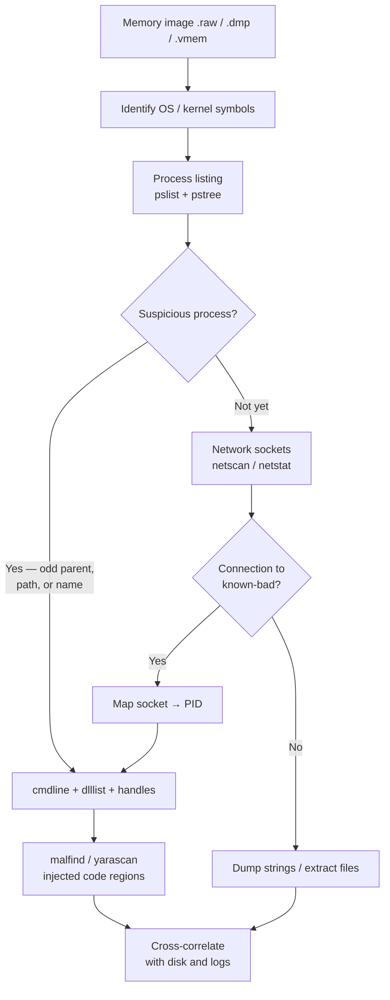

# Chapter 7 — Memory Forensics

## Chapter Overview

Disk artifacts tell you what *was*. Memory tells you what *is* — or what was, until the moment you captured it. The most consequential attacker activity in modern Windows incidents often happens entirely in memory. That includes fileless malware, injected code, in-memory credential theft, command-and-control (C2) beacons that never write a configuration file to disk, and transient PowerShell that leaves nothing in script block logs because the logging was disabled. None of that exists on disk in any useful form, and none of it survives a reboot. All of it is recoverable from a memory image taken before the system was touched, sometimes in striking detail.

Memory forensics has a reputation for being intimidating, but the practical IR workflow is much simpler than the theoretical depth suggests. The field has its own toolchain, with Volatility as the de facto standard. It has its own vocabulary, such as kernel pools, EPROCESS structures, and KDBG signatures, and its own failure modes. Those details matter, yet a small number of well-chosen plugins answer most of the questions a responder brings to a memory image. Those questions include which processes were running, which had unusual parents, which had open network connections, which contained injected code, and which command lines were used.

This chapter covers memory forensics from the IR perspective. It explains why memory matters, walks through the tooling, and describes a workflow for extracting case-note findings from a freshly captured Windows memory image. Chapter 3 covered memory acquisition. This chapter assumes you have an image and need to do something with it.

The central idea: you do not need to be a memory forensics expert to get value from a memory image. You need to know which questions memory can answer, which plugins or commands address each question, and how to triage the output quickly enough to keep up with the rest of the investigation.

## Learning Objectives

By the end of this chapter, you should be able to:

* Explain why memory often contains evidence that no disk artifact preserves
* Describe the major frameworks and tools used for Windows memory analysis
* Identify the OS profile and confirm an image is parsable before deep analysis begins
* Enumerate processes, parent-child relationships, and command lines from a memory image
* Inspect network connections and tie them to owning processes
* Identify common indicators of process injection and in-memory tradecraft
* Triage suspicious processes by dumping memory regions and inspecting strings, DLLs, and handles
* Document memory findings in a way that supports later review and corroborates other evidence

---

## 7.1 Why Memory Matters in IR

Memory captures the live state of the system: what is running, what is connected, which credentials are cached, and what content is decrypted. None of this is stable. A reboot, a killed process, or enough time for the operating system to reuse the memory pages destroys the evidence with no recovery path.

For incident response, three categories of evidence make memory uniquely valuable.

### 7.1.1 Process State and Tradecraft

The list of running processes is the first thing memory can give you, and it carries far more than process names. The live process list shows:

- Every process currently active, with its name, PID, and parent PID
- Each process's full command line, including encoded PowerShell, base64-decoded scripts, and arguments that were never written anywhere persistent
- Each process's loaded DLLs, including unusual or unsigned modules
- Each process's open handles to files, registry keys, named pipes, and other kernel objects
- Each process's owning user and integrity level

Attackers using **fileless techniques** — in-memory PowerShell, reflective DLL loading, process hollowing, process injection — leave no useful disk footprint. They do leave running processes with telltale anomalies. One example is a `notepad.exe` that has no open windows but has an outbound HTTPS connection to an unfamiliar IP. Another is a `svchost.exe` whose parent is `cmd.exe` instead of `services.exe`. A third is a process with a loaded module that no vendor signed and that is not on disk anywhere a legitimate DLL would live.

### 7.1.2 Network Connections and C2 Infrastructure

Memory also captures live network state: established TCP connections, listening sockets, and recently used UDP endpoints. That state is often the most direct evidence of active C2 activity.

A standard memory triage lists network endpoints with their owning processes, so an unfamiliar remote IP, an unusual port, or a process with no business making network connections is immediately visible. The image also preserves the connections that were established at the moment of capture. An active C2 channel is recorded with its precise socket state, even if the connection has since terminated.

Live socket state is one reason memory acquisition is so time-sensitive in active incidents. Containment, a reboot, or even the attacker noticing they have been spotted can close C2 connections. Once a connection closes, its session-specific information may be unrecoverable from any other source.

### 7.1.3 In-Memory Secrets and Decrypted Content

Memory often contains decrypted versions of content that exists on disk only in encrypted form, including:

- Cached credentials (hashes, Kerberos tickets, sometimes plaintext passwords)
- Decrypted private keys and session keys
- The plaintext of encrypted file content while a file is open
- Browser session data including cookies, tokens, and decrypted form data
- Recently accessed cloud authentication tokens

For incident response, this content cuts both ways. Memory can reveal the credentials an attacker harvested or the tokens they intercepted, which informs containment and remediation. The same evidence is also sensitive, because a memory dump from a production system contains material that itself needs careful handling. The chain of custody and access controls established in Chapter 1 apply with particular force to memory images.

---

## 7.2 Tooling

A handful of tools cover most operational needs in Windows memory forensics, a toolchain that has matured considerably over the past decade.

### 7.2.1 Volatility 3 and 2.x

[Volatility](https://www.volatilityfoundation.org/) is the de facto standard framework for memory analysis. It is open source, plugin-driven, and supports Windows, Linux, and macOS images. Two major versions are in active use. The newer Volatility 3 is written in Python 3. The older Volatility 2.x is no longer actively developed, but it still has plugins and workflows that have not been fully ported.

Volatility 3 is the default choice for most modern Windows IR work. Plugin invocations look like this:

```
vol.py -f WKSTN-221_memory.raw windows.info
vol.py -f WKSTN-221_memory.raw windows.pslist
vol.py -f WKSTN-221_memory.raw windows.netscan
vol.py -f WKSTN-221_memory.raw windows.malfind
```

Volatility 3 does not require an explicit profile selection. It identifies the OS version automatically from the image. Volatility 2.x required a `--profile=` flag and an `imageinfo` step to determine the profile, one of the smaller but more visible differences between the versions.

### 7.2.2 MemProcFS

> **Figure 7.1 — _placeholder for `figures/fig-7-1-memprocfs-mount.png`_**
>
> MemProcFS mounted at `M:\` in File Explorer, with the `name\` directory expanded and the suspicious `powershell.exe-3704\` subtree open to `cmdline\` and `modules\`. See [`figures/Readme.md`](figures/Readme.md) for capture instructions.


[MemProcFS](https://github.com/ufrisk/MemProcFS) takes a different approach from Volatility: it mounts a memory image as a virtual file system, typically at `M:\` on Windows or `/tmp/mount/` on Linux. Once the image is mounted, processes appear as directories, modules and handles appear as files, and registry hives are browsable. You can navigate the memory image with familiar shell tools — `dir`, `findstr`, `Get-Content`, `grep`, a code editor, anything that reads files. An operation that takes a Volatility plugin invocation becomes a `cd` and a `cat`.

For exploratory triage, that layout is a substantial ergonomic gain. Looking for a specific suspicious process becomes:

```
M:\name\powershell.exe-3704\
  cmdline\           command line as a text file
  modules\           one file per loaded DLL
  handles\           open handles, browsable
  vad\               virtual address descriptors with hex dumps
  threads\           per-thread stacks and registers
  memorymap.txt      summary of the process address space
  ...
```

Compared with one Volatility plugin per query, this layout is faster to scan and friendlier to scripting in shells you already know. It is also easier to share, because you can copy a directory tree into a zip. Many practitioners reach for MemProcFS first to explore what is running on a host. They then drop into Volatility for plugins where its analysis is sharper, such as the `windows.malfind` heuristics and `windows.svcscan` enumeration.

MemProcFS also exposes a plugin architecture for Python and C. It includes built-in YARA scanning, forensic timeline generation, and integration with [PCILeech](https://github.com/ufrisk/pcileech) for live-system memory acquisition over direct memory access (DMA). It supports the same major Windows versions that Volatility 3 covers, plus several Linux distributions.

The two tools complement each other, and most responders end up using both. If you are choosing one to start with, use **MemProcFS for navigation and exploratory work**. Use Volatility 3 for targeted plugin-driven analysis and for questions where the Volatility community has built more mature heuristics. Lab 07 is built on Volatility 3 output for tooling continuity. Every analytical question the lab asks could be answered equally well, and often more naturally, by mounting the same memory image with MemProcFS.

### 7.2.3 Rekall

[Rekall](https://github.com/google/rekall) began as a fork of Volatility focused on performance and a more interactive analysis experience. The project is archived and no longer maintained. Most new IR work has moved to Volatility 3 or MemProcFS, but Rekall still appears in older case material.

### 7.2.4 Redline and Commercial Tools

**Redline** comes from Mandiant, now part of Google Cloud. It provides guided, GUI-driven memory triage for analysts who are less comfortable with command-line memory analysis. It produces structured reports and supports importing indicators for hunting. It is also legacy software. The original FireEye download page is gone, distribution has moved more than once since the Mandiant acquisition, and it has had no meaningful development in years. Redline still appears in older case material and training, so it is worth recognizing. On a new engagement, treat MemProcFS or Volatility 3 as the current answer rather than reaching for Redline.

Commercial DFIR platforms, such as Magnet AXIOM, OpenText EnCase, and X-Ways, also include memory analysis modules of varying depth. For organizations already invested in those tools, they may be the path of least resistance.

### 7.2.5 EDR Live Response

Many modern EDR products include live response features that capture memory or query the live state of a running system, so you do not have to deploy acquisition tools by hand. Where it is available, EDR live response is sometimes the fastest path to volatile evidence. Output formats vary by vendor, and the analysis is usually shallower than what Volatility provides on a full image. For triage, the speed advantage can be decisive.

---

## 7.3 Typical Workflow



*Figure 7.2 — A typical Windows memory analysis workflow. The two entry points, process tree and network sockets, often converge on the same suspicious PID. When they do, the finding carries unusually high confidence because two independent enumeration paths reached the same conclusion.*


Most Windows memory analyses follow the same general arc. Specific cases vary, but the following sequence is a reliable starting point that produces useful evidence quickly.

### 7.3.1 Confirm the Image

Before running any analytical plugins, confirm that the image is parsable.

```
vol.py -f WKSTN-221_memory.raw windows.info
```

The output identifies the Windows version, build number, kernel base address, and a few related sanity-check fields. If `windows.info` fails, the image may be corrupted, partial, or from an unsupported OS version. Triage stops here until you resolve the image issue.

Also record the time the image was captured, taken from the acquisition record rather than the image itself, and confirm it matches what you expected. Memory analysis is highly time-sensitive. An image captured an hour later than you thought may not contain the evidence you are looking for.

### 7.3.2 Enumerate Processes

The next step is the process list. Two plugins serve different purposes:

```
vol.py -f WKSTN-221_memory.raw windows.pslist
vol.py -f WKSTN-221_memory.raw windows.psscan
```

`pslist` walks the kernel's doubly-linked list of active processes. It produces the same view that Task Manager would on the live system. `psscan` scans memory for `EPROCESS` structures directly, including ones that have been unlinked from the active list, which is a common rootkit technique. A difference between `pslist` and `psscan` output is itself an indicator worth recording.

To visualize parent-child relationships:

```
vol.py -f WKSTN-221_memory.raw windows.pstree
```

`pstree` is one of the most useful triage commands. It shows the process hierarchy in indented form, so anomalies such as `outlook.exe → powershell.exe → cmd.exe` are immediately visible.

### 7.3.3 Inspect Command Lines

Process command lines are often the single highest-value piece of evidence in a memory image.

```
vol.py -f WKSTN-221_memory.raw windows.cmdline
```

Look specifically for:

- PowerShell with `-EncodedCommand` followed by a base64 string
- Any process command line that includes `-w hidden`, `-nop`, `-ep bypass`, or similar evasion arguments
- `cmd.exe /c` invocations that pipe through `powershell` or other interpreters
- Unusually long or unusually short command lines for known executables
- References to paths in user profile temporary directories or other unusual locations

Decode encoded PowerShell command lines immediately. A base64 blob that decodes into a download cradle or in-memory loader is one of the most common findings in modern Windows incidents.

### 7.3.4 Inspect Network Connections

```
vol.py -f WKSTN-221_memory.raw windows.netscan
```

`netscan` enumerates network sockets in the image, including the local and remote endpoints, the connection state, and the owning PID. Cross-reference suspicious endpoints against the process list to identify which process owns each connection.

For each suspicious connection, document:

- Local IP and port
- Remote IP and port
- Connection state (ESTABLISHED, LISTENING, etc.)
- Owning process name and PID
- Any threat intelligence context for the remote IP (organization, geolocation, known infrastructure)

### 7.3.5 Look for Injection and Anomalies

```
vol.py -f WKSTN-221_memory.raw windows.malfind
```

`malfind` looks for memory regions with characteristics common to injected code: regions that are executable and writable and have no corresponding mapped file on disk. Each `malfind` hit shows the process and the injected region. Many hits include a hex dump of the region's first bytes, which often reveals shellcode, unpacker stubs, or recognizable PE headers.

Not every `malfind` hit is malicious. Some legitimate software, such as some EDR agents and browser components, produces hits. Every hit is still worth investigating. Strings of suspicious regions, dumped with `windows.vadinfo --dump` (§7.3.6), often resolve the question quickly.

Other useful injection-related plugins:

```
vol.py -f WKSTN-221_memory.raw windows.dlllist          # all loaded DLLs per process
vol.py -f WKSTN-221_memory.raw windows.handles          # open handles per process
vol.py -f WKSTN-221_memory.raw windows.modules          # kernel modules
vol.py -f WKSTN-221_memory.raw windows.svcscan          # services
```

### 7.3.6 Dump and Inspect Suspicious Processes

You may want two different things out of a suspicious process, and each one uses a different plugin.

```
vol.py -f WKSTN-221_memory.raw windows.vadinfo --pid <PID> --dump
vol.py -f WKSTN-221_memory.raw windows.dumpfiles --pid <PID>
```

`windows.vadinfo --dump` writes out the process's **memory regions**, the virtual address descriptors (VADs) where injected code lives. It is the plugin you want after a `malfind` hit. Volatility 2 had a separate `vaddump` plugin for this job, and Volatility 3 folded it into `vadinfo`.

`windows.dumpfiles` does something different. It extracts **cached file objects** associated with the process: the image on disk and any files it had open that are still in the file cache. It is useful for recovering an attacker binary that has since been deleted from disk, but it is not a dump of process memory.

Inspect the dumped files with standard tools: `strings`, hex editors, [PE-bear](https://github.com/hasherezade/pe-bear-releases) for PE structures, or static analysis tools such as [PEStudio](https://www.winitor.com/) for further triage.

For credentials specifically:

```
vol.py -f WKSTN-221_memory.raw windows.lsadump
vol.py -f WKSTN-221_memory.raw windows.cachedump
vol.py -f WKSTN-221_memory.raw windows.hashdump
```

Despite their association with credential theft, none of these three plugins parses LSASS process memory. They read registry hives out of the memory image instead. `lsadump` recovers **LSA secrets** from the `SECURITY` hive, including service account passwords, DPAPI material, and sometimes cached plaintext. `cachedump` recovers cached domain logon verifiers (MSCACHE/MSCACHEv2), also from `SECURITY`. These verifiers are not passwords, but they can be cracked offline. `hashdump` recovers local account NTLM hashes from `SAM`, decrypted with the boot key from `SYSTEM`.

> **Why this matters:** `hashdump` and `lsadump` are unreliable on Windows 10 1607 and later, where the SAM uses AES rather than RC4 encryption. Plugin support has lagged the OS change and varies by Volatility version. An empty result is not evidence that no credentials were exposed. Before reporting a negative, check that the plugin supports the build you are analyzing. Extracting credential material from LSASS itself is a separate exercise. It usually means running `windows.memmap --dump --pid` against the LSASS PID and parsing the result offline.

Treat the output from all three plugins as sensitive material.

### 7.3.7 Search Strings as a Last Resort

When targeted plugins do not yield results, raw string searches against the memory image often do. Running `strings` against the image and filtering for indicators of interest is slow but often productive. Useful indicators include URLs, command-line fragments, file paths, and error messages from known tools.

```
strings -a -t d WKSTN-221_memory.raw | grep -i "powershell -enc"
```

String searches do not respect process boundaries, so you need to cross-reference the results against process memory regions to attribute them. They are most useful for confirming that indicators are present, not for primary triage.

### 7.3.8 Memory Findings — Quick Reference

For each memory finding, record the plugin or command, the version of Volatility or whichever tool you used, and the exact output captured to a file. For process-related findings, add the PID, process name, and command line. Note the corresponding disk artifact, such as a Prefetch entry, Amcache hash, or registry key, if one exists, and the finding's place in the broader timeline. A common pattern is one Volatility output file per plugin run, named for the plugin and timestamp and kept as a permanent case artifact.

> **From the field — illustrative composite.** In one web-server compromise, every disk artifact looked normal. There was no malware on the file system, no Prefetch, no Amcache hit, no Sysmon log mentioning the rogue process, and no suspicious registry persistence. The host was running a known-vulnerable Apache plugin, and the EDR was flagging outbound traffic on TCP/443 to an unfamiliar autonomous system (AS). Disk forensics would have closed the case as an "EDR false positive." A memory image captured the moment the call came in showed a single child of `httpd.exe` running `python.exe`, with an in-memory PE loaded by reflective injection and no on-disk binary. `windows.malfind` lit up on the injected region, and `windows.netscan` tied the open socket to the same PID. The investigation pivoted in under an hour. The lesson the team took away: when disk evidence is suspiciously absent in a confirmed-suspicious situation, memory becomes the primary source, not the supplement.

---

## Chapter Summary

Memory forensics gives Windows incident responders access to evidence that no other source preserves: live process state, encoded command lines, in-memory credentials, established C2 connections, and the artifacts of fileless and injected tradecraft. That access depends on capture. Memory is volatile, and a reboot, a shutdown, or even a modest delay can destroy it permanently. Chapter 3 covered acquisition. This chapter covers what to do with the image once you have it.

Volatility 3 dominates the toolchain. It is a Python framework whose plugins cover process enumeration, network connections, injected code, loaded modules, services, and credential material. MemProcFS provides a complementary file-system-style view of memory that suits exploratory triage. Redline and commercial DFIR platforms offer guided alternatives. EDR live response can sometimes deliver memory evidence faster than manual acquisition, at the cost of less depth.

A typical memory analysis workflow confirms the image and enumerates processes through both list-walking and structure-scanning. It then inspects command lines, examines network connections, hunts for injected code, and dumps suspicious regions for closer inspection. Each step's evidence is most defensible when you document it carefully and corroborate it against disk artifacts. A Prefetch entry confirms the binary executed, an Amcache hash identifies it, and a registry key shows how it established persistence.

Memory analysis is rarely the whole investigation but often the decisive part of it. Disk evidence may show the binary, and memory shows what it was doing. Logs may show the connection, and memory shows the bytes that crossed it. The strongest IR conclusions are usually those in which memory and disk evidence agree.

## Key Terms

**EPROCESS:** The Windows kernel structure representing an active process; central to memory forensics process enumeration.

**Fileless Malware:** Malicious code that operates primarily or entirely in memory, leaving little or no useful disk footprint.

**Kernel Pool:** A region of kernel memory used for kernel-mode allocations; sometimes scanned during memory analysis to recover unlinked structures.

**`malfind`:** A Volatility plugin that identifies memory regions exhibiting characteristics common to injected code.

**MemProcFS:** A tool that mounts a memory image as a virtual file system, allowing process and module data to be browsed with standard file-system tools.

**Process Hollowing:** A technique in which an attacker creates a legitimate process in suspended state, replaces its memory contents with malicious code, and resumes it.

**Process Injection:** Any of several techniques for inserting code into the address space of another process; visible in memory but often not on disk.

**`pslist`:** A Volatility plugin that walks the kernel's active process list to enumerate running processes.

**`psscan`:** A Volatility plugin that scans memory for `EPROCESS` structures directly, including unlinked or hidden processes.

**`pstree`:** A Volatility plugin that displays the process hierarchy in indented form, making anomalous parent-child relationships visible.

**Reflective DLL Loading:** A technique for loading a DLL into a process from memory rather than from disk, bypassing the standard loader.

**Volatility:** The de facto standard open-source memory forensics framework, currently maintained as Volatility 3.

## Review Questions

1. Why is memory acquisition uniquely time-sensitive compared to most disk artifact collection?
2. What kinds of attacker techniques produce evidence in memory but little or none on disk?
3. What does `pstree` output reveal that `pslist` alone does not?
4. Why is the `cmdline` plugin one of the highest-value triage commands?
5. What does a difference between `pslist` and `psscan` output suggest about the system?
6. How does `malfind` decide that a memory region is suspicious?
7. Why does `netscan` output need to be cross-referenced against the process list?
8. What handling considerations apply to the output of `lsadump`, `cachedump`, and `hashdump`?
9. When would you use MemProcFS rather than command-line Volatility plugins?
10. How do memory findings best combine with disk-based evidence to produce defensible conclusions?

## Practical Exercises

1. Capture a memory image from your lab VM with WinPmem or DumpIt. Compute and record a SHA-256 hash.
2. Run `windows.info` against the image and document the OS version, build, and kernel base address.
3. Run `windows.pslist`, `windows.psscan`, and `windows.pstree` and identify any processes that appear in one output but not another.
4. Run `windows.cmdline` and identify three processes whose command lines you can fully justify based on lab activity.
5. Run `windows.netscan` and tie at least two network endpoints to their owning processes.
6. Run `windows.malfind` and inspect any hits, dumping the relevant memory regions and reviewing their strings.
7. Pick one suspicious-looking process (or fabricate one with a benign test binary) and dump its memory regions. Use `strings` and a hex editor to inspect them.
8. Run `windows.svcscan` and `windows.dlllist` against your image and identify any unsigned modules or services with unusual binary paths.
9. Build a one-page memory triage note for your lab image that lists the plugins you ran, the time of each run, the Volatility version, and the most notable findings.
10. For one finding, build a short corroboration table that ties the memory observation to a Prefetch entry, an Amcache hash, or a registry value.

> **Hands-on:** [Lab 07 — Memory Forensics](../Labs/Lab07/ReadMe.md) — analyze the WEB-APP-03 memory image with Volatility 3 plugin output (or MemProcFS), find the suspicious process tree, and tie memory findings back to disk evidence.

---

## Looking Ahead

Memory captures the volatile state of the host. The next chapter looks outward to network forensics on Windows, where the question is what crossed the wire, when, and on behalf of which process. Network and memory evidence often combine into the strongest reconstructions of active attacker activity. Memory shows the process, and the network shows the conversation.

---

<div align="center">

[Chapters](.) · [Labs](../Labs/ReadMe.md) · [Simulated Data](../Data/README.md) · [Quick Reference](AppendixE.md) · [Glossary](Glossary.md) · [About the Author](About.md)

</div>
