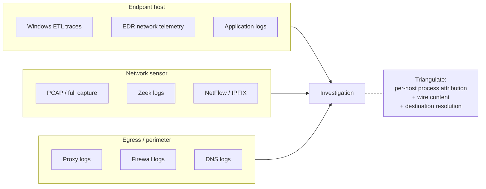

# Chapter 8 — Network Forensics on Windows

## Chapter Overview

Modern intrusions are network events. An attacker may compromise a single host, but they almost always have to communicate with infrastructure outside it to download tools, receive commands, pivot to other systems, and exfiltrate data. Each of those communications crosses the network, and each crossing is in principle observable. The question for incident response is how much of that observability the organization has, where it lives, and how to use it under time pressure.

In incident response, host and network forensics are inseparable, even though they are sometimes treated as separate disciplines. A host artifact tells you what ran, and the network record tells you who it talked to. A registry key tells you what was configured, and the network record tells you whether it was used. Memory tells you the connection existed at a specific moment. The network record may extend that moment into a session that lasted hours and transferred gigabytes of data.

This chapter covers network forensics as responders most often practice it in Windows incident response. That means full packet captures where they exist, flow logs for broader visibility, Windows-native traces for individual hosts, and application logs from proxies, web servers, VPN concentrators, and email gateways. It is not a Wireshark tutorial. It is a guide to which network sources answer which IR questions, how to combine them with host artifacts, and how to produce timeline-ready output for the broader investigation.

The network is rarely a single source. Different layers of the network stack record different facts at different fidelities and retentions. A defensible network finding usually combines two or three sources, each filling in what the others miss.

## Learning Objectives

By the end of this chapter, you should be able to:

* Identify the major sources of network evidence available in a typical Windows environment
* Distinguish full packet capture, flow data, host-based traces, and application logs by fidelity and retention
* Identify the IR use cases that each network evidence source best supports
* Use Wireshark and similar tools to filter and inspect captured network data efficiently
* Acquire host-level network traces with `netsh trace` when nothing else is available
* Reconstruct file transfers, command-and-control sessions, and lateral movement from network evidence
* Produce a network timeline snippet that integrates with host-based timelines
* Document network findings with the source, fidelity, and retention context required for defensibility

---

## 8.1 Sources of Network Evidence



*Figure 8.1 — Network evidence by collection point. Each layer answers a different question: endpoints know which process owned a connection, sensors carry the wire content, perimeter sources know which name resolved to which destination. The strongest network conclusions come from combining at least two layers.*


Network evidence in a Windows environment comes from several places, each with its own characteristics. Know what is available before you assume the network "has" anything.

### 8.1.1 Packet Captures

Full packet captures (PCAPs) are the highest-fidelity network evidence: every byte of every observed conversation, with timing, in a form you can replay and analyze in detail. They come from:

- **Network sensors** — dedicated network monitoring devices, often at network choke points or as part of a network detection and response (NDR) platform
- **SPAN or mirror ports** — switch configurations that copy traffic to a monitoring port
- **TAP devices** — passive hardware taps that mirror traffic without affecting the link
- **Host captures** — packet captures taken on a single endpoint with `tcpdump`, [Wireshark](https://www.wireshark.org/), or `pktmon` on Windows

PCAP fidelity is unmatched: you can reconstruct file transfers byte-for-byte, recover complete HTTP requests and responses, and inspect the full TLS handshake. The cost is volume. Full PCAPs of a busy network run to terabytes per day. Most organizations either capture only at strategic locations or retain only short windows. By the time an incident is recognized, the most relevant capture window may already be gone.

PCAP also has a fundamental limitation: encrypted traffic is opaque without keys. TLS and SSH conversations show endpoints, timing, and byte counts but not content. Reconstructing what crossed an encrypted channel usually requires correlating PCAP with host artifacts that show what the host had open at the time.

### 8.1.2 Flow Data

Flow data — NetFlow, IPFIX, sFlow, and the various vendor-specific equivalents — records summaries of conversations rather than full packet content. Each flow record typically includes:

- Source and destination IP and port
- Protocol
- Start and end time
- Total bytes and packets transferred

Classic NetFlow v5 and v9 records are **unidirectional**, which trips people up. A single TCP conversation produces *two* records, one per direction, and you have to pair them on the 5-tuple before you can talk about a session. Bidirectional ("biflow") records are an IPFIX feature and not universal. sFlow is not flow summarisation at all. It is packet *sampling*, typically 1-in-N, so byte totals derived from it are estimates rather than counts.

Flow records are several orders of magnitude smaller than full PCAPs, so you can retain them much longer and query them much faster. For most IR questions — *did this host talk to this IP?*, *how much data crossed?*, *for how long?* — flow data is sufficient and often more practical than searching through PCAPs.

Flow data does not see content. It cannot tell you what HTTP request was made, what file was transferred, or what command was issued. For that, you need PCAP or application-level logging.

### 8.1.3 Windows ETL Traces

Windows itself can capture network activity through Event Tracing for Windows (ETW). The most accessible interface is `netsh trace`:

```
netsh trace start capture=yes tracefile=C:\Triage\WKSTN-221_net.etl
netsh trace stop
```

The result is an `.etl` file. Microsoft retired Message Analyzer in 2019 and removed the official download. The practical path now is to convert the `.etl` to PCAPNG with [etl2pcapng](https://github.com/microsoft/etl2pcapng) and open it in Wireshark.

`pktmon` is a more recent Windows-native packet capture utility:

```
pktmon start --capture --pkt-size 0    # Windows 10 2004+ / Server 2022
pktmon stop
pktmon pcapng PktMon.etl -o PktMon.pcapng

# On 1809 / 1903 the older syntax applies:
#   pktmon start --etw -p 0
#   pktmon etl2pcap PktMon.etl
```

Host-level traces are useful in two scenarios. First, when the organization has no network sensor and nothing was capturing the relevant traffic at the network level, you can tell the host itself to start capturing. Second, on an isolated or constrained host, a brief host-level trace can answer a specific question, such as what a process is talking to right now, without infrastructure changes.

Host-level traces see only what the host sees, and they run only after someone starts them. They help with live response but rarely cover the historical window most relevant to the incident.

### 8.1.4 Application Logs

The richest network evidence in many environments is not packet-level at all but application-level. Each major class of network appliance and application produces its own logs.

| Source | Typical Records |
|---|---|
| **Proxy logs** | URLs accessed, user agents, response sizes, content categories, denied requests |
| **Web server access logs** | HTTP requests handled, source IPs, response codes, bytes returned |
| **DNS server logs** | DNS queries with source IPs and timestamps |
| **Firewall logs** | Allowed and denied connections at the perimeter, with source/destination/port |
| **VPN concentrator logs** | Authentication, session start/end, source IP, assigned client IP, bytes transferred |
| **Email gateway logs** | Mail flow with sender, recipient, subject, attachment hashes, disposition |
| **EDR network telemetry** | Per-process network connections recorded by the endpoint agent |

Application logs frequently contain attribution information that PCAP does not: a user's domain account, an authenticated session ID, a content classification. They typically have longer retention than PCAPs and, once integrated into a SIEM, are faster to query than flow data.

The drawback is fidelity and completeness. Application logs record what the application chose to record. A misconfigured proxy may not log the URL fragments that contain the most useful data. A firewall in default configuration may not log allowed traffic at all. Competence with a source includes knowing what it does and does not capture.

### 8.1.5 EDR Network Telemetry

Modern EDR products record per-process network activity at the endpoint. It is some of the most useful network evidence in a contemporary investigation because it ties each connection directly to the owning process. Pure network sources cannot do that without correlation.

EDR network telemetry typically records the source process, the destination IP, the destination port, the connection direction, and frequently a timestamp and byte counts. Some products also record the parent process tree and the command line at the time of the connection, which makes root cause analysis much faster.

As with all EDR telemetry, coverage depends on what the agent is configured to collect and how long the platform retains the data. EDR complements network capture. It does not replace it.

For Microsoft Defender for Endpoint, the corresponding KQL query against the `DeviceNetworkEvents` table looks like:

```kql
DeviceNetworkEvents
| where Timestamp between (datetime(2024-11-14 14:00:00) .. datetime(2024-11-14 15:30:00))
| where DeviceName == "WKSTN-221"
| project Timestamp, InitiatingProcessFileName, InitiatingProcessCommandLine,
          RemoteIP, RemotePort, RemoteUrl, ActionType
| sort by Timestamp asc
```

CrowdStrike Falcon exposes equivalent data through the `NetworkConnectIP4` and related event types in the Investigate API. The principle is the same: filter to a host and window, project the process, target, and timing, then sort.

### 8.1.6 Zeek and Network Sensor Logs

[Zeek](https://zeek.org/) (formerly Bro) sits between PCAP and flow data: it observes traffic in real time and produces a set of structured logs richer than NetFlow but far smaller than PCAP. A typical Zeek deployment generates one log file per protocol — `conn.log`, `http.log`, `dns.log`, `ssl.log`, `files.log`, `notice.log` — each in tab-separated format with a stable schema.

For IR, Zeek's `conn.log` is the single highest-value file most responders see. Each line records one observed connection:

```
#fields ts uid id.orig_h id.orig_p id.resp_h id.resp_p proto service duration orig_bytes resp_bytes conn_state
1731593982.014 CqfH9q1OXJ7c2D4wp 10.0.4.32 52914 91.214.47.22 443 tcp ssl 6.123 1847 184221 SF
1731594108.412 C8LpY8oJxWaQ5e2Yx 10.0.4.32 52915 91.214.47.22 443 tcp ssl 26.284 4218 18421 SF
1731594115.907 CmT4Rz2bK9pX7a1Qd 10.0.4.32 52916 91.214.47.22 443 tcp ssl 49.103 184221 2415891 SF
```

These are the same three sessions as in `Data/WKSTN-221/network-flow.csv`, in Zeek's format. The `ts` values are Unix epoch, so 1731593982 is 14:19:42 UTC and 1731594115 is 14:21:55. Each `conn.log` line gives you the four-tuple, the duration, the bytes in each direction, and the connection state, without the original PCAP.

Read the byte columns carefully. `orig_bytes` is what the *originator* sent and `resp_bytes` is what the responder sent back, so on an outbound connection from a workstation, `orig_bytes` is your egress. The middle line is a beacon: 4 KB out, 18 KB back, 26 seconds. The last line is the session that matters. Here the large number is `resp_bytes`: 2.4 MB *inbound* against 184 KB outbound. That is the shape of a download, not a bulk upload. Chapter 13 §13.2.4 works this record into a written finding to show how easily the direction gets reported backwards.

Pair `conn.log` with `ssl.log`, which holds the TLS server name, JA3 fingerprint, and certificate fingerprint, and with `dns.log`, which holds the lookups that preceded the connection. Together they answer most IR questions about a session without opening Wireshark.

If your environment runs Zeek, whether through Corelight, Security Onion, or a self-hosted deployment, get familiar with the schema. Public references include the [Zeek log file reference](https://docs.zeek.org/en/master/script-reference/log-files.html) and the Corelight cheat sheets.

Suricata is a complementary tool built around signature alerts. Its `eve.json` output carries those alerts alongside flow, DNS, HTTP, and TLS records, so it can stand in for some Zeek logs. Many environments run Zeek and Suricata side by side.

---

## 8.2 Key IR Use Cases

Network evidence is best understood by the questions it answers. Four use cases dominate IR work.

### 8.2.1 Confirming Exfiltration

The question is whether sensitive data left the organization, and if so, when, by what route, and how much.

The strongest exfiltration findings combine:

- **Flow or proxy data** showing large outbound transfers to external destinations, with the source host and timing
- **EDR network telemetry** identifying the process that owned each connection
- **Host artifacts** (Prefetch, registry, MFT) confirming the process and its working set
- **Application logs** (cloud storage, webmail) confirming the destination if it is a known service
- **Disk artifacts** (sync client databases, browser uploads, archived staging directories) corroborating the file content

A clean exfiltration finding identifies the data, the channel, the timing, and the destination. In modern environments the channel is increasingly cloud-based: personal cloud storage, webmail attachments, and encrypted messaging services. That makes the cloud and browser artifacts from Chapters 5 and 6 particularly important.

### 8.2.2 Identifying C2 Infrastructure

The question is which external addresses the attacker is using for command and control (C2). The answer serves both the current investigation and future blocking and detection.

C2 identification typically draws on:

- **Memory** showing the active process, its current connection, and the remote endpoint at the time of capture
- **Flow data** showing repeated or sustained communication with the same external address over a longer window
- **Proxy or DNS logs** providing context about the destination (domain category, certificate authority, hosting provider)
- **Threat intelligence** correlating the destination with known infrastructure, where applicable

Once you confirm an address or domain as C2, the organization can block it, hunt for other hosts that communicated with it, and feed it into longer-term detection. An IP or domain that began C2 use during the incident is also a useful pivot for understanding when the intrusion began.

### 8.2.3 Tracing Lateral Movement

The question is which other internal hosts have been touched from a compromised system, and through which protocols.

Lateral movement often shows in:

- **Internal flow data** between workstations and servers that do not normally communicate
- **Authentication logs** (covered in Chapter 9) showing credential use across multiple hosts
- **SMB and RPC traffic** characteristic of `psexec`, `wmiexec`, scheduled task creation across the network, and similar techniques
- **EDR network telemetry** tying the lateral connections to specific processes
- **RDP-related artifacts** on both source and destination hosts

A defensible lateral movement reconstruction names the source host, the destination host, the protocol, the timestamp, and the responsible account. With those five pieces, you can assess scope and target containment.

### 8.2.4 Supporting Blocking and Detection

An incident is also an opportunity to harden the environment against the next one. Network indicators extracted during the investigation, such as IPs, domains, URL patterns, certificate hashes, and JA3 fingerprints, can be:

- Added to perimeter and internal blocking
- Submitted as detections in SIEM and EDR rule sets
- Shared with peer organizations through information-sharing channels
- Used to hunt for additional compromised hosts that did not produce alerts

Network forensics produces these indicators as a matter of course. The discipline is in recording them in a form ready for operational use rather than leaving them buried in case notes.

---

## 8.3 Capture and IR-Focused Analysis Workflow

> **Figure 8.2 — _placeholder for `figures/fig-8-2-wireshark-c2.png`_**
>
> Wireshark with display filter `ip.addr == 91.214.47.22`, showing the C2 conversations on TCP/443. Time column visible; `Follow → TCP Stream` context menu open on a representative packet. See [`figures/Readme.md`](figures/Readme.md) for capture instructions.


A typical IR-focused workflow starts from a known-suspicious host, narrows to the relevant time window, identifies interesting streams, and produces actionable output.

### 8.3.1 Establish the Window

Define the window of interest before you open any tool: when the suspicious activity started, when it ended, and how wide a buffer the analysis should cover. Host evidence usually informs these decisions, such as a Prefetch entry showing first execution, a Security event log entry, or an EDR alert.

A common first window is the suspected execution time plus or minus 30 minutes. Wider windows catch reconnaissance that preceded the execution and exfiltration that followed it. Narrower windows risk missing the relevant traffic entirely.

### 8.3.2 Filter Down to the Host and Window

Whether the source is PCAP, flow data, or proxy logs, the first step is to filter down to the host and time window.

**Wireshark display filter:**

```
ip.addr == 10.0.4.32 and frame.time >= "Nov 14, 2024 14:00:00" and frame.time <= "Nov 14, 2024 15:30:00"
```

**`tshark` for scripted filtering**, which is faster than the GUI for large captures and pipes its output directly into other tools:

```
tshark -r capture.pcapng -Y 'ip.addr == 10.0.4.32 and frame.time >= "Nov 14, 2024 14:00:00"' \
       -T fields -e frame.time_epoch -e ip.src -e tcp.srcport -e ip.dst -e tcp.dstport \
       -e tcp.len -E header=y -E separator=, > wkstn221_subset.csv
```

**Splunk SPL** against forwarded flow or firewall data:

```
index=network sourcetype=cisco:asa (src_ip=10.0.4.32 OR dst_ip=10.0.4.32)
    earliest="11/14/2024:14:00:00" latest="11/14/2024:15:30:00"
| stats sum(bytes_out) as bytes_out, sum(bytes_in) as bytes_in,
        min(_time) as first_seen, max(_time) as last_seen
        by src_ip, dst_ip, dst_port
| sort -bytes_out
```

**KQL** against Microsoft Sentinel's `CommonSecurityLog` (perimeter) or `DeviceNetworkEvents` (endpoint):

```kql
CommonSecurityLog
| where TimeGenerated between (datetime(2024-11-14 14:00:00) .. datetime(2024-11-14 15:30:00))
| where SourceIP == "10.0.4.32" or DestinationIP == "10.0.4.32"
| summarize bytes_out=sum(SentBytes), bytes_in=sum(ReceivedBytes),
            first_seen=min(TimeGenerated), last_seen=max(TimeGenerated)
            by SourceIP, DestinationIP, DestinationPort
| sort by bytes_out desc
```

**Zeek `conn.log` filter** with `zeek-cut`:

```
zeek-cut ts uid id.orig_h id.orig_p id.resp_h id.resp_p proto duration orig_bytes resp_bytes \
  < conn.log | awk '$3=="10.0.4.32" || $5=="10.0.4.32"' | sort -k1,1n
```

Watch for two Splunk details, because both can silently return the wrong data rather than raising an error. First, the `search` command evaluates `OR` before the implied `AND`, so `index=network src_ip=X OR dst_ip=X` already means `index=network AND (src_ip=X OR dst_ip=X)`. The `where` and `eval` commands follow the conventional order instead, with `AND` before `OR`. A condition that is correct after `search` can be wrong after `where`, so parenthesize every `OR` group and the question never arises. Second, a time filter expressed as a `| where` runs *after* Splunk has already retrieved the default time range. Put the window in `earliest`/`latest` on the search line so Splunk applies the time bounds when it reads the index.

The query syntax varies, but the structure is the same: filter by host plus time window, project the columns that matter for IR, and sort by something useful, such as bytes or time. Save the filtered subset to a separate file. Run later analysis against the subset rather than the full data, because the subset is faster to work with and easier to share with another responder.

### 8.3.3 Identify Interesting Streams

Within the filtered subset, look for:

- **Long-lived connections** — sessions that lasted minutes or hours, especially to external destinations
- **Large data transfers** — connections where the host sent significantly more than it received (suggesting exfiltration) or received significantly more than it sent (suggesting tool download)
- **Unusual ports** — outbound traffic on ports rarely used by legitimate applications, or inbound traffic to ports that should not be exposed
- **Unfamiliar destinations** — IPs and domains that are not on the host's normal communication pattern
- **Protocol anomalies** — TLS connections to IPs without DNS context, HTTP traffic with unusual user agents, DNS queries that look like data encoding

Wireshark's *Statistics → Conversations* view is one of the most efficient triage tools for spotting these patterns. For scripted analysis, `tshark` produces the same data:

```
tshark -r capture.pcapng -q -z conv,tcp
```

A typical output line for the WKSTN-221 scenario looks like this:

```
                                               |       |   | Duration |
10.0.4.32:52916  <-> 91.214.47.22:443    142 184221  1842 2415891 14:21:55 49.10
```

Read left to right: source endpoint, destination endpoint, packets and bytes in each direction, start time, duration. The 2.4 MB inbound paired with 184 KB outbound, sustained for 49 seconds, is the pattern that distinguishes a beacon-with-data-pull from a normal short HTTPS request.

To find suspicious destinations, sort by total bytes and exclude the known-good hosts:

```
tshark -r capture.pcapng -q -z conv,tcp \
  | grep -vE '52\.96\.|40\.126\.|13\.107\.|outlook\.|microsoft\.' \
  | sort -k7 -n -r | head -20
```

The same triage on Zeek `conn.log` is one line:

```
zeek-cut id.orig_h id.resp_h id.resp_p duration orig_bytes resp_bytes < conn.log \
  | sort -k6,6 -n -r | head -20
```

DNS context matters most for IPs that turn up in flow data without a corresponding domain. For a suspicious destination, it is one query against `dns.log`:

```
zeek-cut ts query qtype answers < dns.log | grep '91\.214\.47\.22'
```

If the query returns nothing, no host under your visibility resolved the destination IP through DNS. That absence is itself a finding. It suggests the connection used an IP literal, which is common in C2 tooling.

### 8.3.4 Reconstruct Content

For unencrypted protocols, content reconstruction is direct. Wireshark's *Follow → TCP Stream* or *HTTP Stream* shows the full conversation in human-readable form. *File → Export Objects* extracts files transferred over HTTP, SMB, and other supported protocols. You can script the same operations with `tshark`:

```
# Dump every HTTP request URL in a capture, sorted by time
tshark -r capture.pcapng -Y 'http.request' -T fields \
       -e frame.time -e ip.src -e http.host -e http.request.uri

# Extract files transferred over HTTP into ./extracted/
tshark -r capture.pcapng --export-objects http,extracted/
```

Zeek's `files.log` records every file observed crossing the wire, with MIME type and size. Combined with `http.log`, or `smb_files.log` for SMB transfers, it lets you confirm what crossed without parsing the original PCAP at all.

Zeek does **not** produce file hashes by default. You have to load the `hash-all-files` script, and stock deployments that do hash typically emit MD5 and SHA-1 rather than SHA-256. Check what your sensor is configured to record before you plan an analysis around file hashes.

For TLS-encrypted connections, content reconstruction requires session keys. If the host had an `SSLKEYLOGFILE` environment variable set during the capture, Wireshark can decrypt the traffic. That setup is common in browsers configured for debugging but rare in practice. More often, you infer content from the host side: a browser history entry showing the URL, an EDR record of the file written to disk after a download, or a sync client log showing the upload that the encrypted traffic must have carried.

For TLS, the most useful network-side identifiers are the **Server Name Indication (SNI)** field, the JA3 fingerprint of the client's TLS hello, and the certificate's subject and SHA-256. All of them are visible in Zeek's `ssl.log` even without decryption.

### 8.3.5 Map Connections to Processes

Pure network sources do not identify the process responsible for a connection. EDR network telemetry does. Memory does, for connections that were live at capture time. Host artifacts such as Prefetch, Amcache, and the registry tie processes to binaries.

A typical attribution chain follows. FIN-WS23 ships host artifacts only, which is itself the point of the section. You can reproduce steps 3 and 4 against `Data/FIN-WS23/`. Steps 1, 2, and 5 describe the network and EDR sources that a real engagement would have and this dataset deliberately does not:

1. Flow data shows the host made repeated outbound connections to an unfamiliar destination on a non-standard port over an 18-minute window, with a few megabytes moved in each direction. *(Illustrative — no flow file ships for this host.)*
2. EDR network telemetry attributes those connections to a process named `dl.exe` running from the user's `Downloads\` directory. *(Illustrative — no EDR export ships for this host.)*
3. Prefetch shows `dl.exe` first ran at `06:59:14 UTC`, 74 seconds after `winword.exe` opened `Q4_Vendor_Review.docm` at 06:58:00 and 44 seconds after Word launched `powershell.exe` at 06:58:30.
4. Amcache records `dl.exe` with SHA-1 `b8e3f4d12a89c4e5670123456789abcdef0123ab`, matching a known commodity loader hash from threat intelligence.
5. Process tree from EDR confirms the chain `winword.exe → powershell.exe → dl.exe`, consistent with the macro-driven delivery hypothesis. The shipped Security log shows the same parentage in its EID 4688 events.

Each step is a sentence in the eventual finding. The network record is one source among many, and its value comes from correlation. Pure network data alone, such as *something on this host talked to that IP and moved 6 MB*, is a starting point. Adding the EDR attribution makes it specific. Adding Prefetch and Amcache makes it defensible.

---

## 8.4 Building a Network Timeline Snippet

Network analysis output rarely stands alone. You typically merge it into a broader incident timeline that combines host and network events into a single chronological view, so structure a network timeline snippet for that merge.

### 8.4.1 What a Timeline Snippet Should Contain

For each significant network event, the snippet should capture:

| Field | Example Value |
|---|---|
| Timestamp (UTC) | 2024-11-14 14:19:42 |
| Source | host:WKSTN-221 |
| Source IP / Port | 10.0.4.32 / 52914 |
| Destination IP / Port | 91.214.47.22 / 443 |
| Protocol | TCP/HTTPS |
| Bytes Out / In | 1,847 / 184,221 |
| Owning Process (if known) | powershell.exe (0x5128) |
| Evidence Source | Network flow record; corroborated by SRUM |
| Significance | First contact with this destination; the larger transfer follows at 14:21:55 |
| Confidence | High for the connection; the *purpose* of the traffic is not established here |

With this structure, the snippet merges directly with host-based timeline entries built from the same template. Chapter 10 covers full timeline construction.

### 8.4.2 Naming and Storage Conventions

Name network artifact files consistently and store them in a predictable location within the case folder structure. A common convention:

```
IR-2024-WKSTN221\
├── 02_Working_Copy\
│   ├── network\
│   │   ├── WKSTN221_pcap_20241114_1400-1530.pcapng
│   │   ├── WKSTN221_flow_20241114_1400-1530.csv
│   │   ├── WKSTN221_proxy_20241114_1400-1530.csv
│   │   └── WKSTN221_network_timeline.csv
│   └── ...
└── 03_Analysis\
    └── network_findings.md
```

Record each file's hash in the chain of custody alongside its source description: the sensor, SIEM query, or host trace command.

### 8.4.3 Common Mistakes to Avoid

Four patterns regularly weaken network forensic findings:

- **Treating an IP as conclusive without context.** A connection to `91.214.47.22` is data. Whether it is malicious depends on what `91.214.47.22` is, who else talks to it, and what the host was doing at the time.
- **Assuming absence of network evidence equals absence of activity.** Network sensors have blind spots, flow data has gaps, and proxy logs may not cover all egress paths. *We did not see it* is not the same as *it did not happen*.
- **Failing to record retention windows.** A finding that depends on data the SIEM retains for only 30 days may be impossible to reproduce later. Document retention as part of the finding.
- **Skipping the process attribution.** A connection without a process is half a finding. EDR telemetry, memory, or host artifact correlation closes the gap. Without it, the conclusion is weaker than it needs to be.

---

## Chapter Summary

Network forensics on Windows draws on several distinct evidence sources, each with different fidelity, cost, and retention characteristics. Full packet captures provide the highest detail but are expensive to retain. Flow data covers more ground at lower fidelity and is usually queryable for longer windows. Windows-native ETL traces and `pktmon` allow on-host capture when sensors are unavailable. Application logs from proxies, web servers, DNS, firewalls, VPN concentrators, and email gateways often provide the richest contextual evidence and are well-suited to SIEM integration. EDR network telemetry adds the per-process attribution that pure network sources lack.

The IR use cases that drive most network forensic work are confirming exfiltration, identifying command-and-control infrastructure, tracing lateral movement, and producing indicators that can be operationalized into blocking and detection. Each use case is best served by combining several sources: network shows the conversation, EDR shows the owning process, host artifacts confirm the binary, and application logs supply the user attribution.

A practical analysis workflow starts by establishing the time window of interest from host evidence and filtering network sources down to the relevant host and window. It then identifies interesting streams through traffic patterns and conversation statistics, reconstructs content where the protocol and circumstances allow, and ties each connection back to a process through correlation with host evidence. The output is a structured set of timeline entries that merge cleanly with host-based timelines.

The recurring discipline is documentation. A network finding is defensible when it names the source, the time window, the retention conditions of that source, the filter or query used, and the corroborating evidence that supports the conclusion. Network evidence rarely tells the whole story by itself, but it is almost always the part of the story that connects host activity to attacker infrastructure.

## Key Terms

**ETL (Event Trace Log):** The Windows-native trace file format produced by ETW-based capture tools including `netsh trace` and `pktmon`.

**Flow Data:** Summary records of network conversations (source, destination, port, protocol, byte and packet counts, time range), produced by NetFlow, IPFIX, sFlow, and equivalent technologies.

**JA3 Fingerprint:** A hash-based fingerprint of the TLS Client Hello, used to identify TLS clients even on encrypted connections.

**Mirror Port (SPAN Port):** A switch configuration that copies traffic from one port or VLAN to a monitoring port for capture.

**`netsh trace`:** A Windows-native command-line interface for starting and stopping network captures, producing ETL output.

**PCAP / PCAPNG:** Packet capture file formats containing full packet content with timing.

**`pktmon`:** A Windows-native packet capture utility introduced in Windows 10 / Server 2019.

**Proxy Logs:** Application logs from web proxy servers recording URLs accessed, user agents, response sizes, and content categories.

**SSLKEYLOGFILE:** An environment variable that, when set, causes a TLS-aware client to write session keys to a file, allowing later decryption of captured TLS traffic.

**TAP (Terminal Access Point):** A passive hardware device that mirrors network traffic without affecting the link.

**Wireshark:** The de facto standard open-source packet analysis tool.

## Review Questions

1. What are the main differences in fidelity, cost, and retention between full PCAP and flow data?
2. Why is pure network evidence often insufficient to identify the process responsible for a connection?
3. When would `netsh trace` or `pktmon` be the right tool to use during incident response?
4. What kinds of application logs typically provide the richest context for HTTP-based investigations?
5. Why is encrypted traffic still useful evidence even when its content cannot be recovered?
6. How does EDR network telemetry complement traditional network capture?
7. What evidence sources combine to support a defensible exfiltration finding?
8. Why is documenting retention windows an important part of network forensic findings?
9. How does Wireshark's Conversations view accelerate triage?
10. What information should a network timeline snippet contain to merge cleanly with host-based timelines?

## Practical Exercises

1. Capture a brief PCAP of your lab VM browsing a few benign sites. Filter the PCAP in Wireshark by IP and time and identify the three most data-intensive conversations.
2. Use `netsh trace` to capture network activity for a defined ten-minute window on your lab VM. Convert the resulting `.etl` file to PCAP-format and load it in Wireshark.
3. Use `pktmon` to capture a short window of network traffic. Compare the output to `netsh trace` output for the same window.
4. From a Wireshark capture of your lab VM, extract a downloaded file using *File → Export Objects*. Verify the extracted file's hash matches the original.
5. Generate flow-style summary data from a PCAP using a tool like `tshark` (`tshark -r capture.pcap -q -z conv,ip`). Compare with the *Conversations* view in the GUI.
6. Configure a local browser with `SSLKEYLOGFILE` set, then capture and decrypt a short TLS conversation in Wireshark.
7. For a chosen process on your lab VM, build an attribution chain from a captured connection through EDR or memory evidence to the owning process and binary.
8. Build a five-row network timeline snippet for a fabricated lab scenario, with timestamps, source/destination, owning process, and confidence ratings.
9. Pick one network artifact file from your lab and document its hash, source description, retention conditions, and chain of custody entry.
10. Identify three internal sources in your environment that record network evidence (sensor, SIEM, EDR, proxy, etc.). Document each source's retention window and the kinds of IR questions it can answer.

> **Hands-on:** [Lab 08 — Network Forensics on Windows](../Labs/Lab08/ReadMe.md) — work the simulated PCAP, flow, DNS, and proxy data, identify suspicious streams, and map them back to host processes.

---

## Looking Ahead

Network evidence shows what crossed the wire. The next chapter turns to one of the densest text-based evidence sources on Windows: event logs. Logs document authentication, service activity, scheduled task creation, PowerShell execution, and a great deal more, provided they are configured to record it and have not been cleared. Used well, they corroborate everything covered so far. Used poorly, they overwhelm the analyst with noise.

---
