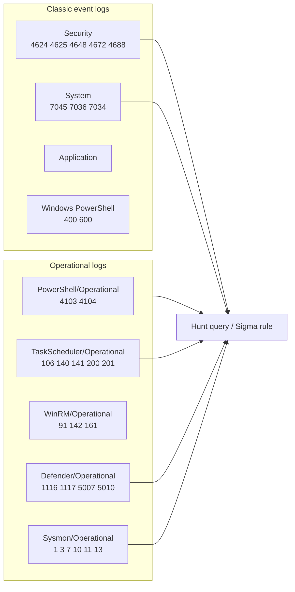

# Chapter 9 — Windows Event Logs

## Chapter Overview

Windows event logs are the most familiar evidence source for many incident responders, and one of the most consistently misused. Almost every serious investigation uses them. Weak investigations treat them as either too definitive or too noisy to be useful. The truth sits in between. Event logs are highly valuable when configured well, collected promptly, and queried with discipline. Without that discipline, they are partial and noisy.

Logs are also the artifact most likely to be tampered with, cleared, or never enabled in the first place. An attacker who wants to hide will often clear `Security.evtx` as one of their first cleanup steps. On a host where nobody enabled command-line auditing or PowerShell script block logging, the log entries an investigation needs do not exist. Competence with the source includes knowing what each log type captures, what its enablement and retention defaults are, and what its silence means.

This chapter covers event logs from an IR perspective: the major log types, the most common analysis challenges, and a structured approach that starts with known-good filters and scales up to broader hunts. It also covers a situation responders face often. When the logs you wanted are missing or cleared, you need to know what the gap itself tells you and which other artifacts can carry the conclusion.

Event logs are at their best as one source among several. A log entry that says a process ran is useful. Add a Prefetch entry confirming the execution and an MFT timestamp confirming the binary's presence on disk, and you have a finding. Chapter 10 pulls these correlations into full timelines. This chapter gets the log evidence ready to feed that process.

## Learning Objectives

By the end of this chapter, you should be able to:

* Identify the major Windows event log channels and what each typically records
* Interpret common security-relevant event IDs from `Security`, `System`, and the major operational logs
* Distinguish a log gap caused by configuration from a log gap caused by deletion
* Use EvtxECmd, Get-WinEvent, and SIEM queries to filter logs efficiently
* Recognize common indicators of log tampering and account for them in findings
* Build reusable filters for authentication, service, scheduled task, and PowerShell activity
* Identify what each log type *cannot* tell you and document those limits in findings
* Combine event log evidence with other artifact sources to produce defensible conclusions

---

## 9.1 Log Types



*Figure 9.1 — Classic vs. operational Windows event-log channels and the high-value EIDs each carries. Most foundational hunting queries land in fewer than ten of these channels. Knowing which channel is authoritative for a given question is more useful than memorizing every EID.*


Windows produces dozens of event log channels, but a small number carry most of the incident response value. Knowing which is which saves hours per case.

### 9.1.1 Security

> **Figure 9.2 — _placeholder for `figures/fig-9-2-eventviewer-4625.png`_**
>
> Event Viewer with a single 4625 (failed logon) record selected, both the *General* and *Details* tabs visible, fields populated from the simulated WKSTN-221 dataset. See [`figures/Readme.md`](figures/Readme.md) for capture instructions.


`Security.evtx`, at `%SystemRoot%\System32\winevt\Logs\Security.evtx`, is the central log for authentication, logon activity, account changes, privilege use, and object access. It is the log IR findings quote most often, and the one attackers most often clear.

Some of the most useful Security event IDs in IR work:

| EID | Meaning |
|---|---|
| 4616 | System time changed |
| 4624 | Successful logon |
| 4625 | Failed logon |
| 4634 / 4647 | Logoff |
| 4648 | Logon attempted with explicit credentials (often associated with lateral movement) |
| 4672 | Special privileges assigned to new logon (administrator-equivalent access) |
| 4688 | Process creation (shows parent and child process; full command line if process command-line auditing is enabled) |
| 4697 | Service installed via Service Control Manager |
| 4698 | Scheduled task created |
| 4720 | User account created |
| 4738 | User account changed |
| 4768 / 4769 / 4771 | Kerberos TGT/service ticket events (on domain controllers) |
| 4776 | NTLM credential validation — on the DC for domain accounts, but also **locally** when a local account authenticates via NTLM |
| 4798 | A user's local group membership was enumerated |
| 1102 | Audit log was cleared (a critical event in itself) |

**Logon types** (the `LogonType` field on EID 4624) are particularly useful:

| LogonType | Meaning |
|---|---|
| 2 | Interactive (console logon) |
| 3 | Network (e.g., SMB access from another host) |
| 4 | Batch (scheduled task) |
| 5 | Service |
| 7 | Unlock |
| 9 | NewCredentials (RunAs with `/netonly`) |
| 10 | RemoteInteractive (RDP) |
| 11 | CachedInteractive (cached domain credentials) |

Logon type combined with source IP and account name often answers the question *who came in, from where, and how?*

### 9.1.2 System

`System.evtx` records system-level events: service start and stop, driver loads, system reboots, time changes, and hardware events. The most commonly used IR event IDs here include:

| EID | Source / Meaning |
|---|---|
| 7045 | Service Control Manager — new service installed |
| 7034 / 7036 | Service crashed / changed state |
| 6005 / 6006 | Event Log service started / stopped |
| 1074 | System shutdown initiated |
| 1 | Kernel-General — system time changed. The Security-log counterpart is EID 4616, logged only when Security State Change auditing is on |

Event ID 7045 (new service installed) is the most important entry here, because many post-exploitation tools install themselves as services for persistence. It records the service name, image path, service type, and start type. Cross-referencing 7045 events with `HKLM\System\CurrentControlSet\Services` registry entries (Chapter 5) is a standard IR pattern.

### 9.1.3 Application

`Application.evtx` content depends on the installed software and varies widely from system to system. It helps most when you investigate a specific application, and less consistently in general IR triage. Defender events, certain Office events, and a handful of Microsoft component events appear here.

### 9.1.4 PowerShell Operational

`Microsoft-Windows-PowerShell/Operational` (`Microsoft-Windows-PowerShell%4Operational.evtx`) records PowerShell engine events, including:

| EID | Meaning |
|---|---|
| 4103 | Module logging (logs pipeline execution) |
| 4104 | Script Block Logging (logs the contents of executed script blocks) |
| 4105 / 4106 | Script start / stop |

**EID 4104 (Script Block Logging)** is one of the most consequential modern Windows IR events. When enabled, it logs the content of every PowerShell script block that runs, including base64-decoded commands, in-memory loaders, and obfuscated strings. The entries are sometimes large, but when present they contain the attacker's actual code.

Script Block Logging is off by default. You enable it through a Group Policy setting: `Computer Configuration → Administrative Templates → Windows Components → Windows PowerShell → Turn on PowerShell Script Block Logging`. On hosts where it is disabled, EID 4104 events do not exist. This is one of the most common log gaps in unprepared environments.

PowerShell logs to two distinct channels. The classic `Windows PowerShell` log (`Windows PowerShell.evtx`) is the older channel, present on every Windows host with PowerShell installed. It carries provider lifecycle events under provider name `PowerShell` (EID 400, 403, 600, 800). The modern `Microsoft-Windows-PowerShell/Operational` channel (`Microsoft-Windows-PowerShell%4Operational.evtx`) holds the higher-fidelity events (4103, 4104, 4105, 4106). On modern Windows systems, check both.

### 9.1.5 Other High-Value Operational Logs

Several other operational channels appear regularly in IR work:

| Channel | Useful Events |
|---|---|
| `Microsoft-Windows-Sysmon/Operational` | Detailed process, network, and file events from [Sysmon](https://learn.microsoft.com/sysinternals/downloads/sysmon) (if installed) |
| `Microsoft-Windows-WMI-Activity/Operational` | WMI queries and event consumers (often used for persistence) |
| `Microsoft-Windows-TaskScheduler/Operational` | Scheduled task creation, modification, and execution |
| `Microsoft-Windows-TerminalServices-LocalSessionManager/Operational` | Local RDP session start, end, reconnect |
| `Microsoft-Windows-TerminalServices-RemoteConnectionManager/Operational` | Inbound RDP connection attempts and successes |
| `Microsoft-Windows-Windows Defender/Operational` | Defender detections, scans, and exclusions |
| `Microsoft-Windows-Bits-Client/Operational` | BITS transfers (occasionally used for staging or lateral movement) |
| `Microsoft-Windows-AppLocker/EXE and DLL` | AppLocker policy enforcement events |
| `Microsoft-Windows-CodeIntegrity/Operational` | Driver loads and code integrity checks |

In environments instrumented with [Sysmon](https://learn.microsoft.com/sysinternals/downloads/sysmon), its operational log often becomes the single most useful source for IR. With a thoughtful configuration, Sysmon produces process creation, image load, network connection, and many other events at higher fidelity than the native logs. The [SwiftOnSecurity Sysmon config](https://github.com/SwiftOnSecurity/sysmon-config) is a reasonable starting point.

### 9.1.6 Public EVTX Datasets for Practice

Hunt-pack filters built against artificial test data only take you so far, because the patterns that matter show up in real attacker activity. The [EVTX-to-MITRE-Attack](https://github.com/mdecrevoisier/EVTX-to-MITRE-Attack) project (CC0 public domain) supplies that activity and complements the simulated data shipped with this book. It contains 270+ real `.evtx` files mapped to MITRE ATT&CK techniques (T1003, T1047, T1053.005, T1078, and dozens more). They span the Security log, Active Directory, Sysmon, SQL Server, DNS Server, Exchange, and firewall channels.

The dataset is a particularly good fit for two activities:

- **Hunt-pack regression testing.** Develop a filter against the simulated WKSTN-221 data (Lab09 walkthrough), then test it against the corresponding technique folder in EVTX-to-MITRE-Attack. If your filter catches the real attacker pattern, it has shown value beyond your synthetic test.
- **Coverage gap analysis.** Walk through the technique folders and check, for each, whether your environment generates the events the dataset captures. Missing events usually mean missing audit policy or absent telemetry, and defenders can find both before an incident.

Use `EvtxECmd` to parse any `.evtx` file from the project into CSV, the same workflow as the rest of this chapter. For queryable analysis at scale, import the files directly into a SIEM through Winlogbeat, NXLog, or the Sentinel agent.

---

## 9.2 Challenges

Several systemic challenges shape every event log investigation, so the work is rarely a matter of *just look at the logs*.

### 9.2.1 Volume and Noise

Event log volume makes unfiltered browsing unproductive. On enterprise-configured systems, even a quiet host's `Security` log produces tens of thousands of events per day. On a busy server with verbose audit policies, daily volume can run into the millions.

The fix is to **start from known-good filters**. Authentication failures, privileged logons, service installations, scheduled task creations, PowerShell script blocks, and RDP sessions form a small set of events that catch most incidents and produce manageable result sets. Section 9.3 walks through this approach in detail.

### 9.2.2 Retention Limits and Overwriting

Event logs are circular buffers with finite default sizes, 20 MB on most modern Windows systems. On a busy host, that capacity holds anywhere from hours to a few days of `Security` events. By the time someone recognizes the incident and triage begins, the most relevant entries may have rolled out of the live log.

> **From the field — illustrative composite.** In one ransomware investigation, the attacker dwelled for 19 days before encrypting. When the responders started collecting evidence, the live `Security` log went back only four days, and the initial-access logon had rolled off completely. The team spent two days reconstructing the dwell window from EDR archives, the DC's intact `Security` log, Windows Defender Operational logs, and shadow-copy snapshots that happened to contain older `Security.evtx` files. The Defender channel retained the entire window because it was much less busy. The investigation still reached a sound outcome, and the postmortem produced a durable habit: **for every host in scope, export the logs first, then raise retention with `wevtutil sl <Log> /ms:1073741824` so nothing further rolls off while the investigation runs.** It costs nothing and prevents a problem that has now bitten the team three separate times.
>
> The order is not a detail. `wevtutil sl` **writes to the evidence host**. It changes the channel's configuration, updates the registry, and is an examiner action recorded on the system you are investigating. If you run it before you have a copy, your first act on the host was to modify it, and you will be explaining that in a deposition instead of explaining the case. An export through `wevtutil epl`, `EvtxECmd`, KAPE, or your EDR's collection hashes and preserves the current state. Raising the cap afterwards protects everything generated from that moment on. If the host is already part of a defensible-collection workflow, record the retention change in your contemporaneous notes alongside every other action you took on the live system. Chapter 3 §3.2.3 covers what a defensible record has to capture.

You can extend retention through `wevtutil sl` or Group Policy, and many organizations forward logs to a SIEM with much longer retention. A defensible analysis names the retention conditions of the source: *the live log holds 18 hours of activity; the SIEM has a 90-day retention; the question we're asking falls within both*.

### 9.2.3 Time Skew

Windows hosts across an environment can have meaningfully different system clocks. Even with domain time synchronization working, drift of a few seconds is common. On isolated or misconfigured hosts, the drift can be much larger.

Skew matters when you correlate events across hosts. Two events that look simultaneous in case notes may be five seconds apart, and two events that look five seconds apart may be simultaneous. Responsible log analysis records the host's reported time at the moment of collection, with `w32tm /query /status` or similar, and notes any known skew. Chapter 10 covers timeline normalization in more depth.

### 9.2.4 Incomplete Logging Configurations

Many of the most useful log entries for IR depend on settings that are off by default:

- **Process command-line auditing** (the `CommandLine` field on EID 4688) requires `Include command line in process creation events` to be enabled
- **PowerShell Script Block Logging** (EID 4104) requires the PowerShell script block logging policy to be enabled
- **Object access auditing** (file and registry SACL events) requires both global audit policy and per-object SACL configuration
- **NTLM auditing** requires explicit policy configuration on domain controllers

A log that lacks the entries you expected may never have been configured to record them. To distinguish a coverage gap from an event that did not happen, confirm the host's audit policy (`auditpol /get /category:*`) and the relevant Group Policy settings.

### 9.2.5 Tampering and Clearing

Attackers clear logs. EID 1102 (Security log cleared) and EID 104 (any other log cleared) record the clearing event itself, but not the cleared content.

A `Security.evtx` that begins suddenly at 14:30 UTC on the day of the incident, with EID 1102 present near the start, is a strong indication of clearing. The cleared content is generally unrecoverable from the live log, but Volume Shadow Copies, prior backups, or SIEM-forwarded copies may preserve it.

Selective deletion of specific events, through DLL injection or other techniques, is subtler and harder to detect. It is rare in practice, because most attackers either clear everything or do not touch the logs at all. When in doubt, compare the live logs against SIEM-forwarded copies if both exist. That comparison often resolves the question.

---

## 9.3 Approach

An effective IR analysis starts from known-good filters and expands as the investigation requires, rather than browsing logs in the hope that something interesting appears.

### 9.3.1 Start with Known-Good Filters

A small set of filters catches a high fraction of incident-relevant events. A reasonable starting set:

| Filter | Purpose |
|---|---|
| EID 4625 (failed logon) — repeated against single account or single source IP | Brute force, credential spraying, password guessing |
| EID 4624 (successful logon) — Type 10 (RDP) from non-admin source IPs | Unexpected RDP from user workstations |
| EID 4624 (successful logon) — followed by EID 4672 (special privileges) for non-admin accounts | Privilege escalation via stolen credentials |
| EID 4648 (explicit credential use) — outbound from workstations | Lateral movement preparation |
| EID 7045 (service installed) — non-standard image paths or random-looking service names | Persistence |
| EID 4698 (scheduled task created) — non-standard task paths | Persistence |
| EID 4104 (PowerShell script block) — containing `IEX`, `DownloadString`, `FromBase64String`, `EncodedCommand` | Common PowerShell tradecraft |
| EID 1102 / 104 (log cleared) | Tampering |

Each filter is well-scoped and produces a reviewable result set. None of them is a magic detector. They are starting points that you inspect, follow up on, and refine.

### 9.3.2 Use Tooling to Parse at Scale

> **Figure 9.3 — _placeholder for `figures/fig-9-3-hayabusa-timeline.png`_**
>
> Hayabusa terminal output of `csv-timeline -d <Logs> -p super-verbose` against the WKSTN-221 logs, showing the rule-hit summary, the top-priority detections, and the path to the resulting CSV. See [`figures/Readme.md`](figures/Readme.md) for capture instructions.


Browsing `evtx` files in `Event Viewer` is fine for a single host and a small window. For larger investigations, parser tools produce CSV output that you can filter, join, and timeline.

[EvtxECmd](https://ericzimmerman.github.io/), part of the Eric Zimmerman tool suite, is the workhorse:

```
EvtxECmd.exe -d C:\Triage\WKSTN-221\Logs --csv C:\Cases\WKSTN-221\evtx\
```

The output CSV contains every event from every log, with parsed fields, ready to filter in PowerShell, Excel, or a SIEM.

`Get-WinEvent` is the native PowerShell interface to event logs. Use it for ad-hoc queries on a live system or a single `evtx` file:

```powershell
Get-WinEvent -FilterHashtable @{Path="C:\Triage\WKSTN-221\Security.evtx"; Id=4625} |
  Select-Object TimeCreated, @{Name="Account";Expression={$_.Properties[5].Value}}, @{Name="SourceIP";Expression={$_.Properties[19].Value}}
```

Windows Event Forwarding (WEF) and SIEM platforms cover the at-scale case. When events from many hosts are centralized, you can write a query once and run it across the environment. That is essential for hunting and large-scale incidents.

### 9.3.3 Build a Hunt Pack

A reusable set of saved searches and documentation is one of the most valuable investments an IR team can make. A "hunt pack" typically contains:

- A markdown document describing each filter, the EIDs it queries, and the logic
- Saved SIEM searches or PowerShell scripts that implement each filter
- Example output and expected baseline noise levels
- Notes on what triggers a false positive
- Links to the relevant attacker techniques (MITRE ATT&CK references where useful)

The pack starts simple and grows as the team encounters new detection opportunities. Lab 09 walks through building one.

### 9.3.4 Combine Logs with Other Artifacts

A log entry by itself is a starting point. A log entry corroborated by other evidence is a finding.

The HR-LT12 persistence scenario in `Data/HR-LT12/` makes a worked example. The registry shows a `Run` value named `HpHotkeyMonitor` under `HKCU\Software\Microsoft\Windows\CurrentVersion\Run`, pointing at `C:\Users\hr-user\AppData\Local\hp-hotkey\hpkey.exe`. The key's last-write time is 2024-11-08 19:06:42 UTC. By itself this is suspicious, because a name imitating an HP utility, running from a user-writable AppData path, is a common persistence disguise. It is not yet a finding. Cross-referencing gives you:

- **Shellbags** — `C:\Users\hr-user\AppData\Local\hp-hotkey` was first interacted with at 19:06:08 UTC, 34 seconds before the `Run` value was written. Somebody navigated to the directory in Explorer immediately before the persistence was registered.
- **The key's last-write time** — 19:06:42 UTC, which bounds *when the key last changed*, not when this specific value was added (Chapter 5 §5.1.2). One key, one timestamp.
- **The Security log** — an EID 4688 at 2024-11-08 19:06:42 UTC records `reg.exe` running as `hr-user` with the command line `reg add "HKCU\Software\Microsoft\Windows\CurrentVersion\Run" /v HpHotkeyMonitor /t REG_SZ /d "C:\Users\hr-user\AppData\Local\hp-hotkey\hpkey.exe" /f`. Its parent was `powershell.exe`. An EID 4657 half a second later records the `HpHotkeyMonitor` value being written by `reg.exe`. These two events date the specific value, which the key's last-write time cannot do. They are direct evidence of the write.

What is not there is the more instructive half. This dataset contains **no execution evidence for `hpkey.exe` at all**. The Security log records process command lines, as the `reg.exe` event shows, yet no EID 4688 records `hpkey.exe` running. `hr-user` logged on at 2024-11-11 08:42:04 and 2024-11-12 09:12:44 UTC, and neither logon produced one. At the first, the `OneDrive` value in the same `Run` key did fire: `OneDrive.exe /background` started at 08:42:11. Prefetch and Amcache are a different case. The HR-LT12 collection has no Prefetch or Amcache export, so those sources are untested, not negative, and the finding has to say so.

The evidence supports one claim: a `powershell.exe` process in `hr-user`'s session configured a persistence mechanism at a known time. It does not show that the mechanism ever ran. A `Run` value executes at logon, so each later logon was a chance for it to run. The binary may have been missing or blocked at those logons, and the Security log cannot say which.

> **Why this matters:** the pull toward overclaiming is strong here. You have a suspicious name, a suspicious path, a suspicious sequence, and a mental model of what malware does, so it is easy to write "the attacker installed and executed a persistence binary." The evidence supports *installed*. Writing *executed* is an unforced error that a reviewer will find in 30 seconds by asking for the Prefetch entry. Chapter 13 §13.2 gives this its own confidence level: the configuration is Confirmed, the execution is Undetermined, and naming the missing source is part of the finding.

### 9.3.5 Log Findings — Quick Reference

For each log-based finding, document the source log file or SIEM index, the retention conditions of that source, and the audit-policy state at the time of the event where relevant. Add the query or filter used, the corroborating artifacts, and any known gaps, such as cleared logs, disabled auditing, or missing forwarding, with what those gaps prevent you from concluding. The last item matters most. A finding that names its limits is more credible than one that claims to have none.

---

## Chapter Summary

Windows event logs are one of the densest evidence sources on the platform when configured well, collected promptly, and queried with discipline. Together, the major channels record authentication, service activity, scheduled task creation, PowerShell execution, RDP sessions, Defender activity, and a great deal more. Those channels are `Security`, `System`, `Application`, the PowerShell operational log, the various Microsoft operational channels, and Sysmon when present.

Several systemic challenges shape analysis. Default log sizes are small, and busy hosts overwrite quickly. Default audit policies omit several of the most useful event types, including process command-line auditing and PowerShell Script Block Logging. Time skew complicates correlation across hosts. Attackers routinely target logs for clearing, and a cleared log records the clearing event but not its prior content.

A defensible workflow starts from a small set of known-good filters and expands as the case requires. The set covers failed logons, privileged logons, explicit credential use, service installations, scheduled task creation, suspicious PowerShell, and log clearing. Tools such as EvtxECmd, `Get-WinEvent`, and SIEM platforms turn raw `evtx` files into queryable, joinable CSV. A team-maintained hunt pack of saved filters and documentation speeds up every later case.

The strongest log-based findings are not log-based alone. They combine event log entries with NTFS metadata, registry persistence keys, Prefetch and Amcache execution evidence, memory state, and network records. Each source carries a piece of the conclusion, and together they produce findings that hold up under scrutiny. Documenting source, retention, audit policy, and query history makes that strength repeatable.

## Key Terms

**Audit Policy:** The Windows configuration that determines which categories of security events are recorded in `Security.evtx`.

**EvtxECmd:** A command-line `.evtx` parser, part of the Eric Zimmerman tool suite, that produces CSV output for further analysis.

**Event ID (EID):** A numeric identifier for a specific kind of event within a log channel.

**Hunt Pack:** A reusable set of saved searches, scripts, and documentation that codifies an organization's standard log-based detection logic.

**Log Channel:** A named log stream in the Windows event log architecture (e.g., `Security`, `System`, `Microsoft-Windows-PowerShell/Operational`).

**LogonType:** A field on logon events that distinguishes interactive, network, batch, service, RDP, and several other logon categories.

**PowerShell Script Block Logging:** A PowerShell logging feature that records the content of executed script blocks as EID 4104 in `Microsoft-Windows-PowerShell/Operational`.

**Sysmon:** A free Microsoft Sysinternals tool that produces high-fidelity process, network, and file event records to a dedicated operational log.

**Windows Event Forwarding (WEF):** A native Windows mechanism for forwarding event log entries from many endpoints to one or more central collectors.

**Wevtutil:** A command-line utility for managing event logs, including configuring retention sizes and exporting log content.

## Review Questions

1. Why is `Security.evtx` so often the first log clearing target during an attack?
2. What is the difference between EID 4624 LogonType 3 and LogonType 10, and what does each suggest?
3. Why is EID 4688's command-line field often missing in default Windows configurations?
4. What does PowerShell EID 4104 record, and why is its presence or absence so consequential?
5. What are the practical implications of default 20 MB log sizes on busy systems?
6. How can a responder distinguish a log gap caused by configuration from a gap caused by clearing?
7. Why are saved filters and a hunt pack a higher-leverage investment than ad-hoc browsing?
8. How do EvtxECmd and `Get-WinEvent` differ in typical use?
9. What artifact sources best corroborate a Security log EID 4688 event?
10. What documentation should accompany a log-based finding to make it defensible?

## Practical Exercises

1. Export `Security.evtx`, `System.evtx`, and the PowerShell operational log from your lab VM. Compute SHA-256 hashes and record them as evidence items.
2. Use EvtxECmd to convert one log to CSV. Filter by event ID and extract the most recent ten EID 4624 events.
3. Use `Get-WinEvent` to query for any EID 1102 events in your lab VM's `Security.evtx`. Document any results and what they imply.
4. Confirm whether process command-line auditing is enabled on your lab VM (`auditpol /get /category:* | findstr "Process Creation"`). Enable it if not and verify with a test process launch.
5. Confirm whether PowerShell Script Block Logging is enabled. Enable it via Group Policy or registry and run a test PowerShell command. Verify the resulting EID 4104 event.
6. Build a saved filter or PowerShell function that identifies repeated EID 4625 events from a single source IP within a sliding window.
7. Build a saved filter for EID 7045 events with image paths outside `%SystemRoot%\System32` and `%ProgramFiles%`.
8. Build a saved filter for EID 4104 events containing strings like `IEX`, `DownloadString`, or `FromBase64String`.
9. For a chosen log entry, build a corroboration table listing the entry, the EID, the supporting NTFS, Prefetch, registry, and memory evidence, and the timestamp alignment across sources.
10. Document one full finding using the structure recommended in 9.3.5: source, retention, audit policy state, query used, corroboration, and limits.

> **Hands-on:** [Lab 09 — Windows Event Logs](../Labs/Lab09/ReadMe.md) — build a reusable hunt pack against the WKSTN-221 logs, run Hayabusa for Sigma-driven detections, and validate your filters against the EVTX-to-MITRE-Attack samples.

---

## Looking Ahead

Logs are dense, structured, time-stamped evidence that fits naturally into a chronological view, and the next chapter builds that view. Timeline analysis takes the artifact streams covered in Chapters 4 through 9 and merges them into a single defensible chronology that tells the incident's story. Those streams are NTFS, registry, shell items, memory, network, and logs.

---
