# Chapter 10 — Timeline Analysis

## Chapter Overview

Single artifacts answer narrow questions. Timelines answer the question incident response actually asks: *what happened, in what order, and what does it mean?* Earlier chapters examined evidence sources one at a time: NTFS, registry, shell items, memory, network, event logs. Timeline analysis brings them together. Done well, it turns a folder of CSV files and case notes into a chronological narrative of the incident. The analyst, the IR team, leadership, and any later reviewer can all follow it.

Timeline analysis has a reputation for being painful, and the pain usually comes from doing too much. Many practitioners first meet it as a "super timeline" of every artifact on a host. That means millions of rows, most of them irrelevant, and the experience is rarely productive. A focused timeline is far more useful than a complete but unreadable super timeline. It holds a few thousand entries from the artifact sources relevant to the case, covers the actual window of interest, and carries confidence ratings and provenance.

This chapter explains why timelines matter, distinguishes the major timeline approaches, walks through the common tools, and shows how to build a small incident timeline from the artifact streams covered in earlier chapters. The lab in the next chapter applies this skill in a full capstone investigation.

A timeline is a curated artifact, not a dump. Every entry should earn its place by advancing the narrative or by supporting an entry that does. Bulk and silence are both decisions, so make each one deliberately.

## Learning Objectives

By the end of this chapter, you should be able to:

* Explain why time-ordered, multi-source views support stronger conclusions than artifact-by-artifact analysis
* Distinguish super timelines from targeted timelines and pick the right one for the case
* Use Plaso/log2timeline, Timeline Explorer, and SIEM platforms to assemble timeline data
* Normalize timestamps across artifact sources to a common timezone and account for skew
* Merge and curate multi-source data into a coherent chronology
* Identify pivot events and use them to focus analysis on the most consequential windows
* Annotate timeline entries with source, significance, and confidence
* State, per artifact, what a timestamp actually marks and how far it can be trusted
* Establish a host's timezone from the registry and record a reproducible conversion
* Distinguish rollup, metadata, and inherited timestamps from genuine event timestamps
* Apply an independence test when assigning confidence, and map timeline confidence onto the reporting scale in Chapter 13
* Recognize the common ways timelines mislead, and avoid them in your own work
* Scale the workflow from a few hundred rows to a super timeline without losing the method
* Produce a narrative summary that turns timeline data into something a non-analyst can read

---

## 10.1 Why Timelines?

A timeline assembles fragments of evidence into a story. Most artifact analysis answers a localized question: *did this binary run?*, *did this file exist?*, *did this connection happen?* Each answer is useful, but on its own each is a fragment.

### 10.1.1 Correlation as a Source of Strength

A finding that depends on a single artifact is plausible. A finding that depends on the same event recorded in three independent artifacts at the same time is much harder to dispute.

The WEB-APP-03 web-shell scenario in `Data/WEB-APP-03/` shows how this works. At 10:18:42 UTC, Volatility's `windows.pstree` shows a `powershell.exe` (PID 3704) and a `cmd.exe` (PID 3580) both running as children of `w3wp.exe` (PID 2860), the IIS worker process. By itself, this is suspicious but inconclusive, because it could be administrative scripting. Now add the other plugins. `windows.cmdline` shows the powershell instance has a `-NoProfile -WindowStyle Hidden -EncodedCommand` argument. `windows.netscan` shows the same PID owns an established connection to `91.214.47.22:443`. `windows.malfind` shows an injected MZ-header region in the same process. `windows.dlllist` for the parent w3wp shows an unsigned `cmdshell.dll` loaded from `C:\Windows\Temp\`. `windows.svcscan` records a now-stopped service named `WindowsHealthCollector` whose binary lived in the same Temp directory. Together, they shift the question from *did this happen?* to *what does it mean?*

Timelines deliver that shift by making multi-source corroboration visible at a glance.

### 10.1.2 Story-Telling and Communication

Timelines are also the most accessible form of forensic output for non-specialist audiences. A leadership briefing built on a chronological narrative communicates incident impact in a way that a list of EIDs and Prefetch entries does not. For example: *at 14:18 the user opened the spreadsheet attachment; at 14:19 PowerShell launched and made an outbound connection; at 14:20 a binary was dropped; at 14:21 the binary executed; at 14:33 lateral movement was attempted to the file server*.

Good timelines support both technical and non-technical readers. The technical reader sees the artifact source, the EID, and the precise timestamp. The non-technical reader sees the narrative. Both are reading the same document.

### 10.1.3 Detecting Gaps and Contradictions

Timelines also make absence and contradiction visible. A 10-minute gap in artifact coverage in the middle of an active incident is itself a finding worth investigating. When two artifacts disagree on the timing of the same event, resolve the disagreement before drawing conclusions.

These patterns are easy to miss in artifact-by-artifact analysis and obvious in a chronological view. A skilled analyst learns to read the silences in a timeline as carefully as the entries.

---

## 10.2 Types of Timelines

Two broad approaches dominate, and each has its place. Choosing the wrong one is one of the most common ways analysts waste time.

### 10.2.1 Super Timelines

A **super timeline** attempts to capture every timestamped event from every artifact source on a system in a single chronological view. The classic implementation is Plaso, the engine behind log2timeline. It extracts timestamps from dozens of artifact types and produces a unified body file or CSV.

Super timelines are exhaustive. They capture file creation, modification, and access; registry key changes; event log entries; browser history; LNK file timestamps; Prefetch entries; and many others. On a typical Windows host, a super timeline may contain tens of millions of rows.

The strength of a super timeline is completeness: nothing relevant is missed because everything is there. The weakness is that the analyst must then sift through tens of millions of rows to find what matters. Super timelines are best suited to:

- Cases where the question is broad and the relevant time window is unclear
- Long-running investigations where deep re-analysis is likely
- Cases where re-running the analysis with different filters is faster than re-extracting the data
- Forensic environments with the storage and processing capacity to handle the volume

Super timelines are usually not the right first move in fast-moving incident response. They take time to build, time to load, and time to filter, and most of the data is irrelevant to the immediate question.

### 10.2.2 Targeted Timelines

A **targeted timeline** is the opposite: a small, curated chronological view of a specific subset of artifacts, in a specific window, focused on a specific question. A targeted timeline might contain a few hundred rows from MFT, event logs, Prefetch, and network records, covering a one-hour window of interest.

The strength of targeted timelines is focus. Every entry is there because the analyst chose to include it, and the resulting document is small enough to read end-to-end. Targeted timelines are best suited to:

- Active incident response where speed matters
- Communicating findings to non-specialist audiences
- Case files where a single chronology will support the report
- Iterative analysis where the timeline is rebuilt as the investigation expands

A typical IR pattern starts with a targeted timeline focused on the suspected first event and expands the window as new evidence arrives. Build a super timeline only if the case warrants the deeper investment.

### 10.2.3 Hybrid Approaches

In practice, many cases use both. A targeted timeline serves the immediate IR work. A super timeline, or staged extracts from one, serves the deeper analysis that follows containment. SIEM platforms with long retention often act as a "rolling super timeline" for log-derived evidence, and targeted timelines pull from them when needed.

The key discipline is stating which kind of timeline you are building and why. *I am building a targeted timeline because I need an answer in the next hour* and *I am building a super timeline because I expect to spend the next three days analyzing this image* are different decisions. The tools and workflow follow from the choice.

---

## 10.3 Common Tools

Several tools dominate Windows timeline work. Each has its niche.

### 10.3.1 Plaso and log2timeline

[Plaso](https://github.com/log2timeline/plaso) is the open-source super timeline framework. It includes `log2timeline.py` (the extractor) and `psort.py` (the formatter). A typical invocation:

```
log2timeline.py --storage-file WKSTN-221.plaso /mnt/evidence/WKSTN-221_image.E01
psort.py -o l2tcsv -w WKSTN-221_timeline.csv WKSTN-221.plaso
```

The result is a wide CSV with one row per timestamp from every recognized artifact source. Plaso can filter during extraction, by parser or date range, and during formatting, by source or event type. That filtering is essential for keeping the output manageable.

[Timesketch](https://github.com/google/timesketch) is a web-based front end for Plaso output, useful for collaborative timeline review and for sharing timelines across an analyst team.

### 10.3.2 Eric Zimmerman Tools and Timeline Explorer

> **Figure 10.1 — _placeholder for `figures/fig-10-1-timeline-explorer-merged.png`_**
>
> Timeline Explorer with a merged Lab 10 timeline CSV loaded (the same six-column shape as `Labs/Lab10/timeline-template.csv`); the `update.exe` pivot row at 14:21:03 UTC is highlighted, with cross-source corroboration visible in adjacent rows. See [`figures/Readme.md`](figures/Readme.md) for capture instructions.


The [Eric Zimmerman tool suite](https://ericzimmerman.github.io/) — MFTECmd, EvtxECmd, RECmd, AmcacheParser, and others — produces CSV output suited to timeline construction. Each tool's output has a timestamp column for sorting and merging.

[Timeline Explorer](https://ericzimmerman.github.io/) is the companion GUI for working with these CSV files. It supports column filtering, sorting, conditional highlighting, and basic merging. For targeted timelines built from EZ Tools output, Timeline Explorer is often the tool of choice.

### 10.3.3 SIEM Platforms

SIEM platforms such as Splunk, Elastic Stack, Microsoft Sentinel, and Sumo Logic provide a different timeline experience. You query centrally stored log and event data, and the results come back sorted by time and exportable to CSV. Where log forwarding covers the environment well, the SIEM is often the fastest way to build a network-wide timeline view.

The SIEM is best at log-derived evidence and at queries that span many hosts. It is less suited to file system, registry, and shell artifact data, which usually has to be collected separately from individual hosts.

### 10.3.4 Spreadsheets and Custom Scripts

For small, targeted timelines, a spreadsheet is often the simplest tool. Importing CSV from a few EZ Tools outputs, sorting by timestamp, and adding columns for source, significance, and confidence produces a working timeline in minutes.

For larger or repeatable work, Python or PowerShell scripts that merge multiple CSV inputs into a unified timeline are common. The scripts typically standardize timezone handling, normalize column names across sources, and add provenance metadata. A small library of these scripts saves hours per case.

### 10.3.5 Collaborative Timeline and Case-Management Platforms

Spreadsheets and Timeline Explorer work well for a single analyst on a single case. When more than one analyst contributes to the same investigation, a shared platform is the natural next step. Examples include a multi-host incident, a multi-shift IR engagement, or a tabletop exercise with a team.

[IRIS-NG](https://github.com/zach115th/iris-ng) is a fork of [DFIR-IRIS](https://github.com/dfir-iris/iris-web), a collaborative incident-response case-management platform. Its **timeline** module accepts CSV import directly, with one event per row. Each event has an `event_date`, `event_tz`, `event_title`, `event_source`, `event_content`, `event_tags`, and optional `event_color`. The spreadsheet schema introduced later in this chapter and used in Lab 10 maps cleanly onto these fields. You can import a CSV built in a spreadsheet into IRIS-NG with no transformation other than column renaming. An IRIS-compatible header version of the template ships alongside the beginner one at `Labs/Lab10/timeline-template-iris.csv`.

[Timesketch](https://github.com/google/timesketch), already mentioned alongside Plaso, plays a similar role for timeline-centric collaborative analysis. It accepts both Plaso storage files and direct CSV uploads, and it adds Sigma rule support, tagging, saved searches, and shared annotations. IRIS-NG is case-shaped: cases contain timelines, IOCs, assets, notes, and tasks. Timesketch is timeline-shaped: sketches contain timelines first, with everything else hanging off them.

Both are open-source and self-hosted. Spreadsheets remain the right answer for the labs in this book, because the mechanics of timeline thinking are easier to learn without a platform in the way. Still, an IR analyst should know where the workflow scales.

---

## 10.4 Building a Mini Incident Timeline

```mermaid
flowchart LR
    subgraph I[Inputs]
        MFT[mft.csv]
        USN[usn-journal.csv]
        SEC[security-evtx.csv]
        PF[prefetch.csv]
        SRUM[srum.csv]
        NF[network-flow.csv]
    end
    I --> N[Normalize timestamps to UTC]
    N --> M[Merge with common 6-column schema]
    M --> P[Pick a pivot event]
    P --> W[Curate ±10–15 min window]
    W --> A[Annotate Significance + Confidence]
    A --> R[Write narrative paragraph]
    R --> O["Deliverables: merged-timeline.csv,<br/>pivot-window.csv,<br/>narrative-paragraph.md"]
```



*Figure 10.2 — The timeline assembly pipeline. The same shape works whether you have five inputs or fifty: normalize, merge, pivot, curate, annotate, narrate. Tools differ, but the pipeline doesn't.*


This section works through an example: building a focused timeline for a Windows incident from a small set of artifact inputs. The pattern generalizes, and the specifics match the WKSTN-221 scenario used in earlier chapters.

### 10.4.1 Gather Inputs

For a typical IR-focused timeline of a single host, the input set might include:

| Source | File |
|---|---|
| MFT | `mftecmd_output.csv` |
| USN Journal | `usnjrnl_output.csv` |
| Security event log | `evtxecmd_security.csv` |
| System event log | `evtxecmd_system.csv` |
| PowerShell operational log | `evtxecmd_powershell.csv` |
| Prefetch | `pecmd_output.csv` |
| Amcache | `amcacheparser_output.csv` |
| LNK files | `lecmd_output.csv` |
| Jump Lists | `jlecmd_output.csv` |
| SRUM | `srum_dump.csv` |
| Network (where available) | `network_summary.csv` |

Each input comes from a tool covered in earlier chapters, and each carries a timestamp column for chronological sorting.

### 10.4.2 Normalize Time

Before merging, convert every timestamp to a single timezone. UTC is the standard choice for IR work because it eliminates ambiguity across systems in different time zones and avoids daylight-saving-time pitfalls.

Tools vary in how they handle timezone. Some emit UTC by default, some emit local time, and some emit a mix depending on the source. A defensible workflow:

- Confirm each tool's output timezone from its documentation, and verify it against known events
- Convert any non-UTC columns to UTC during the merge
- Document the timezone of every source in the timeline metadata

Time skew between hosts is a separate concern. If the host's clock was off by several seconds, the timestamps in its artifacts are off by the same amount. Document the known skew and, where the analysis requires it, correct for it.

Section 10.6 works through the mechanics: finding the host's timezone in the registry, handling daylight-saving transitions, and recording the conversion so a reviewer can reproduce it. Do not treat normalization as a formatting step. It is the step where a merged timeline most often acquires a silent, hour-sized error.

### 10.4.3 Merge into a Single CSV

A merged timeline typically has these columns at minimum:

| Column | Source |
|---|---|
| Timestamp (UTC) | Source-specific timestamp normalized |
| Artifact Source | Tool that produced the entry |
| Event Description | Brief human-readable description |
| Source Detail | Source-specific context (file path, EID, process name, etc.) |
| Significance | Why this entry matters in the case |
| Confidence | High / Medium / Low based on source corroboration |
| Notes | Additional analyst commentary |

You can merge in a spreadsheet by concatenating and sorting by timestamp, in Timeline Explorer by loading multiple CSVs, or in a script. The form matters less than the discipline of normalizing column names and sources during the merge.

### 10.4.4 Curate Down to What Matters

A merged timeline usually contains thousands of entries, and most of them are not directly relevant to the incident. The next step is curation.

A useful approach:

- Identify a **pivot event**: an entry that you are confident is part of the incident, such as the suspicious EID 4688, the malicious Prefetch, or the alerted EDR detection
- Examine entries within a window around the pivot, typically ±10 to ±15 minutes initially
- Mark related entries: same process, same file, same user, same network endpoint
- Exclude entries that are clearly background activity
- Iterate: as new related entries are found, examine the windows around those, too

The result is a curated timeline of perhaps a few hundred rows that tells the incident story. Background noise is set aside. It stays in the merged source but is not part of the curated view.

### 10.4.5 Add Annotations

Each curated entry should have:

- A clear **event description** in plain language
- A **significance** annotation explaining why the entry matters in the case
- A **confidence rating** based on the source: High when multiple independent artifacts agree, Medium when a single reliable artifact supports the entry, Low when the evidence is indirect or ambiguous
- A note on what the entry **does not** prove, where relevant

Annotations are what turn time-sorted data into something a reader can follow.

Confidence in particular is a method rather than a column. Assigning it well requires a test for what "independent" means. Section 10.7 supplies that test and connects the timeline's HIGH/MEDIUM/LOW to the four-level scale used in the written report.

### 10.4.6 Identify Pivot Events and Recurse

Once you have built the initial curated timeline, identify the most consequential entries, the **pivot events**, and use them to drive expansion.

A pivot event might be:

- The first execution of an attacker tool, which sends you to staging, persistence, and follow-on activity
- A successful credential use, which sends you to lateral movement to other hosts
- A confirmed C2 connection, which sends you to the process tree, persistence, and other hosts contacting the same infrastructure
- A file deletion, which sends you to what existed before and what was preserved elsewhere

Each pivot event becomes the center of a sub-investigation, with its own ±15-minute window, its own correlations, and its own additions to the broader timeline.

### 10.4.7 Write a Narrative Paragraph

The final output of a timeline is rarely the timeline itself. It is a paragraph or two of plain language that summarizes what happened, drawn entirely from the entries in the curated timeline.

A worked example:

> *At 14:18:55 UTC on 14 November 2024, the user `payroll-admin` opened the file `Q4_Payroll_Review.xlsm`, recorded as a recent shortcut and as a Jump List entry under Excel. Forty-three seconds later, a `powershell.exe` process was launched as a child of `outlook.exe` (Security EID 4688) with an encoded command line. The PowerShell process established an outbound TCP connection to 91.214.47.22 on port 443 (network record at 14:19:42 UTC). A binary named `update.exe` was created in the user's `Temp` directory at 14:20:11 UTC (MFT, USN Journal) and executed at 14:21:03 UTC (Prefetch, Security EID 4688). Roughly 184 KB was sent over that connection and approximately 2.3 MB received (network flow record at 14:21:55 UTC, corroborated by SRUM). The binary was deleted at 14:23:44 UTC (USN Journal). The same account subsequently authenticated to FILESVR-03 with explicit credentials at 14:33:18 UTC (Security EID 4648).*

Every statement in this paragraph comes from the timeline. It is also the form most likely to appear in a leadership briefing, an executive summary, or an external report. Section 10.10 covers the craft of writing it in detail: tense, hedging, and what to leave out.

---

## 10.5 Timestamp Reliability: Which Sources Lie, and How

Sorting a merged CSV by its time column makes an implicit claim: that every value in that column means the same kind of thing. It does not. Some of those values were written by a subsystem at the instant an event occurred. Some are properties of an object that happen to have been updated. Some are periodic totals stamped with the moment the accumulator flushed. Some were copied out of a header written on somebody else's computer. Sort them together and the timeline will look perfectly coherent while being wrong in ways the reader cannot see.

Internalize this section before you merge anything. A mistake in any other skill in this chapter is recoverable. A timeline built on a misread timestamp produces a confident, well-formatted, false chronology, and nothing downstream of it will flag the error.

### 10.5.1 Four Kinds of Timestamp

Sort the sources by what the number actually marks, not by which file it came from.

- **Event timestamps** are written by a subsystem at the moment it observed the thing. Security EID 4688, a USN Journal entry, a PowerShell 4104 script-block compile, a flow record's start time. These are the only values that belong on a timeline axis without qualification.
- **Metadata timestamps** are properties of an object, updated as a side effect of something else. MFT `$SI` and `$FN`, a registry key's `LastWriteTime`. They tell you *when the object last changed*, never *what changed it* and rarely *who*.
- **Rollup timestamps** are the moment a periodic writer flushed an accumulated total. SRUM is the canonical case. The value is a bucket boundary, not an event.
- **Inherited timestamps** were copied from elsewhere. A LNK file's target MACB set is a snapshot of the target file's `$SI` as it stood when the shortcut was written. ShimCache's `LastModifiedTimeUTC` is the binary's `$SI` Modified. Amcache's `Compiled` field is the PE header's build time.

Amcache shows how badly an inherited timestamp can mislead. The WKSTN-221 Amcache row for `update.exe` carries `Compiled = 2024-11-12 03:14:00`, two days before the incident. That value describes the clock on whatever machine built the binary. It is a field in a file header, editable by anyone who can edit the file, and it says nothing about WKSTN-221. Put it on a WKSTN-221 timeline and you have asserted that something happened on this host on 12 November. Nothing did.

### 10.5.2 The Reliability Table

| Source | Recorded as | Granularity | What the value actually marks | Attacker-rewritable? | Timeline trust |
|---|---|---|---|---|---|
| MFT `$SI` MACB | UTC FILETIME | 100 ns | Last create / modify / access / metadata change on the file | **Yes** — `SetFileTime` from ordinary user mode | Medium; always pair with `$FN` |
| MFT `$FN` MACB | UTC FILETIME | 100 ns | Creation, rename, or move of the *directory entry* | Not directly — but a user-mode rename copies the current `$SI` into `$FN`, so a stomp-then-rename sets it indirectly (Appendix G §G.2.2) | High, with that caveat |
| USN Journal `$J` | UTC FILETIME | 100 ns | The instant the change record was appended | Journal can be deleted or wrapped wholesale; individual records cannot be edited in place | High while present |
| Security / System EVTX `SystemTime` | **UTC internally**, always | 100 ns | When the provider emitted the record | Whole-log clearing (EID 1102). Selective record removal is possible with public `eventlogedit`-class tooling, which unlinks records from a closed `.evtx` — rare, and it leaves chunk checksum and record-number gaps (Appendix G §G.3.2) | High |
| PowerShell Operational 4103 / 4104 | UTC | 100 ns | Pipeline start / script-block compile | Logging can be disabled *before* the fact | High for what it caught |
| Prefetch `LastRun` + previous runs | UTC FILETIME | 100 ns, frequently whole-second in practice | Genuine process launches — the **most recent eight only** | `.pf` deletion; Prefetch disabled (server default) | High for the eight it retains |
| Amcache key `LastWriteTime` | UTC FILETIME | 100 ns | When the compatibility subsystem wrote the entry | Offline hive editing | Medium — presence, not execution |
| Amcache `Compiled` | PE header, UTC | 1 s | The build machine's clock | **Fully** — it is a header field | Not a host event at all |
| ShimCache `LastModifiedTimeUTC` | UTC FILETIME | 100 ns | The binary's `$SI` Modified when the OS evaluated it | Inherits `$SI`, so yes | **Not** an execution time |
| ShimCache cache position | Ordinal, most-recent-first | n/a | Relative recency of evaluation | Ordering survives timestomping | The real signal in the artifact |
| Registry key `LastWriteTime` | UTC FILETIME | 100 ns | Last write to the **key** — any value in it | Offline hive editing | **Key-level only** |
| SRUM | UTC | Bucket (nominally hourly) | When the periodic writer flushed accumulated totals | Database deletion | **Rollup** — never an event time |
| LNK / Jump List source MACB | UTC FILETIME | 100 ns | When the shortcut itself was written | `$SI` rewritable | High for "the shell touched this" |
| LNK / Jump List *target* MACB | UTC FILETIME | 100 ns | The target's `$SI` as of when the shortcut was written | Inherited from the target | Second-hand — label it as such |
| Scheduled task XML `<Date>` | **Local time, no offset recorded** | 1 s | Task registration | Attacker-authored XML | Convert explicitly; never assume UTC |
| Network flow / proxy / firewall | Sensor clock, usually UTC | 1 s typical | When the *sensor* observed the traffic | Not writable from the host | High — but it is a different clock |

> **Why this matters:** three columns of that table decide most disputes. *What the value marks* stops you from calling a metadata change an event. *Attacker-rewritable* tells you which rows survive a competent attacker. *Granularity* tells you how much of the ordering you are allowed to claim. An analyst who can recite those three facts for the six sources in Lab 10 will build better timelines than one who knows twelve tools.

### 10.5.3 Rollup Timestamps: the SRUM Trap

SRUM is the source most likely to put a fabricated event on your timeline, and it does so while being entirely truthful.

Two rows in the WKSTN-221 dataset carry identical byte counts for the same process:

| Source | Timestamp | Process | Sent | Received |
|---|---|---|---|---|
| `network-flow.csv` | 2024-11-14 **14:21:55** | `update.exe` | 184,221 | 2,415,891 |
| `srum.csv` | 2024-11-14 **14:30:00** | `update.exe` | 184,221 | 2,415,891 |

Same process, same volumes, same direction: two independent sources agree. But the timestamps are 8 minutes and 5 seconds apart, and only one is an event time. The flow record says *the transfer started at 14:21:55*. The SRUM row says *at 14:30:00 the resource monitor flushed the totals it had accumulated*. Drop that row into a merged timeline at face value and you have invented a network event at 14:30:00, sitting 6 minutes 16 seconds after the binary that supposedly caused it was deleted.

The `powershell.exe` row in the same 14:30:00 bucket (128,421 sent / 1,842,184 received) matches no single flow at all, because it is aggregated traffic for that process. That is the normal case. The `update.exe` match is a simplification in the simulated dataset. `network-flow.csv` records three `update.exe` flows to `91.214.47.22`, at 14:21:48, 14:21:55, and 14:22:14. The SRUM totals equal the 14:21:55 flow alone, not the sum of all three (206,860 sent / 2,476,496 received). On a real host, SRUM would accrue every flow the process made in the bucket, so expect its totals to be at least the sum of the matching flows.

The handling is simple once you see it. Keep the bucket time in the `Time (UTC)` column and say so in `Notes` — *"SRUM rollup; totals accrued during the bucket, not an event at 14:30"*. Use SRUM to corroborate volume, direction, and owning process. Never use it to establish when something happened.

### 10.5.4 Registry `LastWriteTime` Is Key-Level, Not Value-Level

The registry stores one `LastWriteTime` per key. It does not store one per value. A parser that emits one CSV row per value — which is what you want for analysis — will repeat the key's single timestamp on every row.

Suppose an attacker adds a `Run` value at 14:22 to a key that already holds four legitimate values. All five rows in your export carry `14:22`, and the registry alone cannot tell you which of the five is new. The four legitimate autoruns now look like they were created inside your incident window.

Recovering the real answer requires another source: the MFT and USN entries for the hive file, a registry transaction log (`.LOG1` / `.LOG2`), a previous backup of the hive, a `RegBack` copy, or the value's own content pointing at a file whose `$FN` Born timestamp you can check.

> **Why this matters:** `Data/WKSTN-221/registry-runkeys.csv` carries a `LastWriteTime` on every row, and all four values under `Microsoft\Windows\CurrentVersion\Run` share the same `2024-09-22 11:14:00`. That is the key's timestamp, repeated. The column looks redundant, and that redundancy is the honest representation. If an export shows two values under one key with *different* times, the tool is inventing precision the registry does not have. Find out what it is doing before you place those rows in a timeline as independent events.

### 10.5.5 Ordering Without Times: ShimCache

ShimCache carries a timestamp column that is not a time-of-event, and an ordering that is. `Data/WKSTN-221/shimcache.csv` has 49 entries. Of those, **36 share the identical `LastModifiedTimeUTC` of `2024-09-12 09:21:14.5000000`**. That is when the OS was installed, and those are all stock system binaries whose `$SI` Modified time has never changed.

Sort that file by `LastModifiedTimeUTC` and you get 36 rows in arbitrary order and no information. What you have destroyed is the `CacheEntryPosition` ordering. Position 0 is the most recently evaluated entry, and in this dataset position 0 is `C:\Users\payroll-admin\AppData\Local\Temp\update.exe`. That single ordinal is the finding. The timestamp on the same row (`14:20:11.05`) is the binary's own `$SI` Modified, inherited. It tells you when the file was last written, not when the OS looked at it.

ShimCache belongs in a timeline only as an annotated, hand-placed row: *"ShimCache position 0 — most recently evaluated entry on the host; consistent with `update.exe` being the last new binary the OS saw before shutdown. Not an execution record (Chapter 6 §6.3.3)."* Chapter 6 covers the artifact in full. The timeline-specific rule is that ShimCache is an ordering artifact, and sorting it by time loses the ordering.

### 10.5.6 Granularity and False Precision

The WKSTN-221 file system and event-log sources carry seven fractional digits, which is 100-nanosecond resolution. `network-flow.csv` carries whole seconds. A merged view puts `14:21:55` next to `14:21:55.4218421` and invites the reader to conclude which came first. You cannot conclude that: a flow record stamped `14:21:55` covers anything up to `14:21:55.9999999`, and sensor buffering may widen it further. When ordering matters within a second and one source is second-granularity, the honest statement is that both events fall in the same second and the order is undetermined.

The opposite error is treating high precision as high accuracy. Seven fractional digits from a host whose clock is 11 seconds fast are seven digits of precisely wrong. Precision is a property of the format. Accuracy is a property of the clock.

### 10.5.7 What an Attacker Can Rewrite, and What Survives

Read the `Attacker-rewritable` column as a survivability ranking. `$SI` goes first: one `SetFileTime` call from user mode rewrites all four values. Event logs go wholesale or not at all, and clearing produces EID 1102, which is itself a timeline entry. Prefetch `.pf` files are deletable individually. USN entries cannot be edited, only aged out or the journal destroyed. `$FN` requires kernel or raw-disk access.

That ranking is why comparing `$SI` against `$FN` is a standing check before you trust an MFT-derived row. On `update.exe` in `Data/WKSTN-221/mft.csv`, `$SI` Born and `$FN` Born both read `2024-11-14 14:20:11.0000000`, and both Modified values read `14:20:11.0500000`, the last data write. They agree, so the row can carry its own weight. That is a small finding, but it is the difference between *the MFT says 14:20:11* and *the MFT says 14:20:11 and I checked it for tampering*. Chapter 4 §4.2.3 covers the divergence patterns for when they do not agree.

---

## 10.6 Timezone Normalization in Practice

Timezone handling is the single most common source of a wrong-but-plausible timeline, because a one-hour error moves everything by the same amount. The chronology stays internally coherent, the story still reads well, and the only symptom is that your host's timeline no longer lines up with anyone else's.

### 10.6.1 Establishing the Host's Timezone

The authoritative record is in the registry:

```
HKLM\SYSTEM\CurrentControlSet\Control\TimeZoneInformation
```

| Value | Meaning |
|---|---|
| `TimeZoneKeyName` | The Windows zone identifier, e.g. `Eastern Standard Time`, `GMT Standard Time` |
| `Bias` | Base offset in **minutes**, defined so that `UTC = local + Bias`. US Eastern is `300` |
| `StandardBias` | Additional offset applied during standard time, usually `0` |
| `DaylightBias` | Additional offset during daylight time, usually `-60` |
| `ActiveTimeBias` | The total bias in force **at the moment the hive was last written** |
| `DynamicDaylightTimeDisabled` | `1` if the host has DST handling switched off — rare, and always worth a note |

Two traps live in that table. First, `TimeZoneKeyName` is a *rule set*, not an offset. `Eastern Standard Time` covers both EST (UTC-5) and EDT (UTC-4), and the date of the event decides which applies, not the name. Second, `ActiveTimeBias` is a snapshot from collection time. If the incident predates a DST transition and you collected after it, that value is wrong for the incident. Use the rule and the event date, and treat `ActiveTimeBias` as a cross-check only.

Corroborate against a second source before relying on any of it. A clock-change record in the window is a direct statement about the clock. The Security log writes it as EID 4616, and the System log as Microsoft-Windows-Kernel-General EID 1. WKSTN-221's System log holds one at 2024-11-14 13:55:00 UTC: `svchost.exe` moved the clock forward 2 seconds, from 13:54:58. Comparing a host event to the same event in a server-side source, such as a DC authentication, a proxy entry, or an EDR cloud record, measures timezone and skew at once.

### 10.6.2 Daylight Saving: Duplicate and Missing Hours

DST transitions do two things to local-time data, and both break naive sorting.

- **Spring forward.** Local clocks jump from 01:59:59 to 03:00:00. The local hour 02:00–02:59 *does not exist*. A local timestamp inside it is either a clock that was not adjusted, a record written by a subsystem using a different reference, or a transcription error. All three are findings.
- **Fall back.** Local clocks repeat 01:00:00 to 01:59:59. Every local timestamp in that hour is *ambiguous*: it matches two distinct UTC instants an hour apart. A log rendered in local time across a fall-back boundary contains two hours of records that sort into one hour, interleaved in the wrong order, with no marker distinguishing them.

Fall-back ambiguity cannot be resolved from the timestamp alone. You resolve it from monotonic sequence numbers, such as EVTX `RecordNumber`, USN sequence numbers, and flow session identifiers. These keep increasing across the transition even when the wall clock does not.

The WKSTN-221 incident sits on **14 November 2024**, 11 days after US DST ended on 3 November. A host in US Eastern was therefore on EST, UTC-5. An analyst who applied the summer offset of UTC-4 out of habit would place the entire incident an hour early — including, in this case, one hour before the SOC alert that started the investigation. A timeline is supposed to surface that kind of contradiction, and it is why you record the conversion rather than doing it in your head.

### 10.6.3 Why UTC Is the Only Sane Merge Basis

UTC has no transitions, no ambiguous hours, and no missing hours. It is monotonic, it is what EVTX stores internally, and it is what every network sensor and cloud audit log you will need to correlate against is already using.

The argument for merging in local time is that stakeholders think in local time. That argument is correct, and it is an argument about *presentation*, not storage. Merge in UTC, analyze in UTC, and render local time in the briefing with the offset stated. Never keep two time columns and expect them to stay consistent, because one will be edited without the other. Multi-host cases settle the question outright: the moment a second host in a second timezone enters the case, local time stops being a convenience and becomes a defect.

### 10.6.4 Skew Is a Different Problem From Timezone

A timezone error is a constant offset in whole or half hours applied to one host's entire artifact set. Clock skew is a drift of seconds to minutes between a host's clock and true time. You correct them differently and document them separately.

Skew is measured, not assumed. Pick an event that two clocks both recorded and take the difference. A logon in both the host's Security log and the DC's works, as does a connection in both the host's flow data and the firewall's. State it with the method: *"WKSTN-221 clock measured +4 s ahead of DC01 using the 14:33:18 EID 4648 / 4624 pair; not corrected, as it is below the resolution of the conclusions in this report."* Most skew does not need correcting. A 4-second skew is irrelevant to a 30-minute narrative but decisive to a claim about which of two events came first. Correct it when the analysis depends on it, document it always, and never correct it silently.

### 10.6.5 Recording the Conversion

The test of a normalization is whether a reviewer can reproduce it from your notes without asking you a question. Keep a conversion log alongside the merged timeline. It is five columns and it costs five minutes:

| Source file | Tool + version | Tool's output timezone | Basis for that claim | Conversion applied |
|---|---|---|---|---|
| `security-evtx.csv` | EvtxECmd 1.5.2 | UTC | EVTX stores `SystemTime` in UTC; tool default is UTC | None |
| `mft.csv` | MFTECmd 1.2.2 | UTC | NTFS stores FILETIME in UTC; tool default is UTC | None |
| `prefetch.csv` | PECmd 1.5.0 | UTC | Tool default; verified against a known reboot | None |
| `network-flow.csv` | Sensor export | UTC | Confirmed with the network team; sensor NTP-synced | None |
| *(hypothetical)* `tasks.csv` | Task XML parse | **Local (UTC-5)** | Task XML `<Date>` has no offset; host `TimeZoneKeyName = Eastern Standard Time`, event date after 3 Nov 2024 DST end | **+5 h to UTC** |

> **Why this matters:** "I converted everything to UTC" is not reproducible and is not defensible. A reviewer cannot check it, a second analyst cannot extend your timeline safely, and you cannot reconstruct what you did three months later in a deposition. The conversion log is the cheapest defensibility you will ever buy. It also lets someone else pick up your case without re-deriving your assumptions.

---

## 10.7 Confidence Annotation as a Method

The `Confidence` column is not a mood. It is a claim about how much independent support a row has, and it needs a rule that two analysts applying it to the same data will land on the same answer.

### 10.7.1 The Rule

| Rating | Condition |
|---|---|
| **HIGH** | Two or more genuinely independent sources agree on the claim |
| **MEDIUM** | One reliable source supports it, with nothing contradicting it |
| **LOW** | The evidence is indirect, inferential, or comes from a source with known reliability limits for this kind of claim |

Everything hangs on the word *independent*, and it is where beginners inflate confidence.

### 10.7.2 What "Independent" Excludes

Chapter 13 §13.2.2 gives the working definition: two sources are independent when they **could not have inherited the same error**. Two exports of the same event log are one source. A parsed CSV and the raw artifact it was parsed from are one source.

That test has two axes, and most confusion comes from conflating them.

**Writer independence** asks whether different subsystems wrote the records. **Event independence** asks whether the records testify to different underlying occurrences.

| Pair | Writer-independent? | Event-independent? | What their agreement actually buys you |
|---|---|---|---|
| MFT `$SI` + USN Journal entry | No — both written by NTFS | No — same file-system operation | Very little. This is closer to a checksum than corroboration |
| Prefetch + Amcache | **Yes** — different subsystems | No — both derive from the same execution | Strong support that the binary *ran*; no support for anything downstream of that |
| Prefetch + Security EID 4688 | Yes | Yes — Prefetch is an OS performance feature, 4688 is audit policy | Genuine HIGH. Different writers, different trigger paths |
| Network flow + SRUM | **Yes** — network sensor vs host ESE database | Yes — one observed the wire, one metered the process | Genuine HIGH for volume, direction, and process |
| Security EID 4688 + Sysmon EID 1 | Yes | No — same process creation, two auditors | Good, but it corroborates the observation, not the interpretation |

Prefetch and Amcache deserve a closer look. Chapter 13 correctly calls them independent, because different subsystems write them and they will not inherit each other's errors. But they are not independent of the *event*. Both exist because a binary executed. If your claim is "this binary executed," their agreement is real corroboration. If your claim is "this binary exfiltrated data," they are two witnesses to the wrong thing, and stacking them does not move you toward HIGH.

MFT and USN are the weaker case on both axes. NTFS writes both in response to the same operation. When `Data/WKSTN-221/mft.csv` shows `update.exe` with `InUse=False` and `usn-journal.csv` shows a `FileDelete` at 14:23:44, that is one deletion recorded twice by the same file system. It is strong evidence that the deletion happened. Calling it two independent sources, though, is the most common confidence inflation in beginner timelines. What legitimately raises that row toward HIGH is a *different* kind of source. Amcache still holds the SHA-1 and Prefetch still holds the run count, so the claim "a binary existed here and was removed" survives on evidence NTFS did not write.

> **Why this matters:** Confidence attaches to a **claim**, not to a row. The SRUM and network-flow pair in 10.5.3 is HIGH confidence that `update.exe` moved 184,221 bytes outbound and received 2,415,891. The same pair is worthless as evidence of *when*, because one of the two timestamps is a rollup. The same two rows support one claim at HIGH and another at LOW. Write the claim down before you rate it.

### 10.7.3 Rating a Real Window

`Data/WKSTN-221/example-curated-timeline.csv` is the reference for Lab 10. It holds 40 rows from 14:18:55 to 14:38:00 UTC, of which 36 are rated HIGH and 4 MEDIUM. Three of them show the rule in operation:

- **`update.exe` first execution, 14:21:03 — HIGH.** Prefetch, an OS performance subsystem, records run count 1. Security EID 4688, driven by audit policy, records the process creation with parent `cmd.exe`. Two writers, two independent trigger paths. This is what HIGH should look like. Note what does *not* add to it: the USN record for the creation of `UPDATE.EXE-89A4B22C.pf` is the file system's account of Prefetch doing its job. It is the same fact written down twice, so it corroborates the `.pf` file's integrity and timing but adds nothing to the execution claim. Counting it as a third source is confidence inflation, and it is easy to do because the row looks different in the timeline.
- **User opened `Q4_Payroll_Review.xlsm`, 14:18:55 — MEDIUM, sitting next to a HIGH row for the same instant.** The Jump List row, *"User opened Q4_Payroll_Review.xlsm via Excel"*, is MEDIUM because it names an actor. The LNK row, *"Recent LNK created for Q4_Payroll_Review.xlsm"*, is HIGH because it claims only that the shell wrote a shortcut, which is exactly what the artifact records. Same file, same second, two different confidence levels, and both are right. The gap between them is the inference that a human was at the keyboard, which neither artifact carries. Word the row as what the artifact says, and the rating follows. Word it as what you think happened, and you have to defend the inference. Chapter 13 §13.2.4 works the same distinction as a written finding.
- **Network logon from 10.0.4.17, 14:31:05 — read the direction.** EID 4624 LogonType 3 with source `10.0.4.17`, two minutes before the outbound activity to FILESVR-03 at `10.0.4.18`. It is easy to merge those into a single "lateral movement to the file server" row. They are opposite directions and different hosts. A timeline makes that easy to see and equally easy to fumble. The fix is to put the IP in the `Notes` field of every logon row and re-read the direction before annotating.

### 10.7.4 From Timeline Confidence to Report Confidence

The timeline's three-level column and the report's four-level scale (Chapter 13 §13.2.2) are the same idea at different resolutions. The timeline column is a working annotation applied per row while you are still thinking. The report level is a published commitment applied per finding after you have stopped.

| Timeline `Confidence` | Typical report level | What has to be true |
|---|---|---|
| HIGH | **Confirmed** | The independence test survives restatement as a specific claim about a specific host and account |
| MEDIUM | **Probable** | One reliable source, nothing contradicting, and you can name the benign alternative and say why it is unlikely |
| LOW | **Possible** | You can state a competing explanation the evidence fits equally well |
| *(no row exists)* | **Undetermined** | You can name the source that would have answered it, and why it was unavailable |

The mapping is a starting point, not an automatic promotion. Two things break it routinely. First, a finding may aggregate several timeline rows at different confidences. Chapter 13's rule then applies: split it into more than one finding rather than averaging. Second, beginners skip the last row. A gap in the timeline is a candidate Undetermined finding, and it only becomes one if you *noticed* the gap and named the missing source. Silence in a timeline is data, but only for the analyst who was looking for it.

---

## 10.8 Timeline Anti-Patterns

Each of these anti-patterns produces a document that looks like a good timeline, which is why they are worth naming.

**Including everything, so the signal drowns.** A merged export with every MFT row on the volume is not a timeline. It is a copy of the file system with a sort applied. The reader's attention is finite, and you are spending it. Keep the full merged set as a working file, because you will re-filter it, and curate a separate view for the case. Bulk is not thoroughness. It is the absence of a decision.

**Sorting an ordering artifact by time.** Covered in 10.5.5. ShimCache is the standard example, and the damage is silent: after the sort, nothing in the file tells you that `CacheEntryPosition` ever meant anything. Sort a copy, never the source. For any artifact whose value is in its sequence, ask what the sort is discarding before you click the column header.

**Treating a rollup as an event.** Covered in 10.5.3. The tell is a timestamp that lands exactly on the hour or half hour while everything around it has sub-second precision. Any row in a merged timeline sitting at `:00:00.0000000` deserves a second look before it earns a place in the narrative.

**Letting an annotation column become evidence.** `Data/WKSTN-221/network-flow.csv` carries a `Notes` field on the 14:21:55 flow reading *"Large outbound transfer — possible exfil."* That is a hypothesis, written by whoever triaged the alert first. The byte counts on the same row contradict it: 184,221 out against 2,415,891 in is the shape of a download. Copy that `Notes` string into your timeline's `Event Description` and someone else's guess is now sitting in your evidence column wearing your name. Chapter 13 §13.2.4 works this exact row as a written finding. Cite the numbers, and put your own reading in `Significance`, where it belongs and is visibly yours.

**Anchoring on a convenient pivot rather than a significant one.** The pivot sets the window, and the window sets what the reader sees. The obvious pivot on WKSTN-221 is the SOC alert, escalated at 14:23 UTC, because it is where the case started and it takes no analysis to find. Its ±15-minute window runs 14:08 to 14:38 and holds every row in the curated timeline, with the 14:38:00 logoff exactly on its edge. That is luck, not method. The escalation time measures the SOC's detection and queue latency, not the incident. Had the same alert been escalated 12 minutes later, at 14:35, the window would run 14:20 to 14:50. It would cut off the 14:18:55 open of `Q4_Payroll_Review.xlsm`, the 14:19:38 PowerShell launch the alert itself reported, and the 14:19:42 first connection to `91.214.47.22`. Those rows are the initial access, which is the first part leadership will ask about. The defensible pivot is `update.exe` first execution at 14:21:03: the moment staging became action. Its ±15-minute window runs 14:06:03 to 14:36:03 and holds the whole sequence, however late the alert arrives. Pick the pivot for its significance, then check what your window just cut off. Expand it when the answer is "something that matters."

**Presenting a timeline as proof of causation.** A timeline establishes sequence. Sequence is necessary for causation and nowhere near sufficient. `outlook.exe` spawning `powershell.exe` at 14:19:38 is a parent-child relationship. The story that a user opened an attachment, which ran a macro, which launched PowerShell, is three inferences, each defensible and none observed. Write the sequence as observed and the causal chain as inference, and mark which is which. Task 9 in Lab 10 drills exactly this, and Chapter 13 §13.2.1 gives the fact / inference / assumption split that makes it writable.

---

## 10.9 Scaling Beyond the Toy Case

The Lab 10 merge produces 206 rows. A Plaso super timeline of one workstation produces somewhere between 1 million and 10 million. The method in 10.4 does not change. What changes is that every step you used to do after the merge has to happen before it.

### 10.9.1 Filter Before You Merge, Not After

The beginner workflow is extract everything, merge everything, then filter. It works at 206 rows and fails at 2 million, because the merge itself becomes the bottleneck and every subsequent iteration pays the same cost.

Plaso supports filtering at both ends, and using both is the difference between a five-minute loop and a two-hour one:

```
log2timeline.py --parsers "winevtx,mft,usnjrnl,prefetch,winreg" \
                --storage-file WKSTN-221.plaso /mnt/evidence/WKSTN-221.E01

psort.py -o l2tcsv -w window.csv WKSTN-221.plaso \
         "date > '2024-11-14 14:00:00' AND date < '2024-11-14 15:00:00'"
```

The first command restricts what gets extracted, and the second restricts what gets rendered. Keep the full `.plaso` storage file. Re-running `psort.py` with a different filter takes seconds, while re-running `log2timeline.py` takes hours.

### 10.9.2 Bracket the Window Before You Widen the Sources

The productive pattern is two passes with different economics.

**Pass one — cheap and broad.** Parse only the high-signal, low-volume sources: event logs, Prefetch, scheduled tasks, network flow. On WKSTN-221 that is a few hundred rows, and it establishes the bracket: first suspicious activity at 14:19:38, last at 14:33:42.

**Pass two — expensive and narrow.** Now bring in the high-volume sources, such as MFT, USN, browser history, and shell artifacts, restricted to the bracket plus a margin. The margin matters: widen by an hour on each side at least, because staging often precedes the first *logged* event and cleanup follows the last one. On WKSTN-221 that turns the pass-one bracket of 14:19:38–14:33:42 into 13:19:38–15:33:42, which holds every row of the curated timeline. A bracket of 14:19–14:34 with no margin would have missed the MFT records for the `VBE` folder and `MSForms.exd` that Excel wrote to Temp at 14:18:57 and 14:18:58.

Expect to widen. Each new pivot (10.4.6) can push the bracket outward, and a bracket that never moves during an investigation usually means you stopped looking.

### 10.9.3 Knowing When to Change Tools

| Scale | Tool | What breaks at the next tier |
|---|---|---|
| Hundreds to low thousands of rows | Spreadsheet | Nothing. This is the right tool for Lab 10 and for most single-host targeted timelines |
| Low tens of thousands | Spreadsheet, with discipline | Filtering stays usable; sorting gets slow; collaboration and change-tracking become the real limit |
| Hundreds of thousands to low millions | Timeline Explorer | Purpose-built for EZ Tools CSV at this scale — column filters, conditional highlighting, tagging. Memory becomes the ceiling |
| Millions, or more than one analyst | Timesketch, IRIS-NG, SIEM | Indexed search, shared annotations, saved queries, multi-host correlation. See 10.3.5 |

The signals to move up a tier are practical, not numeric. You are re-typing the same filter for the third time. A second analyst needs to annotate the same rows you are annotating. You need to correlate against a second host. Someone asks a question you cannot answer without a full re-sort. Any of those means the tool has become the work.

### 10.9.4 Two Habits That Survive Every Scale

**Never delete from the merge; curate a view.** The row you drop is the one the next question needs. Add a column, filter on it, export the filtered set. The merged superset and the curated view are two files, and both go in the case folder.

**Deduplicate deliberately, not silently.** At super-timeline scale the same event arrives from several parsers. A file creation, for example, appears as MFT `$SI` Born, `$FN` Born, and a USN `FileCreate`. Collapsing them is usually right. Doing it without recording that you did destroys exactly the cross-source agreement that 10.7 needs. Deduplicate into a row that names every contributing source.

---

## 10.10 Writing the Narrative

The narrative paragraph is the deliverable that outlives everything else in the case. The CSV will be archived, the tooling will change versions, and the analyst will move on. Five years later, the paragraph is what someone reads. It deserves more craft than it usually gets.

### 10.10.1 Tense, Voice, and Subject

**Past simple, active voice, artifact or account as the subject.** Do not write "the attacker downloaded a payload", because you did not observe an attacker. Write "`powershell.exe`, running as `payroll-admin`, requested `https://91.214.47.22/h/u.t`." The subject is the thing the evidence names. Reserve "the attacker" for sentences that explicitly summarize intent, and flag them as interpretation. Reserve the user's *name* for actions the evidence attributes to the person rather than the account. "The `payroll-admin` account" and "the user" are different claims, and usually only one is supported.

Avoid the passive where it hides an actor you actually know. "A binary was created in the Temp directory" is weaker than "`powershell.exe` wrote `update.exe` to the user's Temp directory" when the PowerShell log gives you the `Move-Item` that did it. Use the passive deliberately where you do not know the actor. That is what it is for.

### 10.10.2 Signalling Confidence Without a Confidence Column

The narrative has no `Confidence` column, so the verbs carry it. Use them consistently:

| Confidence | Verb pattern | Example |
|---|---|---|
| Confirmed | *recorded*, *shows*, *logged*, *ran* | "The Security log recorded `powershell.exe` created with `outlook.exe` as its parent at 14:19:38 UTC." |
| Probable | *is consistent with*, *indicates* | "A Jump List entry and a `Recent\` shortcut are consistent with the file being opened in the user's session." |
| Possible | *may*, with the alternative stated | "The 184 KB outbound may represent stolen data; it is equally consistent with command output." |
| Undetermined | *no source records* | "No source records attacker activity on this host between 14:23:44 and 14:31:05 UTC. The Security log is present and continuous across that interval, and the only entries in it are routine: an Excel owner-file cleanup at 14:24:18, the SRUM write at 14:30:00, and two service-state changes." |

Attach the hedge to the clause it belongs to, never to the paragraph. A paragraph that opens "It appears that" and then states nine facts has hedged all nine and committed to none. To a careful reviewer, that reads as an analyst who does not know which parts are solid.

Strike the words that Chapter 13 §13.2.2 lists, for the same reasons given there: *likely, probably, seems, may have, believed to be, sophisticated, advanced*. They read as confidence claims and carry no definition.

### 10.10.3 Writing for a Reader Who Will Never See Your Timeline

Assume the reader has the paragraph and nothing else. That assumption drives five habits:

- **Full date and explicit timezone on first use**, then times alone: "at 14:18:55 UTC on 14 November 2024" and thereafter "at 14:19:38 UTC." Never a bare `14:19`, because the reader cannot tell whether you converted it.
- **Name and identify each host and account on first use.** "the finance workstation WKSTN-221 (10.0.4.32)" and "the account `payroll-admin`."
- **Give magnitudes, not just byte counts.** "roughly 180 KB outbound and 2.3 MB inbound (184,221 and 2,415,891 bytes)" serves the executive and the analyst in one clause.
- **Expand a path or filename once, then shorten it.** `C:\Users\payroll-admin\AppData\Local\Temp\update.exe` on first mention, `update.exe` thereafter.
- **Keep sentence order identical to timeline order.** A reviewer with the CSV open should be able to walk your paragraph down the rows without hunting. A sentence that has to move for readability usually belongs in a different paragraph.

### 10.10.4 What to Leave Out

Leave out everything that belongs in the finding's Basis line rather than the narrative: PIDs, MFT record numbers, USN sequence numbers, EVTX record numbers, SHA-1 hashes, GUIDs, tool names and versions, artifact taxonomy. The narrative says *the file was executed*, and the finding says *Prefetch `UPDATE.EXE-89A4B22C.pf`, run count 1*. Chapter 13 §13.2.3 gives the four-part finding structure that holds the detail.

Also leave out: attacker attribution, malware family naming you have not confirmed, adjectives about the attacker's skill, and anything you would have to defend from a source you did not cite. Leave out the artifact names themselves where the plain fact is clearer. In a narrative, "the binary ran at 14:21:03 UTC" beats "Prefetch shows the binary ran at 14:21:03 UTC", because the narrative is not where you argue for the claim.

### 10.10.5 Before and After

**Before — the version that gets written first.**

> *The attacker phished the user and used a malicious macro to download and run a backdoor called update.exe, then exfiltrated data over an encrypted C2 channel before deleting the malware and pivoting to the file server.*

Read it as a reviewer would. *Phished* — no email was recovered. You observed a document open. *Malicious macro* — the `VBE` folder and `MSForms.exd` in Temp are consistent with VBA initializing, but no macro was extracted. *Backdoor* is a classification, not an observation. *Exfiltrated* is contradicted by the byte counts on the very flow it refers to. *Pivoting* is an authentication and an SMB session, not a confirmed foothold elsewhere. There is no date, no timezone, no host, and no account. Every claim is unfalsifiable as written, and one is wrong.

**After — the version that survives review.**

> *On 14 November 2024, on the finance workstation WKSTN-221 (10.0.4.32), Excel opened `C:\Users\payroll-admin\Documents\Q4_Payroll_Review.xlsm` at 14:18:55 UTC under the account `payroll-admin`; a `Recent\` shortcut and an Excel Jump List entry both record the file at that time. Forty-three seconds later, at 14:19:38 UTC, the Security log recorded `powershell.exe` created with `outlook.exe` as its parent — a parent-child relationship not otherwise observed on this host. The PowerShell operational log captured the command: a web request to `91.214.47.22` writing to a temporary file. A network flow to the same address on TCP/443 ran from 14:19:42 to 14:19:48 UTC, and the temporary file was written while it ran. At 14:20:07 UTC PowerShell ran a routine that decoded that file using a hard-coded key. At 14:20:11 UTC a 170 KB executable (174,080 bytes) named `update.exe` appeared in the user's Temp directory, renamed from the decoded temporary file, and ran for the first time at 14:21:03 UTC — a Prefetch run count of one and a process-creation record agree on the time. Between 14:21:48 and 14:22:42 UTC that process ran four host- and domain-reconnaissance commands and exchanged data with `91.214.47.22`, including one session beginning 14:21:55 UTC carrying roughly 180 KB outbound and 2.3 MB inbound. A scheduled task at 14:22:58 UTC and a WMI event subscription at 14:23:02 UTC were registered, both invoking the same encoded command seen at 14:19:38. The executable was deleted at 14:23:44 UTC. At 14:33:18 UTC the same account authenticated to the file server FILESVR-03 (10.0.4.18) with explicitly supplied credentials and opened an SMB session to it. The 14:21:55 transfer is inbound-heavy and is not by itself evidence that data left the host; the session was encrypted and no packet capture covers the window.*

Every clause maps to a row you can point at. The sequence is unchanged from the timeline. The paragraph declines to make the two inferences that matter: that a human opened the document, and that data was stolen. It says why for the second one.

> **Why this matters:** the "after" paragraph is longer, and length is the objection you will hear. The right comparison is not length against length. It is *what a reviewer can do with each*. The short version cannot be checked, cannot be corrected, and cannot be extended by the next analyst. Someone who has never spoken to you can walk the long version row by row against the CSV. That is the whole job.

---

## Chapter Summary

Timeline analysis is where artifact-by-artifact evidence becomes incident-level understanding. The chronological view turns isolated findings into a narrative, makes correlations and contradictions visible, and produces output that communicates with both technical and non-technical readers. For incident response, it is rarely optional.

Two timeline approaches dominate. Super timelines extract every timestamped event from every artifact source on a host, producing exhaustive but unwieldy chronologies suitable for deep, long-running analysis. Targeted timelines focus on a specific question and a specific window. They draw from the artifact sources that matter for that question and produce manageable, readable, communicable output. Most cases use both, with the choice driven by the time available, the depth required, and the audience.

The tooling is mature. Plaso and log2timeline produce super timelines from disk images. The Eric Zimmerman tool suite plus Timeline Explorer covers most targeted timeline work. SIEM platforms handle log-derived evidence at scale. Spreadsheets and custom scripts cover the long tail of small, repeatable cases.

You build a working timeline by gathering inputs, normalizing timestamps to UTC, merging into a unified CSV, curating down to what matters, annotating each entry with significance and confidence, and identifying pivot events that drive further investigation. The final output is usually not the timeline itself but a narrative paragraph drawn from it, because that is the form that communicates findings best.

Underneath the mechanics sits the harder skill: knowing what each timestamp actually means. Event, metadata, rollup, and inherited timestamps all sort into the same column, and none of them mean the same thing. SRUM records a bucket boundary, not an event. Registry `LastWriteTime` belongs to the key, not the value. ShimCache carries an ordering that a sort destroys and a timestamp that was never an execution time. `$SI` is rewritable from user mode and `$FN` largely is not. A merged timeline asserts equivalence across all of these, and the analyst is the only thing standing between that assertion and a confident, well-formatted, false chronology.

Timezone handling is where the errors most often enter, because a one-hour offset leaves the story internally coherent. Establish the host's zone from `HKLM\SYSTEM\CurrentControlSet\Control\TimeZoneInformation`. Use the rule and the event date rather than the collected `ActiveTimeBias`. Expect duplicate and missing local hours at daylight-saving transitions. Merge in UTC always, and record the conversion in a form a reviewer can reproduce without asking you a question.

Confidence is a method, not a column. HIGH means two or more genuinely independent sources agree. Independence has two axes: different writers and different underlying events. Prefetch and Amcache are writer-independent but both testify to the same execution. MFT and USN are neither. Confidence attaches to a claim rather than a row, and the timeline's HIGH / MEDIUM / LOW feeds the Confirmed / Probable / Possible / Undetermined scale that Chapter 13 uses in the written report.

The recurring discipline is curation. Every entry should earn its place. Bulk is easy. Clarity is the work. The failure modes have names: including everything, sorting an ordering artifact by time, treating a rollup as an event, promoting an annotation column to evidence, anchoring on a convenient pivot, and presenting sequence as causation. Each of them produces a document that looks like a good timeline. In the strongest timelines, every row supports the conclusion and every conclusion rests on rows the reader can verify.

## Key Terms

**ActiveTimeBias:** The value under `HKLM\SYSTEM\CurrentControlSet\Control\TimeZoneInformation` recording the total UTC offset in minutes in force when the hive was last written; a snapshot at collection time, not necessarily the offset that applied during the incident.

**Ambiguous Local Hour:** The repeated local hour produced by a daylight-saving fall-back transition, in which every local timestamp matches two distinct UTC instants and ordering must be recovered from monotonic sequence numbers instead.

**Clock Skew:** The difference between a host's clock and true time, measured against an event that a second clock also recorded; documented always and corrected only when a conclusion depends on it.

**Conversion Log:** A record of each timeline input's source file, parsing tool and version, the tool's output timezone, the basis for that claim, and the offset applied — the artifact that makes a normalization reproducible by a reviewer.

**Curation:** The deliberate process of selecting timeline entries that matter, with annotations that explain why, while setting aside background activity that does not.

**Eric Zimmerman Tool Suite:** A widely used set of Windows forensic tools (MFTECmd, EvtxECmd, RECmd, AmcacheParser, etc.) whose CSV output is naturally suited to timeline construction.

**Event Timestamp:** A time value written by a subsystem at the moment it observed the event, such as a Security EID 4688 or a USN Journal entry; the only class of timestamp that belongs on a timeline axis without qualification.

**Inherited Timestamp:** A time value copied into an artifact from elsewhere, such as a LNK file's target MACB set, ShimCache's `LastModifiedTimeUTC`, or Amcache's PE-header `Compiled` field; describes the source object, not an event on the host.

**log2timeline:** The extractor component of the Plaso super timeline framework.

**Metadata Timestamp:** A time value that is a property of an object updated as a side effect of some operation — MFT `$SI` and `$FN`, a registry key's `LastWriteTime` — recording when the object last changed but not what changed it.

**Pivot Event:** An entry in a timeline that is confirmed to be part of the incident and that drives expansion of the analysis to nearby events.

**Plaso:** An open-source framework for super timeline extraction and formatting from disk images and many artifact sources.

**Provenance:** The record of where a timeline entry came from, including the source artifact, the parsing tool, and the time of collection.

**Rollup Timestamp:** The time a periodic writer flushed accumulated totals, as with SRUM's hourly buckets; a bucket boundary rather than the moment the underlying activity occurred.

**Source Independence:** The test for whether two artifacts corroborate each other — they must not be able to inherit the same error, which requires both different writing subsystems and different underlying events.

**Super Timeline:** A timeline that captures every timestamped event from every recognized artifact source on a system, typically containing millions of rows.

**Targeted Timeline:** A focused, curated timeline drawn from a specific subset of artifacts in a specific time window around a specific question.

**Time-Window Bracketing:** Establishing an incident's outer bounds from cheap, high-signal sources first, then parsing high-volume sources only within that bracket plus a margin.

**Timeline Explorer:** The GUI front end for Eric Zimmerman tools' CSV output, supporting filtering, sorting, and conditional highlighting.

**Timesketch:** A web-based front end for Plaso output, useful for collaborative timeline review.

## Review Questions

1. Why does a chronological view often produce stronger conclusions than artifact-by-artifact analysis?
2. In what circumstances is a super timeline the right choice, and in what circumstances is a targeted timeline?
3. Why is normalizing all timestamps to UTC standard practice?
4. What is the practical effect of clock skew on cross-host correlation?
5. What columns should appear in a useful merged timeline at minimum?
6. What is a pivot event, and how does it shape iterative timeline expansion?
7. Why are annotations as important as the timeline entries themselves?
8. What does a confidence rating express, and how should each level be assigned?
9. Why is the final narrative paragraph often the most important output of timeline work?
10. How does discipline around curation distinguish a strong timeline from a noisy one?

## Practical Exercises

1. From a chosen lab incident, gather CSV outputs for MFT, Security event log, Prefetch, and SRUM. Place all four files in a single directory.
2. Confirm the timezone of each tool's output. Document any conversions needed to bring all sources to UTC.
3. Build a merged CSV containing entries from all four sources, sorted by UTC timestamp.
4. Identify a pivot event in your merged timeline (a Prefetch first-execution, a suspicious EID 4688, etc.). Curate the merged data down to the entries within ±15 minutes of the pivot.
5. Annotate each curated entry with significance and a confidence rating.
6. Add at least one entry from a different artifact source (LNK, registry, Amcache, or network) that corroborates the pivot event.
7. Identify a gap in the timeline — a window with no entries — and document what the gap might mean.
8. Write a one-paragraph narrative summary of the incident, drawn entirely from the curated timeline.
9. Repeat the exercise for a second lab scenario and reuse the merge script or template you built the first time.
10. Document the tool versions, source files, and timezone conversions for each timeline you produce.

> **Hands-on:** [Lab 10 — Timeline Analysis](../Labs/Lab10/ReadMe.md) — merge MFT, USN, event-log, Prefetch, and network-flow CSVs into a single timeline; pivot on a suspicious event; and write the focused ±10–15 minute narrative.

---

## Looking Ahead

This chapter's skills feed directly into the next chapter: multi-source correlation, normalization, curation, and annotation. Chapter 11 brings the entire book's content to bear on a single capstone case. Its scenario starts with a suspected data exfiltration and asks you to plan, collect, analyze, timeline, and report. It concludes with a written case summary suitable for internal or external review.

---
