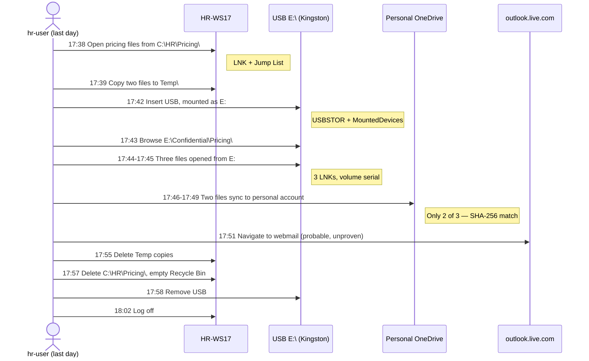

# Chapter 11 — Forensic Challenge: Investigating Unauthorized Data Exfiltration

## Chapter Overview

This chapter is a worked investigation — a capstone challenge — that brings the whole book to bear on a single case. The previous ten chapters covered Windows forensics one artifact category at a time. This chapter introduces no new artifacts. It shows how the artifacts already covered combine in practice when the question is consequential and the answers must be defensible.

The scenario is common in real incident response. An internal investigation suggests that an employee may have copied sensitive files off a workstation and exfiltrated them. The exfiltration channel is not yet known: it might be a USB drive, a personal cloud storage account, or a webmail attachment. The workstation has been preserved, and a disk image, a memory image, and key log and registry exports are available. The question is what happened, who did it, how, and what the organization needs to do next.

The chapter walks through the scenario, recommends a workflow, and shows how to use the Chapter 4 through Chapter 10 skills together to produce a defensible reconstruction. It closes by guiding you through a case summary for legal counsel, HR, executive leadership, and, if the situation warrants, external review. The corresponding lab gives you a parallel exercise to run in your own environment.

No single artifact source resolves a case like this. The MFT cannot tell you the user's intent. The registry cannot tell you what was in the files. The cloud sync database cannot tell you whether the employee even had authorization. A defensible answer to the case requires the file system, the registry, the shell artifacts, the cloud artifacts, the network records, the event logs, and a timeline that ties them together.

## Learning Objectives

By the end of this chapter, you should be able to:

* Plan a multi-artifact investigation with a clear set of investigative questions
* Use chain-of-custody discipline to protect the integrity of preserved evidence
* Combine NTFS, registry, shell, cloud, network, memory, and event log evidence into a single reconstruction
* Identify the most likely exfiltration channel from the artifact pattern
* Profile the user, the device, the cloud account, and the data movement
* Build and curate a multi-source timeline that supports the conclusion
* Distinguish what the evidence proves from what it suggests, and document both
* Produce a written case summary suitable for internal review or external disclosure

---

## 11.1 Scenario

A mid-sized organization runs an internal investigation after the legal team learns from a third party that confidential pricing information from one of its product lines has appeared in a competitor's hands. The information is specific enough to point to an internal source.

HR identifies a recently departed employee whose role gave them access to the pricing data. The employee left the company three weeks ago. Their workstation, **HR-WS17**, was preserved at offboarding pending the standard three-month retention period. No one has touched it since. The IT team acquired the disk image at offboarding using FTK Imager. Chain of custody is documented from acquisition through current preservation.

You are asked to determine whether the employee took the pricing data with them, by what mechanism, and what evidence supports the conclusion. The answer will inform decisions about legal action, regulatory disclosure, contract enforcement, and notifications to affected customers.

You have available:

- **A disk image** of HR-WS17, acquired at offboarding on the employee's last day, after they signed off for the final time
- **A memory image** captured during the same offboarding session, taken before the disk image and while the user's session was still live
- **Key logs and artifact exports** previously bundled by the offboarding script, including registry hives, event logs, Prefetch, browser history, and the OneDrive settings databases
- **Authentication and VPN logs** retained centrally for the employee's last 60 days
- **A list of file names and SHA-256 hashes** for the specific pricing documents in question

You do not have:

- Direct attribution evidence (no admission, no recovered USB drive)
- Cloud account audit data — the employee used personal accounts, which the organization cannot access
- Network packet captures from the relevant window — the SIEM retains only 30-day flow data

Your task is to investigate.

---

## 11.2 Suggested Workflow (You Can Modify)

The workflow below is a starting structure, not a script. The order of steps is a defensible default. The case may suggest changes as new evidence arrives.

### 11.2.1 Confirm Authorization and Custody

Before opening any image, confirm the foundation:

- **Authorization** — Internal IR policy authorizes investigation of pre-preserved evidence in support of a legal hold. The investigation request from legal counsel is on file.
- **Chain of custody** — The disk image, memory image, and offboarding artifact bundle each have a CoC record from acquisition through current storage. The image hashes match the originally recorded SHA-256 values.
- **Working copies** — Create verified working copies of the disk and memory images. Hash and verify both. The originals are preserved untouched.
- **Case folder** — Create a structured case folder following the organization's naming standard.

This step takes 30 minutes and prevents whole categories of problems that would otherwise emerge later.

### 11.2.2 Define the Investigative Questions

Translate the broad case ("did the employee exfiltrate the pricing data?") into specific, answerable questions. A reasonable starting set:

| Category | Question |
|---|---|
| Existence | Did the specific pricing files exist on HR-WS17? Were they accessed in the relevant window? |
| Channel | What plausible exfiltration channels are present (USB, cloud sync, webmail, personal email)? |
| USB | Did any removable device connect to HR-WS17 in the relevant window? Was sensitive data copied to it? |
| Cloud | Were any personal cloud accounts (OneDrive, Dropbox, Google Drive, Box) signed in? Were sensitive files synchronized? |
| Web | Did the user upload files through a browser interface (webmail, cloud storage web UI)? |
| Email | Did the user send sensitive content as email attachments to external addresses? |
| Persistence | Is there any indication of attacker tooling on the host, or is this purely insider activity? |
| Cleanup | Is there evidence that the user attempted to remove traces of the activity? |

These questions drive the rest of the workflow. By the end, each one has an answer, an evidence source, and a confidence rating.

### 11.2.3 Establish the Window

Identify the time window of interest. Start broad: the employee's last 30 days at the organization. As specific events surface, such as a USB connection, a sensitive file access, or a cloud sync, narrow the window around them.

Convert all reference times to UTC immediately. Confirm the host's clock state from the registry (`HKLM\SYSTEM\CurrentControlSet\Control\TimeZoneInformation`) and account for any skew.

### 11.2.4 Gather and Parse the Artifacts

An investigation of this scope uses the standard artifact set:

- MFT and USN Journal (Chapter 4) for file activity
- Registry hives (Chapter 5) for persistence, configuration, USB history, and cloud account associations
- Shell items, LNK files, Jump Lists (Chapter 6) for files and folders the user accessed
- Prefetch, Amcache, SRUM (Chapter 6) for execution evidence and per-process resource usage
- OneDrive settings database, browser history (Chapter 5 and Chapter 6) for cloud sync and web upload activity
- Memory image (Chapter 7) for live process state at the time of capture
- VPN and authentication logs (Chapter 9, central source) for remote access activity
- Security and PowerShell event logs (Chapter 9) for execution and authentication on the host

Parse each source with its standard tooling and produce CSV output suitable for timelining.

### 11.2.5 Build the Timeline

Merge the parsed outputs into a unified timeline (Chapter 10). Across the 30-day window, the merged timeline may have hundreds of thousands of rows, so curate aggressively:

- Mark entries that match the pricing file names or hashes
- Mark entries that involve known cloud sync paths or USB drive letters
- Mark entries that show unusual outbound activity, browser uploads, or large file movements
- Mark entries within the window of any pivot event you identify

The curated subset should fit on a screen. If it does not, cull further.

### 11.2.6 Investigate the Channels

For each plausible exfiltration channel, run the standard analysis:

**USB** — Check `USBSTOR`, `MountedDevices`, and `setupapi.dev.log`. Look for any USB mass storage device connected during the window. For each connection, examine shellbags and LNK files for browsing into sensitive directories on the device.

Binding a shortcut to a physical device takes two steps, and conflating them is the most common error in USB analysis. LNK files record the **volume serial number** — a four-byte value belonging to the *file system* on the device, assigned at format time. `USBSTOR` records the **device serial number**, a string burned into the hardware by the manufacturer. They are different values from different layers, and neither appears in the other's artifact. Two registry keys bridge them. The `\??\Volume{GUID}` entries in `HKLM\SYSTEM\MountedDevices` map a volume back to the `USBSTOR` device instance. `HKCU\...\MountPoints2` ties that volume GUID to the user account that mounted it. Chain them: LNK → volume serial → `MountedDevices` volume → `USBSTOR` device serial. Reformatting the device changes the volume serial and breaks the chain. That is why you state your reasoning rather than assert the binding.

**Cloud sync** — Check OneDrive `Accounts` registry keys for any personal account associations. If you find one, parse the OneDrive settings database for the account and identify any synchronized files matching the pricing file names or hashes. Cross-reference the OneDrive logs for upload activity.

> **Check which hash algorithm you are comparing.** OneDrive does not use a single one. Personal accounts carry SHA-1 and SHA-256 content hashes, which compare directly against a legal-provided SHA-256 list. That is what makes the HR-WS17 case in 11.5 as strong as it is. OneDrive for Business and SharePoint carry quickXorHash, a Microsoft-specific rolling XOR digest. It is not a cryptographic hash and has no relationship to SHA-256, so you cannot compare a quickXorHash against legal's hash list. If the account is a Business account, either compute quickXorHash over the reference files yourself, using the algorithm Microsoft publishes, or fall back to file name, size, and timestamp correlation. Say in the report which one you did, because "the hashes matched" and "the names and sizes matched" are findings at different confidence levels.

**Browser uploads** — Check browser history for visits to webmail, cloud storage web UIs, or file-sharing services. Look for upload events: cache entries, form data, and download history showing the user-side trace of an upload. The Windows Search index occasionally preserves content fragments from uploaded files.

**Email** — If a local mail client is in use, parse the relevant PST/OST files for sent items in the window with attachments matching the pricing files. For cloud-hosted mail, browser history may show webmail activity, but the mail content itself is on the cloud server.

**Other channels** — Look for less common paths. The System log and a few other logs record Bluetooth file transfers. Also check network shares, encrypted messaging clients with file transfer such as Signal and Telegram desktop, and printing of sensitive documents in the print spooler logs.

### 11.2.7 Identify the Channel and Build the Conclusion

Investigating the plausible channels confirms one or more and rules out the others. Build the conclusion from the artifacts that confirm the channel:

- For USB: the device profile, the shellbag entries, the LNK files, and, where available, the file-system evidence on the device itself
- For cloud sync: the account, the synchronized file list, the timestamps, and the corroborating file-system entries
- For browser upload: the browser history entry, the upload-related artifacts, and any host-side trace of the file's existence
- For email: the sent items entry with attachment metadata

A defensible conclusion names the channel, the data, the timing, and the user account. It also names the channels you investigated and ruled out, so the reader knows you reached the conclusion by elimination as well as confirmation.

### 11.2.8 Look for Cleanup

Investigate whether the user attempted to remove traces:

- Browser history clearing, visible in some browsers as gaps in expected history
- Deletion of files or folders containing sensitive data — the USN Journal still retains the deletion entries
- Use of disk wiping or secure delete tools — Prefetch and Amcache may show their execution
- Clearing of event logs (EID 1102 / 104)

Cleanup activity is itself evidence. A clean, sanitized host shortly before the user's departure is rarely innocent.

---

> **From the field — illustrative composite.** On a first capstone-style engagement, a responder spent four hours building a detailed super-timeline of every artifact on the suspect host. It still could not answer counsel's question: *did the user upload the file or not?* The timeline had every keystroke, every Prefetch entry, and every registry write. The actual exfiltration channel, though, was a Slack DM that did not touch local disk in any way the responder had instrumented. The investigation had answered "what happened on the host?" instead of "where did the data go?" No amount of host-side timelining recovers from that category error. On the next engagement, the responder asked the channel question first and built the timeline second. The exfil channel and its evidence sources drive the collection plan. The timeline supports the answer. It does not generate it.

## 11.3 Simulating the Incident (For the Lab)

The corresponding lab in `Labs/Lab11/` walks through simulating this incident in your own environment so you can investigate it end-to-end. The setup steps:

1. Use the Lab 1 baseline VM. Sign into the user account `hr-user` (or your equivalent).
2. Create a `Confidential\` folder and populate it with several test files of varying types and sizes. Treat these as the "pricing data" stand-ins.
3. Sign into a personal OneDrive account on the VM. Move some of the test files into the OneDrive sync folder. Confirm sync completes.
4. Plug in a USB drive (or virtual removable disk) and copy several other test files to it. Eject safely.
5. Open at least one file from the OneDrive sync folder and one from the USB drive in their native applications. Then disconnect the USB drive.
6. (Optional) Send one of the test files as an attachment from a personal webmail account in the browser.
7. (Optional) Delete several of the local copies of the test files. Empty the recycle bin.
8. Capture a memory image. Then power off the VM.
9. Acquire a disk image of the VM disk and the secondary evidence disk.

The result is a Windows host with a documented multi-channel exfiltration scenario. Investigate it with the workflow in 11.2, against your own evidence.

---

## 11.4 Capturing and Preserving Artifacts

For the lab work, the artifact collection mirrors a real investigation:

- Hash the disk and memory images and record the SHA-256 values
- Create working copies of both, verify the hashes, and operate from the copies
- Export the relevant logs, registry hives, OneDrive settings, browser history databases, and other targeted artifacts using the methods described in earlier chapters
- Document each export with tool, version, command, output path, and hash
- Maintain a chain-of-custody log throughout

A real investigation applies the same discipline. The tools and the case folder structure may be more elaborate, but the principle is identical.

---

## 11.5 Investigating the Exfiltration Path



*Figure 11.1 — The HR-WS17 exfiltration reconstructed from the simulated `Data/HR-WS17/` artifacts. This case has no malware, no C2, and no attacker tooling. Every action is an authorized user doing ordinary things in a suspicious order. That makes insider cases harder to evidence than intrusions: you cannot point at a binary that should not be there.*

*Note the asymmetry at 17:46–17:49. Three files went to the USB, but only two reached the cloud. `Margins_Q3.xlsx` appears in no cloud artifact at all. Claiming all three crossed all channels is the single most common way this case gets written up wrongly.*


A worked example shows how the general approach in 11.2.6 applies. Suppose you find that:

- USB activity is present in the window: a Kingston DataTraveler 3.0, serial `001A92053B7CBE3196B40A0F`, was connected on 2024-11-12 at 17:42 UTC. Windows assigned it drive letter `E:`.
- The device's volume serial number appears in three LNK files in `Recent\`, all referencing files in `E:\Confidential\Pricing\`. The shellbags show the user browsed into the directory at 17:43 UTC.
- The local copies of the pricing files were last accessed (per Jump List entries for Excel and Word) at 17:38 to 17:39 UTC.
- The MFT shows two of the files were also copied to `C:\Users\hr-user\AppData\Local\Temp\` at 17:39 UTC. The USN Journal entries confirm that those copies were deleted at 17:55 UTC.
- The OneDrive `Accounts` registry shows a personal account is signed in. The OneDrive database shows two of the same pricing files were synchronized to that personal account between 17:46 and 17:49 UTC.
- The browser history shows the user navigated to a personal webmail interface at 17:51 UTC, opened a compose page at 17:52, and viewed Sent Items at 17:54. No specific upload trace remains in the cache.
- The Security log shows no unusual logons. PowerShell logs are sparse. Memory shows no obvious malicious processes.

The pattern that emerges:

- The user accessed the pricing files in their normal workflow (Jump List entries are consistent with day-to-day Excel usage)
- They staged two of them in the local Temp directory, and all three reached the USB drive (MFT shows the temp copies, and LNK files and shellbags show the USB destination)
- They synchronized two of them to a personal OneDrive account (OneDrive database confirms; account is personal, not corporate)
- They opened a webmail compose page shortly after and then viewed Sent Items. Host artifacts alone cannot show whether the message carried an attachment
- They cleaned up some local traces by deleting the Temp copies

The conclusion identifies USB and personal OneDrive as confirmed channels. Webmail is a probable third channel that the host artifacts cannot fully resolve. Because the conclusion names the data, timing, account, and device, it is defensible.

---

## 11.6 Writing a Case Summary

> **Figure 11.2 — _placeholder for `figures/fig-11-2-iris-case-timeline.png`_**
>
> IRIS-NG case view showing the imported HR-WS17 timeline with each event color-coded by confidence, the 17:42:08 Kingston USB insertion annotated as the pivot, and the IOCs panel visible. See [`figures/Readme.md`](figures/Readme.md) for capture instructions.


A case summary translates the investigation into a document readers can act on. For a case like this, the audience is typically legal counsel, HR, and executive leadership, and all three must be able to read it.

A standard structure:

```markdown
# Case Summary — Suspected Data Exfiltration, HR-WS17

**Case Reference:** IR-2024-EX-014
**Prepared By:** [Analyst]
**Date:** [UTC]
**Audience:** Legal Counsel, HR, Executive Leadership
**Distribution:** Restricted

---

## Executive Summary

[One paragraph in plain language. What was investigated, what was found,
what action is recommended.]

## Background

[Brief description of the trigger event and the investigative request.
2-3 sentences.]

## Scope and Methodology

[What evidence was reviewed, what tools were used, what time window was
covered. Reference the chain of custody.]

## Findings

### Confirmed Findings
- [Finding 1, with the supporting evidence]
- [Finding 2]
- [Finding 3]

### Probable Findings
- [Finding requiring some inference, with the basis]

### Evidence Gaps
- [What could not be determined, and why]

## Channel Analysis

| Channel | Result | Evidence |
|---|---|---|
| USB | Confirmed | [Evidence summary] |
| Cloud sync (OneDrive) | Confirmed | [Evidence summary] |
| Webmail upload | Probable | [Evidence summary] |
| Local email client | Ruled out | [Evidence summary] |
| Print | Ruled out | [Evidence summary] |

## Timeline

[Curated timeline of the most consequential events, formatted for the audience.]

## Recommendations

1. [Action item, with rationale]
2. [Action item, with rationale]
3. [Action item, with rationale]

## Limitations and Caveats

[What this analysis can and cannot support. Specifically, what conclusions
require additional information from sources outside the investigation's scope.]

## Appendices

- A: Chain of custody record
- B: Tool versions and parsing commands
- C: Detailed timeline (full curated set)
- D: Indicators (file names, hashes, USB serials, account identifiers)
```

A few principles for writing the summary:

- **Lead with the conclusion.** The executive summary is what most readers will read, and later sections support it.
- **Distinguish confirmed from probable.** The reader needs to know which findings are evidentially solid and which require inference.
- **Name the gaps explicitly.** Saying *the host artifacts cannot confirm webmail upload content; this would require cooperation with the cloud provider* is honesty, not weakness.
- **Avoid forensic jargon in the executive summary.** Save the EIDs, MFT records, and tool names for the body and the appendices.
- **Document the recommendations with rationale.** A recommendation without a "because" is less useful and harder to defend.

The case summary is often the only document non-technical stakeholders read in detail. Take the time to write it well.

---

## Chapter Summary

This capstone chapter integrates the artifact-specific skills from Chapters 4 through 10 into a single investigation. The scenario is a suspected insider exfiltration after the employment relationship has ended, with a need for a defensible answer. It is one of the most common scenarios in real Windows incident response. It requires combining file-system, registry, shell, cloud, network, memory, and event log evidence into a coherent reconstruction.

The recommended workflow begins with custody and authorization. It then defines specific investigative questions, identifies a starting time window, and gathers and parses the relevant artifacts. It builds a curated multi-source timeline and investigates each plausible exfiltration channel: USB, cloud sync, browser upload, email, and less common paths. It ends by identifying which channels are confirmed and which are ruled out. Cleanup activity — deletion of files, clearing of logs, gaps in expected history — is itself evidence and deserves its own attention.

The investigation produces a written case summary appropriate for legal, HR, and executive readers. The summary leads with a plain-language executive section, distinguishes confirmed from probable findings, names evidence gaps explicitly, presents a curated timeline, and closes with recommendations and rationale. Forensic detail, indicators, tool versions, and the full timeline live in appendices for the reader who wants them.

The recurring discipline across this chapter — and the entire book — is corroboration. No single artifact source resolves a consequential case. The strongest conclusions are those in which the file system, the registry, the cloud database, the memory image, the network record, and the event log all support the same finding. Building those conclusions is the work of incident response forensics. Communicating them is what makes the work valuable.

## Key Terms

**Case Summary:** A written document, suitable for legal, HR, and executive audiences, that translates the technical investigation into actionable conclusions.

**Channel Analysis:** The systematic examination of each plausible exfiltration path (USB, cloud sync, browser upload, email, etc.), confirming or ruling out each.

**Cleanup Evidence:** Indicators that a user attempted to remove traces of activity (file deletion, history clearing, log clearing, secure delete tools), which is itself evidence.

**Confirmed Finding:** A finding directly supported by named artifacts with evidence sufficient to withstand scrutiny.

**Distribution Restriction:** A note on a case document indicating who is authorized to receive it; standard for sensitive investigations.

**Evidence Gap:** A specific question the available evidence cannot answer, named explicitly in findings to maintain honesty about the analysis's limits.

**Insider Exfiltration:** Data movement performed by an authorized user (often without authorization for the specific data) using legitimate access.

**Personal Cloud Account:** A cloud storage or email account associated with a user's personal identity rather than the organization, often used as an exfiltration channel.

**Probable Finding:** A finding supported by evidence that requires some inference, with the basis for the inference documented.

**Working Copy:** A verified copy of preserved evidence used for analysis, leaving the original untouched.

## Review Questions

1. Why is no single artifact source sufficient to resolve a case like the one in this chapter?
2. What investigative questions should drive an exfiltration investigation, and how do they shape collection priority?
3. How do USB-based and cloud-sync-based exfiltration channels differ in the artifacts they leave behind?
4. Why is the OneDrive settings database often the most informative single artifact for cloud-based exfiltration?
5. What evidence sources can confirm or rule out a webmail-based exfiltration channel?
6. Why is cleanup activity itself an evidentiary signal worth investigating?
7. What distinguishes a confirmed finding from a probable finding in case documentation?
8. Why should evidence gaps be named explicitly in a case summary rather than omitted?
9. How does a case summary's structure support readers with different roles and technical backgrounds?
10. What documentation should accompany the case summary as appendices, and why?

## Practical Exercises

1. Run the lab simulation in `Labs/Lab11/` end-to-end on your lab VM. Capture the disk image, memory image, and artifact bundle.
2. Hash all evidence images and record the values in a chain-of-custody log.
3. Create working copies, verify their hashes, and structure a case folder following the conventions in earlier chapters.
4. Define a specific set of at least eight investigative questions for the scenario, grouped by category.
5. Parse the standard artifact set (MFT, USN Journal, registry hives, OneDrive databases, browser history, Prefetch, Amcache, SRUM, event logs) and produce CSV output for each.
6. Build a merged timeline across the parsed sources. Curate it down to the entries relevant to the scenario.
7. Investigate each plausible exfiltration channel (USB, cloud sync, webmail, email) and produce a row in a channel analysis table for each.
8. Identify cleanup activity in your lab data, document what was cleaned up, and identify which artifacts still preserve the evidence.
9. Write a one-page case summary using the template in 11.6, with at least three confirmed findings and one named evidence gap.
10. Review your summary as if you were the recipient: would a legal reviewer with no forensic background be able to understand and act on it? Revise as needed.

> **Hands-on:** [Lab 11 — Forensic Challenge: Investigating Unauthorized Data Exfiltration](../Labs/Lab11/ReadMe.md) — the capstone. Investigate the HR-WS17 exfiltration end-to-end: triage, NTFS, registry, shell, network, event logs, timeline, and final case write-up.

---

## Looking Ahead

This chapter worked a data-theft case, where the damage is disclosure and legal and regulatory deadlines set the clock. Chapter 12 works the other engagement type most responders meet first: ransomware. There the damage is operational, the business sets the clock, and the encryption event you were called about is the *end* of an intrusion that started days or weeks earlier. The artifact skills transfer directly. The pressure, the scoping questions, and the decisions the investigation has to support are different.

---
