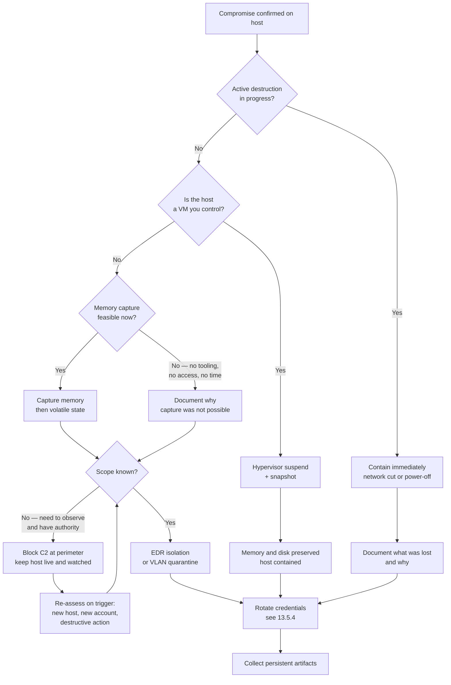

# Chapter 13 — Reporting, Containment, and Recovery

## Chapter Overview

This chapter covers what you do with what you found. Chapter 2 introduced the incident response loop and then left its last third as boxes on a diagram: contain, eradicate, recover, lessons learned. Everything since has been about the middle of that loop — finding the evidence, reading the artifact, building the timeline. This chapter is the bookend.

That work splits into two halves that turn out to be the same problem. The first half is communication. You convert an investigation into documents that other people can act on, under time pressure, for audiences whose tolerance for forensic detail ranges from infinite to zero. The second half is action: containing a host without destroying the evidence you still need, and eradicating the intrusion so that the attacker does not come back in four days. It also means recovering service with enough confidence that you are not simply restoring the compromise from backup.

Both halves fail the same way: the analyst treats the investigation as the deliverable. The deliverable is a decision someone else makes correctly because of your work. A perfect timeline that sits in a case folder while leadership makes an uninformed disclosure decision is a failed engagement, no matter how good the forensics were.

This chapter is deliberately opinionated about writing. It proposes a specific confidence scale and asks you to use it consistently. It shows bad findings next to good ones, because the difference is teachable and almost never taught. Then it moves to the operational side: containment options ranked by evidence cost, and the questions eradication has to answer before anyone declares the incident over. It ends with the feedback loop that turns a closed case into detection content your team keeps.

## Learning Objectives

By the end of this chapter, you should be able to:

* Identify the distinct audiences for incident output and produce the right artifact for each
* Distinguish facts, inferences, and assumptions in written findings and label them explicitly
* Apply a defined four-level confidence scale consistently across a report
* Write a finding that states its basis, its confidence, and what it does not establish
* Recognize and rewrite the common failure patterns in forensic prose
* Structure a one-page executive brief, a full incident report, and a technical appendix
* Rank containment options by their cost to volatile and persistent evidence
* Sequence memory capture, containment, and credential rotation defensibly
* Determine whether a compromised host should be cleaned or rebuilt, with stated criteria
* Convert case findings into detection content, hunt-pack entries, and logging changes

---

## 13.1 Writing for the Audience That Has to Act

A report is not a record of your work. It is an instrument for someone else's decision.

That distinction is more than a writing-style preference. It changes what goes in the document, what order it goes in, and what gets cut. A record of your work is organized around what you did, chronologically, with everything included because everything happened. An instrument for a decision is organized around what the reader has to decide. Anything that does not bear on that decision moves to an appendix or gets deleted.

Analysts default to the first form because their notes are already in it. Converting notes into a report by cleaning up the formatting is the single most common reporting failure in incident response. It is why so many technically excellent investigations produce documents nobody reads.

### 13.1.1 One Investigation, Many Artifacts

A single incident typically generates output for six or seven audiences within the first week. They read different reports because they have different decisions to make, not because they have different clearance.

| Audience | What they need | What they do *not* need | Failure mode when you get it wrong |
|---|---|---|---|
| **Technical peer / incoming responder** | Current hypotheses, what is confirmed, what was checked and ruled out, artifact paths, tool commands, open threads in priority order | Executive framing, business impact language, recommendations they cannot execute | Duplicated work; a lead goes cold because the incoming shift did not know it existed |
| **IR manager** | Scope (hosts, accounts, data), confidence in that scope, resource asks, blockers, ETA to containment | Artifact-level detail, parsing methodology | Cannot allocate people or escalate; discovers scope growth from someone else |
| **Executive leadership** | What happened in plain language, what it means for the business, what is being done, what decisions are theirs and when they are needed | Event IDs, registry paths, tool names, uncertainty they cannot act on | Leadership invents its own narrative, or freezes; external statements get made that the evidence does not support |
| **Legal counsel** | Facts separated from inference, data categories touched, custody and preservation status, dates, what is *not* established | Speculation, conclusions about liability, adjectives | Privileged work product contaminated with guesswork; a position taken that the evidence later contradicts |
| **Cyber insurer** | Timeline of discovery and response, containment actions with timestamps, evidence of controls in place, cost-bearing decisions | Internal blame, process criticism, unqualified impact estimates | Coverage disputes; claims delayed over gaps your report could have pre-empted |
| **Regulator / supervisory authority** | Precise scope of affected data, individuals, and jurisdictions; dates of compromise, discovery, and containment; remediation status | Anything you cannot substantiate; hedged language that reads as evasion | Statutory clock missed, or a notification that must be publicly amended later |
| **Affected business unit** | Which of *their* systems and accounts are involved, what they must do, when they get service back, what to tell their people | The intrusion narrative, attribution, other business units' exposure | Shadow remediation; users reset the wrong things or work around the containment |

Two of these audiences deserve special care. Legal counsel wants facts, and your inferences actively harm counsel unless you label them as inferences. Counsel needs to know what a hostile party could and could not establish from the same evidence. Regulators operate on statutory clocks that start at discovery, not at conclusion. You often have to extract the notification-relevant subset of your findings and state it precisely long before the investigation is finished.

> **Why this matters:** The forensic content of all seven documents is identical. What changes is what you foreground, what you compress, and what you omit. An analyst who writes one document and sends it to everyone has not saved time. That one document is too technical for four audiences and too thin for the other three.

### 13.1.2 The Same Finding, Three Ways

The same underlying evidence, written for three readers:

**For the incoming responder:**

> `update.exe` (SHA-256 `4f8b…2345`) first executed 2024-11-14 14:21:03 UTC on WKSTN-221 as `payroll-admin`. Prefetch `UPDATE.EXE-89A4B22C.pf` run count 1, Security EID 4688 with parent `cmd.exe` PID 0x5184 — itself spawned by `powershell.exe` PID 0x5128. Binary deleted 14:23:44 UTC per USN Journal (reason `FileDelete`); no copy recovered from unallocated space. Amcache entry retained. **Not yet checked:** whether the same hash appears on FILESVR-03 — Amcache and Prefetch for that host are collected but unparsed, in `\cases\IR-2024-11-014\FILESVR-03\`. That is the top open thread.

**For the IR manager:**

> Confirmed malicious binary executed on WKSTN-221 at 14:21 UTC on 14 Nov, two minutes after the phishing document was opened. The attacker deleted it three minutes later, but we have the hash and enough execution evidence to hunt for it elsewhere. Scope is currently one workstation and one file server. FILESVR-03 is unconfirmed and I need it parsed today. If the hash shows up on the file server, scope grows to the whole finance share and we will need a second analyst.

**For executive leadership:**

> On the afternoon of 14 November, a finance workstation was compromised through a malicious email attachment. The attacker ran a program on that machine and attempted to reach a file server. We have contained the workstation and are confirming whether the file server was affected. We expect to know by end of day. No customer data has been confirmed as accessed at this time. That determination depends on the file server review.

Across the three versions, the hash, the Prefetch filename, and the EID disappear. The uncertainty does not. It changes form: "Not yet checked" becomes "unconfirmed and I need it parsed today" becomes "we expect to know by end of day." Every version tells the reader what is not known. Analysts are most tempted to smooth that part over for executives, and it is the part executives most need.

### 13.1.3 Cadence Beats Completeness

During an active incident, an update that arrives on time is worth more than a complete report that arrives on Thursday. The useful update says "here is what we know at 16:00, here is what changed since 12:00, here is what we expect by 20:00." Set a written update cadence in the first hour and hold to it. Every update should carry the same four headings: what changed, what is confirmed now, what is still open, and what decision, if any, the reader needs to make. When nothing has changed, send the update anyway and say so. Readers interpret silence from the IR team, and they never interpret it charitably.

---

## 13.2 The Anatomy of a Defensible Finding

A finding is defensible when a hostile, competent reviewer who has your evidence but not your goodwill reaches the same conclusion. Failing that, the reviewer can at least see exactly where they would have to disagree with you, and why.

Most weak findings are weak in one of three ways. They state an inference as an observation. They use confidence words with no defined meaning. Or they omit what the evidence does not establish, leaving the reader to assume it establishes everything.

### 13.2.1 Fact, Inference, Assumption

Chapter 2 introduced this separation for case notes. In a report, it becomes structural.

A **fact** is a statement directly supported by a named artifact, reproducible by another analyst from the same evidence. *Prefetch file `UPDATE.EXE-89A4B22C.pf` records a first-run timestamp of 2024-11-14 14:21:03 UTC.*

An **inference** is a conclusion drawn from one or more facts by reasoning. *The binary `update.exe` executed on this host at 14:21:03 UTC.* This is very close to the fact, but it is not the same statement. It depends on the reasoning that Prefetch generation implies execution, which is well-established but still a step.

An **assumption** is something treated as true without direct evidence, because the investigation must proceed. *The host clock was accurate to within a few seconds of true UTC.*

Keep these apart in writing because they degrade differently. If a fact is wrong, you misread an artifact. If an inference is wrong, your reasoning was flawed but the evidence stands. If an assumption is wrong — the clock was off by 11 minutes, the user was on leave and someone else was at the keyboard — every conclusion downstream of it moves. Findings that bury assumptions inside prose cannot be repaired when the assumption fails. You have to re-argue the whole report.

### 13.2.2 A Confidence Scale That Means Something

"Likely" is the most abused word in incident reporting. It means 51% to one reader and 95% to another, and the analyst who wrote it usually meant "I believe this but do not want to be pinned down."

Adopt a defined scale, publish the definitions inside the report, and use only those four words. The rest of this chapter and Lab 13 use this scale:

| Level | Definition | Test |
|---|---|---|
| **Confirmed** | Supported by two or more independent artifact sources that agree, or by one authoritative source where no plausible alternative explanation exists. | Could I defend this in a deposition with only the evidence in the appendix? |
| **Probable** | Supported by a single reliable source, with no contradicting evidence. A benign explanation exists but would require an unlikely coincidence. | Would I be genuinely surprised to learn I was wrong? |
| **Possible** | The evidence is consistent with this statement, but it is equally consistent with at least one plausible alternative. | Can I state the competing explanation? If yes, this is Possible, not Probable. |
| **Undetermined** | No evidence supports or refutes the statement. The source that would have answered it was unavailable, cleared, not retained, or never generated. | Do I know *which* source would have answered this? Name it. |

Three rules make the scale work:

1. **"Independent" means the sources could not have inherited the same error.** Different subsystems write Prefetch and Amcache, so a fault in one does not propagate to the other. In that sense they are independent. Be careful what you conclude from the pair, though. Prefetch evidences execution, and Amcache evidences *presence* (Chapter 6 §6.3.2). Together they support "this binary was on the host and ran." They do not independently corroborate the execution itself, because only one of them is about execution at all. Two exports of the same event log are not independent in any sense.
2. **Every finding carries exactly one level.** If parts of a finding have different confidence, it is more than one finding. Split it.
3. **Undetermined is a finding, not a blank.** It goes in the report with the named missing source. On a host whose Security log was wiped, a row such as "Undetermined — Security.evtx was cleared at 14:52 UTC (EID 1102); no forwarded copy exists in the SIEM for this host" tells the reader something important. Omitting the row implies you looked and found nothing, which is a stronger claim than the evidence supports.

Words to strike from findings entirely: *likely, probably, seems, appears, may have, could have, believed to be, presumably, obviously, clearly, sophisticated, advanced, highly targeted.* The first ten are confidence claims without definitions. The last three are adjectives that describe your impression of the attacker rather than the evidence, and they have a habit of appearing in press coverage.

### 13.2.3 The Shape of a Finding

A finding that survives review has four parts, in this order:

1. **The claim** — one sentence, active voice, specific about host, account, time, and object.
2. **The basis** — the artifacts, with enough identifying detail that another analyst can retrieve them.
3. **The confidence** — one of the four levels, with a one-clause reason if the level is not obvious.
4. **What this does not establish** — the boundary of the claim.

The fourth part is the one that gets dropped, and it is the one that protects you. Every finding has a boundary. If you do not draw it, the reader will draw it somewhere more generous than the evidence supports.

### 13.2.4 Good and Bad, Side by Side

> **Figure 13.1 — _placeholder for `figures/fig-13-1-confidence-table.png`_**
>
> A finished findings table from a real, sanitized report, showing the Confirmed / Probable / Possible / Undetermined column in use across several findings at different levels. Redact every identifying detail. Seeing the scale applied across a whole report teaches the calibration better than any single worked example. See [`figures/Readme.md`](figures/Readme.md) for capture instructions.

**Example 1 — the impression essay.**

> **Weak.** *The attacker appears to have been a sophisticated actor. After gaining access via a phishing email, they moved quickly through the environment using advanced techniques and likely exfiltrated a significant amount of sensitive data before we contained the incident.*

Nothing here is checkable. "Sophisticated" and "advanced" are impressions. "Moved quickly through the environment" implies multi-host compromise without saying which hosts. "Likely exfiltrated" is an undefined confidence claim. "A significant amount" is unquantified. "Sensitive data" is uncategorized. If this document reaches counsel, that phrase alone can trigger notification analysis for data that was never touched.

> **Stronger.**
>
> **Finding 4 — Bidirectional network transfer between WKSTN-221 and 91.214.47.22.**
> **Basis:** Flow records show a single session from 10.0.4.32 (WKSTN-221) to 91.214.47.22:443 beginning 14:21:55 UTC on 2024-11-14, carrying 184,221 bytes outbound and 2,415,891 bytes inbound. SRUM `Network Data Usage` attributes 184,221 bytes sent and 2,415,891 bytes received to `update.exe` in the bucket written at 14:30:00.
> **Confidence:** Confirmed.
> **What this does not establish:** That `update.exe` is the process that talked to 91.214.47.22. SRUM carries no destination and buckets by the hour, and five other processes also used the network in the same bucket. The SRUM totals match the session's byte counts exactly, which points strongly at `update.exe`, but a match of two numbers is not a record of the connection. That is why the finding describes a transfer between two endpoints rather than a transfer *by* a named process. Nor does the finding establish that data was exfiltrated. The large volume in this session is inbound: roughly 2.4 MB received against 184 KB sent. That is the shape of a download, not a bulk upload. The 184 KB outbound is consistent with beacon traffic and command output. It is also consistent with a small volume of stolen data, and the evidence does not distinguish between those. The session was TLS-encrypted and no packet capture covers the window. Any exfiltration claim rests on the outbound 184 KB alone and is **Possible**, not Confirmed.

The direction of the traffic changes the finding. The weak version of Finding 4 above asserted outbound transfer and would have been *contradicted by its own evidence*. A reviewer who opened the flow record would find the large number pointing the wrong way. That mistake is the most common form of confidence inflation in network findings: the analyst sees a large byte count next to a suspicious IP and writes "exfiltration" without checking which column it came from.

> **Why this matters:** Annotation columns are not evidence. The flow record in this case carries an analyst-written `Notes` field reading *"Large outbound transfer — possible exfil"*. Whoever first triaged the alert wrote it, and it is wrong. If your Basis line cites a `Notes` column, you are citing someone's earlier hypothesis as though it were data. Cite the byte counts.

**Example 2 — the inference smuggled in as an observation.**

> **Weak.** *The user opened the malicious attachment at 14:18, which launched PowerShell and downloaded the second-stage payload.*

Read as a hostile reviewer would, this sentence has three inferences wearing the costume of observations, and no confidence level at all. Did you observe the user open it? You observed a Jump List entry and an MFT access time. Did you observe the attachment launch PowerShell? You observed a parent-child process relationship. Did you observe a download? You observed an outbound connection and a subsequent file creation.

> **Stronger.**
>
> **Finding 1 — Initial access: Outlook-spawned execution chain on WKSTN-221.**
> **Basis:** `Q4_Payroll_Review.xlsm` exists at `C:\Users\payroll-admin\Documents\` with MFT `$SI` creation 2024-11-12 09:32:14 UTC. At 14:18:55 UTC on 2024-11-14 a `Recent\` LNK file and an Excel Jump List entry were both created referencing it, and Security EID 4688 records `EXCEL.EXE` (PID 0x4844) created with parent `OUTLOOK.EXE` (PID 0x2148). Forty-three seconds later, at 14:19:38 UTC, EID 4688 records `powershell.exe` (PID 0x5128) created with parent `OUTLOOK.EXE` and an `-EncodedCommand` argument. Outlook is not a normal parent for PowerShell in this environment. A check of 30 days of EDR process telemetry across 412 hosts found zero prior instances.
> **Confidence:** Confirmed, for the process chain in the Basis.
> **What this does not establish:** That a person at the keyboard opened the document. The artifacts record file access under the user's session, not a human action, and that inference is Finding 1a. Nor does it establish that the file arrived by email, or that it was the sole entry point. Note the two-day gap. The document was created on disk on 11-12 and opened on 11-14, so the artifacts place the *opening* inside the incident window but say nothing about how the file got there. Recovering the message itself from the mailbox would settle it, and that has not been done. VPN logs for the preceding 72 hours show no anomalous authentication for this account. VPN retention is 30 days, however, and earlier activity cannot be assessed.
>
> **Finding 1a — `payroll-admin` opened `Q4_Payroll_Review.xlsm` interactively at 14:18:55 UTC.**
> **Basis:** The `Recent\` LNK and the Excel Jump List entry from Finding 1, both written to the `payroll-admin` profile at 14:18:55 UTC.
> **Confidence:** Probable. The artifacts record file access under the user's session, not a human action at the keyboard. Nothing in the collection contradicts a human open.
> **What this does not establish:** What the user saw or intended. The artifacts record that the file was opened, not what was on screen or why.

The user's action sits in its own finding because it carries a different level from the chain around it (Rule 2).

**Example 3 — the missing gap.**

> **Weak.** *No evidence of lateral movement to other hosts was identified.*

Readers will take this sentence to mean "the attacker did not move laterally." That may be what you mean, but it is not what you wrote. If the sources that would show lateral movement were unavailable, it is also not something you can support.

> **Stronger.**
>
> **Finding 7 — Lateral movement beyond FILESVR-03: Undetermined.**
> **Basis:** Domain controller Security logs were reviewed for EID 4624 type 3, 4648, and 4776 events referencing the `payroll-admin` account for the 14-day window. Two authentications to FILESVR-03 were identified (Finding 6). No authentications to other hosts were recorded. However, DC log retention is 7 days locally, and the SIEM forwarder for DC02 was in a failed state from 2024-11-08 to 2024-11-16, as confirmed with the platform team. DC02 handled an estimated 40% of authentication traffic in the window.
> **Confidence:** Undetermined. The absence of recorded authentications is not evidence of absence for the DC02 share of traffic.
> **Recommended action:** Hunt for the `update.exe` hash and the C2 IP across all endpoints via EDR, which does not depend on DC logging. Tracked as Recommendation 3.

Example 3 marks the difference between a report that closes an incident and one that an auditor reopens four months later.

### 13.2.5 The Adversarial Reviewer Test

Before releasing a report, read it once in the character of someone who wants it to be wrong — opposing counsel, a regulator's technical assessor, a peer reviewer in a claims dispute. Ask of each finding:

- Which word in this sentence is doing work the evidence does not support?
- If this artifact could be produced by benign activity, did I say so and rule it out?
- Does any conclusion rest on a single source that I described as if it were several?
- Is any assumption stated only implicitly?
- Would removing one finding collapse three others? Are those dependencies visible?

Findings that survive this pass are usually shorter and more heavily caveated than the first draft. That is the correct direction.

---

## 13.3 Report Structures That Work

Three documents cover almost every incident. They are not drafts of each other. They are different documents with different lifespans, and all three normally exist at the same time.

The case summary template in Chapter 11 §11.6 is the worked instance of the middle one, aimed at legal, HR, and executive readers in an insider-exfiltration context. Use it as the concrete pattern. What follows is the general shape, plus the two documents that sit on either side of it.

### 13.3.1 The One-Page Executive Brief

> **Figure 13.2 — _placeholder for `figures/fig-13-2-exec-brief.png`_**
>
> A real one-page executive brief, sanitized. Readers get more from seeing the shape and information density of an actual brief — how little fits on a page, and what got cut to make room — than from any description of one. See [`figures/Readme.md`](figures/Readme.md) for capture instructions.

The brief is one page, written for a reader with five minutes, no forensic background, and a decision to make. Actually one page: a two-page brief is a different document.

```markdown
# Incident Brief — [Short name]        Ref: IR-2024-11-014
As of: [date/time UTC] | Status: [Active / Contained / Closed] | Prepared by: [name]

## Bottom line
[Two or three sentences. What happened, what it means, what is being done.
No jargon. If the reader stops here, they should not be misinformed.]

## What we know
- [3–5 bullets, plain language, each one thing]

## What we do not know yet
- [2–3 bullets, each with when you expect to know]

## Business impact
[Systems affected, users affected, data categories involved or in question,
service status. Say "under assessment" where it is.]

## Actions taken
| When (UTC) | Action | By |

## Decisions needed from leadership
1. [Decision] — needed by [when] — because [consequence of delay]

## Next update: [date/time UTC]
```

The two sections executives most need and most rarely receive are "what we do not know yet" and "decisions needed from you, by when." A brief without the second section is an FYI, and nobody reads FYIs during a crisis.

### 13.3.2 The Incident Report

The incident report is the durable document. It outlives the incident, insurers and auditors read it, and it is the reference when someone asks in 18 months what happened. Write it once the investigation has stabilized, revise it as findings change, and version it.

```markdown
# Incident Report — [Name]                     Ref: IR-2024-11-014
Version | Date | Author | Classification | Distribution
Response coordinator

1. Executive Summary            [1 page, standalone, plain language]
2. Incident Timeline            [Curated. See Chapter 10. Attacker actions and
                                 responder actions in one chronology, labeled.]
3. Scope
   3.1 Systems in scope, and how scope was determined
   3.2 Accounts in scope
   3.3 Data in scope — categories, volumes, and confidence for each;
       personal data; where the data resides; third parties affected
   3.4 Systems and accounts examined and ruled out
4. Findings                     [Numbered. Each: claim, basis, confidence,
                                 what it does not establish. See 13.2.3.]
   4.1 Initial access
   4.2 Execution and tooling
   4.3 Persistence
   4.4 Credential access and lateral movement
   4.5 Collection, staging, and exfiltration
   4.6 Anti-forensics and cleanup
   4.7 Root cause                [Immediate cause vs. underlying weakness in
                                 people, process, technology, or policy.]
5. Evidence Gaps                [Each: what could not be determined, which
                                 source would have answered it, why it was
                                 unavailable, what it prevents concluding.]
6. Response Actions             [Detection, containment, eradication,
                                 recovery — with timestamps and the decision
                                 rationale for each.]
   6.1 Eradication verification
   6.2 Recovery
   6.3 Closure                   [The criteria that ended the active response.]
7. Recommendations              [Prioritized. Each: action, owner, rationale,
                                 and whether it is remediation or hardening.]
8. Lessons Learned              [What worked and why, then people, process,
                                 and technology. Summarizes 13.6.3.]
9. Appendices                   [See 13.3.3]
```

Inexperienced report writers omit Sections 3.4 and 5. Section 3.4, what you examined and cleared, is how a reader distinguishes "the attacker did not touch the domain controllers" from "we did not look at the domain controllers." Section 5 is where the confidence scale earns its keep.

Reports written under pressure drop two more sections. Section 4.7, root cause, is not the same as initial access. "The attacker brute-forced RDP" says what happened. "RDP was exposed to the internet on a host with no lockout policy, and no one owned the firewall rule that exposed it" says why it was possible. Only the second sentence produces a fix. Write root cause about controls and processes, not about the person who opened the port.

Section 8 should lead with what worked well: the alert that fired, the EDR isolation that held, the backup that was clean. Teams that record only failures stop doing the things that worked, because nothing written down says those things mattered. This skeleton adapts Lenny Zeltser's [incident report template](https://zeltser.com/good-incident-reports), which treats root cause and lessons learned as required sections.

Keep attacker actions and responder actions in the same timeline in Section 2, visually distinguished. Insurers and regulators both want to see the interval between discovery and containment, and a merged chronology answers that question at a glance.

### 13.3.3 The Technical Appendix

The technical appendix holds everything needed to reproduce the work. Write it for the analyst who comes after you: an incoming responder, a peer reviewer, a retained expert, or you in a year.

```markdown
A. Chain of custody records            [Per Chapter 1 §1.3.3 — every item,
                                        every transfer, every hash]
B. Evidence inventory                  [Item, host, acquisition method, tool,
                                        version, operator, SHA-256, storage]
C. Tooling and commands                [Exact invocations, versions, platform,
                                        output paths — per Chapter 2 §2.3.4]
D. Full timeline                       [The uncurated merged timeline the
                                        Section 2 chronology was drawn from]
E. Indicators of compromise            [Hashes, IPs, domains, filenames, paths,
                                        registry keys, service names, mutexes,
                                        user-agent strings, account names]
F. Detection content produced          [Sigma rules, EDR queries, SIEM saved
                                        searches — see 13.6.4]
G. Artifact excerpts                   [The specific rows, keys, and log entries
                                        cited in the findings]
H. Analyst notes                       [The case log. Unedited. See Chapter 2 §2.3.3]
```

The appendix is not a dumping ground. It is the reproducibility layer. The test is whether a competent analyst with the appendix and the evidence could re-derive your findings without speaking to you. If they could not, something in C, D, or G is missing.

### 13.3.4 What Not to Write

Keep these out of all three documents:

- **Attribution to a named actor or nation state**, unless you are in the small set of organizations with the intelligence basis to support it. "Consistent with tooling publicly associated with [group]" is defensible. "This was [group]" almost never is, and it changes the legal and insurance posture of the incident.
- **Blame directed at individuals.** "The user opened a malicious attachment" is a fact. "The user should have known better" is an opinion that will be quoted back at your organization.
- **Cost, liability, or notification-obligation estimates**, unless that is your role. Provide the facts those determinations rest on and let counsel and finance make them.
- **Speculation about attacker motive.** It is unfalsifiable and it invites the reader to reason from it.
- **Unqualified negatives.** See 13.2.4, Example 3.

---

## 13.4 Containment Without Destroying Evidence

Every containment action destroys evidence. The question is never whether to accept evidence loss. It is which loss you are choosing, and whether you chose it deliberately.

Chapter 2 §2.4.4 framed the containment decision as one of the outputs of alert triage: isolate now, collect then isolate, or observe. Chapter 3 established that memory is the most volatile thing you have. This section joins the two into an operational ranking.

### 13.4.1 Containment Options Ranked by Evidence Cost

Ordered from least to most destructive of evidence:

| Option | Stops | Preserves | Destroys or costs | Reach for it when |
|---|---|---|---|---|
| **Monitor only (no containment)** | Nothing | Everything, including live attacker behavior | Accepts ongoing attacker action; the risk is the cost | Scope is unknown, attacker is not yet destructive, and you have telemetry and authority to watch |
| **Perimeter / DNS block of C2** | Attacker's command channel | Memory, disk, processes, local lateral movement, the host's live state | Attacker may notice and switch infrastructure; does not stop lateral movement or on-host destruction | You have identified C2 and want to sever it without touching the host |
| **Account disable / credential lockout** | Further use of that identity | Everything on the host | Kills attacker sessions unpredictably; may terminate processes and lose their memory state; tips the attacker off loudly | Credential abuse is the primary vector and the account is not needed for business continuity |
| **EDR host isolation** | All network traffic except the EDR channel | Memory, running processes, disk, volatile state — the host keeps running | Live network connections drop (loses in-flight session state); attacker learns the host is contained; forensic collection now depends on the EDR channel's throughput | The default first move for a single compromised endpoint in an EDR-covered estate |
| **VLAN quarantine / switchport ACL** | Network reachability per policy | Memory, processes, disk; can allow the analyst's own collection path | Same session loss as EDR isolation; slower to implement; depends on network team availability | No EDR containment available, or you need a controlled path in for collection |
| **Physical network disconnect** | All network traffic | Memory, processes, disk | Same as above, plus you lose remote collection entirely — someone must be at the machine | Physical access is available and network-based containment is not trustworthy |
| **Hypervisor suspend + snapshot** (VMs) | Everything | A complete memory image *and* disk state, atomically | Nothing, if done correctly. This is the best-case containment | The host is a VM and you control the hypervisor. Almost always the right answer for virtual hosts |
| **Graceful shutdown** | Everything | Disk, most persistent artifacts | **All memory.** Also triggers shutdown scripts, service stop handlers, and any attacker cleanup wired to shutdown; flushes pagefile if configured | Rarely the right choice for a live compromise. Preferred over hard power-off only when disk consistency matters more than memory |
| **Hard power-off** | Everything | Disk as-is; no shutdown handlers fire | **All memory.** Risk of file system inconsistency and lost writes; hibernation file may be stale | Active destruction in progress (ransomware encryption running), or a credible risk that shutdown handlers will destroy evidence |

Two entries deserve emphasis. **Hypervisor snapshot** on a virtual host is the one containment action with essentially no evidence cost. Responders routinely forget it because they reach for the EDR console by reflex. If the compromised host is a VM and you have hypervisor access, suspend and snapshot first.

**Account disable** is often treated as a low-impact action because it does not touch the host. Killing sessions, though, can terminate the exact processes whose memory you need. Sequence it after capture, not before.

### 13.4.2 Memory First, Then Contain

The default sequence for a live compromised Windows host:

1. **Document the decision and the clock.** Note the time, who authorized containment, and which option you chose and why (Chapter 2 §2.4.4). A reviewer reads this entry first.
2. **Capture memory**, if the host is running and the attacker is not actively destroying data. On a VM, take the hypervisor snapshot instead. It is faster and gives you both memory and disk. Record tool, version, output path, and hash (Chapter 3 §3.3.6).
3. **Capture volatile network and process state** — connections, process tree, logged-on sessions, open handles, scheduled tasks. Minutes, not hours.
4. **Contain**, using the least destructive option that actually stops the harm you are containing against.
5. **Then** disable accounts and rotate credentials, in the order described in 13.5.4.
6. **Then** collect persistent artifacts, at whatever pace the case requires. Disk is patient.

The exception that overrides all of it: **if data is actively being destroyed, contain first.** Ransomware encryption in progress, a wiper running, an attacker deleting logs in real time: in those cases, what a memory capture would give you is worth less than what you lose in the 90 seconds it takes. Chapter 12 covers this tradeoff in the ransomware context, where the calculation is nearly always "cut the network now."

### 13.4.3 The Containment Decision Flow



*Figure 13.3 — Containment decision flow. The two shortcuts are on the left and the right: active destruction bypasses everything, and a controllable VM makes the whole question easy. The middle path is the common one, and its hardest branch is the honest assessment of whether scope is actually known.*

### 13.4.4 Containment Is a Decision, and Decisions Get Documented

Whatever you choose, the case log entry needs five things: the time, the option chosen, the authorizing person, the reason, and the evidence cost accepted. For example:

> `2024-11-14 18:20 UTC — EDR host isolation applied to WKSTN-221. Authorized by J. Okafor (IR Manager). Memory captured at 17:35–18:04 UTC (WinPmem 4.0.rc2, SHA-256 recorded in CoC-014). Isolation chosen over VLAN quarantine because network team escalation would have added ~40 min. Evidence cost accepted: live C2 session state lost; ongoing attacker behavior no longer observable. Trigger for reassessment: if the same hash appears on a second host, re-evaluate whether estate-wide containment is required. — A. Reyes`

That entry answers, in advance, every question a reviewer will ask about the decision. Writing it takes 90 seconds. Reconstructing it from memory nine months later is not possible.

### 13.4.5 Tipping the Attacker Off

Containment is visible. An attacker who sees a host go dark, an account disabled, or a C2 domain sinkholed will draw conclusions. A capable one will respond by accelerating exfiltration, deploying ransomware early, burning their current access to protect a persistence mechanism you have not found, or going quiet for weeks. That cost argues for containing **broadly and at once**, once scope is understood, rather than one host at a time. Piecemeal containment gives the attacker a sequence of warnings and time to adapt between them.

The pressure to contain the first host immediately therefore has to be weighed against the value of understanding scope first. That tradeoff is the "monitor and collect" branch in Figure 13.3, and it is why that branch requires both authority and telemetry before you take it.

---

## 13.5 Eradication and the Reinfection Question

Eradication is where forensics stops being an investigative activity and becomes a completeness check. The question is no longer *what happened* but *have I found all of it*.

### 13.5.1 The Three Questions

An eradication plan is defensible when it can answer all three of these, with confidence levels attached:

1. **Have all persistence mechanisms been identified?** Not "have we found persistence" — have we found *all* of it. Run/RunOnce and Services are the ones everyone checks. The ones that survive cleanup are Scheduled Tasks, WMI event subscriptions, COM hijacks, IFEO debuggers, AppInit/AppCert DLLs, Winlogon shell and userinit keys, LSA and SSP providers, Office add-ins and templates, startup folders, BITS jobs, accessibility-tool replacements, and legitimate-but-attacker-controlled remote access tools. A licensed RMM agent installed by the attacker is persistence.
2. **Have all attacker-accessible credentials been rotated?** Every credential that existed in memory, in a file, in a browser store, in a script, or in a service configuration on any compromised host must be treated as known to the attacker. Not just the compromised user's password.
3. **Is the entry point closed?** If the intrusion began through an unpatched edge device, a valid account without MFA, or a misconfigured remote access service, and that condition still exists, the intrusion has not been eradicated — it has been interrupted.

Any of the three answered as "Possible" or "Undetermined" is a reinfection risk you should name explicitly in the report.

### 13.5.2 Why Cleaned Hosts Come Back

The four-day reinfection is the classic failure, and it has five common causes:

- **Missed persistence.** Almost always in a location the responder did not check rather than one they checked and misread. WMI event subscriptions and scheduled tasks with innocuous names are the perennial winners.
- **Unrotated credentials.** The host was rebuilt, and the attacker logged straight back in with the service account they harvested from LSASS on day one.
- **The entry point was never closed.** The same phishing campaign, the same unpatched VPN appliance, the same RDP exposure.
- **A second compromised host outside the scope.** You eradicated the intrusion on the hosts you found, and the host you did not find re-seeded the environment. This is why 13.2.4's Example 3 matters: an unqualified "no lateral movement identified" is how hosts stay outside scope.
- **Backup restored from a compromised point.** Covered in 13.6.2.

Only the first is a forensics failure in the narrow sense. The other four are failures of scope, sequencing, or coordination. That is why the analyst who did the investigation needs to be in the eradication planning conversation rather than handing over a report and leaving.

### 13.5.3 Rebuild or Clean

| Factor | Points toward **clean** | Points toward **rebuild** |
|---|---|---|
| Attacker access level | User-context only | SYSTEM, administrator, or unknown |
| Tooling observed | Single known commodity payload | Multiple tools, custom tooling, or unidentified binaries |
| Persistence found | One mechanism, fully understood | Multiple mechanisms, or any mechanism not fully understood |
| Kernel-level activity | None observed | Driver loaded, kernel callback, or suspected rootkit |
| Dwell time | Hours | Days or weeks — assume you have not found everything |
| Host role | Low-value, easily reimaged workstation | Domain controller, certificate authority, hypervisor, backup server, jump host |
| Rebuild cost | Low; a golden image exists | High; bespoke configuration, undocumented dependencies |
| Confidence in scope | Confirmed | Probable or lower |

The default should be **rebuild**. Cleaning is the exception that requires justification, not the other way around. For one category, rebuild is not merely preferred but mandatory: domain controllers, certificate authorities, and backup infrastructure. A domain controller compromised at SYSTEM level cannot be trusted after cleaning under any circumstance. A compromised CA means every certificate it issued is suspect, which makes it a forest-recovery conversation, not a host-cleanup conversation.

> **Why this matters:** "We cleaned it and it looks fine" is an assessment made against the attacker techniques you know about. Rebuilding from a trusted image is an assessment made against nothing, so it does not depend on the completeness of your investigation. When scope confidence is Probable rather than Confirmed, rebuilding is how you stop your uncertainty from becoming the organization's risk.

### 13.5.4 Credential Rotation, In Order

Rotate in dependency order, or you will rotate credentials the attacker then re-harvests from a host they still control:

1. **Break the attacker's current access first** — the specific accounts with confirmed attacker use, done simultaneously with host containment.
2. **Local administrator passwords** on all in-scope hosts. If LAPS is not deployed and local admin passwords were shared, that means every host with the shared password.
3. **Service accounts** whose credentials existed on any compromised host — in memory, in a service configuration, in a scheduled task, in a script. Sequence these with the application owners, because this is where rotation causes outages.
4. **Privileged domain accounts** — domain admins, backup operators, anything with delegated rights.
5. **The `krbtgt` account, twice**, with the replication interval between rotations, if there is any indication of domain-level compromise (Golden Ticket capability). Appendix A covers the artifact side of this.
6. **Bulk user population**, if credential dumping was confirmed on a host where many users had sessions — a terminal server, a VDI host, a shared jump box.
7. **Certificates, API keys, and tokens** — the category most often forgotten. Cloud service principals, OAuth refresh tokens, PATs in CI systems, SSH keys, code-signing certificates. Appendix B covers the M365 and Entra ID side, where refresh-token revocation is a separate action from password reset and is routinely skipped.

Rotation happens *after* the hosts holding those credentials are contained and *before* service is restored. Rotating while the attacker still has SYSTEM on a host that sees the new credentials accomplishes nothing but paperwork.

### 13.5.5 Eradication Is Verified, Not Declared

Before you call eradication complete, run a verification pass and document it:

- Re-hunt the full IOC set across the estate — hashes, C2 infrastructure, filenames, registry keys, service names, task names, scheduled task authors.
- Re-check every persistence location on formerly-compromised hosts, including the ones you cleaned.
- Confirm the entry point is closed with a positive test, not an assertion — the appliance version was verified, MFA enrollment was confirmed, the firewall rule was checked in the running config.
- Confirm that credential rotation actually completed for every item on the list. Partial rotation is common, and it usually surfaces during the next incident.
- Monitor with elevated sensitivity for a defined period, typically two to four weeks. Deploy the case's specific detection content and assign someone to triage its hits.

Then write it down. The verification pass is a section in the incident report, with dates and outcomes.

---

## 13.6 Recovery, Lessons Learned, and the Detection Feedback Loop

### 13.6.1 Restoring Service with Confidence

Recovery is the business's decision, informed by yours. The IR team owes the business a clear statement, in the confidence language from 13.2.2, of what has and has not been established. The business then accepts a risk it can see rather than one it has been told does not exist.

The practical prerequisites before service returns:

- Eradication verification (13.5.5) complete, with results documented
- Rebuilt or cleaned hosts brought up on rotated credentials, not the old ones
- Restored systems patched and hardened against the original entry vector *before* being reconnected, not after
- Elevated monitoring in place with owners assigned
- A documented rollback plan if the restoration shows signs of compromise

Bring services back in stages where you can, most-critical and best-understood first. Staged recovery gives you an observable interval after each restoration in which to detect a mistake. It turns "the whole environment is back and something is wrong" into "the third system we brought back is wrong."

### 13.6.2 Validating That Backups Are Clean

Restoring from backup is restoring from a point in time. The question that determines whether recovery works is: **was the backup taken before the attacker got in?**

Answering it requires the one thing only the investigation can produce: a defensible earliest-known-compromise timestamp. Anchor it on the arrival of the attacker's first file, not on its first execution. On WKSTN-221 the first attacker activity is at 2024-11-14 14:18:55 UTC, when Outlook launched Excel and the LNK for `Q4_Payroll_Review.xlsm` was written. The document itself reached disk two days earlier: the MFT records its `$SI` and `$FN` creation at 2024-11-12 09:32:14 UTC. A backup taken after that moment can contain the lure, and restoring it puts the document back on disk for someone to open again. The earliest-known-compromise timestamp for this host is therefore 2024-11-12 09:32:14 UTC. A restore point must predate the file's arrival, not only its execution.

If dwell time is Undetermined because the logs that would establish it were cleared or aged out, you do not have a safe restore point. The honest statement to the business is that any restore point carries unquantified risk.

Before restoring, in every case:

- Identify the earliest confirmed compromise timestamp and state its confidence.
- Select a restore point comfortably before it, not immediately before it.
- Mount the backup content read-only in an isolated environment and scan it offline for the case's IOC set, especially persistence artifacts. Restoring a backup that contains the attacker's scheduled task simply reinstalls the intrusion.
- Verify that the backup infrastructure itself was not compromised. Backup servers are a primary target because compromising them defeats recovery. A backup catalogue that an attacker had administrative access to cannot be trusted without verification.
- Restore into an isolated segment, verify, then reconnect.

### 13.6.3 The Lessons Learned That Isn't Theatre

A useful post-incident review produces a few changes with names and dates attached. The review has a bad reputation because teams often run it as a blameless retrospective that produces a list of aspirations nobody owns.

Hold it within two weeks, while detail is still recoverable. Put the responders, the system owners, the detection engineers, and someone with budget authority in the room. Work from the timeline in the incident report rather than from memory, and answer four questions:

1. **What let this happen?** The control that was missing, misconfigured, or bypassed.
2. **What delayed detection?** The specific interval between first attacker action and first alert, and what would have shortened it.
3. **What slowed the response?** Access we did not have, tooling we could not deploy, data we had not retained, decisions that waited on someone unreachable.
4. **What worked, and is it repeatable?** Teams skip this one, and it is how good practice becomes standard practice.

Every output gets an owner and a date. Outputs without owners are not outputs.

### 13.6.4 Turning Findings into Detection Content

Every case should leave the detection posture measurably better than it found it. "Measurably" means specific artifacts, not a resolution to be more vigilant. Chapter 9 §9.3.3 introduced the hunt pack as a reusable set of saved searches and documentation, and this is where it gets fed.

From a single case, the harvest typically includes:

- **Atomic indicators** — hashes, IPs, domains, URLs — into the blocklists and the retro-hunt. They have low long-term value, because the attacker changes them. Do it anyway. It costs minutes.
- **Behavioral detections** — this is where the value is. The Outlook-parent-PowerShell relationship from Finding 1 is a detection that outlives the campaign. Write it as a Sigma rule so it is portable across your SIEM and EDR:

  ```yaml
  title: PowerShell Spawned by Outlook
  id: 8e3f1c02-5b7a-4d19-9a44-2c6e91f0b7d3
  status: experimental
  description: Detects powershell.exe created with outlook.exe as parent, observed
    as the initial execution step in IR-2024-11-014.
  references:
    - Internal case IR-2024-11-014
  logsource:
    category: process_creation
    product: windows
  detection:
    selection:
      ParentImage|endswith: '\outlook.exe'
      Image|endswith: '\powershell.exe'
    condition: selection
  falsepositives:
    - Office add-ins invoking PowerShell (none observed across 412 hosts / 30 days)
  level: high
  ```

- **Hunt-pack entries** — the saved searches you built during the case, generalized and documented. If you wrote a query to find the C2 IP across the estate, save the *shape* of it, not just the instance: outbound connections from user-context processes to newly-observed external IPs.
- **Detection gaps** — where you had the log but no rule. Each becomes a detection engineering ticket.
- **Logging gaps** — where you did not have the log at all. This is the highest-value output of the whole exercise, and 13.6.5 covers it.

Tag every artifact with the case reference. Three cases later, a detection engineer asking "why does this rule exist?" can find the incident that produced it. Rules whose originating threat is long dead can then be retired deliberately instead of accumulating.

### 13.6.5 Logging Gaps Are Deliverables

Every Undetermined finding in the report points at a source that was unavailable. That list is a work plan, and it is the one artifact from the incident that the organization will still benefit from in three years.

For a Windows estate, the recurring entries are predictable: command-line auditing not enabled in Security EID 4688, PowerShell Script Block Logging off, Security log size too small to cover a realistic dwell time, no central log forwarding, which makes log clearing on the host total, missing process-creation telemetry on servers, no DNS query logging, and outbound firewall logs not retained long enough to cover the exfiltration window.

Write each as a specific change with the finding it would have resolved:

> **Gap L-3:** Security event log on workstations is capped at 20 MB and rolled over in approximately 36 hours on WKSTN-221. Findings 7 and 9 are Undetermined as a direct result. **Change:** increase to 512 MB and enable Windows Event Forwarding for the 4624/4625/4648/4688/1102 subset. **Owner:** Platform Engineering. **Cost:** configuration change plus WEF collector capacity.

A gap tied to a finding gets funded. A gap presented as a general best practice does not. This is the single most effective piece of advocacy an incident responder gets to do. The incident report is the moment to do it, because the window in which the organization will act on logging recommendations closes fast.

### 13.6.6 Closing the Case

Closing is an action, not a fade-out. It means:

- Final report version issued and distributed per its classification
- Evidence retention period set per legal hold or policy, with a disposal date and an owner
- Chain of custody closed out for every item (Chapter 1 §1.3.3)
- Detection content deployed, and its false-positive rate checked after two weeks
- Lessons-learned actions logged, with owners, in whatever system tracks work at your organization
- The case folder archived per the naming standard

That last one matters more than it sounds. The case you close today is the reference material for the case you open next quarter. An archive you cannot search is the same as no archive.

---

## Chapter Summary

Reporting is not the administrative tail of an investigation. It is the mechanism by which the investigation produces effects. A report is an instrument for someone else's decision, and different decision-makers need different instruments built from the same evidence. The technical peer needs open threads and artifact paths. The executive needs plain language, business impact, and the decisions that are theirs to make. Counsel needs facts rigorously separated from inference. The regulator needs precision about data and dates. Writing one document for all of them serves none of them.

A defensible finding states a specific claim, names the artifacts supporting it, assigns a confidence level from a defined scale, and draws the boundary of what it does not establish. The four-level scale proposed here — Confirmed, Probable, Possible, Undetermined — works because the levels are defined and used consistently. It also works because Undetermined is treated as a finding with a named missing source rather than as a blank space. The words that most weaken forensic prose are the undefined confidence hedges and the adjectives that describe the analyst's impression of the attacker rather than the evidence.

Containment always destroys evidence. The discipline is in choosing which loss you accept and documenting the choice. Hypervisor snapshot on a virtual host costs almost nothing and is routinely overlooked. Memory capture before containment is the default sequence, overridden only when data is actively being destroyed. Every containment action deserves a case log entry naming the time, the option, the authorizer, the rationale, and the evidence cost accepted.

Eradication is a completeness check on the investigation: all persistence found, all reachable credentials rotated in dependency order, entry point closed and positively verified. Rebuild is the default, and cleaning is the exception requiring justification. For domain controllers, certificate authorities, and backup infrastructure, rebuild is mandatory. Recovery depends on a defensible earliest-compromise timestamp, because that is what makes a restore point safe rather than hopeful.

Finally, every case should leave the detection posture better than it found it. The outputs are behavioral detections written as Sigma rules, generalized hunt-pack entries, and, most valuably, logging gaps. Write those gaps up as specific funded changes tied to the specific findings they would have resolved. The Undetermined rows in your report are next year's detection roadmap.

## Key Terms

**Adversarial Reviewer Test:** A pre-release review of a report conducted in the character of a hostile competent reader, checking each finding for unsupported words, unstated assumptions, and hidden single-source dependencies.

**Confidence Scale:** A defined, published set of levels — here Confirmed, Probable, Possible, Undetermined — used consistently across a report so that confidence language carries the same meaning for every reader.

**Confirmed (confidence level):** Supported by two or more independent artifact sources in agreement, or by one authoritative source with no plausible alternative explanation.

**Containment:** Action taken to stop an intrusion from continuing or spreading, ranging from perimeter blocking to power-off, each with a distinct cost to available evidence.

**Detection Feedback Loop:** The practice of converting case findings into durable detection content — behavioral rules, hunt-pack entries, and logging changes — so that each incident improves the organization's ability to detect the next one.

**Earliest Confirmed Compromise:** The defensible timestamp of the first attacker activity established by the investigation; the reference point that determines which backups are safe to restore.

**Eradication:** Removal of attacker access, tooling, and persistence from the environment, verified rather than declared, and dependent on the completeness of the investigation's scope.

**Evidence Cost:** The specific categories of evidence lost by a given containment action, accepted deliberately and recorded in the case log.

**Executive Brief:** A one-page incident document written for non-technical decision-makers, stating the bottom line, what is known, what is not yet known, business impact, actions taken, and the decisions required from leadership.

**Reinfection:** Return of attacker access after eradication, typically caused by missed persistence, unrotated credentials, an unclosed entry point, an out-of-scope compromised host, or a restore from a compromised backup.

**Sigma Rule:** A portable, vendor-neutral YAML detection rule format, used to express a behavioral detection derived from case findings in a form deployable across SIEM and EDR platforms.

**Undetermined (confidence level):** A statement that available evidence neither supports nor refutes, recorded as a finding together with the named source that would have resolved it and the reason it was unavailable.

## Review Questions

1. Why is a report best understood as an instrument for someone else's decision rather than as a record of the analyst's work?
2. Choose three of the seven audiences in §13.1.1 and describe how the same finding would be written differently for each.
3. What is the difference between a fact, an inference, and an assumption in a written finding, and why do they fail differently when wrong?
4. State the four levels of the confidence scale proposed in this chapter and give the test for each.
5. Why must "Undetermined" appear as a finding in the report rather than being omitted?
6. What are the four components of a well-formed finding, and which one is most often dropped?
7. Rank the following by evidence cost, least to most: EDR host isolation, hypervisor snapshot, graceful shutdown, perimeter C2 block, hard power-off. Justify the ordering.
8. Under what circumstances should containment precede memory capture rather than follow it?
9. What are the three questions an eradication plan must answer, and what happens when any is answered "Undetermined"?
10. Why does a defensible earliest-confirmed-compromise timestamp determine whether a backup is safe to restore from?

## Practical Exercises

1. Take a finding from your Lab 11 case summary and rewrite it in the four-part form from §13.2.3, assigning one of the four confidence levels and writing an explicit "what this does not establish" clause.
2. Find three instances of banned confidence language (*likely, appears, may have,* and their relatives) in your own past writing or in a public incident report. Rewrite each with a defined confidence level, noting where you cannot because the underlying evidence does not support any level.
3. Write the same finding three ways — for an incoming responder, an IR manager, and a CFO — using the §13.1.2 example as the model. Keep the executive version under 80 words.
4. Draft a one-page executive brief for a Lab 09 or Lab 11 scenario using the §13.3.1 skeleton. Enforce the page limit strictly and note what you had to cut.
5. Run the adversarial reviewer test (§13.2.5) on a report you or a colleague has written. Produce a list of every sentence that fails, with the specific word or omission that fails it.
6. For a compromised host in one of the book's scenarios, write the containment case log entry described in §13.4.4 — time, option, authorizer, rationale, evidence cost accepted, reassessment trigger.
7. Build a persistence verification checklist for eradication covering every mechanism named in §13.5.1, with the artifact or command you would use to check each on a Windows host.
8. Convert one behavioral finding from a lab case into a Sigma rule following the §13.6.4 pattern, then write the corresponding logging-gap entry for a source the case showed you were missing.

> **Hands-on:** [Lab 13 — Reporting, Containment, and Recovery](../Labs/Lab13/ReadMe.md) — take a completed investigation through its full output set: executive brief, incident report findings with confidence levels, a documented containment decision, an eradication checklist, and the Sigma rule the case leaves behind.

---

## Looking Ahead

This is the last working chapter. The book began with a lab VM and a chain-of-custody form. It spent 11 chapters on the artifacts and the reasoning that turn a Windows host into an account of what happened to it. It closes here with the part that makes any of it matter: communicating findings to people who have to act, containing without destroying, eradicating completely, and recovering with confidence.

Chapter 14 wraps up: a self-assessment against everything the book has covered, a map of the territory deliberately left outside its scope, and a structured plan for keeping the skills sharp once the book is closed. The habits are what survive. The specific commands will not.

---
