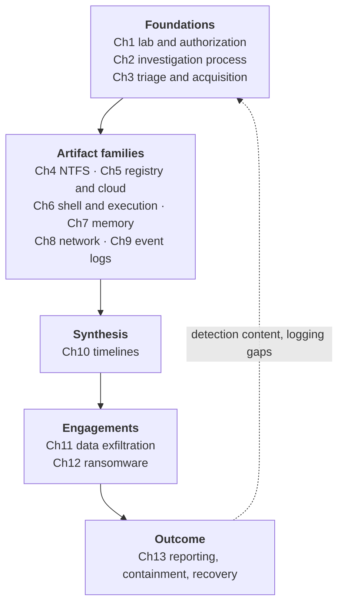

# Chapter 14 — Conclusion and Next Steps

## Chapter Overview

You have reached the end of this book. The 13 chapters and labs before this one follow a deliberate sequence. They cover the IR-process foundations, the major Windows artifact families, and the way those artifacts combine into timelines and findings. Then come a capstone exfiltration investigation, a ransomware engagement, and the reporting and recovery work that turns analysis into organizational action.

The right test of whether the book has worked is whether you have a clear, repeatable approach to acquiring, analyzing, and explaining the evidence. It is not whether you remember every event ID or registry path. You need that approach the next time your phone rings at 2 a.m. and someone says "the Windows servers are acting weird." That approach is the deliverable. Specific artifacts are tools you reach for inside it.

This short closing chapter consolidates what you should now be able to do. It identifies the predictable next-step traps for practitioners moving from competent to proficient. It also gives you a small, structured plan for keeping your skills sharp once the book is closed.

## Learning Objectives

By the end of this chapter, you should be able to:

* Self-assess your current strengths and weaknesses across the artifact families covered in the book
* Identify two to three focus areas for deeper study in the next three to six months
* Build a personal practice routine that survives a busy operational schedule
* Decide which advanced topics (lateral movement, AD forensics, cloud identity, EDR-specific tradecraft, malware analysis) are highest priority for your role
* Plan an internal teaching activity as a way to consolidate your own learning
* Recognize the operational habits — documentation, hash discipline, hypothesis testing — that distinguish responders whose findings hold up under scrutiny from those whose findings do not

---

## 14.1 What You Should Now Be Able to Do



*Figure 14.1 — How the book stacks. Each layer depends on the one below it. That is why the artifact chapters read as a slog if you skip the foundations, and why Chapter 10 is the hinge: it is where isolated artifacts become an argument. The dotted return path is the part most teams never close. Every case should leave your detection posture better than it found it.*

The minimum competencies the book aims to leave you with:

- **Stand up an isolated Windows IR lab** and document it well enough to rebuild from notes (Chapter 1)
- **Translate a vague alert into a structured investigation plan** with prioritized questions, a documented containment decision, and a collection priority list (Chapter 2)
- **Choose between full imaging, targeted triage, and memory acquisition** for a given host with a defensible justification, and handle an encrypted volume without losing the evidence (Chapter 3)
- **Parse and read MFT and USN Journal output** to confirm or refute file existence, timing, and tampering claims, and recover deletion records from the Recycle Bin (Chapter 4)
- **Locate and interpret persistence registry keys, USB device history, and OneDrive sync configuration**, and pull historical hive state out of Volume Shadow Copies (Chapter 5)
- **Profile a removable device and reconstruct user activity** from LNK files, Jump Lists, Prefetch, ShimCache, SRUM, shellbags, UserAssist, Amcache, and browser history (Chapter 6)
- **Acquire a memory image and run a focused triage** with Volatility 3 or MemProcFS, identifying suspicious processes, command lines, network connections, and injected code (Chapter 7)
- **Read network telemetry for IR purposes** — flow data, proxy logs, DNS — and tie connections back to host-side processes (Chapter 8)
- **Build a Windows event log hunt pack** keyed to common attacker patterns, and recognize log gaps and tampering (Chapter 9)
- **Construct a curated multi-source timeline** with normalization, annotation, and a narrative summary suitable for non-technical readers (Chapter 10)
- **Conduct a defensible exfiltration investigation** end-to-end, identifying the channel, the data, the timing, and the user, and document it in a case summary suitable for legal, HR, and executive review (Chapter 11)
- **Work a ransomware engagement** — scope the encryption, find the entry point and dwell time, determine whether data was stolen before encryption, and support the recovery decision (Chapter 12)
- **Write for the audience that has to act on your findings**, and support containment, eradication, and recovery decisions with evidence rather than instinct (Chapter 13)

If most of these feel solid and a few feel shaky, that is the expected state. Pick the shaky ones. They are your focus list for the next three months.

---

## 14.2 What's in the Appendices

Seven appendices sit at the back of the book. Five pick up topics the main chapters touched but did not develop. Appendix E is a quick-reference cheatsheet, and Appendix F is an industry-alignment guide:

- **Appendix A — Lateral Movement, Credential Abuse, and Active Directory.** Covers Pass-the-Hash, Kerberoasting, AS-REP Roasting, DCSync, and Golden and Silver Tickets. It also covers the source-side, destination-side, and domain-side artifacts that together support lateral-movement findings, and the basics of investigating a compromised domain: NTDS.dit, AdminSDHolder, and GPO and ACL backdoors.
- **Appendix B — Cloud Identity and Microsoft 365 Forensics.** Covers Entra ID sign-in logs, audit logs, the Unified Audit Log, and the cloud equivalents of host-side patterns: account compromise, OAuth consent abuse, mailbox access, sharing-link exfiltration. Includes worked KQL queries against Sentinel and `Search-UnifiedAuditLog` PowerShell examples.
- **Appendix C — EDR Platforms and Sysmon.** Covers Microsoft Defender for Endpoint Advanced Hunting (KQL), CrowdStrike Falcon (FQL), SentinelOne Deep Visibility, and Sysmon configuration and querying. Closes the loop on the EDR / Sysmon references that recur throughout the main chapters.
- **Appendix D — Tooling Reference for Windows IR.** Consolidates the tools named throughout the book: Eric Zimmerman tools, KAPE, FTK Imager, Arsenal Image Mounter, Hayabusa, HayabusaAutorun, Volatility 3, MemProcFS, Cyber Triage, SANS SIFT Workstation, Sysmon, Wireshark, IRIS-NG, and Timesketch. For each, it gives what the tool does, where it fits in the IR workflow, its license terms, and the chapter or lab where it is most relevant.
- **Appendix E — Windows Forensics Quick Reference.** A dense one-page-style cheatsheet. It condenses every artifact path, event ID, logon type, registry key, tool invocation, and investigative question the book covers into something you can keep open on a second monitor.
- **Appendix F — Industry and Certification Alignment.** Maps the book's content to GIAC (GCFE, GCFA, GNFA, GREM, GCIH), CompTIA (Security+, CySA+, CASP+), MITRE ATT&CK tactics, and NIST SP 800-61 / 800-86 process phases. Includes suggested reading orders by goal.
- **Appendix G — Anti-Forensics and Evidence Tampering.** Consolidates in one place the anti-forensic techniques that appear across the main chapters: timestomping, log clearing, shadow-copy deletion, secure deletion, Prefetch and journal manipulation, and LOLBin abuse. It gives the detection signal for each and discusses what "absence of evidence" is and is not worth.

The **Glossary** (`Book/Glossary.md`) consolidates the Key Terms from every chapter into one alphabetized searchable file with chapter cross-references.

Use the appendices as deeper reference material once you have the main-chapter foundations solid.

## 14.3 What This Book Still Did Not Cover

Even with the appendices, several adjacent fields are outside the book's scope:

**Malware analysis.** Static and dynamic analysis of recovered binaries — strings, PE inspection, sandboxing, reverse engineering — is a separate discipline that pairs well with forensics but is not covered here. *Practical Malware Analysis* (Sikorski and Honig) is the standard introductory text.

**Digital forensics in cloud-only environments.** AWS, Azure, and GCP forensics differ substantially from Windows endpoint forensics. The artifact sources are API calls and audit logs rather than file-system structures. Appendix B covers Microsoft 365 / Entra ID identity forensics specifically. The broader cloud-resource forensics topic is its own course.

**Threat intelligence integration.** Consuming, validating, and operationalizing external IOCs and TTP intelligence during an investigation is a distinct skill set. It is worth developing once your endpoint analysis is solid.

**macOS and Linux endpoint forensics.** The book is explicitly Windows-focused. Most enterprise investigations also touch macOS workstations and Linux servers. The analytical patterns translate, but the artifact sources are different.

**Courtroom testimony and expert-witness work.** Chapter 1 covers chain of custody and Chapter 13 covers writing for legal audiences, but deposition technique, voir dire, and the rules of evidence are their own training track.

These are the next mountain. Get the foundations from this book solid first.

---

## 14.4 Building a Practice Routine That Survives

Skills decay if you don't use them. A week in incident response exercises some of these muscles and not others. If you only encounter PowerShell-driven commodity intrusions for six months, your memory analysis will atrophy. Deliberate practice prevents this.

A reasonable cadence for an operational responder:

- **One hour a week** of focused practice on a chosen artifact source — running a parser against a sample set, working a public CTF challenge, reproducing a published technique in your lab
- **One half-day a quarter** for deeper work — a full investigation of a public memory or disk image, a writeup of an attacker group's tradecraft from a recent public report, a deep dive into a tool you have only used superficially
- **One internal share a quarter** — a brown-bag, a wiki post, a short walkthrough of a real, sanitized case for your team

The cadence matters more than the volume. A consistent hour a week beats a heroic eight-hour session every two months. Calendar-block it.

### 14.4.1 Public Resources Worth Your Time

A starter set of public material that pairs well with this book:

- **[The DFIR Report](https://thedfirreport.com/)** — published intrusion case studies with concrete artifact-level evidence. Read one a week and try to match the artifacts they cite to chapters in this book.
- **[SANS DFIR posters and cheat sheets](https://www.sans.org/posters/)** — particularly the Windows Forensic Analysis poster and the Hunt Evil poster.
- **[CyberDefenders.org](https://cyberdefenders.org/)** and **[Blue Team Labs Online](https://blueteamlabs.online/)** — hands-on blue-team challenges, including memory and disk forensics scenarios.
- **[MITRE ATT&CK](https://attack.mitre.org/)** — the technique catalogue. Pick a technique your environment is exposed to and trace it through the artifacts in this book.
- **[Eric Zimmerman's training materials](https://ericzimmerman.github.io/)** — the same author who maintains MFTECmd, EvtxECmd, and Registry Explorer publishes deeper material on using them.
- **[13Cubed](https://www.youtube.com/@13Cubed)** — short, focused video walkthroughs of specific Windows artifact analyses, well-aligned with this book's coverage.
- **[EVTX-to-MITRE-Attack](https://github.com/mdecrevoisier/EVTX-to-MITRE-Attack)** — 270+ real `.evtx` samples mapped to MITRE ATT&CK tactics and techniques (CC0). Use it to test your event-log hunt-pack filters against real attacker activity, not only the synthetic dataset shipped with this book. Covered in more depth in Chapter 9 §9.1.6 and as an optional extension exercise in Lab 09.
- **[Ransomware.live](https://www.ransomware.live/)** and the **[CISA #StopRansomware advisories](https://www.cisa.gov/stopransomware)** — current ransomware group TTPs, useful for keeping Chapter 12's patterns current as groups rotate tooling.

Use these in service of the practice cadence above. A public CTF challenge on a Saturday morning is one hour of focused practice, and those hours compound over time.

### 14.4.2 Building Your Own Reference

The most useful reference you will ever own is the one you build yourself. By the end of this book you should be starting or expanding a personal cheatsheet that includes:

- The event IDs you check first for your environment's most common attacker patterns
- The exact tool invocations you use most often, with the version and the platform
- The shortcut paths to the artifacts you parse repeatedly
- The questions you have learned to ask before any collection action
- The mistakes you have made and the documentation conventions that prevent them

This personal reference gets you started faster on every new case. It also outlives any specific tool: the next generation of parsers may replace MFTECmd, but the *questions* you have learned to ask of NTFS will not change.

---

## 14.5 The Habits That Actually Matter

The technical content gets the most pages in this book, but the habits that make incident response defensible are fewer and easier to articulate.

**Document in real time.** Notes written from memory hours after the fact are reconstructions, not records. Real-time documentation is the single biggest factor that separates findings that hold up from findings that don't.

**Hash on acquisition; verify on access.** Hash every preserved evidence item at the moment of acquisition. Verify working copies before analysis begins. Escalate a hash mismatch instead of absorbing it.

**Separate facts from conclusions and assumptions.** Three different categories of statement, with three different evidentiary weights. Mixing them is the most common source of weak findings.

**Name the gap.** When the evidence you wanted is not available — disabled auditing, cleared logs, missing memory — say so explicitly. *We could not confirm X because the relevant source was unavailable* is a finding. Pretending it isn't a finding is how investigations fail review.

**Corroborate before concluding.** A single artifact is a starting point. Two independent sources at the same time is a finding. The strongest investigations are the ones in which the file system, the registry, the logs, and, where available, memory all agree.

**Adapt the plan to new evidence.** You make early triage decisions with incomplete information. Revising them as new facts arrive is discipline, not failure. Document the revision and the trigger.

These habits are simple to state and surprisingly hard to maintain at hour six of a live incident. That is exactly when they matter most.

---

## 14.6 A Final Lab — Plan Your Learning Roadmap

The book closes with one final, non-technical lab. Treat it as seriously as the analytical labs.

### Step 1 — Self-Assessment

For each chapter, rate your confidence on a 1-to-5 scale:

| Chapter | Topic | Confidence (1–5) | Notes |
|---|---|---|---|
| 1 | IR foundations and lab setup | | |
| 2 | Investigation process | | |
| 3 | Triage, acquisition, and encrypted volumes | | |
| 4 | NTFS / file-system forensics | | |
| 5 | Registry, cloud storage, and shadow copies | | |
| 6 | Shell, execution, and device artifacts | | |
| 7 | Memory forensics | | |
| 8 | Network forensics | | |
| 9 | Event logs | | |
| 10 | Timeline analysis | | |
| 11 | Capstone — exfiltration investigation | | |
| 12 | Ransomware incident response | | |
| 13 | Reporting, containment, and recovery | | |

Be honest. A 3 on memory is fine. A 3 you wrote down is more useful than a 4 you talked yourself into.

### Step 2 — Pick Two or Three Focus Areas

Highlight the two or three lowest scores. Those are your next three to six months.

```
Focus Area 1:
  Chapter / Topic:
  Why this matters for my role:
  Target proficiency date:

Focus Area 2:
  Chapter / Topic:
  Why this matters for my role:
  Target proficiency date:

Focus Area 3 (optional):
  Chapter / Topic:
  Why this matters for my role:
  Target proficiency date:
```

### Step 3 — Identify One Resource per Focus Area

For each focus area, pick a single resource you will work through. Keep it specific.

```
Focus Area 1 resource:        [book / blog / course / CTF / public image / podcast]
Estimated total commitment:   [hours]
Cadence:                      [hour per week / hour per fortnight / weekend block]

Focus Area 2 resource:
Estimated total commitment:
Cadence:

Focus Area 3 resource (if applicable):
```

### Step 4 — Schedule the Practice

Open your calendar. Put recurring blocks in for the cadence you identified. Treat them like exercise: small consistent sessions beat rare marathons. If a block conflicts with operational work, reschedule it the same week — do not let it lapse.

### Step 5 — Plan One Sharing Activity

Within the next 90 days, plan one event in which you teach what you have learned to someone else.

```
Sharing activity:        [internal talk / blog post / wiki page / lab walkthrough / mentoring session]
Audience:                [your team / your SOC / your IR manager / your peers / external community]
Topic:                   [the chapter you are most confident in, or the area you are reinforcing]
Date:
```

Teaching is one of the most efficient ways to consolidate your own understanding. Preparing the material exposes the gaps in that understanding. If you cannot explain a registry persistence pattern to a less-experienced colleague, you do not yet understand it well enough to defend a finding based on it.

---

## Closing Thoughts

The point of this book is to give you a working approach that holds up under pressure, and a foundation you can build on once the pressure is off. It is not to make you an expert.

If you walk away with one habit, let it be the discipline of asking the question before touching the evidence. If you walk away with two, add the discipline of corroboration — two sources before you conclude. The third is documentation. Everything else is technique.

Windows forensics will continue to change. Microsoft will introduce new artifacts, deprecate old ones, change default audit policies, and shift logging behavior between releases. Attackers will adapt. Tooling will mature. The specific commands in this book will eventually be out of date. The discipline will not.

When the phone rings at 2 a.m., the goal is not that you remember every chapter. The goal is that you have a clear, repeatable approach to acquiring, analyzing, and explaining the evidence — and that everyone who depends on your answers can trust them.

Good luck out there.

---

*Thank you for reading.*

---

<div align="center">

[Chapters](.) · [Labs](../Labs/ReadMe.md) · [Simulated Data](../Data/README.md) · [Quick Reference](AppendixE.md) · [Glossary](Glossary.md) · [About the Author](About.md)

</div>
