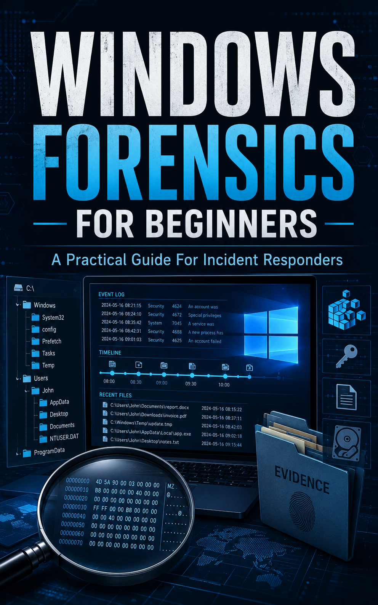

# Windows Forensics for Beginners

### A Practical Guide for Incident Responders

---

*Fourteen chapters · Seven appendices · Thirteen hands-on labs · Seven simulated datasets*

---

## About This Book

This book teaches a repeatable approach to Windows forensics for incident responders who work under time pressure, with incomplete information, while someone waits on an answer. A memorized list of event IDs is not enough for that job.

The book covers the artifact families that matter: NTFS, the registry, shell and execution artifacts, memory, network telemetry, and event logs. It then combines them into timelines, findings, and reports that other people can act on.

Every chapter ends with a hands-on lab. Nine of the labs ship with simulated forensic data, so you can work a full investigation without building a lab environment. Chapter 1 shows you how to build one if you want it.

## What You'll Be Able to Do

- Choose between full imaging, targeted triage, and memory capture — and defend the choice
- Parse `$MFT` and the USN journal to confirm or refute claims about files and timestamps
- Read registry persistence, USB history, and cloud-sync evidence
- Triage a memory image for injected code, suspicious process trees, and live C2
- Build a hunt pack for Windows event logs and recognize when logs have been tampered with
- Construct a multi-source timeline and turn it into a narrative a non-specialist can follow
- Work an exfiltration case and a ransomware engagement end to end
- Write findings at stated confidence levels, and contain a host without destroying the evidence you need

## Who It's For

The book is for incident responders, SOC analysts, and other blue-team practitioners who must work out what happened on a Windows host. You need basic Windows administration and some security background. You do not need prior forensics experience.

---

**[Start with the Preface →](ReadMe.md)**

[Chapters](.) · [Labs](../Labs/ReadMe.md) · [Simulated Data](../Data/README.md) · [Quick Reference](AppendixE.md) · [Glossary](Glossary.md) · [About the Author](About.md)

