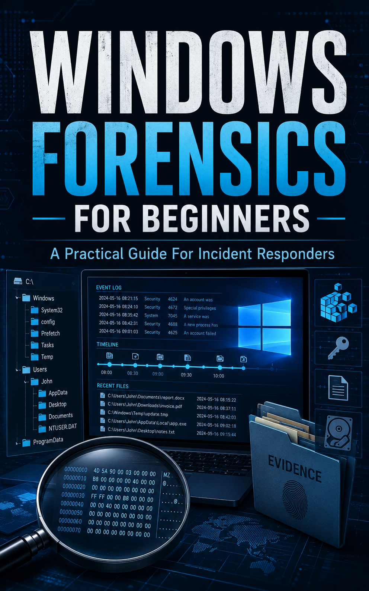

# Windows Forensics for Beginners
*A Practical Guide for Incident Responders*



---

> **This file used to hold a condensed single-file draft of the book.** It was written early, and the manuscript in [`Book/`](Book/) has since grown to roughly eight times its length and gained two chapters it never had. Rather than keep shipping a copy that silently contradicted the real book, this file is now what its name suggests it should be: the way in.
>
> The old draft is not lost — it lives in this file's git history if you want it. But everything in it exists in better form in `Book/`.

---

## Start here

| | |
|---|---|
| **[Cover page](Book/Cover.md)** | Title page, what the book covers, who it's for |
| **[Preface](Book/ReadMe.md)** | Why the book exists and how to read it |
| **[Labs](Labs/ReadMe.md)** | Thirteen hands-on labs, with a capstone map |
| **[Quick Reference](Book/AppendixE.md)** | The cheatsheet to keep open on a second monitor |
| **[Glossary](Book/Glossary.md)** | 170 terms, cross-referenced to the chapters |

## Chapters

| # | Chapter | Lab | Answers |
|---|---|---|---|
| 1 | [Windows Forensics in Incident Response](Book/Chapter01.md) | [Lab 01](Labs/Lab01/ReadMe.md) | [key](Book/answers/Chapter01-answers.md) |
| 2 | [The Forensic Investigation Process for IR](Book/Chapter02.md) | [Lab 02](Labs/Lab02/ReadMe.md) | [key](Book/answers/Chapter02-answers.md) |
| 3 | [Digital Forensics and Advanced Data Triage](Book/Chapter03.md) | [Lab 03](Labs/Lab03/ReadMe.md) | [key](Book/answers/Chapter03-answers.md) |
| 4 | [Windows File System Forensics (NTFS)](Book/Chapter04.md) | [Lab 04](Labs/Lab04/ReadMe.md) | [key](Book/answers/Chapter04-answers.md) |
| 5 | [Registry and Cloud Storage Forensics](Book/Chapter05.md) | [Lab 05](Labs/Lab05/ReadMe.md) | [key](Book/answers/Chapter05-answers.md) |
| 6 | [Shell Items, Removable Devices, Application Artifacts](Book/Chapter06.md) | [Lab 06](Labs/Lab06/ReadMe.md) | [key](Book/answers/Chapter06-answers.md) |
| 7 | [Memory Forensics](Book/Chapter07.md) | [Lab 07](Labs/Lab07/ReadMe.md) | [key](Book/answers/Chapter07-answers.md) |
| 8 | [Network Forensics on Windows](Book/Chapter08.md) | [Lab 08](Labs/Lab08/ReadMe.md) | [key](Book/answers/Chapter08-answers.md) |
| 9 | [Windows Event Logs](Book/Chapter09.md) | [Lab 09](Labs/Lab09/ReadMe.md) | [key](Book/answers/Chapter09-answers.md) |
| 10 | [Timeline Analysis](Book/Chapter10.md) | [Lab 10](Labs/Lab10/ReadMe.md) | [key](Book/answers/Chapter10-answers.md) |
| 11 | [Forensic Challenge: Unauthorized Data Exfiltration](Book/Chapter11.md) | [Lab 11](Labs/Lab11/ReadMe.md) | [key](Book/answers/Chapter11-answers.md) |
| 12 | [Ransomware Incident Response](Book/Chapter12.md) | [Lab 12](Labs/Lab12/ReadMe.md) | [key](Book/answers/Chapter12-answers.md) |
| 13 | [Reporting, Containment, and Recovery](Book/Chapter13.md) | [Lab 13](Labs/Lab13/ReadMe.md) | [key](Book/answers/Chapter13-answers.md) |
| 14 | [Conclusion and Next Steps](Book/Chapter14.md) | — | [guide](Book/answers/Chapter14-answers.md) |

## Appendices

| | |
|---|---|
| **[A](Book/AppendixA.md)** | Lateral Movement, Credential Abuse, and Active Directory |
| **[B](Book/AppendixB.md)** | Cloud Identity and Microsoft 365 Forensics |
| **[C](Book/AppendixC.md)** | EDR Platforms and Sysmon |
| **[D](Book/AppendixD.md)** | Tooling Reference for Windows IR |
| **[E](Book/AppendixE.md)** | Windows Forensics Quick Reference |
| **[F](Book/AppendixF.md)** | Industry and Certification Alignment |
| **[G](Book/AppendixG.md)** | Anti-Forensics and Evidence Tampering |

## Simulated data

Nine of the labs (04–12) ship pre-parsed artifact data, so you can work a full investigation without building a lab environment. Each host folder has a deterministic `generate.py` that reproduces its data.

| Host | Scenario | Labs |
|---|---|---|
| [`WKSTN-221`](Data/WKSTN-221/) | Office macro → PowerShell → C2 → lateral movement | 02, 03, 04, 09, 10 |
| [`HR-LT12`](Data/HR-LT12/) | Registry persistence, USB history, OneDrive sync | 05 |
| [`FIN-WS23`](Data/FIN-WS23/) | Shell and execution artifacts | 06 |
| [`WEB-APP-03`](Data/WEB-APP-03/) | Memory image — web shell, injected code | 07 |
| [`network`](Data/network/) | Flow, proxy, DNS, firewall telemetry | 08 |
| [`HR-WS17`](Data/HR-WS17/) | Multi-channel exfiltration capstone | 11 |
| [`ACCT-FS01`](Data/ACCT-FS01/) | Ransomware engagement, six-day dwell | 12 |

See [`Data/README.md`](Data/README.md) for the full inventory and the caveats that come with simulated data.

## If you want a single file

There isn't one, deliberately. A second hand-maintained copy of a 9,000-line manuscript drifts out of step with the original, which is exactly what happened to the draft this file used to contain.

If you need one for offline reading or an ebook build, generate it rather than maintaining it:

```bash
# Plain concatenation, in reading order
cat Book/Cover.md Book/ReadMe.md Book/Chapter*.md Book/Appendix*.md Book/Glossary.md > book-single.md

# Or build an EPUB with Pandoc, using the cover art directly
pandoc Book/ReadMe.md Book/Chapter*.md Book/Appendix*.md Book/Glossary.md \
  --toc --toc-depth=2 \
  --epub-cover-image=Book/figures/cover.png \
  --metadata title="Windows Forensics for Beginners" \
  --metadata subtitle="A Practical Guide for Incident Responders" \
  -o "Windows Forensics for Beginners.epub"
```

`Book/Chapter*.md` sorts correctly because the files are zero-padded (`Chapter01` … `Chapter14`).

---

## Contributing

See [`CONTRIBUTING.md`](CONTRIBUTING.md). Corrections to the Hands-On Walkthrough counts are especially welcome — they assert specific numbers against the simulated data, and a wrong count is the most damaging class of error in a book like this.

## License

[CC BY-NC-SA 4.0](LICENSE). The cover image is excluded — see the LICENSE file for scope.

---

*Windows Forensics for Beginners — A Practical Guide for Incident Responders*
